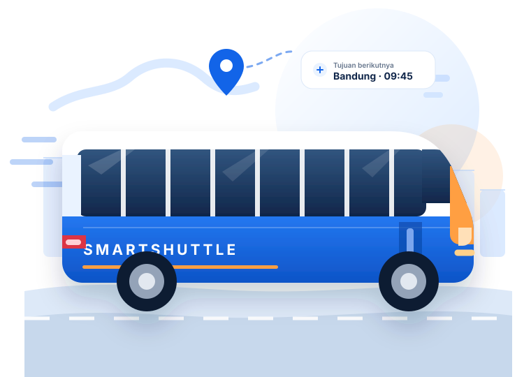
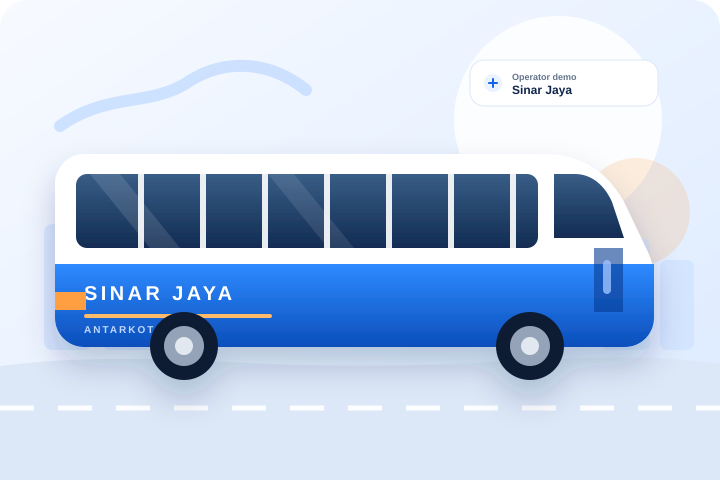
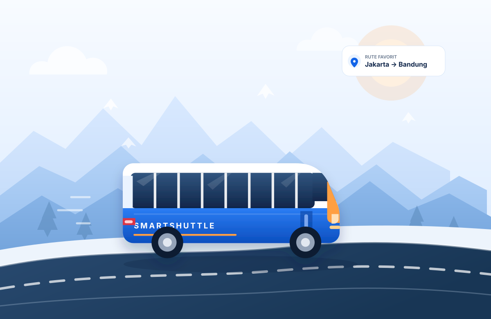

# Kode Lengkap Final SmartShuttle

Dokumen ini berisi isi lengkap setiap file sumber aplikasi final SmartShuttle.

Lokasi proyek: `D:\tugasPSAS_bus\smartshuttle`  
Laporan QA: `LAPORAN-QA-FINAL.md`

## Daftar file

- `index.html` — 1842 baris, 93.8 KB
- `login.html` — 203 baris, 10.2 KB
- `css/style.css` — 8431 baris, 140.2 KB
- `css/login.css` — 1219 baris, 22.5 KB
- `js/data.js` — 531 baris, 16.4 KB
- `js/storage.js` — 446 baris, 12.2 KB
- `js/notifications.js` — 286 baris, 7.6 KB
- `js/seat-map.js` — 197 baris, 6.4 KB
- `js/booking.js` — 1257 baris, 41.8 KB
- `js/tracking-data.js` — 264 baris, 10.3 KB
- `js/tracking.js` — 1160 baris, 36.0 KB
- `js/dashboard.js` — 918 baris, 32.4 KB
- `js/app.js` — 1411 baris, 43.6 KB
- `js/login.js` — 173 baris, 4.9 KB
- `assets/README.txt` — 27 baris, 1.0 KB
- `assets/favicon.svg` — 10 baris, 0.5 KB
- `assets/bus-hero.svg` — 104 baris, 6.1 KB
- `assets/login-journey.svg` — 131 baris, 7.5 KB
- `assets/bus-agra-mas.svg` — 70 baris, 4.1 KB
- `assets/bus-nusantara-express.svg` — 70 baris, 4.2 KB
- `assets/bus-rosalia-indah.svg` — 70 baris, 4.2 KB
- `assets/bus-sinar-jaya.svg` — 70 baris, 4.2 KB

## index.html

````html
<!DOCTYPE html>
<html lang="id">
<head>
  <meta charset="UTF-8">
  <meta name="viewport" content="width=device-width, initial-scale=1.0">
  <meta name="description" content="SmartShuttle adalah demo platform pemesanan tiket bus antarkota dan simulasi pelacakan posisi bus. Seluruh data adalah data contoh.">
  <meta name="theme-color" content="#1264E8">
  <title>Beranda | SmartShuttle</title>
  <link rel="icon" type="image/svg+xml" href="assets/favicon.svg">
  <link rel="preconnect" href="https://fonts.googleapis.com">
  <link rel="preconnect" href="https://fonts.gstatic.com" crossorigin>
  <link href="https://fonts.googleapis.com/css2?family=Inter:wght@400;500;600;700;800&display=swap" rel="stylesheet">
  <link rel="stylesheet" href="https://unpkg.com/leaflet@1.9.4/dist/leaflet.css">
  <link rel="stylesheet" href="css/style.css">
  <script src="js/data.js" defer></script>
  <script src="js/storage.js" defer></script>
  <script src="js/notifications.js" defer></script>
  <script src="js/seat-map.js" defer></script>
  <script src="js/booking.js" defer></script>
  <script src="js/tracking-data.js" defer></script>
  <script src="https://unpkg.com/leaflet@1.9.4/dist/leaflet.js" defer></script>
  <script src="js/tracking.js" defer></script>
  <script src="js/dashboard.js" defer></script>
  <script src="js/app.js" defer></script>
</head>
<body>
  <a class="skip-link" href="#main-content">Lewati ke konten utama</a>

  <svg class="svg-sprite" xmlns="http://www.w3.org/2000/svg" aria-hidden="true">
    <symbol id="icon-bus" viewBox="0 0 24 24">
      <path d="M8 6v6"></path>
      <path d="M15 6v6"></path>
      <path d="M2 12h19.6"></path>
      <path d="M18 18h3s.5-1.7.8-2.8c.1-.4.2-.8.2-1.2 0-.4-.1-.8-.2-1.2l-1.4-5C20.1 6.8 19.1 6 18 6H4a2 2 0 0 0-2 2v10h3"></path>
      <circle cx="7" cy="18" r="2"></circle>
      <path d="M9 18h5"></path>
      <circle cx="16" cy="18" r="2"></circle>
    </symbol>
    <symbol id="icon-arrow-right" viewBox="0 0 24 24">
      <path d="M5 12h14"></path>
      <path d="m12 5 7 7-7 7"></path>
    </symbol>
    <symbol id="icon-arrow-left" viewBox="0 0 24 24">
      <path d="M19 12H5"></path>
      <path d="m12 5-7 7 7 7"></path>
    </symbol>
    <symbol id="icon-search" viewBox="0 0 24 24">
      <circle cx="11" cy="11" r="7"></circle>
      <path d="m20 20-3.5-3.5"></path>
    </symbol>
    <symbol id="icon-map-pin" viewBox="0 0 24 24">
      <path d="M20 10c0 5-8 11-8 11S4 15 4 10a8 8 0 1 1 16 0Z"></path>
      <circle cx="12" cy="10" r="3"></circle>
    </symbol>
    <symbol id="icon-calendar" viewBox="0 0 24 24">
      <rect x="3" y="5" width="18" height="16" rx="2"></rect>
      <path d="M16 3v4"></path>
      <path d="M8 3v4"></path>
      <path d="M3 11h18"></path>
    </symbol>
    <symbol id="icon-users" viewBox="0 0 24 24">
      <path d="M16 21v-2a4 4 0 0 0-4-4H6a4 4 0 0 0-4 4v2"></path>
      <circle cx="9" cy="7" r="4"></circle>
      <path d="M22 21v-2a4 4 0 0 0-3-3.87"></path>
      <path d="M16 3.13a4 4 0 0 1 0 7.75"></path>
    </symbol>
    <symbol id="icon-ticket" viewBox="0 0 24 24">
      <path d="M2 9a3 3 0 0 1 0 6v2a2 2 0 0 0 2 2h16a2 2 0 0 0 2-2v-2a3 3 0 0 1 0-6V7a2 2 0 0 0-2-2H4a2 2 0 0 0-2 2Z"></path>
      <path d="M13 5v2"></path>
      <path d="M13 11v2"></path>
      <path d="M13 17v2"></path>
    </symbol>
    <symbol id="icon-navigation" viewBox="0 0 24 24">
      <polygon points="3 11 22 2 13 21 11 13 3 11"></polygon>
    </symbol>
    <symbol id="icon-clock" viewBox="0 0 24 24">
      <circle cx="12" cy="12" r="9"></circle>
      <path d="M12 7v5l3 2"></path>
    </symbol>
    <symbol id="icon-wifi" viewBox="0 0 24 24">
      <path d="M5 12.55a11 11 0 0 1 14 0"></path>
      <path d="M8.5 16.1a6 6 0 0 1 7 0"></path>
      <path d="M12 20h.01"></path>
      <path d="M2 8.82a15 15 0 0 1 20 0"></path>
    </symbol>
    <symbol id="icon-armchair" viewBox="0 0 24 24">
      <path d="M5 11V6a2 2 0 0 1 2-2h10a2 2 0 0 1 2 2v5"></path>
      <path d="M3 13a2 2 0 0 1 4 0v3h10v-3a2 2 0 0 1 4 0v5a2 2 0 0 1-2 2H5a2 2 0 0 1-2-2Z"></path>
      <path d="M6 21v-1"></path>
      <path d="M18 21v-1"></path>
    </symbol>
    <symbol id="icon-snowflake" viewBox="0 0 24 24">
      <path d="M12 2v20"></path>
      <path d="m4.93 4.93 14.14 14.14"></path>
      <path d="m19.07 4.93-14.14 14.14"></path>
      <path d="M2 12h20"></path>
    </symbol>
    <symbol id="icon-plug" viewBox="0 0 24 24">
      <path d="M12 22v-5"></path>
      <path d="M9 8V2"></path>
      <path d="M15 8V2"></path>
      <path d="M18 8H6a2 2 0 0 0-2 2v1a6 6 0 0 0 6 6h4a6 6 0 0 0 6-6v-1a2 2 0 0 0-2-2Z"></path>
    </symbol>
    <symbol id="icon-coffee" viewBox="0 0 24 24">
      <path d="M17 8h1a4 4 0 1 1 0 8h-1"></path>
      <path d="M3 8h14v9a4 4 0 0 1-4 4H7a4 4 0 0 1-4-4Z"></path>
      <path d="M6 2v2"></path>
      <path d="M10 2v2"></path>
      <path d="M14 2v2"></path>
    </symbol>
    <symbol id="icon-shield-check" viewBox="0 0 24 24">
      <path d="M20 13c0 5-3.5 7.5-8 9-4.5-1.5-8-4-8-9V5l8-3 8 3Z"></path>
      <path d="m9 12 2 2 4-4"></path>
    </symbol>
    <symbol id="icon-menu" viewBox="0 0 24 24">
      <path d="M4 6h16"></path>
      <path d="M4 12h16"></path>
      <path d="M4 18h16"></path>
    </symbol>
    <symbol id="icon-x" viewBox="0 0 24 24">
      <path d="m18 6-12 12"></path>
      <path d="m6 6 12 12"></path>
    </symbol>
    <symbol id="icon-check" viewBox="0 0 24 24">
      <path d="m20 6-11 11-5-5"></path>
    </symbol>
    <symbol id="icon-check-circle" viewBox="0 0 24 24">
      <path d="M21.8 10A10 10 0 1 1 17 3.34"></path>
      <path d="m9 11 3 3L22 4"></path>
    </symbol>
    <symbol id="icon-alert-triangle" viewBox="0 0 24 24">
      <path d="m21.7 18-8-14a2 2 0 0 0-3.4 0l-8 14A2 2 0 0 0 4 21h16a2 2 0 0 0 1.7-3Z"></path>
      <path d="M12 9v4"></path>
      <path d="M12 17h.01"></path>
    </symbol>
    <symbol id="icon-info" viewBox="0 0 24 24">
      <circle cx="12" cy="12" r="9"></circle>
      <path d="M12 11v5"></path>
      <path d="M12 8h.01"></path>
    </symbol>
    <symbol id="icon-x-circle" viewBox="0 0 24 24">
      <circle cx="12" cy="12" r="9"></circle>
      <path d="m15 9-6 6"></path>
      <path d="m9 9 6 6"></path>
    </symbol>
    <symbol id="icon-user" viewBox="0 0 24 24">
      <circle cx="12" cy="8" r="4"></circle>
      <path d="M4 21a8 8 0 0 1 16 0"></path>
    </symbol>
    <symbol id="icon-swap" viewBox="0 0 24 24">
      <path d="M8 3 4 7l4 4"></path>
      <path d="M4 7h16"></path>
      <path d="m16 21 4-4-4-4"></path>
      <path d="M20 17H4"></path>
    </symbol>
    <symbol id="icon-play" viewBox="0 0 24 24">
      <polygon points="6 3 20 12 6 21 6 3"></polygon>
    </symbol>
    <symbol id="icon-pause" viewBox="0 0 24 24">
      <rect x="6" y="4" width="4" height="16" rx="1"></rect>
      <rect x="14" y="4" width="4" height="16" rx="1"></rect>
    </symbol>
    <symbol id="icon-rotate" viewBox="0 0 24 24">
      <path d="M3 12a9 9 0 1 0 3-6.7L3 8"></path>
      <path d="M3 3v5h5"></path>
    </symbol>
    <symbol id="icon-arrow-up" viewBox="0 0 24 24">
      <path d="m18 15-6-6-6 6"></path>
    </symbol>
    <symbol id="icon-route" viewBox="0 0 24 24">
      <circle cx="6" cy="19" r="3"></circle>
      <path d="M9 19h8.5a3.5 3.5 0 0 0 0-7h-11a3.5 3.5 0 0 1 0-7H15"></path>
      <circle cx="18" cy="5" r="3"></circle>
    </symbol>
    <symbol id="icon-radio" viewBox="0 0 24 24">
      <circle cx="12" cy="12" r="2"></circle>
      <path d="M16.24 7.76a6 6 0 0 1 0 8.49"></path>
      <path d="M7.76 16.24a6 6 0 0 1 0-8.49"></path>
      <path d="M19.07 4.93a10 10 0 0 1 0 14.14"></path>
      <path d="M4.93 19.07a10 10 0 0 1 0-14.14"></path>
    </symbol>
    <symbol id="icon-luggage" viewBox="0 0 24 24">
      <rect x="5" y="6" width="14" height="15" rx="2"></rect>
      <path d="M9 6V4a2 2 0 0 1 2-2h2a2 2 0 0 1 2 2v2"></path>
      <path d="M9 10v7"></path>
      <path d="M15 10v7"></path>
    </symbol>
    <symbol id="icon-grid" viewBox="0 0 24 24">
      <rect x="3" y="3" width="7" height="7" rx="1.5"></rect>
      <rect x="14" y="3" width="7" height="7" rx="1.5"></rect>
      <rect x="3" y="14" width="7" height="7" rx="1.5"></rect>
      <rect x="14" y="14" width="7" height="7" rx="1.5"></rect>
    </symbol>
    <symbol id="icon-bell" viewBox="0 0 24 24">
      <path d="M18 8a6 6 0 0 0-12 0c0 7-3 7-3 9h18c0-2-3-2-3-9"></path>
      <path d="M10 21h4"></path>
    </symbol>
    <symbol id="icon-settings" viewBox="0 0 24 24">
      <circle cx="12" cy="12" r="3"></circle>
      <path d="M19.4 15a1.7 1.7 0 0 0 .34 1.88l.06.06-2.83 2.83-.06-.06a1.7 1.7 0 0 0-1.88-.34 1.7 1.7 0 0 0-1.03 1.56V22h-4v-.08A1.7 1.7 0 0 0 8.97 20.4a1.7 1.7 0 0 0-1.88.34l-.06.06-2.83-2.83.06-.06A1.7 1.7 0 0 0 4.6 15a1.7 1.7 0 0 0-1.56-1.03H3v-4h.08A1.7 1.7 0 0 0 4.6 9a1.7 1.7 0 0 0-.34-1.88l-.06-.06 2.83-2.83.06.06A1.7 1.7 0 0 0 8.97 4.6 1.7 1.7 0 0 0 10 3.04V3h4v.08A1.7 1.7 0 0 0 15.03 4.6a1.7 1.7 0 0 0 1.88-.34l.06-.06 2.83 2.83-.06.06A1.7 1.7 0 0 0 19.4 9a1.7 1.7 0 0 0 1.56 1.03H21v4h-.08A1.7 1.7 0 0 0 19.4 15Z"></path>
    </symbol>
    <symbol id="icon-printer" viewBox="0 0 24 24">
      <path d="M6 9V3h12v6"></path>
      <path d="M6 18H4a2 2 0 0 1-2-2v-5a2 2 0 0 1 2-2h16a2 2 0 0 1 2 2v5a2 2 0 0 1-2 2h-2"></path>
      <rect x="6" y="14" width="12" height="8" rx="1"></rect>
    </symbol>
  </svg>

  <header class="site-header" id="site-header">
    <div class="container header-inner">
      <a class="brand" href="#/beranda" aria-label="SmartShuttle, kembali ke beranda">
        <span class="brand__mark">
          <svg class="icon" aria-hidden="true"><use href="#icon-bus"></use></svg>
        </span>
        <span class="brand__text">Smart<span>Shuttle</span></span>
      </a>

      <nav class="site-nav" id="site-nav" aria-label="Navigasi utama">
        <ul class="nav-list">
          <li><a class="nav-link" data-route="beranda" href="#/beranda">Beranda</a></li>
          <li><a class="nav-link" data-route="pesan" href="#/pesan">Pesan Tiket</a></li>
          <li><a class="nav-link" data-route="lacak" href="#/lacak">Lacak Bus</a></li>
          <li><a class="nav-link" data-route="tentang" href="#/tentang">Tentang</a></li>
        </ul>
      </nav>

      <div class="header-actions">
        <button class="account-trigger" id="account-trigger" type="button" aria-label="Buka dashboard demo">
          <span class="account-avatar" id="account-avatar" aria-hidden="true">RP</span>
          <span class="account-label">Akun demo</span>
          <span class="account-notif-badge" id="account-notif-badge" hidden>0</span>
        </button>
        <button class="nav-toggle" id="nav-toggle" type="button" aria-controls="site-nav" aria-expanded="false" aria-label="Buka menu navigasi">
          <svg class="icon icon--menu" aria-hidden="true"><use href="#icon-menu"></use></svg>
          <svg class="icon icon--close" aria-hidden="true"><use href="#icon-x"></use></svg>
        </button>
      </div>
    </div>
  </header>

  <main id="main-content">
    <section class="home-section" id="beranda" data-section="beranda">
      <div class="hero">
        <div class="container hero__grid">
          <div class="hero__content">
            <span class="eyebrow">
              <svg class="icon" aria-hidden="true"><use href="#icon-route"></use></svg>
              Antarkota dalam satu platform
            </span>
            <h1 class="hero__title">Perjalanan Lebih Mudah Bersama <span>SmartShuttle</span></h1>
            <p class="hero__description">Temukan alur pemesanan tiket bus antarkota yang terarah dan lihat simulasi posisi bus secara langsung. Semua fitur di sini menggunakan data demo yang tersimpan di browser Anda.</p>
            <div class="hero__actions">
              <a class="btn btn--primary btn--lg" href="#/pesan">
                <svg class="icon" aria-hidden="true"><use href="#icon-ticket"></use></svg>
                <span>Pesan Tiket Sekarang</span>
                <svg class="icon" aria-hidden="true"><use href="#icon-arrow-right"></use></svg>
              </a>
              <a class="btn btn--secondary btn--lg" href="#/lacak">
                <svg class="icon" aria-hidden="true"><use href="#icon-navigation"></use></svg>
                <span>Lacak Bus</span>
              </a>
            </div>
            <ul class="hero__meta" aria-label="Ringkasan data demo">
              <li><strong>15</strong><span>koridor demo</span></li>
              <li><strong>6</strong><span>kota tujuan</span></li>
              <li><strong>100%</strong><span>simulasi lokal</span></li>
            </ul>
          </div>

          <div class="hero__visual">
            <div class="hero__art">
              <div class="hero__glow" aria-hidden="true"></div>
              
              <div class="hero__fallback" id="hero-image-fallback" hidden>
                <svg class="icon" aria-hidden="true"><use href="#icon-bus"></use></svg>
                <span>Ilustrasi bus SmartShuttle</span>
              </div>
              <div class="hero-trip-card">
                <div class="hero-trip-card__top">
                  <span class="live-label"><span class="live-dot" aria-hidden="true"></span>Contoh pelacakan</span>
                  <span class="badge badge--orange">Demo</span>
                </div>
                <div class="hero-trip-card__route">
                  <div>
                    <span>Jakarta</span>
                    <strong>06:30</strong>
                  </div>
                  <span class="mini-route" aria-hidden="true"><span></span></span>
                  <div class="hero-trip-card__end">
                    <span>Bandung</span>
                    <strong>09:45</strong>
                  </div>
                </div>
                <div class="progress-track progress-track--thin" aria-hidden="true">
                  <span style="width: 42%"></span>
                </div>
                <p class="hero-trip-card__note">Perjalanan contoh · Bus dalam perjalanan</p>
              </div>
              <div class="hero__floating-badge">
                <span class="feature-icon feature-icon--small">
                  <svg class="icon" aria-hidden="true"><use href="#icon-shield-check"></use></svg>
                </span>
                <div>
                  <strong>Data demo</strong>
                  <span>Tersimpan lokal</span>
                </div>
              </div>
            </div>
          </div>
        </div>
      </div>

      <div class="container search-area">
        <form class="search-card" id="home-search-form" novalidate>
          <div class="search-card__header">
            <div>
              <span class="eyebrow eyebrow--plain">Rencanakan perjalanan</span>
              <h2>Cari bus antarkota</h2>
            </div>
            <span class="badge badge--orange">Pencarian bus demo</span>
          </div>

          <div class="search-grid">
            <div class="search-field-group">
              <div class="field">
                <label class="form-label" for="search-origin">Kota asal</label>
                <div class="input-with-icon">
                  <svg class="icon" aria-hidden="true"><use href="#icon-map-pin"></use></svg>
                  <select class="form-control" id="search-origin" name="origin" autocomplete="off" aria-describedby="search-origin-error" required></select>
                </div>
                <p class="field-error" id="search-origin-error" role="alert" hidden></p>
              </div>

              <button class="swap-button" id="search-swap" type="button" aria-label="Tukar kota asal dan tujuan">
                <svg class="icon" aria-hidden="true"><use href="#icon-swap"></use></svg>
              </button>

              <div class="field">
                <label class="form-label" for="search-destination">Kota tujuan</label>
                <div class="input-with-icon">
                  <svg class="icon" aria-hidden="true"><use href="#icon-map-pin"></use></svg>
                  <select class="form-control" id="search-destination" name="destination" autocomplete="off" aria-describedby="search-destination-error" required></select>
                </div>
                <p class="field-error" id="search-destination-error" role="alert" hidden></p>
              </div>
            </div>

            <div class="field">
              <label class="form-label" for="search-date">Tanggal keberangkatan</label>
              <div class="input-with-icon">
                <svg class="icon" aria-hidden="true"><use href="#icon-calendar"></use></svg>
                <input class="form-control" type="date" id="search-date" name="date" aria-describedby="search-date-error" required>
              </div>
              <p class="field-error" id="search-date-error" role="alert" hidden></p>
            </div>

            <div class="field">
              <label class="form-label" for="search-passengers">Penumpang</label>
              <div class="input-with-icon">
                <svg class="icon" aria-hidden="true"><use href="#icon-users"></use></svg>
                <select class="form-control" id="search-passengers" name="passengers" aria-describedby="search-passengers-error" required>
                  <option value="1">1 orang</option>
                  <option value="2">2 orang</option>
                  <option value="3">3 orang</option>
                  <option value="4">4 orang</option>
                  <option value="5">5 orang</option>
                  <option value="6">6 orang</option>
                </select>
              </div>
              <p class="field-error" id="search-passengers-error" role="alert" hidden></p>
            </div>

            <button class="btn btn--primary search-submit" type="submit">
              <svg class="icon" aria-hidden="true"><use href="#icon-search"></use></svg>
              <span>Cari Bus</span>
            </button>
          </div>

          <p class="form-hint">Pilih rute, tanggal, dan jumlah penumpang untuk melihat bus demo yang tersedia. Seluruh jadwal dan operator bersifat simulasi.</p>
        </form>

        <ul class="hero-advantages" aria-label="Keunggulan SmartShuttle">
          <li>
            <span class="advantage-icon"><svg class="icon" aria-hidden="true"><use href="#icon-ticket"></use></svg></span>
            <div><strong>Pemesanan mudah</strong><span>Alur formulir yang terarah dalam satu halaman.</span></div>
          </li>
          <li>
            <span class="advantage-icon"><svg class="icon" aria-hidden="true"><use href="#icon-route"></use></svg></span>
            <div><strong>Informasi perjalanan</strong><span>Rute, jadwal, terminal, dan kelas bus yang jelas.</span></div>
          </li>
          <li>
            <span class="advantage-icon"><svg class="icon" aria-hidden="true"><use href="#icon-clock"></use></svg></span>
            <div><strong>Perkiraan kedatangan</strong><span>Simulasi posisi bus beserta estimasi sisa perjalanan.</span></div>
          </li>
        </ul>
      </div>

      <section class="section section--white" aria-labelledby="how-title">
        <div class="container">
          <div class="section-heading">
            <span class="eyebrow eyebrow--plain">Cara kerja</span>
            <h2 class="section-title" id="how-title">Tiga langkah, perjalanan lebih siap</h2>
            <p class="section-description">Alur demo dibuat sederhana agar Anda dapat mencoba seluruh proses tanpa membuat akun atau melakukan pembayaran.</p>
          </div>

          <div class="how-grid">
            <article class="step-card">
              <span class="step-number">01</span>
              <span class="feature-icon"><svg class="icon" aria-hidden="true"><use href="#icon-map-pin"></use></svg></span>
              <h3>Tentukan rute</h3>
              <p>Pilih kota asal, kota tujuan, tanggal, dan jumlah penumpang. SmartShuttle menampilkan jadwal demo yang sesuai.</p>
            </article>
            <article class="step-card">
              <span class="step-number">02</span>
              <span class="feature-icon"><svg class="icon" aria-hidden="true"><use href="#icon-armchair"></use></svg></span>
              <h3>Pilih jadwal dan kursi</h3>
              <p>Lihat kelas bus, jam keberangkatan, harga, dan pilih kursi. Data pemesanan disimpan hanya di browser Anda.</p>
            </article>
            <article class="step-card">
              <span class="step-number">03</span>
              <span class="feature-icon"><svg class="icon" aria-hidden="true"><use href="#icon-navigation"></use></svg></span>
              <h3>Lacak simulasi bus</h3>
              <p>Masukkan kode tiket untuk melihat animasi perjalanan, status terakhir, dan perkiraan sisa waktu menuju tujuan.</p>
            </article>
          </div>
        </div>
      </section>

      <section class="section" aria-labelledby="features-title">
        <div class="container">
          <div class="section-heading section-heading--left">
            <div>
              <span class="eyebrow eyebrow--plain">Keunggulan</span>
              <h2 class="section-title" id="features-title">Dirancang agar perjalanan terasa lebih tenang</h2>
            </div>
            <p class="section-description">Fokus pada informasi penting, tanpa langkah yang membingungkan atau klaim yang berlebihan.</p>
          </div>

          <div class="feature-grid">
            <article class="feature-card">
              <span class="feature-icon"><svg class="icon" aria-hidden="true"><use href="#icon-ticket"></use></svg></span>
              <h3>Pemesanan terarah</h3>
              <p>Validasi kolom, ringkasan harga, dan konfirmasi modal membantu Anda memeriksa data sebelum menyimpan tiket demo.</p>
            </article>
            <article class="feature-card">
              <span class="feature-icon"><svg class="icon" aria-hidden="true"><use href="#icon-route"></use></svg></span>
              <h3>Informasi perjalanan</h3>
              <p>Terminal, durasi, kelas bus, fasilitas, dan jadwal ditampilkan konsisten dari pemesanan sampai pelacakan.</p>
            </article>
            <article class="feature-card">
              <span class="feature-icon"><svg class="icon" aria-hidden="true"><use href="#icon-clock"></use></svg></span>
              <h3>Perkiraan kedatangan</h3>
              <p>Simulasi memperbarui progres perjalanan, kecepatan contoh, titik transit, dan estimasi waktu tiba.</p>
            </article>
            <article class="feature-card">
              <span class="feature-icon"><svg class="icon" aria-hidden="true"><use href="#icon-shield-check"></use></svg></span>
              <h3>Data tetap lokal</h3>
              <p>Tidak ada backend. Tiket demo dan preferensi tersimpan di LocalStorage perangkat dan dapat dihapus kapan saja.</p>
            </article>
          </div>
        </div>
      </section>

      <section class="section section--white" aria-labelledby="fleet-title">
        <div class="container">
          <div class="section-heading">
            <span class="eyebrow eyebrow--plain">Armada demo</span>
            <h2 class="section-title" id="fleet-title">Pilihan kelas bus antarkota</h2>
            <p class="section-description">Tiga kelas contoh dengan fasilitas berbeda. Harga dan ketersediaan mengikuti jadwal demo pada formulir pemesanan.</p>
          </div>

          <div class="fleet-grid">
            <article class="bus-card">
              <div class="bus-card__banner">
                <span class="badge badge--soft">Ekonomis</span>
                <svg class="bus-card__art" viewBox="0 0 24 24" aria-hidden="true"><use href="#icon-bus"></use></svg>
              </div>
              <div class="bus-card__body">
                <div class="bus-card__title">
                  <div>
                    <h3>SmartShuttle Executive</h3>
                    <p>Kursi 2–2 dengan ruang kaki nyaman untuk perjalanan reguler.</p>
                  </div>
                </div>
                <ul class="amenity-list">
                  <li><svg class="icon" aria-hidden="true"><use href="#icon-snowflake"></use></svg>AC</li>
                  <li><svg class="icon" aria-hidden="true"><use href="#icon-wifi"></use></svg>Wi-Fi</li>
                  <li><svg class="icon" aria-hidden="true"><use href="#icon-plug"></use></svg>USB Charger</li>
                  <li><svg class="icon" aria-hidden="true"><use href="#icon-armchair"></use></svg>Reclining Seat</li>
                </ul>
                <div class="bus-card__footer">
                  <span>Mulai dari</span>
                  <strong>Rp 110.000</strong>
                </div>
              </div>
            </article>

            <article class="bus-card bus-card--featured">
              <div class="bus-card__banner">
                <span class="badge badge--orange">Paling lengkap</span>
                <svg class="bus-card__art" viewBox="0 0 24 24" aria-hidden="true"><use href="#icon-bus"></use></svg>
              </div>
              <div class="bus-card__body">
                <div class="bus-card__title">
                  <div>
                    <h3>SmartShuttle Prime</h3>
                    <p>Kelas unggulan dengan kursi lebih lega dan fasilitas perjalanan.</p>
                  </div>
                </div>
                <ul class="amenity-list">
                  <li><svg class="icon" aria-hidden="true"><use href="#icon-snowflake"></use></svg>AC</li>
                  <li><svg class="icon" aria-hidden="true"><use href="#icon-wifi"></use></svg>Wi-Fi</li>
                  <li><svg class="icon" aria-hidden="true"><use href="#icon-coffee"></use></svg>Snack</li>
                  <li><svg class="icon" aria-hidden="true"><use href="#icon-luggage"></use></svg>Bagasi</li>
                </ul>
                <div class="bus-card__footer">
                  <span>Mulai dari</span>
                  <strong>Rp 145.000</strong>
                </div>
              </div>
            </article>

            <article class="bus-card">
              <div class="bus-card__banner">
                <span class="badge badge--soft">Perjalanan malam</span>
                <svg class="bus-card__art" viewBox="0 0 24 24" aria-hidden="true"><use href="#icon-bus"></use></svg>
              </div>
              <div class="bus-card__body">
                <div class="bus-card__title">
                  <div>
                    <h3>SmartShuttle Nightliner</h3>
                    <p>Kelas sleeper untuk perjalanan malam yang lebih nyaman.</p>
                  </div>
                </div>
                <ul class="amenity-list">
                  <li><svg class="icon" aria-hidden="true"><use href="#icon-armchair"></use></svg>Sleeper Seat</li>
                  <li><svg class="icon" aria-hidden="true"><use href="#icon-wifi"></use></svg>Wi-Fi</li>
                  <li><svg class="icon" aria-hidden="true"><use href="#icon-shield-check"></use></svg>Selimut</li>
                  <li><svg class="icon" aria-hidden="true"><use href="#icon-clock"></use></svg>Berangkat malam</li>
                </ul>
                <div class="bus-card__footer">
                  <span>Mulai dari</span>
                  <strong>Rp 200.000</strong>
                </div>
              </div>
            </article>
          </div>
        </div>
      </section>

      <section class="section section--compact" aria-labelledby="cta-title">
        <div class="container">
          <div class="cta-band">
            <div class="cta-band__content">
              <span class="eyebrow eyebrow--light">Mulai dari sini</span>
              <h2 id="cta-title">Coba pemesanan dan pelacakan dalam satu alur</h2>
              <p>Pilih jadwal, pilih kursi, simpan tiket demo, lalu lacak simulasi perjalanannya menggunakan kode tiket.</p>
            </div>
            <div class="cta-band__actions">
              <a class="btn btn--orange btn--lg" href="#/pesan">
                <span>Pesan Tiket</span>
                <svg class="icon" aria-hidden="true"><use href="#icon-arrow-right"></use></svg>
              </a>
              <a class="btn btn--glass btn--lg" href="#/lacak">
                <svg class="icon" aria-hidden="true"><use href="#icon-navigation"></use></svg>
                <span>Lacak Bus</span>
              </a>
            </div>
          </div>
        </div>
      </section>
    </section>

    <section class="page-section results-section" id="hasil" data-section="hasil" hidden>
      <div class="page-hero page-hero--results">
        <div class="container">
          <nav class="breadcrumb" aria-label="Breadcrumb">
            <a href="#/beranda">Beranda</a>
            <span aria-hidden="true">/</span>
            <span aria-current="page">Hasil Pencarian</span>
          </nav>
          <div class="results-heading">
            <div>
              <span class="eyebrow eyebrow--plain">Hasil pencarian</span>
              <h1>Pilih bus untuk perjalanan Anda</h1>
              <p class="page-description" id="results-summary" aria-live="polite">Menghitung pilihan bus demo...</p>
            </div>
            <a class="btn btn--glass" id="results-edit-search" href="#/beranda">
              <svg class="icon" aria-hidden="true"><use href="#icon-search"></use></svg>
              <span>Ubah Pencarian</span>
            </a>
          </div>
        </div>
      </div>

      <div class="container page-content results-content">
        <div class="results-toolbar">
          <div class="results-toolbar__summary">
            <strong id="results-count" aria-live="polite">0 bus ditemukan</strong>
            <p id="results-context">Lengkapi pencarian untuk melihat jadwal.</p>
          </div>
          <div class="results-sort">
            <label class="form-label" for="results-sort">Urutkan</label>
            <div class="select-wrap">
              <select class="form-control" id="results-sort">
                <option value="cheapest">Harga terendah</option>
                <option value="departure">Keberangkatan paling awal</option>
                <option value="fastest">Durasi terpendek</option>
              </select>
            </div>
          </div>
        </div>

        <div class="results-layout">
          <aside class="panel filter-panel" aria-labelledby="filters-title">
            <div class="filter-panel__header">
              <div>
                <span class="panel-kicker">Filter</span>
                <h2 id="filters-title">Persempit hasil</h2>
              </div>
              <button class="btn btn--ghost btn--small" id="results-reset-filters" type="button">Reset</button>
            </div>

            <fieldset class="filter-group">
              <legend>Operator</legend>
              <div class="filter-options" id="filter-operators"></div>
            </fieldset>

            <fieldset class="filter-group">
              <legend>Kelas bus</legend>
              <div class="filter-options" id="filter-classes"></div>
            </fieldset>

            <fieldset class="filter-group">
              <legend>Fasilitas</legend>
              <div class="filter-options" id="filter-facilities"></div>
            </fieldset>

            <div class="notice-box notice-box--compact filter-note">
              <svg class="icon" aria-hidden="true"><use href="#icon-info"></use></svg>
              <p>Filter hanya bekerja pada bus yang tersedia untuk rute dan tanggal terpilih.</p>
            </div>
          </aside>

          <div class="results-main">
            <div class="result-list" id="results-list" role="list" aria-label="Daftar bus tersedia"></div>

            <div class="empty-state results-empty" id="results-empty" hidden>
              <span class="empty-state__icon">
                <svg class="icon" aria-hidden="true"><use href="#icon-bus"></use></svg>
              </span>
              <h2>Belum ada bus untuk rute dan tanggal ini.</h2>
              <p id="results-empty-description">Coba pilih tanggal lain, ubah rute, atau sesuaikan filter pencarian.</p>
              <a class="btn btn--primary" id="results-empty-edit" href="#/beranda">
                <svg class="icon" aria-hidden="true"><use href="#icon-search"></use></svg>
                <span>Ubah Pencarian</span>
              </a>
            </div>

            <p class="results-disclaimer">Semua operator, jadwal, harga, dan ketersediaan kursi pada halaman ini adalah data simulasi untuk keperluan demo.</p>
          </div>
        </div>
      </div>
    </section>

    <section class="page-section bus-detail-section" id="detail-bus" data-section="detail-bus" hidden>
      <div class="page-hero page-hero--detail">
        <div class="container">
          <nav class="breadcrumb" aria-label="Breadcrumb">
            <a href="#/beranda">Beranda</a>
            <span aria-hidden="true">/</span>
            <a href="#/hasil">Hasil Pencarian</a>
            <span aria-hidden="true">/</span>
            <span aria-current="page">Detail Bus</span>
          </nav>

          <button class="detail-back" id="detail-back" type="button">
            <svg class="icon" aria-hidden="true"><use href="#icon-arrow-left"></use></svg>
            <span>Kembali ke Hasil</span>
          </button>

          <div class="detail-hero">
            <div class="detail-hero__media">
              
              <div class="detail-hero__fallback" id="detail-image-fallback" hidden>
                <svg class="icon" aria-hidden="true"><use href="#icon-bus"></use></svg>
                <span>Ilustrasi bus demo</span>
              </div>
              <span class="badge badge--orange detail-hero__badge" id="detail-status">Aktif</span>
            </div>

            <div class="detail-hero__content">
              <div class="operator-heading">
                <span class="operator-mark operator-mark--large" id="detail-initials" aria-hidden="true">SJ</span>
                <div>
                  <span class="eyebrow eyebrow--plain" id="detail-operator">Operator demo</span>
                  <h1 id="detail-title">Detail bus</h1>
                  <p class="page-description" id="detail-subtitle">Informasi perjalanan dan fasilitas bus.</p>
                </div>
              </div>

              <ul class="detail-hero__facts">
                <li>
                  <svg class="icon" aria-hidden="true"><use href="#icon-route"></use></svg>
                  <span id="detail-route">Rute belum dipilih</span>
                </li>
                <li>
                  <svg class="icon" aria-hidden="true"><use href="#icon-calendar"></use></svg>
                  <span id="detail-date">Tanggal belum dipilih</span>
                </li>
                <li>
                  <svg class="icon" aria-hidden="true"><use href="#icon-users"></use></svg>
                  <span id="detail-passengers">1 penumpang</span>
                </li>
              </ul>

              <div class="detail-trip-times" aria-label="Ringkasan waktu perjalanan">
                <div>
                  <span>Berangkat</span>
                  <strong id="detail-departure">—</strong>
                  <small id="detail-departure-city">—</small>
                </div>
                <div class="detail-trip-times__duration">
                  <span>Durasi</span>
                  <strong id="detail-duration">—</strong>
                  <small>estimasi</small>
                </div>
                <div>
                  <span>Estimasi tiba</span>
                  <strong id="detail-arrival">—</strong>
                  <small id="detail-arrival-city">—</small>
                </div>
              </div>

              <p class="detail-bus-id">ID bus demo: <strong id="detail-bus-id">—</strong></p>
            </div>
          </div>
        </div>
      </div>

      <div class="container page-content">
        <div class="detail-layout">
          <div class="detail-main">
            <section class="panel detail-panel" aria-labelledby="detail-itinerary-title">
              <div class="panel-header">
                <div>
                  <span class="panel-kicker">Itinerary</span>
                  <h2 id="detail-itinerary-title">Perjalanan Anda</h2>
                </div>
                <span class="badge badge--soft" id="detail-class">Kelas bus</span>
              </div>
              <ol class="detail-timeline" id="detail-timeline"></ol>
            </section>

            <section class="panel detail-panel detail-seat-panel" aria-labelledby="detail-seat-title">
              <div class="panel-header">
                <div>
                  <span class="panel-kicker">Pemilihan kursi</span>
                  <h2 id="detail-seat-title">Pilih kursi Anda</h2>
                </div>
                <span class="badge badge--soft" id="detail-seat-capacity">—</span>
              </div>

              <p class="detail-seat-instruction" id="detail-seat-instruction">Pilih kursi sesuai jumlah penumpang sebelum melanjutkan.</p>

              <ul class="seat-legend seat-legend--detailed" aria-label="Keterangan status kursi">
                <li>
                  <span class="legend-seat legend-seat--available" aria-hidden="true">○</span>
                  <span><strong>Tersedia</strong><small>Bisa dipilih</small></span>
                </li>
                <li>
                  <span class="legend-seat legend-seat--selected" aria-hidden="true">✓</span>
                  <span><strong>Dipilih</strong><small>Klik untuk batal</small></span>
                </li>
                <li>
                  <span class="legend-seat legend-seat--occupied" aria-hidden="true">×</span>
                  <span><strong>Terisi</strong><small>Tidak bisa dipilih</small></span>
                </li>
              </ul>

              <div class="seat-map-wrap seat-map-wrap--detail">
                <div class="seat-map-host" id="detail-seat-map" role="group" aria-label="Denah kursi bus" aria-describedby="detail-seat-instruction detail-seat-hint detail-seat-error"></div>
              </div>

              <p class="seat-hint" id="detail-seat-hint" aria-live="polite">0 kursi dipilih.</p>
              <p class="field-error" id="detail-seat-error" role="alert" hidden></p>

              <div class="notice-box notice-box--compact detail-seat-notice">
                <svg class="icon" aria-hidden="true"><use href="#icon-info"></use></svg>
                <p>Status kursi adalah simulasi browser ini. Kursi terisi tidak dapat dipilih, dan pilihan tidak melakukan pemesanan nyata.</p>
              </div>
            </section>

            <section class="panel detail-panel" aria-labelledby="detail-amenities-title">
              <div class="panel-header">
                <div>
                  <span class="panel-kicker">Di dalam bus</span>
                  <h2 id="detail-amenities-title">Fasilitas perjalanan</h2>
                </div>
              </div>
              <ul class="amenity-list amenity-list--detail" id="detail-amenities"></ul>
            </section>

            <section class="panel detail-panel" aria-labelledby="detail-info-title">
              <div class="panel-header">
                <div>
                  <span class="panel-kicker">Informasi armada</span>
                  <h2 id="detail-info-title">Detail layanan demo</h2>
                </div>
              </div>
              <dl class="detail-info-grid">
                <div><dt>Operator</dt><dd id="detail-info-operator">—</dd></div>
                <div><dt>Nomor lambung</dt><dd id="detail-info-code">—</dd></div>
                <div><dt>Plat kendaraan</dt><dd id="detail-info-plate">—</dd></div>
                <div><dt>Pengemudi demo</dt><dd id="detail-info-driver">—</dd></div>
                <div><dt>Kapasitas</dt><dd id="detail-info-capacity">—</dd></div>
                <div><dt>Hari operasi</dt><dd id="detail-info-days">—</dd></div>
                <div><dt>Terminal asal</dt><dd id="detail-info-origin">—</dd></div>
                <div><dt>Terminal tujuan</dt><dd id="detail-info-destination">—</dd></div>
              </dl>
              <p class="detail-service-note" id="detail-service-note"></p>
            </section>
          </div>

          <aside class="detail-sidebar">
            <div class="detail-booking-card">
              <span class="panel-kicker">Ringkasan pilihan</span>
              <div class="detail-booking-card__price">
                <strong id="detail-price">—</strong>
                <span>per penumpang</span>
              </div>
              <dl class="detail-booking-card__rows">
                <div><dt>Tanggal</dt><dd id="detail-side-date">—</dd></div>
                <div><dt>Jadwal</dt><dd id="detail-side-schedule">—</dd></div>
                <div><dt>Penumpang</dt><dd id="detail-side-passengers">—</dd></div>
                <div>
                  <dt>Kursi terpilih</dt>
                  <dd><div class="selected-seat-list" id="detail-selected-seats"><span class="summary-empty">Belum ada kursi dipilih</span></div></dd>
                </div>
                <div><dt>Kursi tersisa</dt><dd id="detail-seat-count">—</dd></div>
                <div><dt>Subtotal tiket</dt><dd id="detail-subtotal">—</dd></div>
                <div><dt>Biaya layanan demo</dt><dd id="detail-service">—</dd></div>
                <div class="detail-booking-card__total"><dt>Total keseluruhan</dt><dd id="detail-total">—</dd></div>
              </dl>
              <button class="btn btn--primary btn--block" id="detail-select" type="button">
                <svg class="icon" aria-hidden="true"><use href="#icon-ticket"></use></svg>
                <span>Lanjutkan ke Pemesanan</span>
              </button>
              <button class="btn btn--secondary btn--block" id="detail-back-secondary" type="button">
                <svg class="icon" aria-hidden="true"><use href="#icon-arrow-left"></use></svg>
                <span>Kembali ke Hasil</span>
              </button>
              <p class="form-hint">Total dihitung dari kursi yang dipilih. Biaya layanan demo ditampilkan terbuka; tidak ada pembayaran nyata.</p>
            </div>
          </aside>
        </div>
      </div>
    </section>

    <section class="page-section" id="pesan" data-section="pesan" hidden>
      <div class="page-hero">
        <div class="container">
          <nav class="breadcrumb" aria-label="Breadcrumb">
            <a href="#/beranda">Beranda</a>
            <span aria-hidden="true">/</span>
            <span aria-current="page">Pesan Tiket</span>
          </nav>
          <span class="eyebrow eyebrow--plain">Pemesanan demo</span>
          <h1>Atur perjalanan antarkota Anda</h1>
          <p class="page-description">Pilih rute, jadwal, dan kursi, lalu isi data penumpang serta simulasi pembayaran. Tidak ada transaksi nyata; tiket dan data demo hanya disimpan di LocalStorage browser ini.</p>
        </div>
      </div>

      <div class="container page-content">
        <ol class="booking-steps" aria-label="Alur pemesanan">
          <li class="booking-step is-active">
            <span class="booking-step__number">1</span>
            <div><strong>Detail perjalanan</strong><span>Rute, tanggal, jadwal</span></div>
          </li>
          <li class="booking-step">
            <span class="booking-step__number">2</span>
            <div><strong>Pilih kursi</strong><span>Kursi sesuai penumpang</span></div>
          </li>
          <li class="booking-step">
            <span class="booking-step__number">3</span>
            <div><strong>Data penumpang</strong><span>Nama dan kontak</span></div>
          </li>
          <li class="booking-step">
            <span class="booking-step__number">4</span>
            <div><strong>Pembayaran</strong><span>Simulasi dan review</span></div>
          </li>
          <li class="booking-step">
            <span class="booking-step__number">5</span>
            <div><strong>E-tiket</strong><span>Tiket demo tersimpan</span></div>
          </li>
        </ol>

        <form class="booking-form" id="booking-form" novalidate>
          <div class="booking-layout" id="booking-flow">
            <div class="booking-main">
              <section class="panel form-panel" aria-labelledby="booking-details-title">
                <div class="panel-header">
                  <div>
                    <span class="panel-kicker">Langkah 1</span>
                    <h2 id="booking-details-title">Detail perjalanan</h2>
                  </div>
                  <span class="badge badge--soft">Data demo</span>
                </div>

                <div class="booking-route-grid">
                  <div class="field">
                    <label class="form-label" for="booking-origin">Kota asal</label>
                    <div class="input-with-icon">
                      <svg class="icon" aria-hidden="true"><use href="#icon-map-pin"></use></svg>
                      <select class="form-control" id="booking-origin" name="booking-origin" aria-describedby="booking-origin-error" required></select>
                    </div>
                    <p class="field-error" id="booking-origin-error" role="alert" hidden></p>
                  </div>

                  <button class="swap-button" id="booking-swap" type="button" aria-label="Tukar kota asal dan tujuan">
                    <svg class="icon" aria-hidden="true"><use href="#icon-swap"></use></svg>
                  </button>

                  <div class="field">
                    <label class="form-label" for="booking-destination">Kota tujuan</label>
                    <div class="input-with-icon">
                      <svg class="icon" aria-hidden="true"><use href="#icon-map-pin"></use></svg>
                      <select class="form-control" id="booking-destination" name="booking-destination" aria-describedby="booking-destination-error" required></select>
                    </div>
                    <p class="field-error" id="booking-destination-error" role="alert" hidden></p>
                  </div>
                </div>

                <div class="form-grid form-grid--two">
                  <div class="field">
                    <label class="form-label" for="booking-date">Tanggal keberangkatan</label>
                    <div class="input-with-icon">
                      <svg class="icon" aria-hidden="true"><use href="#icon-calendar"></use></svg>
                      <input class="form-control" type="date" id="booking-date" name="booking-date" aria-describedby="booking-date-error" required>
                    </div>
                    <p class="field-error" id="booking-date-error" role="alert" hidden></p>
                  </div>

                  <div class="field">
                    <label class="form-label" for="booking-passengers">Jumlah penumpang</label>
                    <div class="input-with-icon">
                      <svg class="icon" aria-hidden="true"><use href="#icon-users"></use></svg>
                      <select class="form-control" id="booking-passengers" name="booking-passengers" aria-describedby="booking-passengers-error" required>
                        <option value="1">1 orang</option>
                        <option value="2">2 orang</option>
                        <option value="3">3 orang</option>
                        <option value="4">4 orang</option>
                        <option value="5">5 orang</option>
                        <option value="6">6 orang</option>
                      </select>
                    </div>
                    <p class="field-error" id="booking-passengers-error" role="alert" hidden></p>
                  </div>
                </div>

                <div class="field">
                  <label class="form-label" for="booking-schedule">Jadwal keberangkatan</label>
                  <div class="select-wrap">
                    <select class="form-control" id="booking-schedule" name="booking-schedule" aria-describedby="booking-schedule-meta booking-schedule-error" required></select>
                  </div>
                  <p class="form-hint" id="booking-schedule-meta" aria-live="polite">Pilih rute untuk melihat detail perjalanan.</p>
                  <p class="field-error" id="booking-schedule-error" role="alert" hidden></p>
                </div>
              </section>

              <section class="panel form-panel" aria-labelledby="booking-seat-title">
                <div class="panel-header">
                  <div>
                    <span class="panel-kicker">Langkah 2</span>
                    <h2 id="booking-seat-title">Pilih kursi</h2>
                  </div>
                  <span class="badge badge--soft" id="booking-seat-capacity">— kursi demo</span>
                </div>

                <ul class="seat-legend seat-legend--detailed" aria-label="Keterangan status kursi">
                  <li>
                    <span class="legend-seat legend-seat--available" aria-hidden="true">○</span>
                    <span><strong>Tersedia</strong><small>Bisa dipilih</small></span>
                  </li>
                  <li>
                    <span class="legend-seat legend-seat--selected" aria-hidden="true">✓</span>
                    <span><strong>Dipilih</strong><small>Klik untuk batal</small></span>
                  </li>
                  <li>
                    <span class="legend-seat legend-seat--occupied" aria-hidden="true">×</span>
                    <span><strong>Terisi</strong><small>Tidak bisa dipilih</small></span>
                  </li>
                </ul>

                <div class="seat-map-wrap seat-map-wrap--booking">
                  <div class="seat-map-host" id="seat-map" role="group" aria-label="Peta kursi bus" aria-describedby="seat-selection-note booking-seats-error"></div>
                </div>

                <p class="seat-hint" id="seat-selection-note" aria-live="polite">0 dari 1 kursi dipilih. Pilih 1 kursi lagi.</p>
                <p class="field-error" id="booking-seats-error" role="alert" hidden></p>
              </section>

              <section class="panel form-panel" aria-labelledby="booking-contact-title">
                <div class="panel-header">
                  <div>
                    <span class="panel-kicker">Langkah 3</span>
                    <h2 id="booking-contact-title">Data penumpang</h2>
                  </div>
                  <span class="badge badge--soft">Sesuai kursi</span>
                </div>

                <div class="passenger-intro">
                  <p>Isi nama lengkap untuk setiap kursi yang dipilih. Jumlah form mengikuti kursi pada langkah sebelumnya.</p>
                </div>

                <div class="passenger-fields" id="passenger-fields"></div>
                <p class="field-error" id="booking-passengers-fields-error" role="alert" hidden></p>

                <div class="passenger-contact">
                  <div class="passenger-contact__header">
                    <h3>Kontak pemesan</h3>
                    <p>Telepon dan email cukup diisi sekali untuk seluruh pesanan demo.</p>
                  </div>

                  <div class="form-grid form-grid--two">
                    <div class="field">
                      <label class="form-label" for="booking-phone">Nomor telepon</label>
                      <input class="form-control" type="tel" id="booking-phone" name="booking-phone" inputmode="tel" autocomplete="tel" placeholder="08xxxxxxxxxx" aria-describedby="booking-phone-error" required>
                      <p class="field-error" id="booking-phone-error" role="alert" hidden></p>
                    </div>

                    <div class="field">
                      <label class="form-label" for="booking-email">Alamat email</label>
                      <input class="form-control" type="email" id="booking-email" name="booking-email" autocomplete="email" placeholder="nama@contoh.com" aria-describedby="booking-email-error" required>
                      <p class="field-error" id="booking-email-error" role="alert" hidden></p>
                    </div>
                  </div>
                </div>

                <div class="field">
                  <label class="form-label" for="booking-notes">Catatan perjalanan <span class="label-optional">(opsional)</span></label>
                  <textarea class="form-control" id="booking-notes" name="booking-notes" rows="3" placeholder="Contoh: membawa satu koper besar"></textarea>
                </div>
              </section>

              <section class="panel form-panel" aria-labelledby="booking-payment-title">
                <div class="panel-header">
                  <div>
                    <span class="panel-kicker">Langkah 4</span>
                    <h2 id="booking-payment-title">Review &amp; pembayaran</h2>
                  </div>
                  <span class="badge badge--soft">100% simulasi</span>
                </div>

                <div class="booking-review">
                  <div class="booking-review__header">
                    <strong>Ringkasan sebelum dibayar</strong>
                    <span class="badge badge--soft">Demo</span>
                  </div>
                  <dl class="booking-review__grid">
                    <div><dt>Rute</dt><dd id="review-route">—</dd></div>
                    <div><dt>Jadwal</dt><dd id="review-schedule">—</dd></div>
                    <div><dt>Penumpang</dt><dd id="review-passengers">—</dd></div>
                    <div><dt>Total demo</dt><dd id="review-total">—</dd></div>
                  </dl>
                </div>

                <fieldset class="payment-methods" id="booking-payment-methods" aria-describedby="booking-payment-error booking-payment-note">
                  <legend class="form-label">Metode pembayaran simulasi</legend>
                  <p class="form-hint" id="booking-payment-note">Pilih satu metode. Tidak ada nomor rekening, kartu, PIN, atau OTP yang diminta.</p>

                  <div class="payment-options">
                    <label class="payment-option" for="booking-payment-transfer">
                      <input type="radio" id="booking-payment-transfer" name="booking-payment-method" value="transfer">
                      <span class="payment-option__icon" aria-hidden="true">
                        <svg class="icon"><use href="#icon-ticket"></use></svg>
                      </span>
                      <span class="payment-option__copy">
                        <strong>Transfer bank demo</strong>
                        <small>Instruksi fiktif, tanpa transfer nyata</small>
                      </span>
                      <span class="payment-option__check" aria-hidden="true">
                        <svg class="icon"><use href="#icon-check"></use></svg>
                      </span>
                    </label>

                    <label class="payment-option" for="booking-payment-ewallet">
                      <input type="radio" id="booking-payment-ewallet" name="booking-payment-method" value="ewallet">
                      <span class="payment-option__icon" aria-hidden="true">
                        <svg class="icon"><use href="#icon-shield-check"></use></svg>
                      </span>
                      <span class="payment-option__copy">
                        <strong>E-wallet demo</strong>
                        <small>Konfirmasi tanpa saldo atau akun asli</small>
                      </span>
                      <span class="payment-option__check" aria-hidden="true">
                        <svg class="icon"><use href="#icon-check"></use></svg>
                      </span>
                    </label>

                    <label class="payment-option" for="booking-payment-counter">
                      <input type="radio" id="booking-payment-counter" name="booking-payment-method" value="counter">
                      <span class="payment-option__icon" aria-hidden="true">
                        <svg class="icon"><use href="#icon-map-pin"></use></svg>
                      </span>
                      <span class="payment-option__copy">
                        <strong>Bayar di loket demo</strong>
                        <small>Bayar fiktif saat simulasi di terminal</small>
                      </span>
                      <span class="payment-option__check" aria-hidden="true">
                        <svg class="icon"><use href="#icon-check"></use></svg>
                      </span>
                    </label>
                  </div>
                </fieldset>
                <p class="field-error" id="booking-payment-error" role="alert" hidden></p>

                <div class="notice-box notice-box--compact booking-payment-notice">
                  <svg class="icon" aria-hidden="true"><use href="#icon-info"></use></svg>
                  <p>Pembayaran ini hanya simulasi. Jangan masukkan data kartu, PIN, OTP, atau kredensial perbankan apa pun.</p>
                </div>

                <div class="form-check">
                  <input type="checkbox" id="booking-terms" name="booking-terms" aria-describedby="booking-terms-error">
                  <label for="booking-terms">Saya memahami bahwa ini adalah pemesanan dan pembayaran simulasi, bukan reservasi atau transaksi nyata.</label>
                </div>
                <p class="field-error" id="booking-terms-error" role="alert" hidden></p>
              </section>
            </div>

            <aside class="booking-aside" aria-label="Ringkasan pemesanan">
              <div class="panel booking-summary">
                <div class="panel-header">
                  <div>
                    <span class="panel-kicker">Ringkasan</span>
                    <h2>Perjalanan Anda</h2>
                  </div>
                  <svg class="icon summary-heading-icon" aria-hidden="true"><use href="#icon-ticket"></use></svg>
                </div>

                <div class="summary-route-block">
                  <span class="summary-label">Rute</span>
                  <strong id="summary-route">Jakarta → Bandung</strong>
                  <span class="summary-date" id="summary-date">Tanggal belum dipilih</span>
                </div>

                <dl class="summary-list">
                  <div><dt>Jadwal</dt><dd id="summary-schedule">—</dd></div>
                  <div><dt>Bus</dt><dd id="summary-bus">—</dd></div>
                  <div>
                    <dt>Kursi</dt>
                    <dd><div class="selected-seat-list" id="summary-seat-list"><span class="summary-empty">Belum ada kursi dipilih</span></div></dd>
                  </div>
                </dl>

                <div class="summary-price">
                  <div><span id="summary-fare-label">Tiket × 1</span><span id="summary-fare">—</span></div>
                  <div><span>Biaya layanan</span><span id="summary-service">—</span></div>
                  <div class="summary-total"><span>Total demo</span><strong id="summary-total">—</strong></div>
                </div>

                <button class="btn btn--primary btn--block" id="booking-submit" type="submit" disabled>
                  <span class="spinner" aria-hidden="true"></span>
                  <span class="btn__label">Konfirmasi Pembayaran Demo</span>
                </button>

                <div class="notice-box notice-box--compact">
                  <svg class="icon" aria-hidden="true"><use href="#icon-info"></use></svg>
                  <p>Tidak ada pembayaran atau pengiriman tiket nyata. Data demo disimpan di LocalStorage perangkat ini.</p>
                </div>
              </div>
            </aside>
          </div>
        </form>

        <section class="booking-success" id="booking-success" aria-labelledby="success-heading" hidden>
          <div class="success-card">
            <div class="ticket-brand">
              <span class="brand brand--ticket">
                <span class="brand__mark">
                  <svg class="icon" aria-hidden="true"><use href="#icon-bus"></use></svg>
                </span>
                <span class="brand__text">Smart<span>Shuttle</span></span>
              </span>
              <span class="ticket-brand__label">E-tiket demo</span>
            </div>

            <span class="success-card__icon">
              <svg class="icon" aria-hidden="true"><use href="#icon-check-circle"></use></svg>
            </span>
            <span class="badge badge--success">Pesanan demo berhasil</span>
            <h2 id="success-heading">E-tiket demo berhasil dibuat</h2>
            <p class="success-lead">Simpan kode berikut untuk mencoba simulasi pelacakan bus. Tiket ini tidak berlaku untuk perjalanan nyata.</p>

            <div class="booking-code-box">
              <span>Kode pemesanan</span>
              <strong id="success-code">SS-2026-XXXXX</strong>
            </div>

            <dl class="success-details">
              <div><dt>Rute</dt><dd id="success-route">—</dd></div>
              <div><dt>Tanggal</dt><dd id="success-date">—</dd></div>
              <div><dt>Jadwal</dt><dd id="success-time">—</dd></div>
              <div><dt>Kursi</dt><dd id="success-seats">—</dd></div>
              <div><dt>Pemesan</dt><dd id="success-name">—</dd></div>
              <div><dt>Terminal asal</dt><dd id="success-terminal">—</dd></div>
              <div><dt>Pembayaran</dt><dd id="success-payment">—</dd></div>
              <div><dt>Total demo</dt><dd id="success-total">—</dd></div>
            </dl>

            <div class="ticket-passengers">
              <div class="ticket-passengers__header">
                <h3>Daftar penumpang</h3>
                <span class="ticket-passengers__note">Nama sesuai isian demo</span>
              </div>
              <ul class="ticket-passenger-list" id="success-passengers-list"></ul>
            </div>

            <div class="success-actions">
              <button class="btn btn--primary" id="success-track" type="button">
                <svg class="icon" aria-hidden="true"><use href="#icon-navigation"></use></svg>
                <span>Lacak Bus</span>
              </button>
              <button class="btn btn--secondary" id="success-new" type="button">
                <svg class="icon" aria-hidden="true"><use href="#icon-ticket"></use></svg>
                <span>Buat Tiket Lagi</span>
              </button>
            </div>
            <p class="form-hint">Tiket ini hanya tersimpan di LocalStorage browser ini. Menghapus data situs akan menghapus riwayat demo.</p>
          </div>
        </section>
      </div>
    </section>

    <section class="page-section" id="lacak" data-section="lacak" hidden>
      <div class="page-hero">
        <div class="container">
          <nav class="breadcrumb" aria-label="Breadcrumb">
            <a href="#/beranda">Beranda</a>
            <span aria-hidden="true">/</span>
            <span aria-current="page">Lacak Bus</span>
          </nav>
          <span class="eyebrow eyebrow--plain">Pelacakan simulasi</span>
          <h1>Lacak Perjalanan Bus</h1>
          <p class="page-description">Pantau simulasi perjalanan bus dan lihat perkiraan waktu kedatangan melalui SmartShuttle. Posisi pada peta adalah animasi demo, bukan GPS atau data operator sungguhan.</p>
        </div>
      </div>

      <div class="container page-content">
        <section class="panel tracking-lookup" aria-labelledby="tracking-lookup-title">
          <div>
            <span class="panel-kicker">Mulai pelacakan</span>
            <h2 id="tracking-lookup-title">Masukkan kode pemesanan</h2>
            <p>Gunakan kode dari tiket demo yang baru saja dibuat, atau pilih salah satu kode contoh di bawah.</p>

            <form class="tracking-form" id="tracking-form" novalidate>
              <div class="field">
                <label class="form-label" for="tracking-code">Kode pemesanan</label>
                <div class="tracking-controls">
                  <input class="form-control code-input" type="text" id="tracking-code" name="tracking-code" placeholder="SS-2026-XXXXX" autocomplete="off" spellcheck="false" maxlength="13" aria-describedby="tracking-error">
                  <button class="btn btn--primary" id="tracking-submit" type="submit">
                    <span class="spinner" aria-hidden="true"></span>
                    <svg class="icon" aria-hidden="true"><use href="#icon-search"></use></svg>
                    <span class="btn__label">Lacak Bus</span>
                  </button>
                </div>
                <p class="field-error" id="tracking-error" role="alert" hidden></p>
              </div>
            </form>

            <div class="demo-codes">
              <span class="demo-codes__label">Coba kode demo:</span>
              <div class="demo-code-list" id="demo-code-list"></div>
            </div>
          </div>
          <div class="tracking-lookup__badge" aria-hidden="true">
            <svg class="icon" aria-hidden="true"><use href="#icon-radio"></use></svg>
            <span>Simulasi</span>
          </div>
        </section>

        <div class="panel empty-state tracking-empty" id="tracking-empty">
          <span class="empty-state__icon">
            <svg class="icon" aria-hidden="true"><use href="#icon-navigation"></use></svg>
          </span>
          <h2>Belum ada perjalanan yang dilacak</h2>
          <p>Pilih kode demo di atas atau masukkan kode tiket demo yang tersimpan di browser ini. Panel perjalanan akan muncul setelah kode ditemukan.</p>
          <button class="btn btn--primary" id="tracking-demo-cta" type="button">
            <svg class="icon" aria-hidden="true"><use href="#icon-play"></use></svg>
            <span>Coba Perjalanan Demo</span>
          </button>
        </div>

        <div class="tracking-dashboard" id="tracking-dashboard" hidden>
          <div class="tracking-main">
            <section class="panel tracking-card" aria-labelledby="track-route-title">
              <div class="tracking-top">
                <div>
                  <span class="status-badge status-badge--transit" id="track-status-badge"><span class="status-dot" aria-hidden="true"></span>Dalam perjalanan</span>
                  <h2 id="track-route-title">Rute perjalanan</h2>
                  <p id="track-route-subtitle">Terminal asal menuju terminal tujuan</p>
                </div>
                <div class="tracking-bus-tag">
                  <span class="tracking-bus-tag__icon"><svg class="icon" aria-hidden="true"><use href="#icon-bus"></use></svg></span>
                  <div><span>Bus aktif</span><strong id="track-bus-name">—</strong></div>
                </div>
              </div>

              <div class="tracking-trip-meta" aria-label="Informasi utama perjalanan">
                <div><span>Operator</span><strong id="track-operator">—</strong></div>
                <div><span>Kode</span><strong class="code-value" id="track-code-header">—</strong></div>
                <div><span>Keberangkatan</span><strong id="track-departure">—</strong></div>
                <div><span>Estimasi tiba</span><strong id="track-eta-header">—</strong></div>
                <div><span>Sisa waktu</span><strong id="track-remaining-header">—</strong></div>
                <div><span>Pembaruan</span><strong id="track-update-header">—</strong></div>
              </div>

              <div class="tracking-map-shell">
                <div class="tracking-map-head">
                  <div>
                    <span class="mode-chip">MODE SIMULASI</span>
                    <strong>Peta perjalanan ilustratif</strong>
                  </div>
                  <span class="tracking-map-status" id="tracking-map-status">Menyiapkan peta...</span>
                </div>
                <div class="tracking-map" id="tracking-map" role="region" aria-label="Peta simulasi perjalanan bus"></div>
                <div class="tracking-map-fallback" id="tracking-map-fallback" hidden></div>
                <p class="tracking-map-note">Jalur pada peta adalah ilustrasi untuk simulasi, bukan navigasi jalan resmi. Posisi bus tidak berasal dari GPS.</p>
              </div>

              <div class="route-progress">
                <div class="route-endpoints">
                  <div><span>Asal</span><strong id="track-start-terminal">—</strong></div>
                  <div class="route-endpoints__end"><span>Tujuan</span><strong id="track-end-terminal">—</strong></div>
                </div>

                <div class="route-track" id="track-progress" role="progressbar" aria-label="Progres perjalanan simulasi" aria-valuemin="0" aria-valuemax="100" aria-valuenow="0">
                  <span class="route-track__fill" id="track-progress-fill"></span>
                  <span class="route-track__bus" id="track-bus-marker" aria-hidden="true">
                    <svg class="icon" aria-hidden="true"><use href="#icon-bus"></use></svg>
                  </span>
                </div>

                <div class="progress-meta">
                  <span class="progress-value" id="track-progress-value">0% perjalanan</span>
                  <span id="track-progress-context">Simulasi belum dimulai.</span>
                </div>
              </div>

              <div class="tracking-stops-wrap">
                <h3>Urutan perjalanan</h3>
                <ol class="stop-list" id="track-stops"></ol>
              </div>

              <div class="simulation-controls">
                <div class="simulation-controls__actions">
                  <button class="btn btn--secondary btn--small" id="tracking-toggle" type="button" aria-pressed="false">
                    <svg class="icon" aria-hidden="true"><use href="#icon-play"></use></svg>
                    <span class="btn__label">Mulai simulasi</span>
                  </button>
                  <button class="btn btn--ghost btn--small" id="tracking-reset" type="button">
                    <svg class="icon" aria-hidden="true"><use href="#icon-rotate"></use></svg>
                    <span>Reset</span>
                  </button>
                </div>
                <div class="simulation-options">
                  <div class="simulation-speed" id="simulation-speed" role="group" aria-label="Kecepatan simulasi">
                    <span>Kecepatan simulasi</span>
                    <div class="simulation-speed__buttons">
                      <button class="speed-chip is-active" type="button" data-speed="1" aria-pressed="true">1×</button>
                      <button class="speed-chip" type="button" data-speed="2" aria-pressed="false">2×</button>
                      <button class="speed-chip" type="button" data-speed="4" aria-pressed="false">4×</button>
                    </div>
                  </div>
                  <p class="simulation-note">Posisi diperbarui berkala dari skenario simulasi. Waktu perjalanan dipercepat agar mudah diamati.</p>
                  <p class="simulation-mode-note" id="tracking-time-mode">Mode simulasi dipercepat 1×. ETA mengikuti jam perangkat Anda.</p>
                </div>
              </div>
            </section>
          </div>

          <aside class="tracking-side" aria-label="Detail pelacakan">
            <div class="panel eta-card">
              <span class="eyebrow eyebrow--plain">Perkiraan tiba</span>
              <strong class="eta-value" id="track-eta">—</strong>
              <p id="track-eta-caption">Perkiraan sisa perjalanan akan muncul di sini.</p>
              <span class="live-label"><span class="live-dot" aria-hidden="true"></span>Pembaruan simulasi otomatis</span>
            </div>

            <div class="panel tracking-details">
              <h3>Detail perjalanan</h3>
              <dl class="detail-list">
                <div><dt>Kode tiket</dt><dd class="code-value" id="track-code">—</dd></div>
                <div><dt>Tanggal</dt><dd id="track-date">—</dd></div>
                <div><dt>Pembaruan terakhir</dt><dd id="track-last-update">—</dd></div>
                <div><dt>Kecepatan</dt><dd id="track-speed">—</dd></div>
                <div><dt>Pengemudi</dt><dd id="track-driver">—</dd></div>
                <div><dt>Plat bus</dt><dd id="track-plate">—</dd></div>
                <div><dt>Sumber data</dt><dd id="track-source">—</dd></div>
              </dl>
            </div>

            <div class="notice-box">
              <svg class="icon" aria-hidden="true"><use href="#icon-alert-triangle"></use></svg>
              <p>Simulasi ini tidak terhubung ke GPS, operator bus, atau layanan peta. Gunakan kode demo untuk mencoba tanpa membuat tiket.</p>
            </div>
          </aside>
        </div>
      </div>
    </section>

    <section class="page-section dashboard-section" id="dashboard" data-section="dashboard" hidden>
      <div class="container dashboard-layout">
        <aside class="dashboard-sidebar">
          <div class="dashboard-profile-card">
            <span class="dashboard-avatar" id="dashboard-avatar" aria-hidden="true">RP</span>
            <div>
              <strong id="dashboard-profile-name">Rani Prameswari</strong>
              <span id="dashboard-profile-email">rani.demo@smartshuttle.local</span>
              <span class="badge badge--soft">Akun demo</span>
            </div>
          </div>

          <nav class="dashboard-nav" aria-label="Navigasi dashboard demo">
            <p class="dashboard-nav__label">Menu akun</p>
            <button class="dashboard-nav__item is-active" type="button" data-dashboard-view="ringkasan">
              <svg class="icon" aria-hidden="true"><use href="#icon-grid"></use></svg>
              <span>Ringkasan</span>
            </button>
            <button class="dashboard-nav__item" type="button" data-dashboard-view="pesanan">
              <svg class="icon" aria-hidden="true"><use href="#icon-ticket"></use></svg>
              <span>Pesanan Saya</span>
            </button>
            <button class="dashboard-nav__item" type="button" data-dashboard-view="lacak">
              <svg class="icon" aria-hidden="true"><use href="#icon-navigation"></use></svg>
              <span>Lacak Bus</span>
            </button>
            <button class="dashboard-nav__item" type="button" data-dashboard-view="notifikasi">
              <svg class="icon" aria-hidden="true"><use href="#icon-bell"></use></svg>
              <span>Notifikasi</span>
              <span class="dashboard-menu-badge" id="dashboard-menu-notif-badge" hidden>0</span>
            </button>
            <button class="dashboard-nav__item" type="button" data-dashboard-view="profil">
              <svg class="icon" aria-hidden="true"><use href="#icon-user"></use></svg>
              <span>Profil</span>
            </button>
            <button class="dashboard-nav__item" type="button" data-dashboard-view="pengaturan">
              <svg class="icon" aria-hidden="true"><use href="#icon-settings"></use></svg>
              <span>Pengaturan</span>
            </button>
          </nav>

          <div class="dashboard-sidebar__note">
            <svg class="icon" aria-hidden="true"><use href="#icon-shield-check"></use></svg>
            <p>Semua data di dashboard ini adalah demo dan tersimpan di LocalStorage browser Anda.</p>
          </div>
        </aside>

        <div class="dashboard-main">
          <header class="dashboard-topbar">
            <div>
              <span class="eyebrow"><svg class="icon" aria-hidden="true"><use href="#icon-grid"></use></svg>Dashboard demo</span>
              <h1>Dashboard Demo</h1>
              <p>Kelola pesanan, tiket, notifikasi, dan preferensi demo Anda dalam satu tempat.</p>
            </div>
            <a class="btn btn--primary" href="#/pesan">
              <svg class="icon" aria-hidden="true"><use href="#icon-ticket"></use></svg>
              <span>Pesan Tiket</span>
            </a>
          </header>

          <div class="dashboard-view" data-dashboard-view-panel="ringkasan">
            <div class="dashboard-stats">
              <article class="dashboard-stat-card">
                <span class="dashboard-stat-card__icon"><svg class="icon" aria-hidden="true"><use href="#icon-ticket"></use></svg></span>
                <strong id="dashboard-stat-orders">0</strong>
                <span>Total pesanan</span>
                <small>Seluruh pesanan demo di browser ini</small>
              </article>
              <article class="dashboard-stat-card">
                <span class="dashboard-stat-card__icon dashboard-stat-card__icon--success"><svg class="icon" aria-hidden="true"><use href="#icon-navigation"></use></svg></span>
                <strong id="dashboard-stat-upcoming">0</strong>
                <span>Perjalanan mendatang</span>
                <small>Tanggal hari ini atau setelahnya</small>
              </article>
              <article class="dashboard-stat-card">
                <span class="dashboard-stat-card__icon dashboard-stat-card__icon--muted"><svg class="icon" aria-hidden="true"><use href="#icon-clock"></use></svg></span>
                <strong id="dashboard-stat-history">0</strong>
                <span>Riwayat perjalanan</span>
                <small>Termasuk pesanan selesai dan dibatalkan</small>
              </article>
              <article class="dashboard-stat-card">
                <span class="dashboard-stat-card__icon dashboard-stat-card__icon--orange"><svg class="icon" aria-hidden="true"><use href="#icon-bell"></use></svg></span>
                <strong id="dashboard-stat-notifications">0</strong>
                <span>Notifikasi belum dibaca</span>
                <small id="dashboard-stat-notifications-caption">Belum ada notifikasi</small>
              </article>
            </div>

            <div class="dashboard-overview-grid">
              <section class="dashboard-panel">
                <div class="dashboard-panel__head">
                  <div>
                    <h2>Pesanan terkini</h2>
                    <p>Pesanan mendatang dan riwayat terbaru dari perangkat ini.</p>
                  </div>
                  <button class="btn btn--ghost btn--small" type="button" data-dashboard-go="pesanan">Lihat semua</button>
                </div>
                <div class="dashboard-recent-list" id="dashboard-recent-orders"></div>
              </section>

              <section class="dashboard-panel">
                <div class="dashboard-panel__head">
                  <div>
                    <h2>Notifikasi terbaru</h2>
                    <p>Aktivitas pemesanan dan simulasi perjalanan.</p>
                  </div>
                  <button class="btn btn--ghost btn--small" type="button" data-dashboard-go="notifikasi">Lihat semua</button>
                </div>
                <div class="dashboard-recent-list" id="dashboard-recent-notifications"></div>
              </section>
            </div>
          </div>

          <div class="dashboard-view" data-dashboard-view-panel="pesanan" hidden>
            <section class="dashboard-panel">
              <div class="dashboard-panel__head">
                <div>
                  <h2>Pesanan Saya</h2>
                  <p>Riwayat pesanan lokal beserta status demo dan akses ke detail tiket.</p>
                </div>
                <span class="dashboard-count" id="dashboard-order-count">0 pesanan ditampilkan</span>
              </div>

              <div class="dashboard-toolbar">
                <label class="dashboard-search" for="dashboard-order-search">
                  <svg class="icon" aria-hidden="true"><use href="#icon-search"></use></svg>
                  <span class="sr-only">Cari kode pesanan</span>
                  <input type="search" id="dashboard-order-search" placeholder="Cari kode pesanan..." autocomplete="off">
                </label>
                <label class="dashboard-select" for="dashboard-order-status">
                  <span>Status</span>
                  <select id="dashboard-order-status">
                    <option value="Semua">Semua status</option>
                    <option value="Terjadwal">Terjadwal</option>
                    <option value="Berlangsung">Berlangsung</option>
                    <option value="Selesai">Selesai</option>
                    <option value="Dibatalkan">Dibatalkan</option>
                  </select>
                </label>
              </div>

              <div class="dashboard-order-list" id="dashboard-orders-list"></div>
            </section>
          </div>

          <div class="dashboard-view" data-dashboard-view-panel="lacak" hidden>
            <section class="dashboard-panel">
              <div class="dashboard-panel__head">
                <div>
                  <h2>Lacak Perjalanan Demo</h2>
                  <p>Buka simulasi posisi bus untuk pesanan mendatang yang memiliki rute simulasi.</p>
                </div>
                <a class="btn btn--secondary btn--small" href="#/lacak">
                  <svg class="icon" aria-hidden="true"><use href="#icon-navigation"></use></svg>
                  <span>Halaman Lacak</span>
                </a>
              </div>
              <div class="notice-box notice-box--soft">
                <svg class="icon" aria-hidden="true"><use href="#icon-info"></use></svg>
                <p>Pelacakan di SmartShuttle adalah simulasi. Posisi bus bukan berasal dari GPS kendaraan nyata.</p>
              </div>
              <div class="dashboard-track-list" id="dashboard-track-list"></div>
            </section>
          </div>

          <div class="dashboard-view" data-dashboard-view-panel="notifikasi" hidden>
            <section class="dashboard-panel">
              <div class="dashboard-panel__head">
                <div>
                  <h2>Notifikasi Demo</h2>
                  <p id="dashboard-notification-count">0 belum dibaca</p>
                </div>
                <button class="btn btn--secondary btn--small" type="button" id="dashboard-mark-all">Tandai semua dibaca</button>
              </div>
              <div class="dashboard-notification-list" id="dashboard-notification-list"></div>
              <p class="dashboard-note">Notifikasi disimpan di browser ini dan hanya dibuat saat Anda memakai fitur demo. SmartShuttle tidak mengirim push notification.</p>
            </section>
          </div>

          <div class="dashboard-view" data-dashboard-view-panel="profil" hidden>
            <section class="dashboard-panel dashboard-panel--narrow">
              <div class="dashboard-panel__head">
                <div>
                  <h2>Profil Demo</h2>
                  <p>Atur nama tampilan dan kontak demo untuk label pesanan.</p>
                </div>
              </div>
              <form class="dashboard-form" id="dashboard-profile-form" novalidate>
                <div class="field">
                  <label for="dashboard-profile-name-input">Nama tampilan</label>
                  <input type="text" id="dashboard-profile-name-input" name="name" maxlength="60" autocomplete="name" aria-describedby="dashboard-profile-name-input-error" required>
                  <p class="field-error" id="dashboard-profile-name-input-error" role="alert" hidden></p>
                </div>
                <div class="field">
                  <label for="dashboard-profile-email-input">Email demo</label>
                  <input type="email" id="dashboard-profile-email-input" name="email" autocomplete="email" aria-describedby="dashboard-profile-email-input-hint dashboard-profile-email-input-error" required>
                  <p class="field-hint" id="dashboard-profile-email-input-hint">Gunakan alamat email contoh. Tidak ada verifikasi email.</p>
                  <p class="field-error" id="dashboard-profile-email-input-error" role="alert" hidden></p>
                </div>
                <div class="field">
                  <label for="dashboard-profile-phone-input">Telepon demo</label>
                  <input type="tel" id="dashboard-profile-phone-input" name="phone" autocomplete="tel" aria-describedby="dashboard-profile-phone-input-hint dashboard-profile-phone-input-error" required>
                  <p class="field-hint" id="dashboard-profile-phone-input-hint">Nomor ini hanya disimpan di browser dan tidak digunakan untuk mengirim pesan.</p>
                  <p class="field-error" id="dashboard-profile-phone-input-error" role="alert" hidden></p>
                </div>
                <div class="notice-box notice-box--soft">
                  <svg class="icon" aria-hidden="true"><use href="#icon-shield-check"></use></svg>
                  <p>SmartShuttle tidak meminta kata sandi, PIN, atau OTP. Jangan masukkan data pribadi yang sensitif.</p>
                </div>
                <button class="btn btn--primary" type="submit">Simpan Profil Demo</button>
              </form>
            </section>
          </div>

          <div class="dashboard-view" data-dashboard-view-panel="pengaturan" hidden>
            <section class="dashboard-panel dashboard-panel--narrow">
              <div class="dashboard-panel__head">
                <div>
                  <h2>Pengaturan</h2>
                  <p>Preferensi tampilan dan data demo pada browser ini.</p>
                </div>
              </div>
              <form class="dashboard-form" id="dashboard-settings-form">
                <label class="dashboard-toggle">
                  <span>
                    <strong>Notifikasi dalam aplikasi</strong>
                    <small>Simpan notifikasi demo saat pesanan atau simulasi berjalan.</small>
                  </span>
                  <input type="checkbox" id="dashboard-settings-notifications">
                  <span class="dashboard-toggle__track" aria-hidden="true"></span>
                </label>
                <label class="dashboard-toggle">
                  <span>
                    <strong>Tampilan ringkas</strong>
                    <small>Kurangi jarak kartu dashboard agar lebih padat.</small>
                  </span>
                  <input type="checkbox" id="dashboard-settings-compact">
                  <span class="dashboard-toggle__track" aria-hidden="true"></span>
                </label>
                <button class="btn btn--primary" type="submit">Simpan Pengaturan</button>
              </form>

              <div class="dashboard-danger">
                <div>
                  <h3>Hapus data demo</h3>
                  <p>Menghapus pesanan, notifikasi, profil, dan pengaturan SmartShuttle di browser ini. Data situs lain tidak dihapus.</p>
                </div>
                <button class="btn btn--danger" type="button" id="dashboard-reset-data">Hapus Data Demo</button>
              </div>
            </section>
          </div>

          <div class="dashboard-view" data-dashboard-view-panel="tiket" hidden>
            <div class="dashboard-ticket-actions">
              <button class="btn btn--secondary btn--small" type="button" id="dashboard-ticket-back">
                <svg class="icon" aria-hidden="true"><use href="#icon-arrow-left"></use></svg>
                <span>Kembali ke Pesanan</span>
              </button>
              <button class="btn btn--primary btn--small" type="button" id="dashboard-ticket-print">
                <svg class="icon" aria-hidden="true"><use href="#icon-printer"></use></svg>
                <span>Cetak Tiket</span>
              </button>
            </div>
            <div id="dashboard-ticket-detail"></div>
          </div>
        </div>
      </div>
    </section>

    <section class="page-section" id="tentang" data-section="tentang" hidden>
      <div class="page-hero">
        <div class="container">
          <nav class="breadcrumb" aria-label="Breadcrumb">
            <a href="#/beranda">Beranda</a>
            <span aria-hidden="true">/</span>
            <span aria-current="page">Tentang</span>
          </nav>
          <span class="eyebrow eyebrow--plain">Tentang SmartShuttle</span>
          <h1>Perjalanan antarkota yang lebih terarah</h1>
          <p class="page-description">SmartShuttle adalah proyek demo antarmuka untuk membantu penumpang memahami alur pemesanan tiket dan pelacakan bus dalam satu pengalaman yang konsisten.</p>
        </div>
      </div>

      <div class="container page-content">
        <div class="about-grid">
          <section class="about-story" aria-labelledby="about-story-title">
            <span class="eyebrow eyebrow--plain">Tujuan proyek</span>
            <h2 id="about-story-title">Menjembatani informasi perjalanan yang sering terpisah</h2>
            <p>Penumpang biasanya harus berpindah antara halaman jadwal, formulir pemesanan, dan informasi keberangkatan. SmartShuttle menyatukan alur tersebut menjadi satu aplikasi sederhana yang dapat dibuka langsung dari browser.</p>
            <p>Versi ini menyatukan pencarian bus, daftar hasil yang dapat diurutkan dan difilter, pemesanan kursi demo, penyimpanan lokal, serta animasi pelacakan dalam satu pengalaman.</p>
            <div class="notice-box">
              <svg class="icon" aria-hidden="true"><use href="#icon-info"></use></svg>
              <p>SmartShuttle bukan layanan pemesanan resmi. Seluruh rute, harga, jadwal, nama pengemudi, dan posisi bus adalah data contoh untuk pembelajaran.</p>
            </div>
          </section>

          <aside class="about-stats" aria-label="Statistik data demo">
            <div class="stat-card"><strong>6</strong><span>Kota dalam jaringan demo</span></div>
            <div class="stat-card"><strong>15</strong><span>Koridor dua arah</span></div>
            <div class="stat-card"><strong>3</strong><span>Kelas bus contoh</span></div>
            <div class="stat-card"><strong>0</strong><span>Koneksi backend</span></div>
          </aside>
        </div>

        <section class="section section--flush" aria-labelledby="values-title">
          <div class="section-heading section-heading--left">
            <div>
              <span class="eyebrow eyebrow--plain">Prinsip desain</span>
              <h2 class="section-title" id="values-title">Jelas, konsisten, dan tidak berlebihan</h2>
            </div>
            <p class="section-description">Setiap komponen memiliki tujuan, status yang terbaca, dan umpan balik yang terlihat.</p>
          </div>

          <div class="value-grid">
            <article class="value-card">
              <span class="feature-icon"><svg class="icon" aria-hidden="true"><use href="#icon-search"></use></svg></span>
              <h3>Mudah dipahami</h3>
              <p>Label eksplisit, pesan validasi yang spesifik, dan ringkasan sebelum konfirmasi membantu mengurangi kesalahan input.</p>
            </article>
            <article class="value-card">
              <span class="feature-icon"><svg class="icon" aria-hidden="true"><use href="#icon-shield-check"></use></svg></span>
              <h3>Transparan</h3>
              <p>Status demo ditandai di seluruh antarmuka. Tidak ada klaim pembayaran nyata, ketersediaan resmi, atau pelacakan GPS.</p>
            </article>
            <article class="value-card">
              <span class="feature-icon"><svg class="icon" aria-hidden="true"><use href="#icon-armchair"></use></svg></span>
              <h3>Nyaman di semua layar</h3>
              <p>Layout responsif, target sentuh yang cukup besar, dan navigasi keyboard diterapkan pada desktop maupun ponsel kecil.</p>
            </article>
          </div>
        </section>

        <section class="section section--flush" aria-labelledby="data-title">
          <div class="data-explainer">
            <div>
              <span class="eyebrow eyebrow--plain">Cara data bekerja</span>
              <h2 id="data-title">Demo tanpa instalasi dan tanpa server</h2>
              <p>SmartShuttle menggunakan HTML, CSS, dan JavaScript murni. Data tiket yang Anda buat disimpan melalui LocalStorage pada browser yang sama.</p>
            </div>
            <ol class="data-steps">
              <li><span>1</span><p>Pilih rute dan jadwal demo.</p></li>
              <li><span>2</span><p>Pilih kursi serta isi data pemesan.</p></li>
              <li><span>3</span><p>Simpan tiket demo dan gunakan kodenya untuk pelacakan.</p></li>
              <li><span>4</span><p>Hapus data situs dari browser jika ingin memulai dari awal.</p></li>
            </ol>
          </div>
        </section>

        <div class="about-cta">
          <div>
            <h2>Siap mencoba alurnya?</h2>
            <p>Mulai dari pemesanan demo atau langsung lihat simulasi perjalanan dengan kode contoh.</p>
          </div>
          <div class="about-cta__actions">
            <a class="btn btn--primary" href="#/pesan">Pesan Tiket</a>
            <a class="btn btn--secondary" href="#/lacak">Lacak Bus</a>
          </div>
        </div>
      </div>
    </section>
  </main>

  <footer class="site-footer">
    <div class="container footer-grid">
      <div class="footer-brand">
        <a class="brand brand--footer" href="#/beranda" aria-label="SmartShuttle, kembali ke beranda">
          <span class="brand__mark">
            <svg class="icon" aria-hidden="true"><use href="#icon-bus"></use></svg>
          </span>
          <span class="brand__text">Smart<span>Shuttle</span></span>
        </a>
        <p>Demo platform pemesanan tiket bus antarkota dan simulasi pelacakan perjalanan. Dibuat dengan HTML, CSS, dan JavaScript murni.</p>
        <span class="badge badge--footer">Proyek demo akademik</span>
      </div>

      <nav class="footer-column" aria-label="Navigasi footer">
        <h2>Navigasi</h2>
        <ul>
          <li><a href="#/beranda">Beranda</a></li>
          <li><a href="#/pesan">Pesan Tiket</a></li>
          <li><a href="#/lacak">Lacak Bus</a></li>
          <li><a href="#/tentang">Tentang</a></li>
          <li><a href="login.html">Masuk</a></li>
        </ul>
      </nav>

      <div class="footer-column">
        <h2>Fitur demo</h2>
        <ul>
          <li>Pemilihan jadwal dan kursi</li>
          <li>Penyimpanan tiket lokal</li>
          <li>Simulasi posisi bus</li>
          <li>Akun dan riwayat demo</li>
        </ul>
      </div>

      <div class="footer-column">
        <h2>Catatan</h2>
        <ul>
          <li>Tidak ada pembayaran nyata</li>
          <li>Tidak ada pelacakan GPS</li>
          <li>Data hanya tersimpan di browser</li>
          <li>Pencarian dan filter bus demo</li>
        </ul>
      </div>
    </div>

    <div class="container footer-bottom">
      <p>© <span id="footer-year">2026</span> SmartShuttle. Seluruh data adalah contoh.</p>
      <button class="back-to-top" id="back-to-top" type="button">
        <span>Kembali ke atas</span>
        <svg class="icon" aria-hidden="true"><use href="#icon-arrow-up"></use></svg>
      </button>
    </div>
  </footer>

  <div class="toast-region" id="toast-region" aria-live="polite" aria-atomic="false"></div>

  <dialog class="app-modal" id="app-modal" aria-labelledby="app-modal-title">
    <div class="modal-panel">
      <button class="modal-close" type="button" aria-label="Tutup dialog">
        <svg class="icon" aria-hidden="true"><use href="#icon-x"></use></svg>
      </button>
      <h2 class="modal-title" id="app-modal-title">Informasi</h2>
      <div class="modal-body" id="app-modal-body"></div>
      <div class="modal-actions" id="app-modal-footer"></div>
    </div>
  </dialog>
</body>
</html>

````

## login.html

````html
<!DOCTYPE html>
<html lang="id">
<head>
  <meta charset="UTF-8">
  <meta name="viewport" content="width=device-width, initial-scale=1.0">
  <meta name="description" content="Halaman masuk demo SmartShuttle. UI login untuk platform pemesanan tiket bus dan pelacakan perjalanan.">
  <meta name="theme-color" content="#1264E8">
  <title>Masuk | SmartShuttle</title>
  <link rel="icon" type="image/svg+xml" href="assets/favicon.svg">
  <link rel="preconnect" href="https://fonts.googleapis.com">
  <link rel="preconnect" href="https://fonts.gstatic.com" crossorigin>
  <link href="https://fonts.googleapis.com/css2?family=Inter:wght@400;500;600;700;800&display=swap" rel="stylesheet">
  <link rel="stylesheet" href="css/login.css">
</head>
<body class="login-page">
  <a class="login-skip" href="#login-access">Langsung ke formulir masuk</a>

  <main class="login-layout">
    <section class="login-visual" aria-labelledby="login-hero-title">
      <span class="login-visual__glow login-visual__glow--one" aria-hidden="true"></span>
      <span class="login-visual__glow login-visual__glow--two" aria-hidden="true"></span>

      <div class="login-visual__top">
        <a class="login-brand" href="index.html" aria-label="SmartShuttle, kembali ke beranda">
          <span class="login-brand__mark">
            <svg viewBox="0 0 24 24" aria-hidden="true">
              <path d="M8 6v6M15 6v6M2 12h19.6M18 18h3s.5-1.7.8-2.8c.1-.4.2-.8.2-1.2 0-.4-.1-.8-.2-1.2l-1.4-5C20.1 6.8 19.1 6 18 6H4a2 2 0 0 0-2 2v10h3"></path>
              <circle cx="7" cy="18" r="2"></circle>
              <path d="M9 18h5"></path>
              <circle cx="16" cy="18" r="2"></circle>
            </svg>
          </span>
          <span class="login-brand__text">Smart<span>Shuttle</span></span>
        </a>
        <span class="login-visual__tag">Bus antarkota</span>
      </div>

      <div class="login-visual__content">
        <span class="login-eyebrow">
          <span class="login-eyebrow__dot" aria-hidden="true"></span>
          Modern bus travel experience
        </span>
        <h1 class="login-visual__title" id="login-hero-title">Perjalanan Impian Dimulai di Sini</h1>
        <p class="login-visual__description">Pesan tiket bus dengan mudah, lacak perjalanan, dan nikmati perjalanan yang lebih nyaman bersama SmartShuttle.</p>

        <ul class="login-benefits" aria-label="Keunggulan SmartShuttle">
          <li class="login-benefit">
            <span class="login-benefit__icon">
              <svg viewBox="0 0 24 24" aria-hidden="true">
                <path d="M2 9a3 3 0 0 1 0 6v2a2 2 0 0 0 2 2h16a2 2 0 0 0 2-2v-2a3 3 0 0 1 0-6V7a2 2 0 0 0-2-2H4a2 2 0 0 0-2 2Z"></path>
                <path d="M13 5v2M13 11v2M13 17v2"></path>
              </svg>
            </span>
            <span class="login-benefit__text"><strong>Pemesanan Mudah</strong><span>Alur terarah dalam satu halaman.</span></span>
          </li>
          <li class="login-benefit">
            <span class="login-benefit__icon">
              <svg viewBox="0 0 24 24" aria-hidden="true">
                <circle cx="12" cy="12" r="9"></circle>
                <path d="M12 7v5l3 2"></path>
              </svg>
            </span>
            <span class="login-benefit__text"><strong>Informasi Perjalanan</strong><span>Jadwal, rute, dan terminal jelas.</span></span>
          </li>
          <li class="login-benefit">
            <span class="login-benefit__icon">
              <svg viewBox="0 0 24 24" aria-hidden="true">
                <polygon points="3 11 22 2 13 21 11 13 3 11"></polygon>
              </svg>
            </span>
            <span class="login-benefit__text"><strong>Perkiraan Kedatangan</strong><span>Simulasi posisi dan sisa waktu.</span></span>
          </li>
        </ul>
      </div>

      <figure class="login-scene">
        
        <figcaption class="login-scene__caption">
          <span class="login-scene__status" aria-hidden="true"></span>
          <span>Rute demo siap dijelajahi</span>
        </figcaption>
      </figure>
    </section>

    <section class="login-access" id="login-access" tabindex="-1" aria-labelledby="login-title">
      <div class="login-access__inner">
        <a class="login-back" href="index.html">
          <svg viewBox="0 0 24 24" aria-hidden="true">
            <path d="M19 12H5"></path>
            <path d="m12 5-7 7 7 7"></path>
          </svg>
          <span>Kembali ke beranda</span>
        </a>

        <div class="login-card">
          <header class="login-card__header">
            <div class="login-card__brand">
              <span class="login-card__mark">
                <svg viewBox="0 0 24 24" aria-hidden="true">
                  <path d="M8 6v6M15 6v6M2 12h19.6M18 18h3s.5-1.7.8-2.8c.1-.4.2-.8.2-1.2 0-.4-.1-.8-.2-1.2l-1.4-5C20.1 6.8 19.1 6 18 6H4a2 2 0 0 0-2 2v10h3"></path>
                  <circle cx="7" cy="18" r="2"></circle>
                  <path d="M9 18h5"></path>
                  <circle cx="16" cy="18" r="2"></circle>
                </svg>
              </span>
              <span>SmartShuttle</span>
            </div>
            <span class="login-demo-badge"><span aria-hidden="true"></span>Mode demo</span>
            <h2 class="login-card__title" id="login-title">Selamat Datang Kembali</h2>
            <p class="login-card__description">Masuk ke akun Anda untuk melanjutkan perjalanan bersama SmartShuttle.</p>
          </header>

          <div class="login-alert" id="login-alert" role="status" aria-live="polite" tabindex="-1" hidden>
            <svg class="login-alert__icon" viewBox="0 0 24 24" aria-hidden="true">
              <circle cx="12" cy="12" r="9"></circle>
              <path d="M12 8v5"></path>
              <path d="M12 16h.01"></path>
            </svg>
            <span id="login-alert-text"></span>
          </div>

          <form class="login-form" id="login-form" action="login.html" method="post" novalidate>
            <div class="login-field">
              <label class="login-label" for="login-identifier">Email atau Username</label>
              <div class="login-input-wrap">
                <svg class="login-input-icon" viewBox="0 0 24 24" aria-hidden="true">
                  <rect x="3" y="5" width="18" height="14" rx="3"></rect>
                  <path d="m4 7 8 6 8-6"></path>
                </svg>
                <input class="login-input" id="login-identifier" name="identifier" type="text" placeholder="Masukkan email atau username" autocomplete="username" autocapitalize="none" spellcheck="false" aria-describedby="login-identifier-error" required>
              </div>
              <p class="login-field__error" id="login-identifier-error" role="alert" hidden></p>
            </div>

            <div class="login-field">
              <label class="login-label" for="login-password">Password</label>
              <div class="login-input-wrap">
                <svg class="login-input-icon" viewBox="0 0 24 24" aria-hidden="true">
                  <rect x="4" y="10" width="16" height="11" rx="3"></rect>
                  <path d="M8 10V7a4 4 0 0 1 8 0v3"></path>
                  <path d="M12 14v3"></path>
                </svg>
                <input class="login-input login-input--password" id="login-password" name="password" type="password" placeholder="Masukkan password" autocomplete="current-password" aria-describedby="login-password-error" required>
                <button class="login-password-toggle" id="login-password-toggle" type="button" aria-label="Tampilkan password" aria-pressed="false" aria-controls="login-password">
                  <svg class="login-eye login-eye--show" viewBox="0 0 24 24" aria-hidden="true">
                    <path d="M2 12s3.5-6 10-6 10 6 10 6-3.5 6-10 6S2 12 2 12Z"></path>
                    <circle cx="12" cy="12" r="3"></circle>
                  </svg>
                  <svg class="login-eye login-eye--hide" viewBox="0 0 24 24" aria-hidden="true">
                    <path d="m3 3 18 18"></path>
                    <path d="M10.6 6.2A10.8 10.8 0 0 1 12 6c6.5 0 10 6 10 6a17 17 0 0 1-2.3 3"></path>
                    <path d="M6.6 6.7C3.6 8.5 2 12 2 12s3.5 6 10 6a11 11 0 0 0 4.1-.8"></path>
                    <path d="M9.9 9.9a3 3 0 0 0 4.2 4.2"></path>
                  </svg>
                </button>
              </div>
              <p class="login-field__error" id="login-password-error" role="alert" hidden></p>
            </div>

            <div class="login-options">
              <label class="login-checkbox" for="login-remember">
                <input id="login-remember" name="remember" type="checkbox" aria-describedby="login-remember-hint">
                <span>Ingat saya</span>
              </label>
              <span class="login-remember-hint" id="login-remember-hint">Email/username saja</span>
            </div>

            <button class="login-submit" id="login-submit" type="submit">
              <span class="login-submit__spinner" aria-hidden="true"></span>
              <span id="login-submit-text">Masuk</span>
              <svg class="login-submit__arrow" viewBox="0 0 24 24" aria-hidden="true">
                <path d="M5 12h14"></path>
                <path d="m12 5 7 7-7 7"></path>
              </svg>
            </button>
          </form>

          <div class="login-divider"><span>atau</span></div>

          <p class="login-register">Belum punya akun? <button class="login-link" id="login-register" type="button">Daftar sekarang</button></p>

          <p class="login-demo-disclaimer">
            <svg viewBox="0 0 24 24" aria-hidden="true">
              <path d="M12 22s8-3.5 8-10V5l-8-3-8 3v7c0 6.5 8 10 8 10Z"></path>
              <path d="m9 12 2 2 4-4"></path>
            </svg>
            <span>UI demo tanpa autentikasi nyata. Tidak ada kredensial yang diverifikasi atau sesi yang dibuat. Password tidak pernah disimpan.</span>
          </p>
        </div>

        <p class="login-access__footnote">Data perjalanan SmartShuttle disimpan secara lokal di browser Anda.</p>
      </div>
    </section>
  </main>

  <noscript>
    <p class="login-noscript">Aktifkan JavaScript untuk menggunakan formulir validasi halaman masuk demo ini.</p>
  </noscript>

  <script src="js/login.js" defer></script>
</body>
</html>

````

## css/style.css

````css
:root {
  --primary: #1264E8;
  --primary-dark: #0C4FBF;
  --navy: #10264A;
  --light-blue: #EAF3FF;
  --white: #FFFFFF;
  --orange: #FF9F43;
  --orange-soft: #FFF1E0;
  --orange-ink: #8A4A00;
  --text: #182230;
  --muted: #64748B;
  --muted-dark: #475569;
  --background: #F5F8FC;
  --success: #16A36A;
  --success-soft: #E9F8F1;
  --success-ink: #087047;
  --warning: #F59E0B;
  --warning-soft: #FFF8E6;
  --warning-ink: #855400;
  --error: #DC3545;
  --border: #E1E9F4;
  --border-strong: #D0DCEB;
  --container: 1180px;
  --header-height: 76px;
  --radius-xs: 8px;
  --radius-sm: 12px;
  --radius-md: 16px;
  --radius-lg: 22px;
  --radius-xl: 30px;
  --shadow-xs: 0 2px 8px rgba(16, 38, 74, 0.05);
  --shadow-sm: 0 8px 24px rgba(16, 38, 74, 0.07);
  --shadow-md: 0 18px 44px rgba(16, 38, 74, 0.11);
  --shadow-lg: 0 28px 70px rgba(16, 38, 74, 0.16);
  --ease: cubic-bezier(0.2, 0.7, 0.2, 1);
}

*,
*::before,
*::after {
  box-sizing: border-box;
}

html {
  scroll-behavior: smooth;
}

html.modal-open {
  overflow: hidden;
}

body {
  margin: 0;
  background: var(--background);
  color: var(--text);
  font-family: "Inter", "Segoe UI", Tahoma, Arial, sans-serif;
  font-size: 16px;
  line-height: 1.6;
  -webkit-font-smoothing: antialiased;
  text-rendering: optimizeLegibility;
  overflow-x: hidden;
}

h1,
h2,
h3,
h4,
p,
dl,
dd,
figure {
  margin: 0;
}

ul,
ol {
  margin: 0;
  padding: 0;
  list-style: none;
}

img,
svg {
  display: block;
}

img {
  max-width: 100%;
  height: auto;
}

a {
  color: inherit;
  text-decoration: none;
}

button,
input,
select,
textarea {
  font: inherit;
}

button {
  cursor: pointer;
}

button:disabled {
  cursor: not-allowed;
}

[hidden] {
  display: none !important;
}

::selection {
  color: var(--white);
  background: var(--primary);
}

:focus-visible {
  outline: 3px solid rgba(18, 100, 232, 0.42);
  outline-offset: 3px;
}

[tabindex="-1"]:focus,
[tabindex="-1"]:focus-visible {
  outline: none;
}

.container {
  width: min(calc(100% - 48px), var(--container));
  margin-inline: auto;
}

.svg-sprite {
  position: absolute;
  width: 0;
  height: 0;
  overflow: hidden;
}

.icon {
  width: 1.25em;
  height: 1.25em;
  fill: none;
  stroke: currentColor;
  stroke-width: 1.8;
  stroke-linecap: round;
  stroke-linejoin: round;
  flex-shrink: 0;
}

.skip-link {
  position: fixed;
  top: 12px;
  left: 12px;
  z-index: 200;
  padding: 12px 18px;
  color: var(--white);
  background: var(--navy);
  border-radius: var(--radius-sm);
  box-shadow: var(--shadow-md);
  transform: translateY(-150%);
  transition: transform 160ms var(--ease);
}

.skip-link:focus {
  transform: translateY(0);
}

.eyebrow {
  display: inline-flex;
  align-items: center;
  gap: 8px;
  width: fit-content;
  padding: 8px 12px;
  color: var(--primary-dark);
  background: var(--light-blue);
  border-radius: 999px;
  font-size: 0.73rem;
  font-weight: 700;
  line-height: 1.2;
  letter-spacing: 0.09em;
  text-transform: uppercase;
}

.eyebrow .icon {
  width: 15px;
  height: 15px;
}

.eyebrow--plain {
  padding: 0;
  color: var(--primary);
  background: transparent;
}

.eyebrow--light {
  padding: 0;
  color: #BBD4FF;
  background: transparent;
}

.badge {
  display: inline-flex;
  align-items: center;
  gap: 6px;
  width: fit-content;
  padding: 5px 10px;
  border: 1px solid transparent;
  border-radius: 999px;
  font-size: 0.72rem;
  font-weight: 700;
  line-height: 1.3;
  white-space: nowrap;
}

.badge--soft {
  color: var(--primary-dark);
  background: var(--light-blue);
  border-color: #D7E7FF;
}

.badge--orange {
  color: var(--orange-ink);
  background: var(--orange-soft);
  border-color: #FFE0BA;
}

.badge--success {
  color: var(--success-ink);
  background: var(--success-soft);
  border-color: #C8ECD9;
}

.badge--footer {
  color: #C9DFFF;
  background: rgba(255, 255, 255, 0.07);
  border-color: rgba(255, 255, 255, 0.14);
}

.btn {
  display: inline-flex;
  align-items: center;
  justify-content: center;
  gap: 9px;
  min-height: 46px;
  padding: 0 20px;
  color: var(--navy);
  background: transparent;
  border: 1px solid transparent;
  border-radius: var(--radius-sm);
  font-size: 0.93rem;
  font-weight: 700;
  line-height: 1.2;
  text-align: center;
  white-space: nowrap;
  transition: color 180ms var(--ease), background-color 180ms var(--ease), border-color 180ms var(--ease), box-shadow 180ms var(--ease), transform 180ms var(--ease);
}

.btn:hover {
  transform: translateY(-1px);
}

.btn:active {
  transform: translateY(0);
}

.btn .icon {
  width: 18px;
  height: 18px;
}

.btn--primary {
  color: var(--white);
  background: var(--primary);
  border-color: var(--primary);
  box-shadow: 0 8px 20px rgba(18, 100, 232, 0.2);
}

.btn--primary:hover {
  background: var(--primary-dark);
  border-color: var(--primary-dark);
  box-shadow: 0 12px 24px rgba(18, 100, 232, 0.25);
}

.btn--secondary {
  color: var(--navy);
  background: var(--white);
  border-color: var(--border-strong);
  box-shadow: var(--shadow-xs);
}

.btn--secondary:hover {
  color: var(--primary-dark);
  background: var(--light-blue);
  border-color: #B9D4FA;
}

.btn--ghost {
  color: var(--muted-dark);
  background: transparent;
  border-color: transparent;
}

.btn--ghost:hover {
  color: var(--primary);
  background: var(--light-blue);
}

.btn--orange {
  color: #3D2100;
  background: var(--orange);
  border-color: var(--orange);
  box-shadow: 0 10px 24px rgba(255, 159, 67, 0.2);
}

.btn--orange:hover {
  background: #FFB35F;
  border-color: #FFB35F;
}

.btn--glass {
  color: var(--white);
  background: rgba(255, 255, 255, 0.08);
  border-color: rgba(255, 255, 255, 0.3);
}

.btn--glass:hover {
  background: rgba(255, 255, 255, 0.14);
  border-color: rgba(255, 255, 255, 0.5);
}

.btn--lg {
  min-height: 54px;
  padding-inline: 24px;
  border-radius: 14px;
  font-size: 0.98rem;
}

.btn--small {
  min-height: 38px;
  padding-inline: 14px;
  border-radius: 10px;
  font-size: 0.82rem;
}

.btn--block {
  width: 100%;
}

.btn:disabled {
  color: #8391A5;
  background: #EDF1F6;
  border-color: #E2E7EE;
  box-shadow: none;
  opacity: 0.8;
  transform: none;
}

.btn.is-loading {
  pointer-events: none;
}

.btn.is-loading > .icon {
  display: none;
}

.spinner {
  display: none;
  width: 16px;
  height: 16px;
  border: 2px solid currentColor;
  border-right-color: transparent;
  border-radius: 50%;
  animation: spin 700ms linear infinite;
}

.btn.is-loading .spinner {
  display: inline-block;
}

@keyframes spin {
  to {
    transform: rotate(360deg);
  }
}

.live-label {
  display: inline-flex;
  align-items: center;
  gap: 7px;
  color: var(--muted);
  font-size: 0.75rem;
  font-weight: 600;
}

.live-dot,
.status-dot {
  display: inline-block;
  width: 7px;
  height: 7px;
  background: var(--success);
  border-radius: 50%;
  flex: none;
}

.live-dot {
  box-shadow: 0 0 0 4px rgba(22, 163, 106, 0.12);
  animation: livePulse 2s ease-in-out infinite;
}

@keyframes livePulse {
  0%,
  100% {
    box-shadow: 0 0 0 4px rgba(22, 163, 106, 0.12);
  }
  50% {
    box-shadow: 0 0 0 7px rgba(22, 163, 106, 0.04);
  }
}

.site-header {
  position: sticky;
  top: 0;
  z-index: 80;
  background: rgba(255, 255, 255, 0.94);
  border-bottom: 1px solid rgba(16, 38, 74, 0.07);
  backdrop-filter: blur(14px);
  -webkit-backdrop-filter: blur(14px);
  transition: box-shadow 180ms var(--ease), background-color 180ms var(--ease);
}

.site-header.is-scrolled {
  background: rgba(255, 255, 255, 0.98);
  box-shadow: 0 8px 24px rgba(16, 38, 74, 0.07);
}

.header-inner {
  display: flex;
  align-items: center;
  gap: 24px;
  min-height: var(--header-height);
}

.brand {
  display: inline-flex;
  align-items: center;
  gap: 11px;
  color: var(--navy);
  font-size: 1.13rem;
  font-weight: 800;
  letter-spacing: -0.035em;
  white-space: nowrap;
}

.brand__mark {
  display: grid;
  place-items: center;
  width: 40px;
  height: 40px;
  color: var(--white);
  background: var(--primary);
  border-radius: 12px;
  box-shadow: 0 7px 16px rgba(18, 100, 232, 0.23);
}

.brand__mark .icon {
  width: 22px;
  height: 22px;
}

.brand__text span {
  color: var(--primary);
}

.site-nav {
  margin-left: auto;
}

.nav-list {
  display: flex;
  align-items: center;
  gap: 3px;
}

.nav-link {
  display: block;
  padding: 10px 14px;
  color: var(--muted-dark);
  border-radius: 10px;
  font-size: 0.9rem;
  font-weight: 600;
  transition: color 160ms var(--ease), background-color 160ms var(--ease);
}

.nav-link:hover {
  color: var(--primary);
  background: #F2F7FF;
}

.nav-link[aria-current="page"] {
  color: var(--primary-dark);
  background: var(--light-blue);
}

.header-actions {
  display: flex;
  align-items: center;
  gap: 9px;
}

.account-trigger {
  display: inline-flex;
  align-items: center;
  gap: 9px;
  min-height: 42px;
  padding: 4px 12px 4px 5px;
  color: var(--navy);
  background: var(--white);
  border: 1px solid var(--border);
  border-radius: 999px;
  font-size: 0.8rem;
  font-weight: 700;
  transition: border-color 160ms var(--ease), box-shadow 160ms var(--ease), background-color 160ms var(--ease);
}

.account-trigger:hover,
.account-trigger.is-active {
  background: #F8FBFF;
  border-color: #BBD5F8;
  box-shadow: var(--shadow-xs);
}

.account-trigger.is-active {
  color: var(--primary-dark);
  border-color: #A9CBF9;
}

.account-avatar {
  display: grid;
  place-items: center;
  width: 31px;
  height: 31px;
  color: var(--white);
  background: var(--navy);
  border-radius: 50%;
  font-size: 0.67rem;
  font-weight: 800;
  letter-spacing: 0.02em;
}

.nav-toggle {
  display: none;
  place-items: center;
  width: 42px;
  height: 42px;
  padding: 0;
  color: var(--navy);
  background: var(--white);
  border: 1px solid var(--border);
  border-radius: 11px;
}

.nav-toggle .icon {
  width: 22px;
  height: 22px;
}

.nav-toggle .icon--close {
  display: none;
}

.nav-toggle[aria-expanded="true"] .icon--menu {
  display: none;
}

.nav-toggle[aria-expanded="true"] .icon--close {
  display: block;
}

.hero {
  position: relative;
  padding: 72px 0 0;
  background:
    radial-gradient(circle at 86% 16%, rgba(18, 100, 232, 0.08), transparent 27%),
    var(--background);
}

.hero__grid {
  display: grid;
  grid-template-columns: minmax(0, 1.06fr) minmax(360px, 0.94fr);
  gap: 50px;
  align-items: center;
  padding-bottom: 54px;
}

.hero__content {
  min-width: 0;
}

.hero__title {
  max-width: 680px;
  margin: 20px 0 5px;
  color: var(--navy);
  font-size: clamp(2.45rem, 4.65vw, 4rem);
  font-weight: 800;
  line-height: 1.06;
  letter-spacing: -0.047em;
}

.hero__title span {
  color: var(--primary);
}

.hero__description {
  max-width: 610px;
  margin-top: 22px;
  color: var(--muted);
  font-size: 1.04rem;
  line-height: 1.75;
}

.hero__actions {
  display: flex;
  flex-wrap: wrap;
  gap: 12px;
  margin-top: 30px;
}

.hero__meta {
  display: flex;
  flex-wrap: wrap;
  gap: 0;
  margin-top: 36px;
  padding-top: 24px;
  border-top: 1px solid var(--border);
}

.hero__meta li {
  display: flex;
  flex-direction: column;
  min-width: 118px;
  padding-right: 24px;
  margin-right: 24px;
  border-right: 1px solid var(--border);
}

.hero__meta li:last-child {
  padding-right: 0;
  margin-right: 0;
  border-right: 0;
}

.hero__meta strong {
  color: var(--navy);
  font-size: 1.25rem;
  font-weight: 800;
  line-height: 1.2;
  letter-spacing: -0.025em;
}

.hero__meta span {
  margin-top: 4px;
  color: var(--muted);
  font-size: 0.76rem;
  font-weight: 500;
}

.hero__visual {
  position: relative;
  min-width: 0;
}

.hero__art {
  position: relative;
  padding: 14px;
  background: linear-gradient(145deg, #F0F7FF 0%, #FFFFFF 72%);
  border: 1px solid #DCE9FA;
  border-radius: var(--radius-xl);
  box-shadow: var(--shadow-md);
}

.hero__glow {
  position: absolute;
  top: 12%;
  right: 8%;
  width: 62%;
  aspect-ratio: 1;
  background: rgba(18, 100, 232, 0.08);
  border-radius: 50%;
  filter: blur(2px);
}

.hero__image {
  position: relative;
  z-index: 1;
  width: 100%;
  max-height: 430px;
  object-fit: contain;
}

.hero__fallback {
  display: grid;
  place-items: center;
  gap: 12px;
  min-height: 360px;
  color: var(--primary);
  background: var(--light-blue);
  border-radius: var(--radius-lg);
  font-weight: 700;
}

.hero__fallback .icon {
  width: 64px;
  height: 64px;
}

.hero-trip-card {
  position: absolute;
  z-index: 3;
  left: -16px;
  bottom: 30px;
  width: min(310px, calc(100% - 38px));
  padding: 16px;
  background: rgba(255, 255, 255, 0.97);
  border: 1px solid var(--border);
  border-radius: 18px;
  box-shadow: var(--shadow-lg);
  backdrop-filter: blur(10px);
}

.hero-trip-card__top {
  display: flex;
  align-items: center;
  justify-content: space-between;
  gap: 12px;
}

.hero-trip-card__route {
  display: flex;
  align-items: center;
  gap: 12px;
  margin-top: 14px;
}

.hero-trip-card__route > div {
  display: flex;
  flex-direction: column;
  min-width: 60px;
}

.hero-trip-card__route span {
  color: var(--muted);
  font-size: 0.7rem;
  font-weight: 600;
}

.hero-trip-card__route strong {
  margin-top: 2px;
  color: var(--navy);
  font-size: 0.92rem;
  font-weight: 800;
}

.hero-trip-card__end {
  align-items: flex-end;
  text-align: right;
}

.mini-route {
  position: relative;
  flex: 1;
  height: 1px;
  background: #C9DAF0;
}

.mini-route::before,
.mini-route::after {
  content: "";
  position: absolute;
  top: 50%;
  width: 6px;
  height: 6px;
  background: var(--white);
  border: 2px solid var(--primary);
  border-radius: 50%;
  transform: translateY(-50%);
}

.mini-route::before {
  left: 0;
}

.mini-route::after {
  right: 0;
}

.mini-route span {
  position: absolute;
  top: 50%;
  left: 42%;
  width: 8px;
  height: 8px;
  background: var(--orange);
  border-radius: 50%;
  box-shadow: 0 0 0 3px rgba(255, 159, 67, 0.17);
  transform: translate(-50%, -50%);
}

.progress-track {
  height: 7px;
  margin-top: 13px;
  overflow: hidden;
  background: var(--light-blue);
  border-radius: 999px;
}

.progress-track span {
  display: block;
  height: 100%;
  background: var(--primary);
  border-radius: inherit;
}

.progress-track--thin {
  height: 5px;
}

.hero-trip-card__note {
  margin-top: 8px;
  color: var(--muted);
  font-size: 0.68rem;
}

.hero__floating-badge {
  position: absolute;
  z-index: 3;
  top: 24px;
  right: -12px;
  display: flex;
  align-items: center;
  gap: 10px;
  padding: 10px 14px 10px 10px;
  background: rgba(255, 255, 255, 0.97);
  border: 1px solid var(--border);
  border-radius: 14px;
  box-shadow: var(--shadow-sm);
}

.hero__floating-badge > div {
  display: flex;
  flex-direction: column;
}

.hero__floating-badge strong {
  color: var(--navy);
  font-size: 0.76rem;
  line-height: 1.35;
}

.hero__floating-badge span {
  color: var(--muted);
  font-size: 0.67rem;
}

.feature-icon {
  display: grid;
  place-items: center;
  width: 46px;
  height: 46px;
  color: var(--primary);
  background: var(--light-blue);
  border-radius: 14px;
  flex: none;
}

.feature-icon .icon {
  width: 22px;
  height: 22px;
}

.feature-icon--small {
  width: 34px;
  height: 34px;
  border-radius: 10px;
}

.feature-icon--small .icon {
  width: 17px;
  height: 17px;
}

.search-area {
  position: relative;
  z-index: 2;
  padding-bottom: 34px;
}

.search-card {
  padding: 24px 26px 22px;
  background: var(--white);
  border: 1px solid var(--border);
  border-radius: var(--radius-lg);
  box-shadow: var(--shadow-md);
}

.search-card__header {
  display: flex;
  align-items: flex-start;
  justify-content: space-between;
  gap: 20px;
}

.search-card__header h2 {
  margin-top: 7px;
  color: var(--navy);
  font-size: 1.32rem;
  font-weight: 800;
  line-height: 1.25;
  letter-spacing: -0.025em;
}

.search-grid {
  display: grid;
  grid-template-columns: minmax(0, 1.75fr) minmax(158px, 0.8fr) minmax(122px, 0.56fr) auto;
  gap: 15px;
  align-items: end;
  margin-top: 20px;
}

.search-field-group {
  display: grid;
  grid-template-columns: minmax(0, 1fr) 40px minmax(0, 1fr);
  gap: 9px;
  align-items: end;
  min-width: 0;
}

.field {
  display: flex;
  flex-direction: column;
  gap: 7px;
  min-width: 0;
}

.form-label {
  color: var(--navy);
  font-size: 0.8rem;
  font-weight: 700;
  line-height: 1.35;
}

.label-optional {
  color: var(--muted);
  font-weight: 500;
}

.input-with-icon {
  position: relative;
  min-width: 0;
}

.input-with-icon > .icon {
  position: absolute;
  top: 50%;
  left: 14px;
  z-index: 1;
  width: 18px;
  height: 18px;
  color: #7A8AA0;
  pointer-events: none;
  transform: translateY(-50%);
}

.form-control {
  width: 100%;
  min-height: 48px;
  padding: 0 13px;
  color: var(--text);
  background: var(--white);
  border: 1px solid var(--border-strong);
  border-radius: var(--radius-sm);
  font-size: 0.9rem;
  line-height: 1.4;
  transition: border-color 160ms var(--ease), box-shadow 160ms var(--ease), background-color 160ms var(--ease);
}

.input-with-icon .form-control {
  padding-left: 42px;
}

textarea.form-control {
  min-height: 96px;
  padding: 12px 14px;
  resize: vertical;
}

.form-control:hover {
  border-color: #B9CBE0;
}

.form-control:focus {
  border-color: var(--primary);
  outline: none;
  box-shadow: 0 0 0 4px rgba(18, 100, 232, 0.11);
}

.form-control::placeholder {
  color: #94A3B8;
}

.form-control.is-invalid {
  border-color: var(--error);
  background: #FFFDFD;
}

.form-control.is-invalid:focus {
  box-shadow: 0 0 0 4px rgba(220, 53, 69, 0.11);
}

select.form-control {
  cursor: pointer;
}

.field-error {
  color: var(--error);
  font-size: 0.77rem;
  font-weight: 600;
  line-height: 1.45;
}

.form-hint {
  color: var(--muted);
  font-size: 0.78rem;
  line-height: 1.55;
}

.search-card > .form-hint {
  margin-top: 13px;
}

.search-submit {
  min-height: 48px;
  height: 48px;
}

.swap-button {
  display: grid;
  place-items: center;
  width: 40px;
  height: 48px;
  padding: 0;
  color: var(--primary);
  background: var(--light-blue);
  border: 1px solid #D6E7FF;
  border-radius: var(--radius-sm);
  transition: color 160ms var(--ease), background-color 160ms var(--ease), transform 160ms var(--ease);
}

.swap-button:hover {
  color: var(--white);
  background: var(--primary);
  transform: translateY(-1px);
}

.swap-button .icon {
  width: 18px;
  height: 18px;
}

.hero-advantages {
  display: grid;
  grid-template-columns: repeat(3, minmax(0, 1fr));
  gap: 14px;
  margin-top: 17px;
}

.hero-advantages li {
  display: flex;
  align-items: flex-start;
  gap: 12px;
  padding: 16px 18px;
  background: rgba(255, 255, 255, 0.65);
  border: 1px solid var(--border);
  border-radius: var(--radius-md);
}

.advantage-icon {
  display: grid;
  place-items: center;
  width: 34px;
  height: 34px;
  color: var(--primary);
  background: var(--white);
  border: 1px solid #DCE9FA;
  border-radius: 10px;
  flex: none;
}

.advantage-icon .icon {
  width: 17px;
  height: 17px;
}

.hero-advantages li > div {
  display: flex;
  flex-direction: column;
  gap: 2px;
  min-width: 0;
}

.hero-advantages strong {
  color: var(--navy);
  font-size: 0.86rem;
  line-height: 1.4;
}

.hero-advantages span:not(.advantage-icon) {
  color: var(--muted);
  font-size: 0.75rem;
  line-height: 1.5;
}

.section {
  padding: 92px 0;
  background: var(--background);
}

.section--white {
  background: var(--white);
}

.section--compact {
  padding: 20px 0 92px;
  background: var(--white);
}

.section--flush {
  padding: 72px 0 0;
  background: transparent;
}

.section-heading {
  max-width: 730px;
  margin: 0 auto 42px;
  text-align: center;
}

.section-heading--left {
  display: flex;
  align-items: flex-end;
  justify-content: space-between;
  gap: 40px;
  max-width: none;
  text-align: left;
}

.section-heading--left .section-description {
  max-width: 360px;
  margin: 0 0 4px;
}

.section-title {
  margin-top: 13px;
  color: var(--navy);
  font-size: clamp(1.8rem, 3vw, 2.55rem);
  font-weight: 800;
  line-height: 1.15;
  letter-spacing: -0.035em;
}

.section-description {
  margin-top: 13px;
  color: var(--muted);
  font-size: 0.98rem;
  line-height: 1.7;
}

.how-grid {
  display: grid;
  grid-template-columns: repeat(3, minmax(0, 1fr));
  gap: 20px;
}

.step-card {
  position: relative;
  padding: 26px;
  overflow: hidden;
  background: var(--white);
  border: 1px solid var(--border);
  border-radius: var(--radius-lg);
  transition: border-color 180ms var(--ease), box-shadow 180ms var(--ease), transform 180ms var(--ease);
}

.step-card:hover {
  border-color: #C8DCF5;
  box-shadow: var(--shadow-sm);
  transform: translateY(-3px);
}

.step-number {
  position: absolute;
  top: 18px;
  right: 22px;
  color: #E3EDF9;
  font-size: 2.45rem;
  font-weight: 800;
  line-height: 1;
  letter-spacing: -0.05em;
}

.step-card h3,
.feature-card h3,
.value-card h3 {
  margin-top: 17px;
  color: var(--navy);
  font-size: 1.08rem;
  font-weight: 800;
  line-height: 1.35;
  letter-spacing: -0.015em;
}

.step-card p,
.feature-card p,
.value-card p {
  margin-top: 8px;
  color: var(--muted);
  font-size: 0.88rem;
  line-height: 1.7;
}

.feature-grid {
  display: grid;
  grid-template-columns: repeat(4, minmax(0, 1fr));
  gap: 18px;
}

.feature-card {
  padding: 24px;
  background: var(--white);
  border: 1px solid var(--border);
  border-radius: var(--radius-lg);
}

.fleet-grid {
  display: grid;
  grid-template-columns: repeat(3, minmax(0, 1fr));
  gap: 20px;
}

.bus-card {
  overflow: hidden;
  background: var(--white);
  border: 1px solid var(--border);
  border-radius: var(--radius-lg);
  transition: border-color 180ms var(--ease), box-shadow 180ms var(--ease), transform 180ms var(--ease);
}

.bus-card:hover {
  border-color: #C8DCF5;
  box-shadow: var(--shadow-sm);
  transform: translateY(-3px);
}

.bus-card--featured {
  border-color: #BFD8FA;
  box-shadow: 0 14px 34px rgba(18, 100, 232, 0.1);
}

.bus-card__banner {
  position: relative;
  display: grid;
  place-items: center;
  height: 152px;
  overflow: hidden;
  background: linear-gradient(145deg, #EAF3FF 0%, #F9FCFF 100%);
  border-bottom: 1px solid var(--border);
}

.bus-card--featured .bus-card__banner {
  background: linear-gradient(145deg, #FFF4E5 0%, #EAF3FF 100%);
}

.bus-card__banner::before {
  content: "";
  position: absolute;
  width: 190px;
  height: 190px;
  background: rgba(255, 255, 255, 0.7);
  border-radius: 50%;
}

.bus-card__banner .badge {
  position: absolute;
  top: 16px;
  left: 16px;
  z-index: 1;
}

.bus-card__art {
  position: relative;
  width: 94px;
  height: 94px;
  color: var(--primary);
  fill: none;
  stroke: currentColor;
  stroke-width: 1.25;
  stroke-linecap: round;
  stroke-linejoin: round;
}

.bus-card--featured .bus-card__art {
  color: var(--primary-dark);
}

.bus-card__body {
  padding: 22px;
}

.bus-card__title h3 {
  color: var(--navy);
  font-size: 1.12rem;
  font-weight: 800;
  letter-spacing: -0.02em;
}

.bus-card__title p {
  margin-top: 7px;
  color: var(--muted);
  font-size: 0.85rem;
  line-height: 1.65;
}

.amenity-list {
  display: flex;
  flex-wrap: wrap;
  gap: 7px;
  margin-top: 18px;
}

.amenity-list li {
  display: inline-flex;
  align-items: center;
  gap: 5px;
  padding: 6px 9px;
  color: var(--muted-dark);
  background: #F6F9FD;
  border: 1px solid #E8EEF6;
  border-radius: 8px;
  font-size: 0.68rem;
  font-weight: 600;
}

.amenity-list .icon {
  width: 13px;
  height: 13px;
  color: var(--primary);
}

.bus-card__footer {
  display: flex;
  align-items: center;
  justify-content: space-between;
  gap: 10px;
  margin-top: 20px;
  padding-top: 17px;
  border-top: 1px solid var(--border);
}

.bus-card__footer span {
  color: var(--muted);
  font-size: 0.72rem;
}

.bus-card__footer strong {
  color: var(--navy);
  font-size: 1rem;
  font-weight: 800;
}

.cta-band {
  position: relative;
  display: flex;
  align-items: center;
  justify-content: space-between;
  gap: 38px;
  padding: 44px 48px;
  overflow: hidden;
  color: var(--white);
  background: var(--navy);
  border-radius: var(--radius-xl);
  box-shadow: var(--shadow-md);
}

.cta-band::before {
  content: "";
  position: absolute;
  top: -100px;
  right: 9%;
  width: 300px;
  height: 300px;
  border: 1px solid rgba(255, 255, 255, 0.09);
  border-radius: 50%;
}

.cta-band::after {
  content: "";
  position: absolute;
  right: -70px;
  bottom: -120px;
  width: 260px;
  height: 260px;
  background: rgba(18, 100, 232, 0.28);
  border-radius: 50%;
}

.cta-band__content,
.cta-band__actions {
  position: relative;
  z-index: 1;
}

.cta-band__content {
  max-width: 650px;
}

.cta-band h2 {
  margin-top: 10px;
  color: var(--white);
  font-size: clamp(1.65rem, 2.7vw, 2.25rem);
  font-weight: 800;
  line-height: 1.2;
  letter-spacing: -0.035em;
}

.cta-band p {
  margin-top: 10px;
  color: #C3D3E8;
  font-size: 0.92rem;
  line-height: 1.7;
}

.cta-band__actions {
  display: flex;
  flex-wrap: wrap;
  gap: 10px;
  flex: none;
}

.page-section {
  min-height: 70vh;
  padding-bottom: 92px;
  background: var(--background);
}

.page-hero {
  padding: 36px 0 38px;
  background: #EDF5FF;
  border-bottom: 1px solid #DFEAF8;
}

.breadcrumb {
  display: flex;
  flex-wrap: wrap;
  align-items: center;
  gap: 8px;
  margin-bottom: 20px;
  color: #7A8AA0;
  font-size: 0.78rem;
  font-weight: 500;
}

.breadcrumb a {
  color: var(--primary-dark);
  transition: color 150ms var(--ease);
}

.breadcrumb a:hover {
  color: var(--primary);
  text-decoration: underline;
  text-underline-offset: 3px;
}

.breadcrumb [aria-current="page"] {
  color: var(--muted-dark);
  font-weight: 700;
}

.page-hero h1 {
  max-width: 850px;
  margin-top: 13px;
  color: var(--navy);
  font-size: clamp(2rem, 3.8vw, 3.15rem);
  font-weight: 800;
  line-height: 1.12;
  letter-spacing: -0.04em;
}

.page-description {
  max-width: 730px;
  margin-top: 13px;
  color: var(--muted);
  font-size: 0.97rem;
  line-height: 1.7;
}

.page-content {
  padding-top: 30px;
}

.panel {
  background: var(--white);
  border: 1px solid var(--border);
  border-radius: var(--radius-lg);
  box-shadow: var(--shadow-xs);
}

.panel-header {
  display: flex;
  align-items: flex-start;
  justify-content: space-between;
  gap: 18px;
  margin-bottom: 22px;
}

.panel-header h2 {
  margin-top: 3px;
  color: var(--navy);
  font-size: 1.18rem;
  font-weight: 800;
  line-height: 1.3;
  letter-spacing: -0.02em;
}

.panel-kicker {
  display: block;
  color: var(--primary);
  font-size: 0.7rem;
  font-weight: 700;
  letter-spacing: 0.09em;
  text-transform: uppercase;
}

.booking-steps {
  display: grid;
  grid-template-columns: repeat(5, minmax(0, 1fr));
  padding: 15px;
  margin-bottom: 22px;
  background: var(--white);
  border: 1px solid var(--border);
  border-radius: var(--radius-md);
  box-shadow: var(--shadow-xs);
}

.booking-step {
  display: flex;
  align-items: center;
  gap: 11px;
  padding: 5px 17px;
  color: var(--muted);
  border-right: 1px solid var(--border);
}

.booking-step:last-child {
  border-right: 0;
}

.booking-step__number {
  display: grid;
  place-items: center;
  width: 30px;
  height: 30px;
  color: var(--muted-dark);
  background: #F2F5F9;
  border: 1px solid #E4EAF2;
  border-radius: 50%;
  font-size: 0.72rem;
  font-weight: 800;
  flex: none;
}

.booking-step.is-complete {
  color: var(--success-ink);
}

.booking-step.is-complete .booking-step__number {
  color: var(--success-ink);
  background: var(--success-soft);
  border-color: #BDE9D5;
}

.booking-step.is-active {
  color: var(--primary-dark);
}

.booking-step.is-active .booking-step__number {
  color: var(--white);
  background: var(--primary);
  border-color: var(--primary);
}

.booking-step > div {
  display: flex;
  flex-direction: column;
  line-height: 1.35;
}

.booking-step strong {
  color: var(--navy);
  font-size: 0.82rem;
  font-weight: 700;
}

.booking-step span:not(.booking-step__number) {
  color: var(--muted);
  font-size: 0.7rem;
}

.booking-layout {
  display: grid;
  grid-template-columns: minmax(0, 1fr) 350px;
  gap: 22px;
  align-items: start;
}

.booking-main {
  min-width: 0;
}

.form-panel {
  padding: 25px 27px;
  margin-bottom: 18px;
}

.booking-route-grid {
  display: grid;
  grid-template-columns: minmax(0, 1fr) 42px minmax(0, 1fr);
  gap: 10px;
  align-items: end;
  margin-bottom: 18px;
}

.booking-route-grid .swap-button {
  height: 48px;
}

.form-grid {
  display: grid;
  gap: 16px;
}

.form-grid--two {
  grid-template-columns: repeat(2, minmax(0, 1fr));
  margin-bottom: 18px;
}

.form-panel > .field + .field,
.form-panel > .form-grid + .field {
  margin-top: 17px;
}

.select-wrap {
  position: relative;
}

.form-panel .form-hint {
  margin-top: 8px;
}

.form-check {
  display: flex;
  align-items: flex-start;
  gap: 10px;
  margin-top: 20px;
}

.form-check input[type="checkbox"] {
  width: 18px;
  height: 18px;
  margin: 3px 0 0;
  accent-color: var(--primary);
  flex: none;
}

.form-check label {
  color: var(--muted-dark);
  font-size: 0.8rem;
  line-height: 1.55;
}

.passenger-intro {
  padding: 12px 14px;
  color: var(--muted-dark);
  background: #F7FAFE;
  border: 1px solid #E6EEF8;
  border-radius: var(--radius-sm);
  font-size: 0.8rem;
  line-height: 1.6;
}

.passenger-fields {
  display: flex;
  flex-direction: column;
  gap: 11px;
  margin-top: 16px;
}

.passenger-empty {
  padding: 24px 18px;
  text-align: center;
  background: #FBFCFE;
  border: 1px dashed #D5E1EF;
  border-radius: var(--radius-sm);
}

.passenger-empty strong {
  display: block;
  color: var(--navy);
  font-size: 0.88rem;
}

.passenger-empty p {
  max-width: 430px;
  margin: 5px auto 0;
  color: var(--muted);
  font-size: 0.78rem;
  line-height: 1.55;
}

.passenger-row {
  display: grid;
  grid-template-columns: 112px minmax(0, 1fr);
  gap: 14px;
  align-items: start;
  padding: 14px;
  background: #FBFCFE;
  border: 1px solid #E5ECF5;
  border-radius: var(--radius-sm);
}

.passenger-row__seat {
  display: flex;
  flex-direction: column;
  justify-content: center;
  gap: 3px;
  min-height: 70px;
  padding: 10px 12px;
  background: var(--white);
  border: 1px solid #D9E7F8;
  border-radius: 9px;
}

.passenger-row__seat span {
  color: var(--muted);
  font-size: 0.65rem;
  font-weight: 600;
  letter-spacing: 0.04em;
  text-transform: uppercase;
}

.passenger-row__seat strong {
  color: var(--primary-dark);
  font-size: 0.86rem;
  font-weight: 800;
}

.passenger-row .field {
  min-width: 0;
}

.passenger-row .form-control {
  background: var(--white);
}

.passenger-contact {
  padding-top: 22px;
  margin-top: 22px;
  border-top: 1px solid var(--border);
}

.passenger-contact__header {
  margin-bottom: 14px;
}

.passenger-contact__header h3 {
  color: var(--navy);
  font-size: 0.95rem;
  font-weight: 800;
}

.passenger-contact__header p {
  margin-top: 3px;
  color: var(--muted);
  font-size: 0.77rem;
  line-height: 1.5;
}

.passenger-contact .form-grid--two {
  margin-bottom: 0;
}

.booking-review {
  padding: 16px;
  margin-bottom: 21px;
  background: #F7FAFE;
  border: 1px solid #E4EDF8;
  border-radius: var(--radius-sm);
}

.booking-review__header {
  display: flex;
  align-items: center;
  justify-content: space-between;
  gap: 10px;
}

.booking-review__header strong {
  color: var(--navy);
  font-size: 0.86rem;
  font-weight: 800;
}

.booking-review__grid {
  display: grid;
  grid-template-columns: repeat(2, minmax(0, 1fr));
  gap: 10px 18px;
  margin-top: 13px;
  padding-top: 13px;
  border-top: 1px solid #E2EBF6;
}

.booking-review__grid dt {
  color: var(--muted);
  font-size: 0.68rem;
  font-weight: 600;
}

.booking-review__grid dd {
  margin-top: 2px;
  color: var(--text);
  font-size: 0.78rem;
  font-weight: 600;
  line-height: 1.45;
  overflow-wrap: anywhere;
}

.payment-methods {
  min-width: 0;
  padding: 0;
  margin: 0;
  border: 0;
}

.payment-methods .form-hint {
  margin: 6px 0 12px;
}

.payment-options {
  display: grid;
  gap: 9px;
}

.payment-option {
  position: relative;
  display: flex;
  align-items: center;
  gap: 12px;
  padding: 13px 14px;
  background: var(--white);
  border: 1px solid var(--border);
  border-radius: var(--radius-sm);
  cursor: pointer;
  transition: border-color 0.18s ease, background 0.18s ease, box-shadow 0.18s ease;
}

.payment-option:hover {
  background: #FAFCFF;
  border-color: #BCD8FA;
}

.payment-option:has(input:checked) {
  background: #F7FBFF;
  border-color: var(--primary);
  box-shadow: 0 0 0 3px rgba(18, 100, 232, 0.08);
}

.payment-option:has(input:focus-visible) {
  outline: 2px solid var(--primary);
  outline-offset: 2px;
}

.payment-option input {
  position: absolute;
  width: 1px;
  height: 1px;
  opacity: 0;
  pointer-events: none;
}

.payment-option__icon {
  display: grid;
  place-items: center;
  width: 38px;
  height: 38px;
  color: var(--primary-dark);
  background: var(--light-blue);
  border-radius: 9px;
  flex: none;
}

.payment-option__icon .icon {
  width: 19px;
  height: 19px;
}

.payment-option__copy {
  display: flex;
  flex: 1;
  flex-direction: column;
  gap: 2px;
  min-width: 0;
}

.payment-option__copy strong {
  color: var(--navy);
  font-size: 0.82rem;
  font-weight: 700;
}

.payment-option__copy small {
  color: var(--muted);
  font-size: 0.71rem;
  line-height: 1.45;
}

.payment-option__check {
  display: grid;
  place-items: center;
  width: 21px;
  height: 21px;
  color: transparent;
  background: var(--white);
  border: 1px solid #CFD9E6;
  border-radius: 50%;
  flex: none;
  transition: color 0.18s ease, background 0.18s ease, border-color 0.18s ease;
}

.payment-option__check .icon {
  width: 12px;
  height: 12px;
}

.payment-option input:checked ~ .payment-option__icon {
  color: var(--white);
  background: var(--primary);
}

.payment-option input:checked ~ .payment-option__check {
  color: var(--white);
  background: var(--primary);
  border-color: var(--primary);
}

.payment-methods.is-invalid .payment-option {
  border-color: #F0B8BA;
}

.booking-payment-notice {
  margin-top: 15px;
}

.booking-aside {
  position: sticky;
  top: calc(var(--header-height) + 18px);
}

.booking-summary {
  padding: 23px;
}

.summary-heading-icon {
  width: 30px;
  height: 30px;
  color: var(--primary);
  padding: 6px;
  background: var(--light-blue);
  border-radius: 9px;
}

.summary-route-block {
  padding: 14px;
  background: #F7FAFE;
  border: 1px solid #E6EEF8;
  border-radius: var(--radius-sm);
}

.summary-label {
  display: block;
  color: var(--muted);
  font-size: 0.68rem;
  font-weight: 600;
  text-transform: uppercase;
  letter-spacing: 0.06em;
}

.summary-route-block strong {
  display: block;
  margin-top: 4px;
  color: var(--navy);
  font-size: 0.98rem;
  font-weight: 800;
  line-height: 1.4;
}

.summary-date {
  display: block;
  margin-top: 4px;
  color: var(--muted);
  font-size: 0.75rem;
}

.summary-list {
  display: flex;
  flex-direction: column;
  gap: 0;
  margin-top: 14px;
}

.summary-list > div {
  display: flex;
  align-items: flex-start;
  justify-content: space-between;
  gap: 14px;
  padding: 10px 0;
  border-bottom: 1px solid #EEF3F9;
}

.summary-list > div:last-child {
  border-bottom: 0;
}

.summary-list dt {
  color: var(--muted);
  font-size: 0.75rem;
  flex: none;
}

.summary-list dd {
  color: var(--text);
  font-size: 0.77rem;
  font-weight: 600;
  line-height: 1.5;
  text-align: right;
}

.selected-seat-list {
  display: flex;
  flex-wrap: wrap;
  justify-content: flex-end;
  gap: 4px;
}

.seat-chip {
  display: inline-flex;
  padding: 3px 7px;
  color: var(--primary-dark);
  background: var(--light-blue);
  border: 1px solid #D5E7FF;
  border-radius: 6px;
  font-size: 0.67rem;
  font-weight: 700;
  white-space: nowrap;
}

.summary-empty {
  color: var(--muted);
  font-size: 0.72rem;
  font-weight: 500;
}

.summary-price {
  padding-top: 13px;
  margin-top: 7px;
  border-top: 1px solid var(--border);
}

.summary-price > div {
  display: flex;
  align-items: center;
  justify-content: space-between;
  gap: 12px;
  padding: 5px 0;
  color: var(--muted);
  font-size: 0.76rem;
}

.summary-price .summary-total {
  margin-top: 7px;
  padding-top: 12px;
  color: var(--navy);
  border-top: 1px dashed #DCE5F0;
  font-size: 0.82rem;
  font-weight: 700;
}

.summary-total strong {
  color: var(--navy);
  font-size: 1.15rem;
  font-weight: 800;
  letter-spacing: -0.02em;
}

.booking-summary > .btn {
  margin: 16px 0 14px;
}

.booking-success {
  max-width: 780px;
  margin: 0 auto;
}

.success-card {
  padding: 38px;
  background: var(--white);
  border: 1px solid var(--border);
  border-radius: var(--radius-xl);
  box-shadow: var(--shadow-md);
  text-align: center;
}

.success-card__icon {
  display: grid;
  place-items: center;
  width: 70px;
  height: 70px;
  margin: 0 auto 16px;
  color: var(--white);
  background: var(--success);
  border-radius: 50%;
  box-shadow: 0 10px 24px rgba(22, 163, 106, 0.22);
}

.success-card__icon .icon {
  width: 34px;
  height: 34px;
}

.success-card h2 {
  margin-top: 12px;
  color: var(--navy);
  font-size: clamp(1.45rem, 2.5vw, 2rem);
  font-weight: 800;
  letter-spacing: -0.03em;
}

.success-lead {
  margin-top: 7px;
  color: var(--muted);
  font-size: 0.9rem;
}

.booking-code-box {
  display: flex;
  flex-direction: column;
  align-items: center;
  gap: 3px;
  max-width: 330px;
  margin: 24px auto;
  padding: 15px;
  background: #F5FAFF;
  border: 1px dashed #BFD7F8;
  border-radius: var(--radius-md);
}

.booking-code-box span {
  color: var(--muted);
  font-size: 0.72rem;
  font-weight: 600;
}

.booking-code-box strong,
.booking-code {
  color: var(--primary-dark);
  font-family: "SFMono-Regular", Consolas, "Liberation Mono", monospace;
  font-size: 1.35rem;
  font-weight: 800;
  letter-spacing: 0.08em;
}

.booking-code {
  font-size: 0.82rem;
}

.success-details {
  display: grid;
  grid-template-columns: repeat(2, minmax(0, 1fr));
  overflow: hidden;
  text-align: left;
  border-top: 1px solid var(--border);
  border-left: 1px solid var(--border);
  border-radius: var(--radius-sm);
}

.success-details > div {
  padding: 12px 14px;
  border-right: 1px solid var(--border);
  border-bottom: 1px solid var(--border);
}

.success-details dt {
  color: var(--muted);
  font-size: 0.68rem;
  font-weight: 600;
}

.success-details dd {
  margin-top: 3px;
  color: var(--text);
  font-size: 0.83rem;
  font-weight: 600;
  line-height: 1.45;
}

.ticket-brand {
  display: flex;
  align-items: center;
  justify-content: space-between;
  gap: 12px;
  padding-bottom: 18px;
  margin-bottom: 21px;
  text-align: left;
  border-bottom: 1px dashed #D6E2F0;
}

.brand--ticket {
  gap: 9px;
  font-size: 1rem;
}

.brand--ticket .brand__mark {
  width: 34px;
  height: 34px;
  border-radius: 9px;
}

.brand--ticket .brand__mark .icon {
  width: 18px;
  height: 18px;
}

.ticket-brand__label {
  padding: 5px 9px;
  color: var(--primary-dark);
  background: var(--light-blue);
  border: 1px solid #D5E7FF;
  border-radius: 999px;
  font-size: 0.64rem;
  font-weight: 700;
  letter-spacing: 0.05em;
  text-transform: uppercase;
  white-space: nowrap;
}

.ticket-passengers {
  padding: 17px;
  margin-top: 20px;
  text-align: left;
  background: #F7FAFE;
  border: 1px solid #E5EDF7;
  border-radius: var(--radius-sm);
}

.ticket-passengers__header {
  display: flex;
  align-items: baseline;
  justify-content: space-between;
  gap: 12px;
}

.ticket-passengers__header h3 {
  color: var(--navy);
  font-size: 0.88rem;
  font-weight: 800;
}

.ticket-passengers__note {
  color: var(--muted);
  font-size: 0.66rem;
}

.ticket-passenger-list {
  display: flex;
  flex-direction: column;
  gap: 0;
  margin-top: 10px;
}

.ticket-passenger-list li {
  display: flex;
  align-items: center;
  justify-content: space-between;
  gap: 14px;
  padding: 9px 0;
  border-bottom: 1px solid #E8EFF8;
}

.ticket-passenger-list li:last-child {
  padding-bottom: 0;
  border-bottom: 0;
}

.ticket-passenger-list strong {
  color: var(--text);
  font-size: 0.8rem;
  font-weight: 600;
  overflow-wrap: anywhere;
}

.success-actions {
  display: flex;
  justify-content: center;
  flex-wrap: wrap;
  gap: 10px;
  margin-top: 24px;
}

.success-card > .form-hint {
  margin-top: 16px;
}

.seat-legend {
  display: flex;
  flex-wrap: wrap;
  gap: 14px;
  margin-bottom: 16px;
}

.seat-legend li {
  display: inline-flex;
  align-items: center;
  gap: 6px;
  color: var(--muted-dark);
  font-size: 0.72rem;
}

.legend-swatch {
  width: 15px;
  height: 15px;
  border: 1px solid var(--border-strong);
  border-radius: 4px;
  flex: none;
}

.legend-swatch--available {
  background: var(--white);
}

.legend-swatch--selected {
  background: var(--primary);
  border-color: var(--primary);
}

.legend-swatch--occupied {
  background-color: #E9EEF4;
  background-image: repeating-linear-gradient(135deg, transparent 0 3px, rgba(100, 116, 139, 0.25) 3px 5px);
}

.seat-map-wrap {
  max-width: 330px;
  margin: 0 auto;
  padding: 20px 16px 17px;
  background: #F8FAFD;
  border: 1px dashed #D7E3F0;
  border-radius: var(--radius-md);
}

.seat-map-front {
  display: flex;
  align-items: center;
  gap: 10px;
  padding: 0 5px 10px;
  color: var(--muted);
  font-size: 0.65rem;
  font-weight: 600;
  text-transform: uppercase;
  letter-spacing: 0.08em;
}

.seat-map-front__line {
  flex: 1;
  height: 2px;
  background: #DCE6F2;
}

.seat-map {
  display: grid;
  grid-template-columns: repeat(2, 40px) 24px repeat(2, 40px);
  gap: 9px 8px;
  justify-content: center;
  min-height: 60px;
}

.seat-map__empty {
  grid-column: 1 / -1;
  align-self: center;
  padding: 20px;
  color: var(--muted);
  font-size: 0.8rem;
  text-align: center;
}

.seat {
  position: relative;
  display: grid;
  place-items: center;
  width: 40px;
  height: 38px;
  padding: 0;
  color: #45556B;
  background: var(--white);
  border: 1px solid #C7D5E6;
  border-radius: 8px 8px 6px 6px;
  font-size: 0.72rem;
  font-weight: 700;
  transition: color 140ms var(--ease), background-color 140ms var(--ease), border-color 140ms var(--ease), transform 140ms var(--ease);
}

.seat:hover:not(:disabled) {
  color: var(--primary-dark);
  background: var(--light-blue);
  border-color: #A9CBF9;
}

.seat--selected {
  color: var(--white);
  background: var(--primary);
  border-color: var(--primary);
  box-shadow: 0 4px 10px rgba(18, 100, 232, 0.22);
}

.seat--selected:hover:not(:disabled) {
  color: var(--white);
  background: var(--primary-dark);
  border-color: var(--primary-dark);
}

.seat--occupied {
  color: #8794A6;
  background-color: #E9EEF4;
  background-image: repeating-linear-gradient(135deg, transparent 0 3px, rgba(100, 116, 139, 0.14) 3px 5px);
  border-color: #D8E0EA;
  cursor: not-allowed;
}

.seat-aisle {
  width: 24px;
}

.seat-hint {
  margin-top: 13px;
  color: var(--muted);
  font-size: 0.76rem;
  font-weight: 500;
  text-align: center;
}

.seat-hint.is-complete {
  color: var(--success-ink);
  font-weight: 700;
}

#booking-seats-error {
  margin-top: 6px;
  text-align: center;
}

.notice-box {
  display: flex;
  align-items: flex-start;
  gap: 10px;
  padding: 14px;
  color: var(--muted-dark);
  background: #F7FAFE;
  border: 1px solid #E3EDF8;
  border-radius: var(--radius-sm);
}

.notice-box .icon {
  width: 18px;
  height: 18px;
  margin-top: 2px;
  color: var(--primary);
}

.notice-box p {
  font-size: 0.76rem;
  line-height: 1.6;
}

.notice-box--compact {
  padding: 11px 12px;
  margin-top: 4px;
}

.notice-box--compact p {
  font-size: 0.71rem;
}

.tracking-lookup {
  display: flex;
  align-items: center;
  justify-content: space-between;
  gap: 32px;
  padding: 27px 29px;
}

.tracking-lookup > div:first-child {
  min-width: 0;
}

.tracking-lookup h2 {
  margin-top: 3px;
  color: var(--navy);
  font-size: 1.25rem;
  font-weight: 800;
  letter-spacing: -0.02em;
}

.tracking-lookup p {
  max-width: 650px;
  margin-top: 5px;
  color: var(--muted);
  font-size: 0.84rem;
  line-height: 1.6;
}

.tracking-form {
  max-width: 650px;
  margin-top: 17px;
}

.tracking-controls {
  display: flex;
  gap: 9px;
  align-items: stretch;
}

.tracking-controls .form-control {
  flex: 1;
}

.code-input {
  font-family: "SFMono-Regular", Consolas, "Liberation Mono", monospace;
  font-weight: 700;
  letter-spacing: 0.08em;
  text-transform: uppercase;
}

.tracking-controls .btn {
  min-width: 132px;
}

.demo-codes {
  display: flex;
  flex-wrap: wrap;
  align-items: center;
  gap: 9px;
  margin-top: 15px;
}

.demo-codes__label {
  color: var(--muted);
  font-size: 0.73rem;
  font-weight: 600;
}

.demo-code-list {
  display: flex;
  flex-wrap: wrap;
  gap: 7px;
}

.demo-code-button {
  display: flex;
  flex-direction: column;
  gap: 1px;
  padding: 6px 10px;
  color: var(--muted-dark);
  background: #F7FAFE;
  border: 1px solid #E0EAF6;
  border-radius: 8px;
  text-align: left;
  transition: color 150ms var(--ease), background-color 150ms var(--ease), border-color 150ms var(--ease);
}

.demo-code-button:hover {
  color: var(--primary-dark);
  background: var(--light-blue);
  border-color: #BDD7FA;
}

.demo-code-button__code {
  color: var(--primary-dark);
  font-family: "SFMono-Regular", Consolas, "Liberation Mono", monospace;
  font-size: 0.69rem;
  font-weight: 800;
  letter-spacing: 0.03em;
}

.demo-code-button__route {
  color: var(--muted);
  font-size: 0.62rem;
}

.tracking-lookup__badge {
  display: flex;
  flex-direction: column;
  align-items: center;
  justify-content: center;
  gap: 5px;
  width: 105px;
  height: 105px;
  color: var(--primary);
  background: var(--light-blue);
  border: 1px solid #D5E7FF;
  border-radius: 24px;
  flex: none;
}

.tracking-lookup__badge .icon {
  width: 28px;
  height: 28px;
}

.tracking-lookup__badge span {
  font-size: 0.66rem;
  font-weight: 700;
  text-transform: uppercase;
  letter-spacing: 0.08em;
}

.tracking-empty {
  margin-top: 22px;
}

.empty-state {
  padding: 50px 24px;
  text-align: center;
}

.empty-state__icon {
  display: grid;
  place-items: center;
  width: 64px;
  height: 64px;
  margin: 0 auto 14px;
  color: var(--primary);
  background: var(--light-blue);
  border-radius: 20px;
}

.empty-state__icon .icon {
  width: 30px;
  height: 30px;
}

.empty-state h2,
.empty-state h3 {
  color: var(--navy);
  font-size: 1.12rem;
  font-weight: 800;
  letter-spacing: -0.02em;
}

.empty-state p {
  max-width: 510px;
  margin: 7px auto 0;
  color: var(--muted);
  font-size: 0.84rem;
  line-height: 1.7;
}

.empty-state--compact {
  padding: 28px 18px;
}

.empty-state--compact .empty-state__icon {
  width: 50px;
  height: 50px;
  margin-bottom: 10px;
  border-radius: 15px;
}

.empty-state--compact .empty-state__icon .icon {
  width: 23px;
  height: 23px;
}

.empty-state--compact h3 {
  font-size: 0.96rem;
}

.empty-state--compact p {
  font-size: 0.77rem;
}

.tracking-dashboard {
  display: grid;
  grid-template-columns: minmax(0, 1fr) 316px;
  gap: 22px;
  align-items: start;
  margin-top: 22px;
}

.tracking-main {
  min-width: 0;
}

.tracking-card {
  padding: 27px;
}

.tracking-top {
  display: flex;
  align-items: flex-start;
  justify-content: space-between;
  gap: 22px;
}

.tracking-top h2 {
  margin-top: 9px;
  color: var(--navy);
  font-size: clamp(1.4rem, 2.7vw, 1.9rem);
  font-weight: 800;
  line-height: 1.2;
  letter-spacing: -0.035em;
}

.tracking-top p {
  margin-top: 4px;
  color: var(--muted);
  font-size: 0.8rem;
}

.tracking-bus-tag {
  display: flex;
  align-items: center;
  gap: 9px;
  max-width: 240px;
  padding: 8px 12px 8px 8px;
  background: #F7FAFE;
  border: 1px solid #E3EDF8;
  border-radius: var(--radius-sm);
  flex: none;
}

.tracking-bus-tag__icon {
  display: grid;
  place-items: center;
  width: 32px;
  height: 32px;
  color: var(--primary);
  background: var(--white);
  border: 1px solid #DCE8F7;
  border-radius: 9px;
}

.tracking-bus-tag > div {
  display: flex;
  flex-direction: column;
  min-width: 0;
}

.tracking-bus-tag span {
  color: var(--muted);
  font-size: 0.63rem;
}

.tracking-bus-tag strong {
  overflow: hidden;
  color: var(--navy);
  font-size: 0.72rem;
  font-weight: 700;
  line-height: 1.4;
  text-overflow: ellipsis;
  white-space: nowrap;
}

.tracking-trip-meta {
  display: grid;
  grid-template-columns: repeat(auto-fit, minmax(112px, 1fr));
  gap: 1px;
  margin-top: 22px;
  overflow: hidden;
  background: var(--border);
  border: 1px solid var(--border);
  border-radius: var(--radius-sm);
}

.tracking-trip-meta > div {
  display: flex;
  flex-direction: column;
  gap: 3px;
  min-width: 0;
  padding: 10px 12px;
  background: #FBFDFF;
}

.tracking-trip-meta span {
  color: var(--muted);
  font-size: 0.59rem;
  font-weight: 600;
  text-transform: uppercase;
  letter-spacing: 0.06em;
}

.tracking-trip-meta strong {
  overflow-wrap: anywhere;
  color: var(--navy);
  font-size: 0.73rem;
  font-weight: 700;
  line-height: 1.4;
}

.tracking-map-shell {
  margin-top: 18px;
  overflow: hidden;
  background: #EDF4FC;
  border: 1px solid #DCE8F7;
  border-radius: var(--radius-sm);
}

.tracking-map-head {
  display: flex;
  align-items: center;
  justify-content: space-between;
  gap: 14px;
  padding: 10px 12px;
  background: var(--white);
  border-bottom: 1px solid #E3EDF8;
}

.tracking-map-head > div {
  display: flex;
  align-items: center;
  gap: 9px;
  min-width: 0;
}

.tracking-map-head strong {
  overflow: hidden;
  color: var(--navy);
  font-size: 0.72rem;
  font-weight: 700;
  text-overflow: ellipsis;
  white-space: nowrap;
}

.mode-chip {
  padding: 4px 7px;
  color: var(--warning-ink);
  background: var(--warning-soft);
  border: 1px solid #FCE6B3;
  border-radius: 5px;
  font-size: 0.56rem;
  font-weight: 800;
  letter-spacing: 0.07em;
  flex: none;
}

.tracking-map-status {
  color: var(--muted);
  font-size: 0.65rem;
  font-weight: 600;
  text-align: right;
}

.tracking-map {
  z-index: 0;
  width: 100%;
  height: clamp(300px, 38vw, 390px);
  background: #E8F1F8;
}

.tracking-map-fallback {
  display: grid;
  place-items: center;
  width: 100%;
  height: clamp(300px, 38vw, 390px);
  padding: 16px;
  background:
    linear-gradient(rgba(18, 100, 232, 0.035) 1px, transparent 1px),
    linear-gradient(90deg, rgba(18, 100, 232, 0.035) 1px, transparent 1px),
    #EFF6FC;
  background-size: 26px 26px;
}

.tracking-map-fallback svg {
  display: block;
  width: 100%;
  height: 100%;
}

.map-route-base {
  fill: none;
  stroke: #C9D9EA;
  stroke-width: 5;
  stroke-linecap: round;
  stroke-linejoin: round;
}

.map-route-traveled {
  fill: none;
  stroke: var(--primary);
  stroke-width: 5;
  stroke-linecap: round;
  stroke-linejoin: round;
}

.map-stop {
  fill: var(--white);
  stroke: #9FB3C8;
  stroke-width: 2;
}

.map-stop--passed {
  fill: var(--primary);
  stroke: var(--primary);
}

.map-endpoint-label {
  fill: var(--navy);
  font-family: "Inter", system-ui, sans-serif;
  font-size: 10px;
  font-weight: 700;
}

.map-bus-dot {
  fill: var(--primary);
  stroke: var(--white);
  stroke-width: 3;
}

.map-bus-icon {
  fill: var(--white);
  pointer-events: none;
}

.map-fallback-note {
  margin-top: 8px;
  color: var(--muted);
  font-size: 0.67rem;
  line-height: 1.5;
  text-align: center;
}

.tracking-map-note {
  padding: 8px 12px;
  color: var(--muted);
  background: var(--white);
  border-top: 1px solid #E3EDF8;
  font-size: 0.64rem;
  line-height: 1.5;
}

.leaflet-container {
  font-family: "Inter", system-ui, sans-serif;
}

.leaflet-control-attribution {
  font-size: 9px !important;
}

.bus-map-marker-wrap {
  background: transparent;
  border: 0;
}

.map-fallback-empty {
  max-width: 280px;
  color: var(--muted);
  font-size: 0.75rem;
  line-height: 1.6;
  text-align: center;
}

.bus-map-marker {
  display: grid;
  place-items: center;
  width: 42px;
  height: 42px;
  color: var(--white);
  background: var(--primary);
  border: 3px solid var(--white);
  border-radius: 50%;
  box-shadow: 0 6px 16px rgba(18, 100, 232, 0.34);
}

.bus-map-marker .icon {
  width: 19px;
  height: 19px;
}

.map-popup {
  min-width: 150px;
  color: var(--text);
  font-size: 0.72rem;
  line-height: 1.5;
}

.map-popup strong {
  display: block;
  margin-bottom: 2px;
  color: var(--navy);
  font-size: 0.78rem;
}

.map-popup span {
  color: var(--muted);
}

.status-badge {
  display: inline-flex;
  align-items: center;
  gap: 6px;
  padding: 5px 10px;
  border: 1px solid transparent;
  border-radius: 999px;
  font-size: 0.7rem;
  font-weight: 700;
  line-height: 1.35;
}

.status-badge--transit,
.status-badge--scheduled {
  color: var(--primary-dark);
  background: var(--light-blue);
  border-color: #D4E6FF;
}

.status-badge--almost {
  color: var(--warning-ink);
  background: var(--warning-soft);
  border-color: #FCE6B3;
}

.status-badge--arrived {
  color: var(--success-ink);
  background: var(--success-soft);
  border-color: #C8ECD9;
}

.status-badge--cancelled {
  color: #9B1C2A;
  background: #FFF0F1;
  border-color: #F6D4D8;
}

.status-badge--transit .status-dot,
.status-badge--scheduled .status-dot {
  background: var(--primary);
}

.status-badge--almost .status-dot {
  background: var(--warning);
}

.status-badge--arrived .status-dot {
  background: var(--success);
}

.status-badge--cancelled .status-dot {
  background: var(--error);
}

.route-progress {
  padding: 27px 0 20px;
}

.route-endpoints {
  display: flex;
  align-items: flex-end;
  justify-content: space-between;
  gap: 20px;
  margin-bottom: 11px;
}

.route-endpoints > div {
  display: flex;
  flex-direction: column;
}

.route-endpoints span {
  color: var(--muted);
  font-size: 0.65rem;
  font-weight: 600;
  text-transform: uppercase;
  letter-spacing: 0.07em;
}

.route-endpoints strong {
  margin-top: 2px;
  color: var(--navy);
  font-size: 0.83rem;
  font-weight: 700;
}

.route-endpoints__end {
  align-items: flex-end;
  text-align: right;
}

.route-track {
  position: relative;
  height: 11px;
  margin: 0 18px;
  background: #E6EEF8;
  border-radius: 999px;
}

.route-track__fill {
  display: block;
  width: 0;
  height: 100%;
  background: linear-gradient(90deg, var(--primary), #4D93FF);
  border-radius: inherit;
  transition: width 600ms linear;
}

.route-track__bus {
  position: absolute;
  top: 50%;
  left: 3%;
  display: grid;
  place-items: center;
  width: 38px;
  height: 38px;
  color: var(--white);
  background: var(--primary);
  border: 3px solid var(--white);
  border-radius: 50%;
  box-shadow: 0 6px 14px rgba(18, 100, 232, 0.25);
  transform: translate(-50%, -50%);
  transition: left 600ms linear;
  pointer-events: none;
}

.route-track__bus .icon {
  width: 18px;
  height: 18px;
}

.progress-meta {
  display: flex;
  justify-content: space-between;
  gap: 14px;
  margin-top: 9px;
  padding: 0 3px;
  color: var(--muted);
  font-size: 0.71rem;
}

.progress-value {
  color: var(--primary-dark);
  font-weight: 700;
  flex: none;
}

#track-progress-context {
  text-align: right;
}

.tracking-stops-wrap {
  padding-top: 18px;
  border-top: 1px solid var(--border);
}

.tracking-stops-wrap h3 {
  margin-bottom: 15px;
  color: var(--navy);
  font-size: 0.86rem;
  font-weight: 800;
}

.stop-list {
  display: flex;
  flex-direction: column;
}

.stop-item {
  position: relative;
  display: grid;
  grid-template-columns: 28px minmax(0, 1fr);
  gap: 11px;
  padding-bottom: 19px;
}

.stop-item:last-child {
  padding-bottom: 0;
}

.stop-item:not(:last-child)::before {
  content: "";
  position: absolute;
  top: 26px;
  bottom: 0;
  left: 13px;
  width: 2px;
  background: #E2EAF4;
}

.stop-marker {
  position: relative;
  z-index: 1;
  display: grid;
  place-items: center;
  width: 28px;
  height: 28px;
  background: var(--white);
  border: 2px solid #CCD9E8;
  border-radius: 50%;
}

.stop-marker__dot {
  width: 7px;
  height: 7px;
  background: #AEBBCB;
  border-radius: 50%;
}

.stop-copy {
  min-width: 0;
  padding-top: 1px;
}

.stop-heading {
  display: flex;
  align-items: baseline;
  justify-content: space-between;
  gap: 12px;
}

.stop-name {
  color: var(--text);
  font-size: 0.8rem;
  font-weight: 700;
  line-height: 1.4;
}

.stop-time {
  color: var(--muted);
  font-family: "SFMono-Regular", Consolas, "Liberation Mono", monospace;
  font-size: 0.69rem;
  font-weight: 600;
  flex: none;
}

.stop-time small {
  font-size: 0.6rem;
}

.stop-status {
  display: inline-block;
  margin-top: 2px;
  color: var(--muted);
  font-size: 0.65rem;
  font-weight: 500;
}

.stop-item--done .stop-marker {
  background: var(--primary);
  border-color: var(--primary);
}

.stop-item--done .stop-marker__dot {
  background: var(--white);
}

.stop-item--done .stop-name,
.stop-item--done .stop-time {
  color: var(--navy);
}

.stop-item--done .stop-status {
  color: var(--success-ink);
  font-weight: 600;
}

.stop-item--next .stop-marker {
  border-color: var(--orange);
  box-shadow: 0 0 0 4px rgba(255, 159, 67, 0.14);
}

.stop-item--next .stop-marker__dot {
  background: var(--orange);
}

.stop-item--next .stop-name {
  color: var(--navy);
}

.stop-item--next .stop-status {
  color: var(--orange-ink);
  font-weight: 700;
}

.simulation-controls {
  display: flex;
  flex-direction: column;
  gap: 12px;
  margin-top: 19px;
  padding-top: 17px;
  border-top: 1px solid var(--border);
}

.simulation-controls__actions {
  display: flex;
  align-items: center;
  gap: 8px;
  flex-wrap: wrap;
}

.simulation-options {
  display: flex;
  align-items: center;
  gap: 10px 16px;
  flex-wrap: wrap;
}

.simulation-speed {
  display: flex;
  align-items: center;
  gap: 9px;
}

.simulation-speed > span {
  color: var(--muted);
  font-size: 0.65rem;
  font-weight: 600;
}

.simulation-speed__buttons {
  display: flex;
  gap: 2px;
  padding: 3px;
  background: #F1F6FC;
  border: 1px solid #E0EAF5;
  border-radius: 8px;
}

.speed-chip {
  min-width: 33px;
  padding: 4px 7px;
  color: var(--muted);
  background: transparent;
  border: 0;
  border-radius: 5px;
  font: inherit;
  font-size: 0.67rem;
  font-weight: 700;
  cursor: pointer;
  transition: color 160ms ease, background-color 160ms ease;
}

.speed-chip:hover {
  color: var(--primary-dark);
  background: var(--white);
}

.speed-chip.is-active {
  color: var(--white);
  background: var(--primary);
}

.speed-chip:focus-visible {
  outline: 3px solid rgba(18, 100, 232, 0.2);
  outline-offset: 1px;
}

.simulation-note {
  margin: 0;
  color: var(--muted);
  font-size: 0.68rem;
  line-height: 1.5;
}

.simulation-mode-note {
  width: 100%;
  margin: 0;
  padding-top: 9px;
  color: var(--muted);
  border-top: 1px dashed var(--border);
  font-size: 0.65rem;
  line-height: 1.5;
}

.simulation-mode-note strong {
  color: var(--primary-dark);
  font-weight: 700;
}

.tracking-side {
  position: sticky;
  top: calc(var(--header-height) + 18px);
  display: flex;
  flex-direction: column;
  gap: 16px;
}

.eta-card {
  padding: 22px;
  overflow: hidden;
  color: var(--white);
  background: var(--navy);
  border-color: var(--navy);
}

.eta-card .eyebrow {
  color: #A9C9FF;
}

.eta-value {
  display: block;
  margin-top: 9px;
  color: var(--white);
  font-size: 2rem;
  font-weight: 800;
  line-height: 1.1;
  letter-spacing: -0.04em;
}

.eta-card p {
  margin-top: 5px;
  color: #BCD0E8;
  font-size: 0.76rem;
  line-height: 1.55;
}

.eta-card .live-label {
  margin-top: 17px;
  color: #C8DAF2;
  font-size: 0.69rem;
}

.tracking-details {
  padding: 22px;
}

.tracking-details h3 {
  color: var(--navy);
  font-size: 0.93rem;
  font-weight: 800;
}

.detail-list {
  margin-top: 11px;
}

.detail-list > div {
  display: flex;
  align-items: flex-start;
  justify-content: space-between;
  gap: 12px;
  padding: 8px 0;
  border-bottom: 1px solid #EEF3F9;
}

.detail-list > div:last-child {
  padding-bottom: 0;
  border-bottom: 0;
}

.detail-list dt {
  color: var(--muted);
  font-size: 0.7rem;
  flex: none;
}

.detail-list dd {
  color: var(--text);
  font-size: 0.72rem;
  font-weight: 600;
  line-height: 1.45;
  text-align: right;
}

.code-value {
  color: var(--primary-dark) !important;
  font-family: "SFMono-Regular", Consolas, "Liberation Mono", monospace;
  letter-spacing: 0.04em;
}

.about-grid {
  display: grid;
  grid-template-columns: minmax(0, 1.25fr) minmax(300px, 0.75fr);
  gap: 48px;
  align-items: start;
}

.about-story h2 {
  margin-top: 12px;
  color: var(--navy);
  font-size: clamp(1.8rem, 3vw, 2.45rem);
  font-weight: 800;
  line-height: 1.17;
  letter-spacing: -0.035em;
}

.about-story > p {
  margin-top: 14px;
  color: var(--muted);
  font-size: 0.94rem;
  line-height: 1.75;
}

.about-story .notice-box {
  margin-top: 22px;
}

.about-stats {
  display: grid;
  grid-template-columns: repeat(2, minmax(0, 1fr));
  gap: 12px;
}

.stat-card {
  display: flex;
  flex-direction: column;
  gap: 4px;
  padding: 20px;
  background: var(--white);
  border: 1px solid var(--border);
  border-radius: var(--radius-md);
  box-shadow: var(--shadow-xs);
}

.stat-card strong {
  color: var(--primary);
  font-size: 1.9rem;
  font-weight: 800;
  line-height: 1;
  letter-spacing: -0.045em;
}

.stat-card span {
  color: var(--muted);
  font-size: 0.72rem;
  line-height: 1.45;
}

.value-grid {
  display: grid;
  grid-template-columns: repeat(3, minmax(0, 1fr));
  gap: 18px;
}

.value-card {
  padding: 23px;
  background: var(--white);
  border: 1px solid var(--border);
  border-radius: var(--radius-lg);
}

.data-explainer {
  display: grid;
  grid-template-columns: minmax(0, 0.9fr) minmax(0, 1.1fr);
  gap: 38px;
  padding: 32px;
  background: var(--white);
  border: 1px solid var(--border);
  border-radius: var(--radius-lg);
  box-shadow: var(--shadow-xs);
}

.data-explainer h2 {
  margin-top: 10px;
  color: var(--navy);
  font-size: 1.55rem;
  font-weight: 800;
  line-height: 1.25;
  letter-spacing: -0.03em;
}

.data-explainer p {
  margin-top: 9px;
  color: var(--muted);
  font-size: 0.86rem;
  line-height: 1.7;
}

.data-steps {
  display: flex;
  flex-direction: column;
  gap: 10px;
}

.data-steps li {
  display: flex;
  align-items: flex-start;
  gap: 10px;
  padding: 10px 12px;
  background: #F7FAFE;
  border: 1px solid #E8F0F9;
  border-radius: var(--radius-sm);
}

.data-steps li > span {
  display: grid;
  place-items: center;
  width: 24px;
  height: 24px;
  color: var(--primary-dark);
  background: var(--light-blue);
  border-radius: 7px;
  font-size: 0.68rem;
  font-weight: 800;
  flex: none;
}

.data-steps p {
  margin: 2px 0 0;
  color: var(--muted-dark);
  font-size: 0.77rem;
  line-height: 1.55;
}

.about-cta {
  display: flex;
  align-items: center;
  justify-content: space-between;
  gap: 28px;
  padding: 27px 30px;
  margin-top: 34px;
  background: var(--white);
  border: 1px solid var(--border);
  border-radius: var(--radius-lg);
  box-shadow: var(--shadow-xs);
}

.about-cta h2 {
  color: var(--navy);
  font-size: 1.32rem;
  font-weight: 800;
  letter-spacing: -0.025em;
}

.about-cta p {
  margin-top: 4px;
  color: var(--muted);
  font-size: 0.83rem;
}

.about-cta__actions {
  display: flex;
  flex-wrap: wrap;
  gap: 9px;
  flex: none;
}

.site-footer {
  padding: 58px 0 23px;
  color: #C8D6E8;
  background: var(--navy);
}

.footer-grid {
  display: grid;
  grid-template-columns: 1.5fr repeat(3, minmax(0, 1fr));
  gap: 40px;
}

.brand--footer {
  color: var(--white);
}

.brand--footer .brand__mark {
  color: var(--white);
  background: var(--primary);
}

.brand--footer .brand__text span {
  color: #85B7FF;
}

.footer-brand p {
  max-width: 330px;
  margin-top: 15px;
  color: #AFC2D9;
  font-size: 0.82rem;
  line-height: 1.7;
}

.footer-brand .badge {
  margin-top: 15px;
}

.footer-column h2 {
  color: var(--white);
  font-size: 0.82rem;
  font-weight: 700;
  letter-spacing: 0.02em;
}

.footer-column ul {
  display: flex;
  flex-direction: column;
  gap: 8px;
  margin-top: 14px;
}

.footer-column a,
.footer-column li {
  color: #AFC2D9;
  font-size: 0.79rem;
  line-height: 1.55;
}

.footer-column a {
  display: inline-block;
  transition: color 150ms var(--ease);
}

.footer-column a:hover {
  color: var(--white);
  text-decoration: underline;
  text-underline-offset: 3px;
}

.footer-bottom {
  display: flex;
  align-items: center;
  justify-content: space-between;
  gap: 18px;
  margin-top: 43px;
  padding-top: 20px;
  border-top: 1px solid rgba(255, 255, 255, 0.1);
}

.footer-bottom p {
  color: #91A8C2;
  font-size: 0.73rem;
}

.back-to-top {
  display: inline-flex;
  align-items: center;
  gap: 6px;
  padding: 7px 11px;
  color: #C7D9ED;
  background: transparent;
  border: 1px solid rgba(255, 255, 255, 0.16);
  border-radius: 8px;
  font-size: 0.7rem;
  font-weight: 600;
  transition: color 150ms var(--ease), background-color 150ms var(--ease), border-color 150ms var(--ease);
}

.back-to-top:hover {
  color: var(--white);
  background: rgba(255, 255, 255, 0.08);
  border-color: rgba(255, 255, 255, 0.3);
}

.back-to-top .icon {
  width: 14px;
  height: 14px;
}

.toast-region {
  position: fixed;
  top: calc(var(--header-height) + 14px);
  right: 20px;
  z-index: 150;
  display: flex;
  flex-direction: column;
  gap: 9px;
  width: min(360px, calc(100vw - 32px));
  pointer-events: none;
}

.toast {
  display: flex;
  align-items: flex-start;
  gap: 9px;
  padding: 12px 12px 12px 13px;
  background: var(--white);
  border: 1px solid var(--border);
  border-left: 4px solid var(--primary);
  border-radius: var(--radius-sm);
  box-shadow: var(--shadow-md);
  pointer-events: auto;
  animation: toastIn 220ms var(--ease);
}

.toast--leaving {
  animation: toastOut 220ms var(--ease) forwards;
}

.toast--success {
  border-left-color: var(--success);
}

.toast--error {
  border-left-color: var(--error);
}

.toast--warning {
  border-left-color: var(--warning);
}

.toast--info {
  border-left-color: var(--primary);
}

.toast__icon {
  color: var(--primary);
  margin-top: 1px;
  flex: none;
}

.toast--success .toast__icon {
  color: var(--success);
}

.toast--error .toast__icon {
  color: var(--error);
}

.toast--warning .toast__icon {
  color: var(--warning);
}

.toast__icon svg {
  width: 18px;
  height: 18px;
  fill: none;
  stroke: currentColor;
  stroke-width: 1.8;
  stroke-linecap: round;
  stroke-linejoin: round;
}

.toast__message {
  flex: 1;
  color: var(--text);
  font-size: 0.78rem;
  font-weight: 500;
  line-height: 1.5;
}

.toast__close {
  display: grid;
  place-items: center;
  width: 22px;
  height: 22px;
  padding: 0;
  color: var(--muted);
  background: transparent;
  border: 0;
  border-radius: 5px;
  font-size: 1.1rem;
  line-height: 1;
  flex: none;
}

.toast__close:hover {
  color: var(--navy);
  background: #F1F5FA;
}

@keyframes toastIn {
  from {
    opacity: 0;
    transform: translateY(-7px);
  }
  to {
    opacity: 1;
    transform: translateY(0);
  }
}

@keyframes toastOut {
  to {
    opacity: 0;
    transform: translateY(-5px);
  }
}

.app-modal {
  width: min(520px, calc(100% - 32px));
  max-width: none;
  max-height: calc(100vh - 40px);
  padding: 0;
  overflow: visible;
  color: var(--text);
  background: transparent;
  border: 0;
}

.app-modal--wide {
  width: min(740px, calc(100% - 32px));
}

.app-modal::backdrop {
  background: rgba(8, 20, 38, 0.58);
  backdrop-filter: blur(3px);
}

.modal-panel {
  position: relative;
  max-height: calc(100vh - 40px);
  padding: 27px;
  overflow-y: auto;
  background: var(--white);
  border: 1px solid rgba(255, 255, 255, 0.2);
  border-radius: var(--radius-lg);
  box-shadow: var(--shadow-lg);
  animation: modalIn 200ms var(--ease);
}

@keyframes modalIn {
  from {
    opacity: 0;
    transform: translateY(8px) scale(0.99);
  }
  to {
    opacity: 1;
    transform: translateY(0) scale(1);
  }
}

.modal-close {
  position: absolute;
  top: 15px;
  right: 15px;
  display: grid;
  place-items: center;
  width: 34px;
  height: 34px;
  padding: 0;
  color: var(--muted);
  background: #F5F8FC;
  border: 1px solid var(--border);
  border-radius: 9px;
}

.modal-close:hover {
  color: var(--navy);
  background: #EEF4FB;
}

.modal-close .icon {
  width: 17px;
  height: 17px;
}

.modal-title {
  padding-right: 38px;
  color: var(--navy);
  font-size: 1.26rem;
  font-weight: 800;
  line-height: 1.3;
  letter-spacing: -0.025em;
}

.modal-body {
  margin-top: 14px;
}

.modal-lead {
  color: var(--muted);
  font-size: 0.86rem;
  line-height: 1.7;
}

.modal-body .notice-box {
  margin-top: 15px;
}

.modal-summary {
  margin-top: 16px;
  border-top: 1px solid var(--border);
}

.modal-summary > div {
  display: flex;
  align-items: flex-start;
  justify-content: space-between;
  gap: 18px;
  padding: 9px 0;
  border-bottom: 1px solid var(--border);
}

.modal-summary dt {
  color: var(--muted);
  font-size: 0.76rem;
  flex: none;
}

.modal-summary dd {
  color: var(--text);
  font-size: 0.78rem;
  font-weight: 600;
  line-height: 1.5;
  text-align: right;
}

.modal-summary strong {
  color: var(--navy);
  font-size: 0.9rem;
}

.modal-actions {
  display: flex;
  align-items: center;
  justify-content: flex-end;
  flex-wrap: wrap;
  gap: 9px;
  margin-top: 22px;
}

.account-profile {
  display: flex;
  align-items: center;
  gap: 13px;
  padding: 15px;
  background: #F7FAFE;
  border: 1px solid #E6EEF8;
  border-radius: var(--radius-md);
}

.account-profile__avatar {
  display: grid;
  place-items: center;
  width: 50px;
  height: 50px;
  color: var(--white);
  background: var(--primary);
  border-radius: 50%;
  font-size: 0.92rem;
  font-weight: 800;
  flex: none;
}

.account-profile h3 {
  color: var(--navy);
  font-size: 0.96rem;
  font-weight: 800;
}

.account-profile p {
  color: var(--muted);
  font-size: 0.75rem;
}

.account-profile .badge {
  margin-top: 4px;
}

.account-stats {
  display: grid;
  grid-template-columns: repeat(2, minmax(0, 1fr));
  gap: 10px;
  margin-top: 13px;
}

.account-stats > div {
  display: flex;
  flex-direction: column;
  padding: 12px 14px;
  background: var(--white);
  border: 1px solid var(--border);
  border-radius: var(--radius-sm);
}

.account-stats strong {
  color: var(--navy);
  font-size: 1.25rem;
  font-weight: 800;
  line-height: 1.2;
}

.account-stats span {
  color: var(--muted);
  font-size: 0.69rem;
}

.account-section-heading {
  display: flex;
  align-items: baseline;
  justify-content: space-between;
  gap: 12px;
  margin: 20px 0 10px;
}

.account-section-heading h3 {
  color: var(--navy);
  font-size: 0.9rem;
  font-weight: 800;
}

.account-section-heading span {
  color: var(--muted);
  font-size: 0.66rem;
}

.account-bookings {
  display: flex;
  flex-direction: column;
  gap: 9px;
}

.account-booking {
  padding: 13px 14px;
  background: var(--white);
  border: 1px solid var(--border);
  border-radius: var(--radius-sm);
}

.account-booking__top,
.account-booking__bottom {
  display: flex;
  align-items: center;
  justify-content: space-between;
  gap: 12px;
}

.account-booking h3 {
  margin-top: 6px;
  color: var(--navy);
  font-size: 0.85rem;
  font-weight: 700;
}

.account-booking__meta {
  margin-top: 2px;
  color: var(--muted);
  font-size: 0.7rem;
}

.account-booking__bottom {
  margin-top: 9px;
  padding-top: 8px;
  border-top: 1px solid #EEF3F9;
}

.account-booking__bottom > span {
  color: var(--navy);
  font-size: 0.76rem;
  font-weight: 700;
}

.account-footnote {
  margin-top: 14px;
  color: var(--muted);
  font-size: 0.68rem;
  line-height: 1.55;
}

@media (max-width: 1080px) {
  .hero__grid {
    gap: 34px;
  }

  .hero-trip-card {
    left: -5px;
  }

  .hero__floating-badge {
    right: -4px;
  }

  .feature-grid {
    grid-template-columns: repeat(2, minmax(0, 1fr));
  }

  .booking-layout {
    grid-template-columns: minmax(0, 1fr) 325px;
  }

  .tracking-dashboard {
    grid-template-columns: minmax(0, 1fr) 295px;
  }
}

@media (max-width: 960px) {
  .nav-toggle {
    display: grid;
  }

  .site-nav {
    position: absolute;
    top: calc(100% + 1px);
    right: 0;
    left: 0;
    display: none;
    padding: 10px 20px 18px;
    margin: 0;
    background: var(--white);
    border-bottom: 1px solid var(--border);
    box-shadow: 0 18px 30px rgba(16, 38, 74, 0.09);
  }

  .site-nav.is-open {
    display: block;
  }

  .nav-list {
    flex-direction: column;
    align-items: stretch;
    gap: 3px;
  }

  .nav-link {
    padding: 12px 13px;
    font-size: 0.95rem;
  }

  .header-actions {
    margin-left: auto;
  }

  .hero {
    padding-top: 54px;
  }

  .hero__grid {
    grid-template-columns: minmax(0, 1fr);
    gap: 38px;
    padding-bottom: 42px;
  }

  .hero__content {
    max-width: 760px;
  }

  .hero__visual {
    width: min(100%, 660px);
    margin-inline: auto;
  }

  .hero__image {
    max-height: 430px;
  }

  .hero-trip-card {
    left: 10px;
  }

  .hero__floating-badge {
    right: 10px;
  }

  .search-grid {
    grid-template-columns: repeat(2, minmax(0, 1fr));
  }

  .search-grid > .search-field-group {
    grid-column: 1 / -1;
  }

  .search-submit {
    grid-column: 1 / -1;
  }

  .section-heading--left {
    align-items: flex-start;
    flex-direction: column;
    gap: 10px;
  }

  .section-heading--left .section-description {
    max-width: 650px;
    margin-top: 0;
  }

  .how-grid {
    gap: 15px;
  }

  .fleet-grid {
    grid-template-columns: repeat(2, minmax(0, 1fr));
  }

  .fleet-grid .bus-card:last-child {
    grid-column: 1 / -1;
    max-width: calc(50% - 10px);
  }

  .cta-band {
    flex-direction: column;
    align-items: flex-start;
    padding: 36px;
  }

  .booking-layout,
  .tracking-dashboard {
    grid-template-columns: minmax(0, 1fr);
  }

  .booking-aside,
  .tracking-side {
    position: static;
  }

  .tracking-side {
    display: grid;
    grid-template-columns: repeat(2, minmax(0, 1fr));
  }

  .tracking-side .notice-box {
    grid-column: 1 / -1;
  }

  .about-grid {
    grid-template-columns: minmax(0, 1fr);
    gap: 28px;
  }

  .about-stats {
    grid-template-columns: repeat(4, minmax(0, 1fr));
  }

  .data-explainer {
    grid-template-columns: minmax(0, 1fr);
    gap: 22px;
  }

  .footer-grid {
    gap: 26px;
  }
}

@media (max-width: 768px) {
  :root {
    --header-height: 70px;
  }

  .container {
    width: min(calc(100% - 32px), var(--container));
  }

  .header-inner {
    min-height: var(--header-height);
    gap: 10px;
  }

  .hero {
    padding-top: 42px;
  }

  .hero__title {
    font-size: clamp(2.2rem, 7.5vw, 3.2rem);
  }

  .hero__description {
    font-size: 0.98rem;
  }

  .hero__meta {
    margin-top: 27px;
  }

  .hero__meta li {
    min-width: 96px;
    padding-right: 18px;
    margin-right: 18px;
  }

  .search-card {
    padding: 20px;
  }

  .hero-advantages {
    grid-template-columns: minmax(0, 1fr);
    gap: 9px;
  }

  .hero-advantages li {
    padding: 13px 15px;
  }

  .section {
    padding: 70px 0;
  }

  .section--compact {
    padding: 12px 0 70px;
  }

  .section--flush {
    padding-top: 55px;
  }

  .section-heading {
    margin-bottom: 30px;
  }

  .how-grid,
  .value-grid {
    grid-template-columns: minmax(0, 1fr);
  }

  .step-card {
    padding: 23px;
  }

  .fleet-grid {
    grid-template-columns: minmax(0, 1fr);
  }

  .fleet-grid .bus-card:last-child {
    grid-column: auto;
    max-width: none;
  }

  .bus-card__banner {
    height: 138px;
  }

  .cta-band {
    padding: 29px 25px;
    border-radius: var(--radius-lg);
  }

  .cta-band__actions {
    width: 100%;
  }

  .cta-band__actions .btn {
    flex: 1;
  }

  .page-section {
    padding-bottom: 70px;
  }

  .page-hero {
    padding: 28px 0 30px;
  }

  .page-content {
    padding-top: 22px;
  }

  .booking-steps {
    padding: 10px;
  }

  .booking-step {
    padding: 4px 10px;
  }

  .booking-step strong {
    font-size: 0.76rem;
  }

  .booking-step span:not(.booking-step__number) {
    display: none;
  }

  .form-panel {
    padding: 21px;
  }

  .tracking-lookup {
    padding: 22px;
  }

  .tracking-lookup__badge {
    display: none;
  }

  .tracking-card {
    padding: 21px;
  }

  .about-stats {
    grid-template-columns: repeat(2, minmax(0, 1fr));
  }

  .footer-grid {
    grid-template-columns: repeat(2, minmax(0, 1fr));
    gap: 30px;
  }

  .footer-brand {
    grid-column: 1 / -1;
  }

  .footer-brand p {
    max-width: 500px;
  }

  .footer-bottom {
    align-items: flex-start;
    flex-direction: column;
  }

  .toast-region {
    top: calc(var(--header-height) + 10px);
    right: 16px;
    left: 16px;
    width: auto;
  }
}

@media (max-width: 620px) {
  .account-label {
    display: none;
  }

  .account-trigger {
    padding-right: 5px;
  }

  .hero__actions {
    flex-direction: column;
  }

  .hero__actions .btn {
    width: 100%;
  }

  .hero-trip-card {
    left: 5px;
    bottom: 14px;
    width: calc(100% - 26px);
  }

  .hero__floating-badge {
    top: 12px;
    right: 12px;
  }

  .search-grid {
    grid-template-columns: minmax(0, 1fr);
  }

  .search-grid > .search-field-group,
  .search-submit {
    grid-column: auto;
  }

  .search-card__header {
    align-items: flex-start;
    flex-direction: column;
    gap: 9px;
  }

  .feature-grid {
    grid-template-columns: minmax(0, 1fr);
  }

  .booking-steps {
    grid-template-columns: repeat(2, minmax(0, 1fr));
    gap: 5px;
  }

  .booking-step {
    padding: 7px 10px;
    border-right: 0;
    border-bottom: 1px solid var(--border);
  }

  .booking-step:last-child {
    grid-column: 1 / -1;
    border-bottom: 0;
  }

  .booking-step span:not(.booking-step__number) {
    display: inline;
  }

  .passenger-row {
    grid-template-columns: minmax(0, 1fr);
    gap: 10px;
  }

  .passenger-row__seat {
    min-height: 0;
    flex-direction: row;
    align-items: center;
    justify-content: space-between;
  }

  .ticket-brand {
    align-items: flex-start;
    flex-direction: column;
  }

  .form-grid--two {
    grid-template-columns: minmax(0, 1fr);
    margin-bottom: 17px;
  }

  .success-card {
    padding: 27px 20px;
  }

  .success-details {
    grid-template-columns: minmax(0, 1fr);
  }

  .success-actions {
    flex-direction: column;
  }

  .success-actions .btn {
    width: 100%;
  }

  .tracking-top {
    flex-direction: column;
  }

  .tracking-bus-tag {
    max-width: none;
  }

  .tracking-trip-meta {
    grid-template-columns: repeat(2, minmax(0, 1fr));
  }

  .tracking-map-head {
    align-items: flex-start;
    flex-direction: column;
    gap: 6px;
  }

  .tracking-map-status {
    text-align: left;
  }

  .simulation-options {
    align-items: flex-start;
    flex-direction: column;
  }

  .tracking-side {
    grid-template-columns: minmax(0, 1fr);
  }

  .tracking-side .notice-box {
    grid-column: auto;
  }

  .simulation-note {
    width: 100%;
    margin: 4px 0 0;
  }

  .about-stats {
    grid-template-columns: repeat(2, minmax(0, 1fr));
  }

  .data-explainer {
    padding: 23px;
  }

  .about-cta {
    flex-direction: column;
    align-items: flex-start;
    padding: 22px;
  }

  .data-steps li {
    padding: 9px 10px;
  }

  .footer-grid {
    grid-template-columns: minmax(0, 1fr);
    gap: 27px;
  }

  .footer-brand {
    grid-column: auto;
  }

  .modal-panel {
    padding: 23px 19px;
  }

  .modal-actions {
    flex-direction: column-reverse;
    align-items: stretch;
  }

  .modal-actions .btn {
    width: 100%;
  }

  .account-profile {
    align-items: flex-start;
  }

  .success-details > div {
    padding: 10px 12px;
  }
}

@media (max-width: 480px) {
  .container {
    width: min(calc(100% - 28px), var(--container));
  }

  .brand {
    font-size: 1.03rem;
    gap: 9px;
  }

  .brand__mark {
    width: 37px;
    height: 37px;
    border-radius: 11px;
  }

  .header-actions {
    gap: 6px;
  }

  .account-trigger {
    min-height: 39px;
  }

  .account-avatar {
    width: 29px;
    height: 29px;
  }

  .nav-toggle {
    width: 39px;
    height: 39px;
  }

  .hero__title {
    font-size: clamp(2.05rem, 10.7vw, 2.75rem);
  }

  .hero__description {
    font-size: 0.93rem;
  }

  .hero__meta li {
    min-width: 0;
    flex: 1;
    padding-right: 10px;
    margin-right: 10px;
  }

  .hero__meta strong {
    font-size: 1.05rem;
  }

  .hero__meta span {
    font-size: 0.66rem;
  }

  .hero__floating-badge {
    display: none;
  }

  .hero-trip-card {
    position: relative;
    left: auto;
    bottom: auto;
    width: 100%;
    margin-top: 12px;
    box-shadow: var(--shadow-sm);
  }

  .hero__art {
    padding: 10px;
    border-radius: var(--radius-lg);
  }

  .hero-trip-card__route {
    gap: 9px;
  }

  .search-card {
    padding: 17px;
  }

  .search-field-group {
    grid-template-columns: minmax(0, 1fr) 34px minmax(0, 1fr);
    gap: 6px;
  }

  .swap-button {
    width: 34px;
  }

  .form-control {
    min-height: 46px;
    font-size: 0.85rem;
  }

  .input-with-icon .form-control {
    padding-left: 36px;
  }

  .input-with-icon > .icon {
    left: 11px;
    width: 16px;
    height: 16px;
  }

  .search-submit {
    width: 100%;
  }

  .booking-route-grid {
    grid-template-columns: minmax(0, 1fr) 36px minmax(0, 1fr);
    gap: 6px;
  }

  .booking-route-grid .swap-button {
    width: 36px;
  }

  .form-panel {
    padding: 18px;
  }

  .panel-header {
    gap: 10px;
  }

  .panel-header h2 {
    font-size: 1.05rem;
  }

  .seat-map-wrap {
    padding: 17px 10px 14px;
  }

  .seat-map {
    grid-template-columns: repeat(2, 37px) 22px repeat(2, 37px);
    gap: 8px 7px;
  }

  .seat {
    width: 37px;
    height: 36px;
    font-size: 0.69rem;
  }

  .seat-aisle {
    width: 22px;
  }

  .booking-summary {
    padding: 18px;
  }

  .tracking-controls {
    flex-direction: column;
  }

  .tracking-controls .btn {
    width: 100%;
  }

  .tracking-card {
    padding: 18px;
  }

  .route-track {
    margin-inline: 14px;
  }

  .route-track__bus {
    width: 34px;
    height: 34px;
  }

  .route-track__bus .icon {
    width: 16px;
    height: 16px;
  }

  .stop-heading {
    align-items: flex-start;
    flex-direction: column;
    gap: 0;
  }

  .progress-meta {
    flex-direction: column;
    gap: 2px;
  }

  .progress-meta #track-progress-context {
    text-align: left;
  }

  .simulation-controls .btn {
    flex: 1;
  }

  .simulation-controls__actions {
    width: 100%;
  }

  .simulation-speed {
    align-items: flex-start;
    flex-direction: column;
    gap: 5px;
  }

  .tracking-map,
  .tracking-map-fallback {
    height: 285px;
  }

  .tracking-map-head strong {
    white-space: normal;
  }

  .tracking-map-note {
    font-size: 0.62rem;
  }

  .about-stats {
    gap: 9px;
  }

  .stat-card {
    padding: 16px;
  }

  .stat-card strong {
    font-size: 1.55rem;
  }

  .toast-region {
    right: 12px;
    left: 12px;
  }

  .app-modal {
    width: calc(100% - 20px);
  }

  .app-modal--wide {
    width: calc(100% - 20px);
  }

  .modal-panel {
    padding: 21px 16px;
    border-radius: var(--radius-md);
  }

  .account-section-heading {
    align-items: flex-start;
    flex-direction: column;
    gap: 2px;
  }

  .account-stats {
    gap: 8px;
  }
}

@media (max-width: 360px) {
  .container {
    width: min(calc(100% - 20px), var(--container));
  }

  .brand__mark {
    width: 34px;
    height: 34px;
    border-radius: 10px;
  }

  .brand__mark .icon {
    width: 19px;
    height: 19px;
  }

  .brand {
    font-size: 0.96rem;
  }

  .account-trigger {
    padding: 3px;
  }

  .nav-toggle {
    width: 37px;
    height: 37px;
  }

  .account-avatar {
    width: 31px;
    height: 31px;
  }

  .hero__title {
    font-size: 1.9rem;
  }

  .hero__meta li {
    padding-right: 7px;
    margin-right: 7px;
  }

  .search-field-group {
    grid-template-columns: minmax(0, 1fr);
  }

  .search-field-group .swap-button {
    width: 100%;
    height: 34px;
    transform: rotate(90deg);
  }

  .search-field-group .swap-button:hover {
    transform: rotate(90deg);
  }

  .booking-route-grid {
    grid-template-columns: minmax(0, 1fr);
  }

  .booking-route-grid .swap-button {
    width: 100%;
    height: 34px;
    transform: rotate(90deg);
  }

  .booking-route-grid .swap-button:hover {
    transform: rotate(90deg);
  }

  .seat-map {
    grid-template-columns: repeat(2, 34px) 18px repeat(2, 34px);
    gap: 7px 5px;
  }

  .seat {
    width: 34px;
    height: 34px;
  }

  .seat-aisle {
    width: 18px;
  }

  .booking-review__grid {
    grid-template-columns: minmax(0, 1fr);
  }

  .payment-option {
    align-items: flex-start;
    padding: 12px;
  }

  .ticket-passengers__header {
    align-items: flex-start;
    flex-direction: column;
    gap: 3px;
  }

  .success-card {
    padding: 22px 15px;
  }

  .modal-actions .btn {
    min-height: 43px;
    padding-inline: 12px;
    font-size: 0.84rem;
  }

  .tracking-controls .btn {
    white-space: normal;
  }
}

.page-hero--results,
.page-hero--detail {
  background: linear-gradient(135deg, #EAF3FF 0%, #F7FBFF 58%, #FFF5E9 100%);
}

.results-heading {
  display: flex;
  align-items: flex-end;
  justify-content: space-between;
  gap: 26px;
}

.results-heading > div {
  min-width: 0;
}

.results-heading #results-edit-search {
  flex: none;
  color: var(--primary-dark);
  background: rgba(255, 255, 255, 0.78);
  border-color: #C9DDF8;
  box-shadow: var(--shadow-xs);
}

.results-heading #results-edit-search:hover {
  color: var(--primary);
  background: var(--white);
  border-color: #A9CBF7;
}

.results-content {
  padding-bottom: 20px;
}

.results-toolbar {
  display: flex;
  align-items: flex-end;
  justify-content: space-between;
  gap: 22px;
  padding: 18px 22px;
  margin-bottom: 22px;
  background: var(--white);
  border: 1px solid var(--border);
  border-radius: var(--radius-md);
  box-shadow: var(--shadow-xs);
}

.results-toolbar__summary {
  min-width: 0;
}

.results-toolbar__summary strong {
  display: block;
  color: var(--navy);
  font-size: 1.08rem;
  font-weight: 800;
  letter-spacing: -0.015em;
}

.results-toolbar__summary p {
  margin-top: 2px;
  color: var(--muted);
  font-size: 0.8rem;
  line-height: 1.55;
}

.results-sort {
  display: flex;
  align-items: center;
  gap: 10px;
  flex: none;
}

.results-sort .form-label {
  white-space: nowrap;
}

.results-sort .select-wrap {
  width: 226px;
}

.results-layout {
  display: grid;
  grid-template-columns: 252px minmax(0, 1fr);
  gap: 24px;
  align-items: start;
}

.filter-panel {
  position: sticky;
  top: calc(var(--header-height) + 18px);
  padding: 20px;
}

.filter-panel__header {
  display: flex;
  align-items: flex-start;
  justify-content: space-between;
  gap: 12px;
  padding-bottom: 16px;
  border-bottom: 1px solid var(--border);
}

.filter-panel__header h2 {
  margin-top: 3px;
  color: var(--navy);
  font-size: 1.08rem;
  font-weight: 800;
  letter-spacing: -0.02em;
}

.filter-panel__header .btn {
  margin: -6px -8px 0 0;
}

.filter-group {
  padding: 18px 0;
  margin: 0;
  border: 0;
  border-bottom: 1px solid var(--border);
}

.filter-group:last-of-type {
  border-bottom: 0;
}

.filter-group legend {
  padding: 0;
  margin-bottom: 11px;
  color: var(--navy);
  font-size: 0.78rem;
  font-weight: 800;
  letter-spacing: 0.01em;
}

.filter-options {
  display: grid;
  gap: 3px;
}

.filter-option {
  display: flex;
  align-items: center;
  gap: 9px;
  min-height: 33px;
  padding: 5px 7px;
  color: var(--muted-dark);
  border-radius: 8px;
  font-size: 0.79rem;
  font-weight: 600;
  cursor: pointer;
  transition: color 150ms var(--ease), background-color 150ms var(--ease);
}

.filter-option:hover {
  color: var(--primary-dark);
  background: #F5F9FF;
}

.filter-option input {
  width: 16px;
  height: 16px;
  margin: 0;
  accent-color: var(--primary);
  flex: none;
}

.filter-option span {
  flex: 1;
}

.filter-option small {
  display: inline-flex;
  align-items: center;
  justify-content: center;
  min-width: 23px;
  height: 20px;
  padding: 0 6px;
  color: var(--muted);
  background: #F1F5FA;
  border-radius: 999px;
  font-size: 0.66rem;
  font-weight: 700;
}

.filter-empty {
  color: var(--muted);
  font-size: 0.76rem;
  line-height: 1.55;
}

.filter-note {
  margin-top: 4px;
}

.filter-note p {
  font-size: 0.7rem;
  line-height: 1.55;
}

.results-main {
  min-width: 0;
}

.result-list {
  display: grid;
  gap: 16px;
}

.result-card {
  display: grid;
  grid-template-columns: 236px minmax(0, 1fr);
  overflow: hidden;
  background: var(--white);
  border: 1px solid var(--border);
  border-radius: var(--radius-lg);
  box-shadow: var(--shadow-xs);
  transition: border-color 180ms var(--ease), box-shadow 180ms var(--ease), transform 180ms var(--ease);
}

.result-card:hover {
  border-color: #C6DAF4;
  box-shadow: var(--shadow-sm);
  transform: translateY(-2px);
}

.result-card__media {
  position: relative;
  min-height: 250px;
  background: radial-gradient(circle at 50% 46%, #F8FBFF 0%, #E4EFFF 68%, #D8E8FB 100%);
}

.result-card__media > img {
  width: 100%;
  height: 100%;
  min-height: 250px;
  object-fit: contain;
}

.result-card__media > .badge {
  position: absolute;
  top: 14px;
  left: 14px;
  background: rgba(255, 255, 255, 0.92);
  box-shadow: var(--shadow-xs);
  backdrop-filter: blur(6px);
}

.result-card__image-fallback,
.detail-hero__fallback {
  display: flex;
  flex-direction: column;
  align-items: center;
  justify-content: center;
  gap: 10px;
  width: 100%;
  height: 100%;
  min-height: 250px;
  color: var(--primary);
  background: linear-gradient(145deg, #E7F1FF, #D8E9FF);
  font-size: 0.76rem;
  font-weight: 700;
  text-align: center;
}

.result-card__image-fallback .icon,
.detail-hero__fallback .icon {
  width: 44px;
  height: 44px;
}

.result-card__body {
  display: flex;
  flex-direction: column;
  min-width: 0;
  padding: 21px 22px 19px;
}

.result-card__top {
  display: flex;
  align-items: flex-start;
  justify-content: space-between;
  gap: 18px;
}

.operator-heading {
  display: flex;
  align-items: center;
  gap: 14px;
  min-width: 0;
}

.operator-mark {
  display: grid;
  place-items: center;
  width: 46px;
  height: 46px;
  color: var(--primary-dark);
  background: var(--light-blue);
  border: 1px solid #D5E6FF;
  border-radius: 14px;
  font-size: 0.8rem;
  font-weight: 800;
  letter-spacing: 0.03em;
  flex: none;
}

.operator-mark--large {
  width: 56px;
  height: 56px;
  border-radius: 17px;
  font-size: 0.96rem;
}

.operator-heading--compact {
  gap: 11px;
}

.operator-heading--compact h2 {
  color: var(--navy);
  font-size: 1.04rem;
  font-weight: 800;
  line-height: 1.3;
  letter-spacing: -0.02em;
}

.operator-heading--compact p {
  margin-top: 3px;
  color: var(--muted);
  font-size: 0.73rem;
  line-height: 1.45;
}

.result-card__price {
  flex: none;
  text-align: right;
}

.result-card__price > span,
.result-card__price > small {
  display: block;
  color: var(--muted);
  font-size: 0.68rem;
  line-height: 1.4;
}

.result-card__price strong {
  display: block;
  margin: 1px 0;
  color: var(--primary-dark);
  font-size: 1.22rem;
  font-weight: 800;
  letter-spacing: -0.03em;
}

.result-schedule {
  display: grid;
  grid-template-columns: minmax(88px, auto) minmax(110px, 1fr) minmax(88px, auto);
  gap: 14px;
  align-items: center;
  padding: 16px 0 13px;
}

.result-schedule__end {
  min-width: 0;
}

.result-schedule__end strong {
  display: block;
  color: var(--navy);
  font-size: 1.38rem;
  font-weight: 800;
  line-height: 1.2;
  letter-spacing: -0.03em;
}

.result-schedule__end strong small {
  color: var(--muted);
  font-size: 0.6rem;
  font-weight: 600;
  letter-spacing: 0;
}

.result-schedule__end span {
  display: block;
  margin-top: 2px;
  color: var(--muted);
  font-size: 0.76rem;
  font-weight: 600;
}

.result-schedule__end--right {
  text-align: right;
}

.result-schedule__line {
  display: flex;
  flex-direction: column;
  gap: 5px;
  align-items: center;
  color: var(--muted);
  text-align: center;
}

.result-schedule__line > span:first-child {
  color: var(--muted-dark);
  font-size: 0.67rem;
  font-weight: 700;
  white-space: nowrap;
}

.result-schedule__line small {
  font-size: 0.62rem;
  line-height: 1.45;
  white-space: nowrap;
}

.result-schedule__track {
  display: flex;
  align-items: center;
  width: 100%;
  color: var(--primary);
}

.result-schedule__track::before,
.result-schedule__track::after {
  content: "";
  height: 1px;
  background: #C9DCF5;
  flex: 1;
}

.result-schedule__track .icon {
  width: 18px;
  height: 18px;
  margin: 0 7px;
}

.result-facts {
  display: flex;
  flex-wrap: wrap;
  gap: 7px 15px;
  padding-top: 12px;
  border-top: 1px solid var(--border);
}

.result-facts li {
  display: inline-flex;
  align-items: center;
  gap: 5px;
  color: var(--muted);
  font-size: 0.71rem;
  font-weight: 600;
  line-height: 1.45;
}

.result-facts .icon {
  width: 14px;
  height: 14px;
  color: var(--primary);
}

.result-amenities {
  gap: 5px;
  margin-top: 11px;
}

.result-amenities li {
  padding: 4px 7px;
  font-size: 0.63rem;
}

.result-amenities .icon {
  width: 12px;
  height: 12px;
}

.result-card__footer {
  display: flex;
  align-items: center;
  justify-content: space-between;
  gap: 14px;
  padding-top: 15px;
  margin-top: auto;
}

.result-card__detail-link {
  display: inline-flex;
  align-items: center;
  gap: 4px;
  color: var(--primary-dark);
  font-size: 0.78rem;
  font-weight: 700;
}

.result-card__detail-link .icon {
  width: 15px;
  height: 15px;
  transition: transform 150ms var(--ease);
}

.result-card__detail-link:hover .icon {
  transform: translateX(3px);
}

.result-card__footer .btn {
  min-height: 42px;
  padding-inline: 17px;
}

.results-empty {
  padding: 54px 24px;
  background: var(--white);
  border: 1px solid var(--border);
  border-radius: var(--radius-lg);
  box-shadow: var(--shadow-xs);
}

.results-empty h2 {
  max-width: 620px;
  margin-inline: auto;
  font-size: 1.22rem;
}

.results-empty .btn {
  margin-top: 20px;
}

.results-disclaimer {
  margin-top: 14px;
  color: var(--muted);
  font-size: 0.71rem;
  line-height: 1.6;
  text-align: center;
}

.detail-back {
  display: inline-flex;
  align-items: center;
  gap: 6px;
  min-height: 34px;
  padding: 0;
  margin-bottom: 14px;
  color: var(--primary-dark);
  background: transparent;
  border: 0;
  font-size: 0.79rem;
  font-weight: 700;
}

.detail-back .icon {
  width: 17px;
  height: 17px;
  transition: transform 150ms var(--ease);
}

.detail-back:hover .icon {
  transform: translateX(-3px);
}

.detail-hero {
  display: grid;
  grid-template-columns: minmax(300px, 0.82fr) minmax(0, 1.18fr);
  gap: 34px;
  align-items: center;
}

.detail-hero__media {
  position: relative;
  overflow: hidden;
  min-height: 320px;
  background: #E7F1FF;
  border: 1px solid #D7E6F8;
  border-radius: var(--radius-lg);
  box-shadow: var(--shadow-sm);
}

.detail-hero__media > img {
  width: 100%;
  height: 100%;
  min-height: 320px;
  object-fit: cover;
}

.detail-hero__fallback {
  min-height: 320px;
}

.detail-hero__badge {
  position: absolute;
  top: 16px;
  right: 16px;
  box-shadow: var(--shadow-xs);
}

.detail-hero__content {
  min-width: 0;
  padding: 6px 0;
}

.detail-hero__content h1 {
  margin-top: 13px;
}

.operator-heading .eyebrow {
  padding: 0;
  color: var(--primary-dark);
  background: transparent;
}

.detail-hero__facts {
  display: flex;
  flex-wrap: wrap;
  gap: 8px;
  margin-top: 20px;
}

.detail-hero__facts li {
  display: inline-flex;
  align-items: center;
  gap: 7px;
  padding: 8px 11px;
  color: var(--muted-dark);
  background: rgba(255, 255, 255, 0.72);
  border: 1px solid #D8E6F7;
  border-radius: 10px;
  font-size: 0.76rem;
  font-weight: 600;
  line-height: 1.4;
}

.detail-hero__facts .icon {
  width: 15px;
  height: 15px;
  color: var(--primary);
}

.detail-bus-id {
  margin-top: 14px;
  color: var(--muted);
  font-size: 0.72rem;
  letter-spacing: 0.03em;
}

.detail-bus-id strong {
  color: var(--muted-dark);
  font-weight: 700;
}

.detail-layout {
  display: grid;
  grid-template-columns: minmax(0, 1fr) 336px;
  gap: 24px;
  align-items: start;
}

.detail-panel {
  padding: 24px;
  margin-bottom: 18px;
}

.detail-panel:last-child {
  margin-bottom: 0;
}

.detail-panel .panel-header {
  margin-bottom: 18px;
}

.detail-timeline {
  position: relative;
  display: grid;
  gap: 0;
}

.detail-stop {
  position: relative;
  display: grid;
  grid-template-columns: 22px 70px minmax(0, 1fr);
  gap: 12px;
  align-items: start;
  min-height: 66px;
  padding-bottom: 16px;
}

.detail-stop:last-child {
  min-height: auto;
  padding-bottom: 0;
}

.detail-stop::before {
  content: "";
  position: absolute;
  top: 14px;
  bottom: -2px;
  left: 6px;
  width: 2px;
  background: #DCE8F7;
}

.detail-stop:last-child::before {
  display: none;
}

.detail-stop__marker {
  position: relative;
  z-index: 1;
  width: 14px;
  height: 14px;
  margin-top: 5px;
  margin-left: 0;
  background: var(--white);
  border: 3px solid #B9D2F1;
  border-radius: 50%;
}

.detail-stop--first .detail-stop__marker,
.detail-stop--last .detail-stop__marker {
  background: var(--primary);
  border-color: var(--primary);
  box-shadow: 0 0 0 4px rgba(18, 100, 232, 0.11);
}

.detail-stop time {
  color: var(--navy);
  font-size: 0.85rem;
  font-weight: 800;
  line-height: 1.45;
  white-space: nowrap;
}

.detail-stop time small {
  color: var(--muted);
  font-size: 0.61rem;
  font-weight: 600;
}

.detail-stop div strong {
  display: block;
  color: var(--navy);
  font-size: 0.86rem;
  font-weight: 700;
  line-height: 1.4;
}

.detail-stop div span {
  display: block;
  margin-top: 2px;
  color: var(--muted);
  font-size: 0.7rem;
  line-height: 1.45;
}

.amenity-list--detail {
  gap: 8px;
  margin-top: 0;
}

.amenity-list--detail li {
  padding: 8px 11px;
  font-size: 0.74rem;
}

.amenity-list--detail .icon {
  width: 15px;
  height: 15px;
}

.detail-info-grid {
  display: grid;
  grid-template-columns: repeat(2, minmax(0, 1fr));
  gap: 0 24px;
}

.detail-info-grid > div {
  padding: 11px 0;
  border-bottom: 1px solid var(--border);
}

.detail-info-grid dt {
  color: var(--muted);
  font-size: 0.68rem;
  font-weight: 600;
  line-height: 1.5;
}

.detail-info-grid dd {
  margin-top: 2px;
  color: var(--navy);
  font-size: 0.81rem;
  font-weight: 700;
  line-height: 1.5;
}

.detail-service-note {
  padding-top: 15px;
  margin-top: 14px;
  color: var(--muted);
  border-top: 1px dashed var(--border-strong);
  font-size: 0.73rem;
  line-height: 1.65;
}

.detail-sidebar {
  position: sticky;
  top: calc(var(--header-height) + 18px);
}

.detail-booking-card {
  position: relative;
  overflow: hidden;
  padding: 24px;
  background: var(--white);
  border: 1px solid var(--border);
  border-radius: var(--radius-lg);
  box-shadow: var(--shadow-sm);
}

.detail-booking-card::before {
  content: "";
  position: absolute;
  top: 0;
  right: 0;
  left: 0;
  height: 4px;
  background: linear-gradient(90deg, var(--primary), #5AA1FF 62%, var(--orange));
}

.detail-booking-card__price {
  display: flex;
  align-items: baseline;
  gap: 7px;
  padding: 12px 0 18px;
  border-bottom: 1px solid var(--border);
}

.detail-booking-card__price strong {
  color: var(--primary-dark);
  font-size: 1.7rem;
  font-weight: 800;
  line-height: 1.2;
  letter-spacing: -0.04em;
}

.detail-booking-card__price span {
  color: var(--muted);
  font-size: 0.71rem;
}

.detail-booking-card__rows {
  display: grid;
  gap: 0;
  padding: 6px 0 15px;
}

.detail-booking-card__rows > div {
  display: flex;
  align-items: flex-start;
  justify-content: space-between;
  gap: 14px;
  padding: 8px 0;
}

.detail-booking-card__rows dt {
  color: var(--muted);
  font-size: 0.73rem;
  line-height: 1.5;
}

.detail-booking-card__rows dd {
  color: var(--navy);
  font-size: 0.76rem;
  font-weight: 700;
  line-height: 1.5;
  text-align: right;
}

.detail-booking-card__rows .detail-booking-card__total {
  padding-top: 13px;
  margin-top: 4px;
  border-top: 1px dashed var(--border-strong);
}

.detail-booking-card__total dd {
  color: var(--primary-dark);
  font-size: 1rem;
  font-weight: 800;
}

.detail-booking-card .btn {
  margin-top: 9px;
}

.detail-booking-card .form-hint {
  margin-top: 12px;
  text-align: center;
}

@media (max-width: 1080px) {
  .results-layout {
    grid-template-columns: 228px minmax(0, 1fr);
  }

  .result-card {
    grid-template-columns: 205px minmax(0, 1fr);
  }

  .result-card__media,
  .result-card__media > img {
    min-height: 270px;
  }

  .result-schedule {
    gap: 9px;
  }

  .detail-layout {
    grid-template-columns: minmax(0, 1fr) 310px;
  }
}

@media (max-width: 960px) {
  .results-heading {
    align-items: flex-start;
    flex-direction: column;
    gap: 16px;
  }

  .results-layout {
    grid-template-columns: minmax(0, 1fr);
  }

  .filter-panel {
    position: static;
    display: grid;
    grid-template-columns: repeat(3, minmax(0, 1fr));
    gap: 0 22px;
  }

  .filter-panel__header {
    grid-column: 1 / -1;
  }

  .filter-group {
    border-bottom: 0;
    padding-bottom: 8px;
  }

  .filter-note {
    grid-column: 1 / -1;
  }

  .detail-hero {
    grid-template-columns: minmax(0, 1fr);
    gap: 24px;
  }

  .detail-hero__media {
    min-height: 290px;
    max-width: 660px;
  }

  .detail-hero__media > img,
  .detail-hero__fallback {
    min-height: 290px;
  }

  .detail-layout {
    grid-template-columns: minmax(0, 1fr);
  }

  .detail-sidebar {
    position: static;
  }

  .detail-booking-card {
    max-width: 520px;
  }
}

@media (max-width: 768px) {
  .results-toolbar {
    align-items: stretch;
    flex-direction: column;
    gap: 14px;
  }

  .results-sort {
    align-items: stretch;
    flex-direction: column;
    gap: 6px;
  }

  .results-sort .select-wrap {
    width: 100%;
  }

  .filter-panel {
    grid-template-columns: repeat(2, minmax(0, 1fr));
  }

  .result-card {
    grid-template-columns: minmax(0, 1fr);
  }

  .result-card__media,
  .result-card__media > img,
  .result-card__image-fallback {
    min-height: 210px;
    max-height: 230px;
  }

  .result-card__body {
    padding: 19px;
  }

  .result-schedule {
    grid-template-columns: minmax(72px, auto) minmax(80px, 1fr) minmax(72px, auto);
    gap: 8px;
  }

  .result-schedule__line small {
    display: none;
  }

  .detail-panel {
    padding: 20px;
  }
}

@media (max-width: 620px) {
  .results-heading #results-edit-search {
    width: 100%;
  }

  .results-toolbar {
    padding: 15px 16px;
  }

  .filter-panel {
    grid-template-columns: minmax(0, 1fr);
    gap: 0;
  }

  .filter-panel__header,
  .filter-note {
    grid-column: auto;
  }

  .filter-group {
    padding: 15px 0;
    border-bottom: 1px solid var(--border);
  }

  .result-card__top {
    flex-direction: column;
    gap: 12px;
  }

  .result-card__price {
    display: flex;
    align-items: baseline;
    gap: 6px;
    text-align: left;
  }

  .result-card__price > span {
    display: none;
  }

  .result-card__price strong {
    margin: 0;
  }

  .result-card__price > small {
    font-size: 0.66rem;
  }

  .result-schedule__end strong {
    font-size: 1.2rem;
  }

  .result-schedule__line > span:first-child {
    font-size: 0.61rem;
  }

  .result-facts {
    gap: 6px 10px;
  }

  .result-card__footer {
    align-items: stretch;
    flex-direction: column;
    gap: 10px;
  }

  .result-card__detail-link {
    min-height: 32px;
  }

  .result-card__footer .btn {
    width: 100%;
  }

  .results-empty {
    padding: 40px 18px;
  }

  .detail-hero__media,
  .detail-hero__media > img,
  .detail-hero__fallback {
    min-height: 220px;
    max-height: 250px;
  }

  .detail-info-grid {
    grid-template-columns: minmax(0, 1fr);
  }

  .detail-stop {
    grid-template-columns: 20px 58px minmax(0, 1fr);
    gap: 9px;
  }

  .detail-booking-card {
    padding: 21px;
  }

  .detail-booking-card__price strong {
    font-size: 1.5rem;
  }
}

@media (max-width: 480px) {
  .result-schedule {
    grid-template-columns: minmax(0, 1fr) 72px minmax(0, 1fr);
  }

  .result-schedule__track .icon {
    margin: 0 4px;
  }

  .result-schedule__line > span:first-child {
    white-space: normal;
  }

  .result-amenities li:nth-child(n+4) {
    display: none;
  }

  .operator-heading--compact h2 {
    font-size: 0.98rem;
  }

  .detail-panel {
    padding: 18px 16px;
  }

  .detail-hero__facts {
    flex-direction: column;
    align-items: stretch;
  }

  .detail-hero__facts li {
    justify-content: flex-start;
  }
}

@media (prefers-reduced-motion: reduce) {
  *,
  *::before,
  *::after {
    scroll-behavior: auto !important;
    animation-duration: 0.01ms !important;
    animation-iteration-count: 1 !important;
    transition-duration: 0.01ms !important;
  }
}

.detail-trip-times {
  display: grid;
  grid-template-columns: minmax(0, 1fr) auto minmax(0, 1fr);
  gap: 10px;
  margin-top: 18px;
  padding: 14px 16px;
  background: rgba(255, 255, 255, 0.82);
  border: 1px solid rgba(207, 225, 245, 0.9);
  border-radius: 14px;
}

.detail-trip-times > div {
  display: grid;
  align-content: start;
  gap: 1px;
  min-width: 0;
}

.detail-trip-times > div:last-child {
  text-align: right;
}

.detail-trip-times span {
  color: var(--muted);
  font-size: 0.61rem;
  font-weight: 700;
  letter-spacing: 0.06em;
  text-transform: uppercase;
}

.detail-trip-times strong {
  color: var(--navy);
  font-size: 1.06rem;
  font-weight: 800;
  line-height: 1.35;
}

.detail-trip-times small {
  overflow: hidden;
  color: var(--muted);
  font-size: 0.66rem;
  line-height: 1.4;
  text-overflow: ellipsis;
  white-space: nowrap;
}

.detail-trip-times__duration {
  min-width: 108px;
  padding: 0 14px;
  text-align: center;
  border-right: 1px dashed #D8E6F5;
  border-left: 1px dashed #D8E6F5;
}

.detail-trip-times__duration strong {
  font-size: 0.79rem;
}

.seat-legend--detailed {
  display: grid;
  grid-template-columns: repeat(3, minmax(0, 1fr));
  gap: 8px;
  margin: 14px 0 16px;
}

.seat-legend--detailed li {
  align-items: center;
  gap: 8px;
  padding: 8px 9px;
  background: #F8FBFF;
  border: 1px solid #E2EDF9;
  border-radius: 10px;
}

.seat-legend--detailed li > span:last-child {
  display: grid;
  gap: 0;
  min-width: 0;
}

.seat-legend--detailed strong {
  color: var(--navy);
  font-size: 0.69rem;
  font-weight: 700;
  line-height: 1.35;
}

.seat-legend--detailed small {
  color: var(--muted);
  font-size: 0.59rem;
  line-height: 1.35;
}

.legend-seat {
  display: grid;
  place-items: center;
  width: 26px;
  height: 26px;
  flex: none;
  color: #52657B;
  background: var(--white);
  border: 1px solid #C7D5E6;
  border-radius: 7px 7px 5px 5px;
  font-size: 0.8rem;
  font-weight: 800;
  line-height: 1;
}

.legend-seat--selected {
  color: var(--white);
  background: var(--primary);
  border-color: var(--primary);
}

.legend-seat--occupied {
  color: #7D8A9C;
  background-color: #E9EEF4;
  background-image: repeating-linear-gradient(135deg, transparent 0 3px, rgba(100, 116, 139, 0.18) 3px 5px);
  border-color: #D8E0EA;
}

.detail-seat-instruction {
  margin-top: -2px;
  color: var(--muted-dark);
  font-size: 0.79rem;
  line-height: 1.65;
}

.seat-map-wrap {
  max-width: 432px;
}

.seat-map-wrap--detail,
.seat-map-wrap--booking {
  max-width: 432px;
  padding: 16px;
  background:
    radial-gradient(circle at 50% 0%, rgba(18, 100, 232, 0.08), transparent 46%),
    #F7FAFE;
  border: 1px solid #DCE8F6;
  border-radius: 22px;
}

.seat-map-host {
  width: 100%;
}

.bus-cabin {
  --seat-width: clamp(30px, 7.3vw, 38px);
  --seat-gap: clamp(6px, 1.7vw, 9px);
  --aisle-width: clamp(27px, 6vw, 38px);
  max-width: 330px;
  margin: 0 auto;
  padding: 12px 12px 16px;
  background: var(--white);
  border: 1px solid #E2EAF3;
  border-radius: 34px 34px 18px 18px;
  box-shadow: inset 0 -5px 0 rgba(216, 228, 242, 0.48), 0 10px 30px rgba(31, 61, 102, 0.05);
}

.bus-cabin__front {
  margin-bottom: 8px;
}

.bus-cabin__windshield {
  position: relative;
  display: grid;
  place-items: center;
  gap: 0;
  height: 47px;
  overflow: hidden;
  color: #5D7692;
  background: linear-gradient(180deg, #E4F2FF 0%, #F7FBFF 72%, #E8F2FC 100%);
  border: 1px solid #CFE3F6;
  border-radius: 27px 27px 9px 9px;
  text-align: center;
}

.bus-cabin__windshield::after {
  content: "";
  position: absolute;
  top: -20px;
  right: 16%;
  width: 70px;
  height: 54px;
  background: linear-gradient(145deg, rgba(255, 255, 255, 0.85), rgba(255, 255, 255, 0));
  transform: rotate(18deg);
}

.bus-cabin__windshield span {
  position: relative;
  z-index: 1;
  font-size: 0.57rem;
  font-weight: 800;
  letter-spacing: 0.11em;
  text-transform: uppercase;
}

.bus-cabin__windshield small {
  position: relative;
  z-index: 1;
  color: #8DA0B5;
  font-size: 0.51rem;
  font-weight: 600;
}

.bus-cabin__front-row {
  display: flex;
  align-items: center;
  justify-content: space-between;
  gap: 10px;
  margin-top: 8px;
}

.bus-cabin__door,
.bus-cabin__driver {
  display: inline-flex;
  align-items: center;
  gap: 4px;
  padding: 4px 7px;
  font-size: 0.54rem;
  font-weight: 700;
  line-height: 1;
  white-space: nowrap;
}

.bus-cabin__door {
  color: #8190A2;
  border: 1px dashed #D3DFEB;
  border-radius: 6px;
}

.bus-cabin__door .icon {
  width: 10px;
  height: 10px;
}

.bus-cabin__driver {
  color: #9A5B12;
  background: #FFF4E7;
  border: 1px solid #F6DFC2;
  border-radius: 7px;
}

.bus-cabin__driver .icon {
  width: 11px;
  height: 11px;
}

.bus-cabin__axis {
  display: grid;
  grid-template-columns: minmax(0, 1fr) var(--aisle-width) minmax(0, 1fr);
  gap: var(--seat-gap);
  align-items: center;
  margin: 12px 0 7px;
  color: #94A3B5;
  font-size: 0.51rem;
  font-weight: 700;
  letter-spacing: 0.07em;
  text-transform: uppercase;
}

.bus-cabin__axis span:nth-child(2) {
  text-align: center;
}

.bus-cabin__axis span:last-child {
  text-align: right;
}

.bus-cabin__rows {
  display: grid;
  gap: 7px;
}

.bus-seat-row {
  display: grid;
  grid-template-columns: minmax(0, 1fr) var(--aisle-width) minmax(0, 1fr);
  gap: var(--seat-gap);
  align-items: center;
  min-height: calc(var(--seat-width) * 0.94);
}

.bus-seat-pair {
  display: grid;
  grid-template-columns: repeat(2, var(--seat-width));
  gap: var(--seat-gap);
  min-width: 0;
}

.bus-seat-pair--right {
  justify-content: end;
}

.bus-seat {
  position: relative;
  display: grid;
  place-items: center;
  width: var(--seat-width);
  height: calc(var(--seat-width) * 0.94);
  padding: 0;
  color: #40546B;
  background: var(--white);
  border: 1px solid #C7D5E6;
  border-radius: 9px 9px 6px 6px;
  box-shadow: inset 0 -3px 0 rgba(207, 221, 237, 0.62);
  font-size: 0.7rem;
  font-weight: 800;
  line-height: 1;
  transition: color 140ms var(--ease), background-color 140ms var(--ease), border-color 140ms var(--ease), transform 140ms var(--ease), box-shadow 140ms var(--ease);
}

.bus-seat__number {
  margin-top: -1px;
}

.bus-seat__state {
  position: absolute;
  top: 4px;
  right: 5px;
  display: grid;
  place-items: center;
  color: #A6B7C9;
  font-size: 0.46rem;
  line-height: 1;
}

.bus-seat__state .icon {
  width: 8px;
  height: 8px;
}

.bus-seat:hover:not(:disabled) {
  color: var(--primary-dark);
  background: var(--light-blue);
  border-color: #A9CBF9;
  transform: translateY(-1px);
}

.bus-seat:focus-visible {
  outline: 3px solid rgba(18, 100, 232, 0.26);
  outline-offset: 2px;
}

.bus-seat--selected,
.bus-seat--selected:hover:not(:disabled) {
  color: var(--white);
  background: linear-gradient(180deg, #2B7CF0, var(--primary));
  border-color: var(--primary-dark);
  box-shadow: inset 0 -3px 0 rgba(10, 71, 161, 0.24), 0 5px 12px rgba(18, 100, 232, 0.25);
}

.bus-seat--selected .bus-seat__state {
  color: var(--white);
}

.bus-seat--occupied,
.bus-seat--occupied:hover {
  color: #7D8A9C;
  background-color: #E9EEF4;
  background-image: repeating-linear-gradient(135deg, transparent 0 3px, rgba(100, 116, 139, 0.17) 3px 5px);
  border-color: #D4DEE9;
  box-shadow: inset 0 -3px 0 rgba(197, 208, 221, 0.4);
  cursor: not-allowed;
  transform: none;
}

.bus-seat--occupied .bus-seat__state {
  color: #8C99AA;
}

.bus-aisle {
  position: relative;
  display: grid;
  place-items: center;
  align-self: stretch;
  width: 100%;
}

.bus-aisle::before {
  content: "";
  width: 1px;
  height: 100%;
  background: repeating-linear-gradient(180deg, #D7E5F4 0 4px, transparent 4px 8px);
}

.bus-aisle span {
  position: absolute;
  width: 1px;
  height: 1px;
  overflow: hidden;
  clip: rect(0 0 0 0);
  white-space: nowrap;
}

.bus-cabin--locked {
  opacity: 0.78;
}

.bus-cabin--locked .bus-seat:not(.bus-seat--occupied) {
  background-color: #F4F7FA;
  cursor: not-allowed;
}

.detail-seat-panel .seat-hint {
  margin-top: 14px;
}

#detail-seat-error {
  margin-top: 7px;
  text-align: center;
}

.detail-seat-notice {
  margin-top: 15px;
  text-align: left;
}

.detail-booking-card .selected-seat-list {
  justify-content: flex-end;
}

@media (max-width: 560px) {
  .detail-trip-times {
    grid-template-columns: minmax(0, 1fr) minmax(0, 1fr);
  }

  .detail-trip-times__duration {
    grid-column: 1 / -1;
    grid-row: 2;
    display: flex;
    align-items: center;
    justify-content: space-between;
    min-width: 0;
    padding: 8px 0 0;
    margin-top: 2px;
    text-align: left;
    border-top: 1px dashed #D8E6F5;
    border-right: 0;
    border-left: 0;
  }

  .detail-trip-times > div:last-child {
    text-align: right;
  }
}

@media (max-width: 430px) {
  .seat-legend--detailed {
    grid-template-columns: minmax(0, 1fr);
  }

  .seat-legend--detailed li {
    padding: 7px 9px;
  }

  .seat-map-wrap--detail,
  .seat-map-wrap--booking {
    padding: 12px 10px;
  }

  .bus-cabin {
    padding: 10px 9px 14px;
    border-radius: 28px 28px 16px 16px;
  }
}

.account-trigger { position: relative; }

.account-notif-badge,
.dashboard-menu-badge {
  display: inline-flex;
  align-items: center;
  justify-content: center;
  min-width: 18px;
  height: 18px;
  padding: 0 5px;
  color: var(--white);
  background: var(--error);
  border: 2px solid var(--white);
  border-radius: 999px;
  font-size: 0.59rem;
  font-weight: 800;
  line-height: 1;
}

.account-notif-badge {
  position: absolute;
  top: -3px;
  right: -2px;
}

.sr-only {
  position: absolute;
  width: 1px;
  height: 1px;
  padding: 0;
  margin: -1px;
  overflow: hidden;
  clip: rect(0 0 0 0);
  white-space: nowrap;
  border: 0;
}

.btn--danger {
  color: var(--white);
  background: var(--error);
  border-color: var(--error);
  box-shadow: 0 8px 20px rgba(220, 53, 69, 0.16);
}

.btn--danger:hover {
  background: #C82333;
  border-color: #C82333;
}

.dashboard-section {
  padding: 42px 0 80px;
  background:
    radial-gradient(circle at 8% 0%, rgba(18, 100, 232, 0.07), transparent 26rem),
    var(--background);
}

.dashboard-layout {
  display: grid;
  grid-template-columns: 258px minmax(0, 1fr);
  gap: 26px;
  align-items: start;
}

.dashboard-sidebar {
  position: sticky;
  top: calc(var(--header-height) + 20px);
  display: grid;
  gap: 16px;
  min-width: 0;
}

.dashboard-profile-card {
  display: flex;
  align-items: center;
  gap: 12px;
  min-width: 0;
  padding: 17px;
  background: var(--white);
  border: 1px solid var(--border);
  border-radius: var(--radius-md);
  box-shadow: var(--shadow-xs);
}

.dashboard-profile-card > div {
  display: flex;
  flex-direction: column;
  align-items: flex-start;
  gap: 3px;
  min-width: 0;
}

.dashboard-profile-card strong,
.dashboard-profile-card span:not(.dashboard-avatar):not(.badge) {
  max-width: 100%;
  overflow: hidden;
  text-overflow: ellipsis;
  white-space: nowrap;
}

.dashboard-profile-card strong {
  color: var(--navy);
  font-size: 0.88rem;
  line-height: 1.35;
}

.dashboard-profile-card > div > span:not(.badge) {
  color: var(--muted);
  font-size: 0.69rem;
}

.dashboard-profile-card .badge {
  margin-top: 3px;
  padding: 3px 8px;
  font-size: 0.62rem;
}

.dashboard-avatar {
  display: grid;
  place-items: center;
  width: 45px;
  height: 45px;
  flex: none;
  color: var(--white);
  background: linear-gradient(145deg, #1D74F4, #0B4AAE);
  border-radius: 14px;
  font-size: 0.82rem;
  font-weight: 800;
  letter-spacing: 0.03em;
  box-shadow: 0 7px 15px rgba(18, 100, 232, 0.2);
}

.dashboard-nav {
  display: grid;
  gap: 4px;
  padding: 10px;
  background: var(--white);
  border: 1px solid var(--border);
  border-radius: var(--radius-md);
  box-shadow: var(--shadow-xs);
}

.dashboard-nav__label {
  padding: 5px 10px 7px;
  color: #94A3B8;
  font-size: 0.61rem;
  font-weight: 800;
  letter-spacing: 0.11em;
  text-transform: uppercase;
}

.dashboard-nav__item {
  display: flex;
  align-items: center;
  gap: 10px;
  width: 100%;
  min-height: 43px;
  padding: 9px 11px;
  color: var(--muted-dark);
  background: transparent;
  border: 0;
  border-radius: 10px;
  font-size: 0.81rem;
  font-weight: 650;
  text-align: left;
  white-space: nowrap;
  transition: color 150ms var(--ease), background-color 150ms var(--ease);
}

.dashboard-nav__item .icon {
  width: 18px;
  height: 18px;
  color: #7C8DA4;
}

.dashboard-nav__item:hover {
  color: var(--primary-dark);
  background: #F4F8FE;
}

.dashboard-nav__item.is-active {
  color: var(--primary-dark);
  background: var(--light-blue);
  box-shadow: inset 3px 0 0 var(--primary);
}

.dashboard-nav__item.is-active .icon {
  color: var(--primary);
}

.dashboard-nav__item > span:nth-child(2) {
  flex: 1;
}

.dashboard-sidebar__note {
  display: flex;
  align-items: flex-start;
  gap: 9px;
  padding: 13px;
  color: #49617D;
  background: #EEF6FF;
  border: 1px solid #DCEBFC;
  border-radius: var(--radius-sm);
}

.dashboard-sidebar__note .icon {
  width: 17px;
  height: 17px;
  margin-top: 2px;
  color: var(--primary);
}

.dashboard-sidebar__note p {
  font-size: 0.69rem;
  line-height: 1.55;
}

.dashboard-main {
  min-width: 0;
}

.dashboard-topbar {
  display: flex;
  align-items: flex-end;
  justify-content: space-between;
  gap: 25px;
  margin-bottom: 23px;
}

.dashboard-topbar > div {
  min-width: 0;
}

.dashboard-topbar h1 {
  margin-top: 11px;
  color: var(--navy);
  font-size: clamp(1.8rem, 3.2vw, 2.55rem);
  font-weight: 800;
  line-height: 1.1;
  letter-spacing: -0.035em;
}

.dashboard-topbar p {
  max-width: 600px;
  margin-top: 8px;
  color: var(--muted);
  font-size: 0.87rem;
  line-height: 1.65;
}

.dashboard-topbar > .btn {
  flex: none;
}

.dashboard-view {
  min-width: 0;
}

.dashboard-stats {
  display: grid;
  grid-template-columns: repeat(4, minmax(0, 1fr));
  gap: 14px;
  margin-bottom: 20px;
}

.dashboard-stat-card {
  display: flex;
  flex-direction: column;
  align-items: flex-start;
  min-width: 0;
  padding: 17px;
  background: var(--white);
  border: 1px solid var(--border);
  border-radius: var(--radius-md);
  box-shadow: var(--shadow-xs);
}

.dashboard-stat-card__icon {
  display: grid;
  place-items: center;
  width: 35px;
  height: 35px;
  margin-bottom: 14px;
  color: var(--primary);
  background: var(--light-blue);
  border-radius: 10px;
}

.dashboard-stat-card__icon--success {
  color: var(--success-ink);
  background: var(--success-soft);
}

.dashboard-stat-card__icon--muted {
  color: #55657A;
  background: #EEF2F7;
}

.dashboard-stat-card__icon--orange {
  color: var(--orange-ink);
  background: var(--orange-soft);
}

.dashboard-stat-card__icon .icon {
  width: 18px;
  height: 18px;
}

.dashboard-stat-card strong {
  color: var(--navy);
  font-size: 1.75rem;
  font-weight: 800;
  line-height: 1.1;
  letter-spacing: -0.04em;
}

.dashboard-stat-card > span:not(.dashboard-stat-card__icon) {
  margin-top: 3px;
  color: var(--text);
  font-size: 0.75rem;
  font-weight: 700;
}

.dashboard-stat-card small {
  margin-top: 5px;
  color: var(--muted);
  font-size: 0.65rem;
  line-height: 1.45;
}

.dashboard-overview-grid {
  display: grid;
  grid-template-columns: repeat(2, minmax(0, 1fr));
  gap: 18px;
}

.dashboard-panel {
  min-width: 0;
  padding: 21px;
  background: var(--white);
  border: 1px solid var(--border);
  border-radius: var(--radius-lg);
  box-shadow: var(--shadow-xs);
}

.dashboard-panel--narrow {
  max-width: 730px;
}

.dashboard-panel__head {
  display: flex;
  align-items: flex-start;
  justify-content: space-between;
  gap: 18px;
  margin-bottom: 17px;
}

.dashboard-panel__head > div {
  min-width: 0;
}

.dashboard-panel__head h2 {
  color: var(--navy);
  font-size: 1.06rem;
  font-weight: 800;
  line-height: 1.3;
  letter-spacing: -0.02em;
}

.dashboard-panel__head p {
  margin-top: 4px;
  color: var(--muted);
  font-size: 0.75rem;
  line-height: 1.55;
}

.dashboard-panel__head > .btn,
.dashboard-panel__head > .dashboard-count {
  flex: none;
}

.dashboard-count {
  padding: 6px 10px;
  color: var(--muted-dark);
  background: #F3F7FC;
  border-radius: 999px;
  font-size: 0.68rem;
  font-weight: 700;
  white-space: nowrap;
}

.dashboard-recent-list {
  display: grid;
  gap: 9px;
}

.dashboard-recent-order {
  display: grid;
  gap: 5px;
  width: 100%;
  padding: 13px;
  color: var(--text);
  background: #FBFDFF;
  border: 1px solid var(--border);
  border-radius: var(--radius-sm);
  text-align: left;
  transition: border-color 150ms var(--ease), background-color 150ms var(--ease), transform 150ms var(--ease);
}

.dashboard-recent-order:hover {
  background: var(--white);
  border-color: #BBD5F8;
  transform: translateY(-1px);
}

.dashboard-recent-order__top {
  display: flex;
  align-items: center;
  justify-content: space-between;
  gap: 10px;
}

.dashboard-recent-order strong {
  color: var(--navy);
  font-size: 0.8rem;
  line-height: 1.45;
}

.dashboard-recent-order__meta {
  color: var(--muted);
  font-size: 0.68rem;
  line-height: 1.45;
}

.dashboard-recent-notification {
  display: flex;
  align-items: flex-start;
  gap: 10px;
  padding: 12px 13px;
  background: #FBFDFF;
  border: 1px solid var(--border);
  border-radius: var(--radius-sm);
}

.dashboard-recent-notification.is-unread {
  background: #F4F9FF;
  border-color: #D8E8FD;
}

.dashboard-notification__dot {
  width: 7px;
  height: 7px;
  flex: none;
  margin-top: 7px;
  background: #CBD5E1;
  border-radius: 50%;
}

.dashboard-recent-notification.is-unread .dashboard-notification__dot {
  background: var(--primary);
  box-shadow: 0 0 0 3px rgba(18, 100, 232, 0.1);
}

.dashboard-recent-notification > div {
  min-width: 0;
}

.dashboard-recent-notification strong {
  display: block;
  color: var(--navy);
  font-size: 0.76rem;
  line-height: 1.4;
}

.dashboard-recent-notification p {
  display: -webkit-box;
  margin-top: 2px;
  overflow: hidden;
  color: var(--muted-dark);
  font-size: 0.68rem;
  line-height: 1.5;
  -webkit-box-orient: vertical;
  -webkit-line-clamp: 2;
}

.dashboard-recent-notification time {
  display: block;
  margin-top: 5px;
  color: #94A3B8;
  font-size: 0.61rem;
}

.dashboard-toolbar {
  display: flex;
  align-items: flex-end;
  gap: 11px;
  padding: 12px;
  margin-bottom: 16px;
  background: #F8FBFE;
  border: 1px solid var(--border);
  border-radius: var(--radius-sm);
}

.dashboard-search {
  position: relative;
  display: flex;
  flex: 1;
  align-items: center;
  min-width: 0;
}

.dashboard-search .icon {
  position: absolute;
  left: 13px;
  width: 17px;
  height: 17px;
  color: #7C8DA4;
  pointer-events: none;
}

.dashboard-search input {
  width: 100%;
  min-height: 42px;
  padding: 0 13px 0 39px;
  color: var(--text);
  background: var(--white);
  border: 1px solid var(--border-strong);
  border-radius: 10px;
  font-size: 0.81rem;
  outline: none;
}

.dashboard-search input:focus {
  border-color: var(--primary);
  box-shadow: 0 0 0 3px rgba(18, 100, 232, 0.1);
}

.dashboard-select {
  display: flex;
  align-items: center;
  gap: 8px;
  flex: none;
  color: var(--muted-dark);
  font-size: 0.72rem;
  font-weight: 700;
}

.dashboard-select select {
  min-height: 42px;
  padding: 0 31px 0 11px;
  color: var(--text);
  background: var(--white);
  border: 1px solid var(--border-strong);
  border-radius: 10px;
  font-size: 0.76rem;
  cursor: pointer;
}

.dashboard-order-list {
  display: grid;
  grid-template-columns: repeat(2, minmax(0, 1fr));
  gap: 13px;
}

.dashboard-order-card {
  display: flex;
  flex-direction: column;
  min-width: 0;
  padding: 16px;
  background: #FCFDFF;
  border: 1px solid var(--border);
  border-radius: var(--radius-md);
  transition: border-color 160ms var(--ease), box-shadow 160ms var(--ease), transform 160ms var(--ease);
}

.dashboard-order-card:hover {
  border-color: #C6DAF4;
  box-shadow: var(--shadow-sm);
  transform: translateY(-1px);
}

.dashboard-order-card__top {
  display: flex;
  align-items: center;
  justify-content: space-between;
  gap: 9px;
}

.dashboard-order-card__route {
  margin: 14px 0 12px;
}

.dashboard-order-card__route h3 {
  color: var(--navy);
  font-size: 0.94rem;
  font-weight: 800;
  line-height: 1.4;
}

.dashboard-order-card__route p {
  margin-top: 3px;
  color: var(--muted);
  font-size: 0.69rem;
  line-height: 1.45;
}

.dashboard-order-facts {
  display: grid;
  grid-template-columns: repeat(2, minmax(0, 1fr));
  gap: 1px;
  overflow: hidden;
  background: var(--border);
  border: 1px solid var(--border);
  border-radius: 10px;
}

.dashboard-order-facts > div {
  min-width: 0;
  padding: 9px 10px;
  background: var(--white);
}

.dashboard-order-facts dt {
  color: #8291A5;
  font-size: 0.6rem;
  font-weight: 600;
}

.dashboard-order-facts dd {
  margin-top: 2px;
  overflow: hidden;
  color: var(--text);
  font-size: 0.72rem;
  font-weight: 700;
  line-height: 1.4;
  text-overflow: ellipsis;
  white-space: nowrap;
}

.dashboard-order-card__actions {
  display: flex;
  align-items: center;
  gap: 8px;
  margin-top: auto;
  padding-top: 14px;
}

.dashboard-order-card__actions .btn {
  flex: 1;
}

.dashboard-order-card__actions .btn:disabled span {
  max-width: 110px;
  overflow: hidden;
  text-overflow: ellipsis;
}

.dashboard-track-list {
  display: grid;
  gap: 11px;
}

.dashboard-track-card {
  display: flex;
  align-items: center;
  justify-content: space-between;
  gap: 18px;
  padding: 14px;
  background: #FBFDFF;
  border: 1px solid var(--border);
  border-radius: var(--radius-sm);
}

.dashboard-track-card > div {
  min-width: 0;
}

.dashboard-track-card h3 {
  margin-top: 3px;
  color: var(--navy);
  font-size: 0.86rem;
  line-height: 1.45;
}

.dashboard-track-card p {
  margin-top: 2px;
  color: var(--muted);
  font-size: 0.68rem;
  line-height: 1.45;
}

.dashboard-track-card > .btn {
  flex: none;
}

.dashboard-notification-list {
  display: grid;
  gap: 10px;
}

.dashboard-notification {
  display: flex;
  align-items: flex-start;
  gap: 12px;
  padding: 14px;
  background: #FBFDFF;
  border: 1px solid var(--border);
  border-radius: var(--radius-sm);
}

.dashboard-notification.is-unread {
  background: #F5FAFF;
  border-color: #D5E7FD;
  box-shadow: inset 3px 0 0 var(--primary);
}

.dashboard-notification__icon {
  display: grid;
  place-items: center;
  width: 34px;
  height: 34px;
  flex: none;
  color: var(--primary);
  background: var(--light-blue);
  border-radius: 10px;
}

.dashboard-notification__icon .icon {
  width: 17px;
  height: 17px;
}

.dashboard-notification__icon--success {
  color: var(--success-ink);
  background: var(--success-soft);
}

.dashboard-notification__icon--warning {
  color: var(--warning-ink);
  background: var(--warning-soft);
}

.dashboard-notification__icon--error {
  color: var(--error);
  background: #FFF0F1;
}

.dashboard-notification__body {
  flex: 1;
  min-width: 0;
}

.dashboard-notification__top {
  display: flex;
  align-items: flex-start;
  justify-content: space-between;
  gap: 15px;
}

.dashboard-notification__top strong {
  color: var(--navy);
  font-size: 0.81rem;
  line-height: 1.45;
}

.dashboard-notification__top time {
  flex: none;
  color: #94A3B8;
  font-size: 0.61rem;
  white-space: nowrap;
}

.dashboard-notification__body > p {
  margin-top: 3px;
  color: var(--muted-dark);
  font-size: 0.73rem;
  line-height: 1.55;
}

.dashboard-notification__foot {
  display: flex;
  align-items: center;
  justify-content: space-between;
  gap: 12px;
  margin-top: 8px;
}

.dashboard-notification__foot .code-value {
  padding: 3px 7px;
  color: var(--primary-dark);
  background: var(--light-blue);
  border-radius: 5px;
  font-family: "SFMono-Regular", Consolas, monospace;
  font-size: 0.64rem;
  font-weight: 700;
  letter-spacing: 0.04em;
}

.dashboard-notification__foot > div {
  display: flex;
  align-items: center;
  gap: 2px;
}

.dashboard-notification__delete:hover {
  color: var(--error);
  background: #FFF0F1;
}

.dashboard-note {
  margin-top: 14px;
  color: var(--muted);
  font-size: 0.69rem;
  line-height: 1.6;
}

.dashboard-form {
  display: grid;
  gap: 16px;
}

.dashboard-form .field label {
  color: var(--navy);
  font-size: 0.76rem;
  font-weight: 700;
}

.dashboard-form .field input {
  width: 100%;
  min-height: 45px;
  padding: 0 12px;
  color: var(--text);
  background: var(--white);
  border: 1px solid var(--border-strong);
  border-radius: 10px;
  font-size: 0.84rem;
  outline: none;
  transition: border-color 150ms var(--ease), box-shadow 150ms var(--ease);
}

.dashboard-form .field input:focus {
  border-color: var(--primary);
  box-shadow: 0 0 0 3px rgba(18, 100, 232, 0.1);
}

.field-hint {
  color: var(--muted);
  font-size: 0.68rem;
  line-height: 1.5;
}

.dashboard-form > .btn {
  justify-self: start;
}

.dashboard-toggle {
  position: relative;
  display: flex;
  align-items: center;
  justify-content: space-between;
  gap: 20px;
  padding: 14px;
  background: #FBFDFF;
  border: 1px solid var(--border);
  border-radius: var(--radius-sm);
  cursor: pointer;
}

.dashboard-toggle > span:first-child {
  display: flex;
  flex-direction: column;
  min-width: 0;
}

.dashboard-toggle strong {
  color: var(--navy);
  font-size: 0.8rem;
  line-height: 1.45;
}

.dashboard-toggle small {
  margin-top: 2px;
  color: var(--muted);
  font-size: 0.68rem;
  line-height: 1.5;
}

.dashboard-toggle input {
  position: absolute;
  width: 1px;
  height: 1px;
  opacity: 0;
}

.dashboard-toggle__track {
  position: relative;
  width: 43px;
  height: 24px;
  flex: none;
  background: #CBD5E1;
  border-radius: 999px;
  transition: background-color 160ms var(--ease);
}

.dashboard-toggle__track::after {
  content: "";
  position: absolute;
  top: 3px;
  left: 3px;
  width: 18px;
  height: 18px;
  background: var(--white);
  border-radius: 50%;
  box-shadow: 0 2px 5px rgba(16, 38, 74, 0.18);
  transition: transform 160ms var(--ease);
}

.dashboard-toggle input:checked + .dashboard-toggle__track {
  background: var(--primary);
}

.dashboard-toggle input:checked + .dashboard-toggle__track::after {
  transform: translateX(19px);
}

.dashboard-toggle input:focus-visible + .dashboard-toggle__track {
  outline: 3px solid rgba(18, 100, 232, 0.32);
  outline-offset: 3px;
}

.dashboard-danger {
  display: flex;
  align-items: center;
  justify-content: space-between;
  gap: 20px;
  margin-top: 24px;
  padding: 17px;
  background: #FFF7F7;
  border: 1px solid #F6D4D8;
  border-radius: var(--radius-md);
}

.dashboard-danger > div {
  min-width: 0;
}

.dashboard-danger h3 {
  color: #8C1D2B;
  font-size: 0.86rem;
  line-height: 1.4;
}

.dashboard-danger p {
  max-width: 460px;
  margin-top: 3px;
  color: #89616A;
  font-size: 0.7rem;
  line-height: 1.55;
}

.dashboard-danger .btn {
  flex: none;
}

.notice-box--soft {
  margin-bottom: 15px;
  background: #F4F9FF;
  border-color: #DCECFD;
}

.dashboard-empty {
  display: grid;
  justify-items: center;
  padding: 34px 18px;
  text-align: center;
  background: #FBFDFF;
  border: 1px dashed #D5E3F4;
  border-radius: var(--radius-sm);
}

.dashboard-empty .empty-state__icon {
  display: grid;
  place-items: center;
  width: 44px;
  height: 44px;
  margin-bottom: 10px;
  color: var(--primary);
  background: var(--light-blue);
  border-radius: 13px;
}

.dashboard-empty h3 {
  color: var(--navy);
  font-size: 0.91rem;
  line-height: 1.4;
}

.dashboard-empty p {
  max-width: 390px;
  margin-top: 4px;
  color: var(--muted);
  font-size: 0.72rem;
  line-height: 1.6;
}

.dashboard-empty .btn {
  margin-top: 13px;
}

.dashboard-ticket-actions {
  display: flex;
  align-items: center;
  justify-content: space-between;
  gap: 12px;
  margin-bottom: 15px;
}

.ticket-print {
  overflow: hidden;
  background: var(--white);
  border: 1px solid var(--border);
  border-radius: var(--radius-lg);
  box-shadow: var(--shadow-sm);
}

.ticket-print__head {
  display: flex;
  align-items: center;
  justify-content: space-between;
  gap: 24px;
  padding: 21px 25px;
  background: var(--navy);
  color: var(--white);
}

.ticket-print__brand {
  display: flex;
  align-items: center;
  gap: 11px;
}

.ticket-print__brand .brand__mark {
  background: var(--primary);
}

.ticket-print__brand > span:last-child {
  display: flex;
  flex-direction: column;
}

.ticket-print__brand strong {
  font-size: 1.06rem;
  font-weight: 800;
  letter-spacing: -0.02em;
}

.ticket-print__brand small {
  color: #BBD0EE;
  font-size: 0.64rem;
}

.ticket-print__code {
  display: flex;
  flex-direction: column;
  align-items: flex-end;
  gap: 4px;
}

.ticket-print__code > span {
  color: #B7CCE9;
  font-size: 0.61rem;
  font-weight: 600;
}

.ticket-print__code > strong {
  font-family: "SFMono-Regular", Consolas, monospace;
  font-size: 1.2rem;
  font-weight: 800;
  letter-spacing: 0.09em;
}

.ticket-print__code .status-badge {
  margin-top: 2px;
}

.ticket-print__hero {
  display: flex;
  align-items: flex-end;
  justify-content: space-between;
  gap: 26px;
  padding: 25px;
  background: linear-gradient(135deg, #F4F9FF, #FBFDFF 60%, #FFF9F0);
  border-bottom: 1px solid var(--border);
}

.ticket-print__hero > div {
  min-width: 0;
}

.ticket-print__hero h2 {
  margin-top: 6px;
  color: var(--navy);
  font-size: clamp(1.35rem, 3vw, 1.9rem);
  font-weight: 800;
  line-height: 1.2;
  letter-spacing: -0.035em;
}

.ticket-print__hero p {
  margin-top: 5px;
  color: var(--muted);
  font-size: 0.76rem;
  line-height: 1.55;
}

.ticket-print__operator {
  display: flex;
  flex-direction: column;
  align-items: flex-end;
  flex: none;
  max-width: 240px;
  text-align: right;
}

.ticket-print__operator span {
  color: var(--muted);
  font-size: 0.61rem;
}

.ticket-print__operator strong {
  margin-top: 2px;
  color: var(--navy);
  font-size: 0.84rem;
  line-height: 1.45;
}

.ticket-print__operator small {
  color: var(--muted);
  font-size: 0.67rem;
}

.ticket-print__facts {
  display: grid;
  grid-template-columns: repeat(3, minmax(0, 1fr));
  gap: 1px;
  background: var(--border);
  border-bottom: 1px solid var(--border);
}

.ticket-print__facts > div {
  min-width: 0;
  padding: 14px 20px;
  background: var(--white);
}

.ticket-print__facts dt {
  color: var(--muted);
  font-size: 0.62rem;
  font-weight: 600;
}

.ticket-print__facts dd {
  margin-top: 3px;
  color: var(--text);
  font-size: 0.79rem;
  font-weight: 700;
  line-height: 1.45;
}

.ticket-print__columns {
  display: grid;
  grid-template-columns: minmax(0, 1.15fr) minmax(0, 0.85fr);
  gap: 26px;
  padding: 24px 25px;
}

.ticket-print__section {
  min-width: 0;
}

.ticket-print__section h3 {
  margin-bottom: 10px;
  color: var(--navy);
  font-size: 0.79rem;
  font-weight: 800;
  line-height: 1.4;
}

.ticket-print__passengers {
  display: grid;
  gap: 6px;
}

.ticket-print__passengers li {
  display: flex;
  align-items: center;
  justify-content: space-between;
  gap: 12px;
  padding: 8px 10px;
  background: #F7FAFE;
  border-radius: 8px;
  font-size: 0.74rem;
  font-weight: 600;
}

.seat-chip {
  flex: none;
  padding: 3px 7px;
  color: var(--primary-dark);
  background: var(--light-blue);
  border-radius: 5px;
  font-size: 0.63rem;
  font-weight: 800;
}

.ticket-print__small-facts {
  display: grid;
  gap: 7px;
  margin-top: 15px;
}

.ticket-print__small-facts > div {
  display: grid;
  grid-template-columns: 110px minmax(0, 1fr);
  gap: 10px;
  font-size: 0.69rem;
  line-height: 1.5;
}

.ticket-print__small-facts dt {
  color: var(--muted);
}

.ticket-print__small-facts dd {
  overflow-wrap: anywhere;
  color: var(--text);
  font-weight: 600;
}

.ticket-print__payment {
  display: grid;
  gap: 7px;
  padding: 13px;
  background: #F8FBFE;
  border: 1px solid var(--border);
  border-radius: 10px;
}

.ticket-print__payment > div {
  display: flex;
  align-items: center;
  justify-content: space-between;
  gap: 15px;
  font-size: 0.7rem;
}

.ticket-print__payment dt {
  color: var(--muted);
}

.ticket-print__payment dd {
  color: var(--text);
  font-weight: 700;
}

.ticket-print__payment .ticket-print__total {
  padding-top: 8px;
  border-top: 1px dashed #CBD9E9;
  font-size: 0.84rem;
}

.ticket-print__total dd {
  color: var(--primary-dark);
  font-size: 1rem;
  font-weight: 800;
}

.ticket-print__payment-status {
  margin-top: 8px;
  color: var(--success-ink);
  font-size: 0.66rem;
  font-weight: 700;
}

.ticket-print__foot {
  display: flex;
  align-items: flex-start;
  justify-content: space-between;
  gap: 22px;
  padding: 14px 25px;
  background: #F8FBFE;
  border-top: 1px dashed #C9D8E9;
}

.ticket-print__foot p {
  max-width: 650px;
  color: var(--muted);
  font-size: 0.62rem;
  line-height: 1.5;
}

.ticket-print__foot span {
  flex: none;
  color: #94A3B8;
  font-size: 0.59rem;
}

.dashboard-compact .dashboard-view,
.dashboard-compact .dashboard-sidebar {
  --dashboard-gap: 12px;
}

.dashboard-compact .dashboard-panel {
  padding: 15px;
}

.dashboard-compact .dashboard-order-card {
  padding: 13px;
}

.dashboard-compact .dashboard-stat-card {
  padding: 13px;
}

.dashboard-compact .dashboard-stat-card__icon {
  margin-bottom: 9px;
}

@media (max-width: 1080px) {
  .dashboard-layout {
    grid-template-columns: 232px minmax(0, 1fr);
    gap: 20px;
  }

  .dashboard-stats {
    grid-template-columns: repeat(2, minmax(0, 1fr));
  }

  .dashboard-overview-grid {
    grid-template-columns: minmax(0, 1fr);
  }

  .dashboard-order-list {
    grid-template-columns: minmax(0, 1fr);
  }
}

@media (max-width: 900px) {
  .dashboard-section {
    padding-top: 26px;
  }

  .dashboard-layout {
    display: block;
  }

  .dashboard-sidebar {
    position: static;
    display: block;
    margin-bottom: 20px;
  }

  .dashboard-profile-card {
    padding: 13px;
  }

  .dashboard-nav {
    display: grid;
    grid-template-columns: repeat(3, minmax(0, 1fr));
    gap: 5px;
    margin-top: 10px;
    padding: 7px;
  }

  .dashboard-nav__label {
    display: none;
  }

  .dashboard-nav__item {
    width: 100%;
    min-height: 39px;
    padding: 8px 10px;
  }

  .dashboard-nav__item.is-active {
    box-shadow: inset 0 -3px 0 var(--primary);
  }

  .dashboard-sidebar__note {
    display: none;
  }

  .dashboard-topbar {
    align-items: flex-start;
  }

  .dashboard-topbar > .btn {
    min-height: 41px;
    padding-inline: 14px;
    font-size: 0.81rem;
  }
}

@media (max-width: 680px) {
  .dashboard-section {
    padding-bottom: 52px;
  }

  .dashboard-nav {
    grid-template-columns: repeat(2, minmax(0, 1fr));
  }

  .dashboard-topbar {
    flex-direction: column;
    gap: 14px;
  }

  .dashboard-topbar h1 {
    font-size: 1.85rem;
  }

  .dashboard-panel {
    padding: 16px;
    border-radius: var(--radius-md);
  }

  .dashboard-panel__head {
    flex-direction: column;
    gap: 9px;
  }

  .dashboard-panel__head > .btn,
  .dashboard-panel__head > .dashboard-count {
    align-self: flex-start;
  }

  .dashboard-toolbar {
    flex-direction: column;
    align-items: stretch;
  }

  .dashboard-select {
    justify-content: space-between;
  }

  .dashboard-select select {
    flex: 1;
    max-width: 210px;
  }

  .dashboard-order-card__actions {
    flex-direction: column;
    align-items: stretch;
  }

  .dashboard-track-card {
    flex-direction: column;
    align-items: flex-start;
  }

  .dashboard-track-card > .btn {
    width: 100%;
  }

  .dashboard-notification__top {
    flex-direction: column;
    gap: 2px;
  }

  .dashboard-notification__foot {
    flex-direction: column;
    align-items: flex-start;
  }

  .dashboard-notification__foot > div {
    width: 100%;
    justify-content: flex-end;
  }

  .dashboard-danger {
    flex-direction: column;
    align-items: stretch;
  }

  .dashboard-danger .btn {
    width: 100%;
  }

  .ticket-print__head {
    align-items: flex-start;
    padding: 17px;
  }

  .ticket-print__brand small {
    display: none;
  }

  .ticket-print__code > strong {
    font-size: 0.96rem;
  }

  .ticket-print__hero {
    flex-direction: column;
    align-items: flex-start;
    gap: 14px;
    padding: 18px 17px;
  }

  .ticket-print__operator {
    align-items: flex-start;
    max-width: none;
    text-align: left;
  }

  .ticket-print__facts {
    grid-template-columns: repeat(2, minmax(0, 1fr));
  }

  .ticket-print__facts > div {
    padding: 11px 14px;
  }

  .ticket-print__columns {
    grid-template-columns: minmax(0, 1fr);
    gap: 20px;
    padding: 18px 17px;
  }

  .ticket-print__foot {
    flex-direction: column;
    gap: 7px;
    padding: 12px 17px;
  }
}

@media (max-width: 430px) {
  .dashboard-ticket-actions {
    flex-direction: column-reverse;
    align-items: stretch;
  }

  .dashboard-ticket-actions .btn {
    width: 100%;
  }

  .dashboard-stats {
    gap: 9px;
  }

  .dashboard-stat-card {
    padding: 13px;
  }

  .dashboard-stat-card__icon {
    margin-bottom: 10px;
  }

  .dashboard-stat-card strong {
    font-size: 1.5rem;
  }

  .dashboard-stat-card small {
    display: none;
  }

  .dashboard-order-facts {
    grid-template-columns: minmax(0, 1fr);
  }

  .dashboard-order-card__actions {
    padding-top: 11px;
  }

  .dashboard-nav__item {
    padding-inline: 10px;
  }

  .dashboard-nav__item .icon {
    width: 16px;
    height: 16px;
  }

  .ticket-print__facts {
    grid-template-columns: minmax(0, 1fr);
  }

  .ticket-print__small-facts > div {
    grid-template-columns: minmax(0, 1fr);
    gap: 1px;
  }

  .ticket-print__code {
    align-items: flex-start;
  }

  .ticket-print__head {
    flex-direction: column;
    gap: 12px;
  }

  .ticket-print__code .status-badge {
    align-self: flex-start;
  }
}

@media print {
  @page {
    size: A4;
    margin: 13mm;
  }

  body {
    background: var(--white);
    color: #000;
  }

  .skip-link,
  .site-header,
  .site-footer,
  .dashboard-sidebar,
  .dashboard-topbar,
  .dashboard-ticket-actions,
  .toast-region,
  #app-modal,
  .dashboard-section .eyebrow,
  [data-dashboard-view-panel]:not([data-dashboard-view-panel="tiket"]) {
    display: none !important;
  }

  .dashboard-section {
    display: block !important;
    padding: 0 !important;
    background: var(--white) !important;
  }

  .dashboard-layout,
  .dashboard-main,
  .dashboard-view[data-dashboard-view-panel="tiket"],
  #dashboard-ticket-detail {
    display: block !important;
    width: 100% !important;
    max-width: none !important;
    margin: 0 !important;
    padding: 0 !important;
  }

  .container {
    width: 100% !important;
    max-width: none !important;
    margin: 0 !important;
  }

  .ticket-print {
    overflow: visible;
    border: 1px solid #B9C8D9;
    border-radius: 0;
    box-shadow: none;
  }

  .ticket-print__head {
    color: #000;
    background: #F2F6FB;
    border-bottom: 1px solid #B9C8D9;
  }

  .ticket-print__brand small,
  .ticket-print__code > span,
  .ticket-print__operator span,
  .ticket-print__operator small {
    color: #4B5563;
  }

  .ticket-print__brand strong,
  .ticket-print__code > strong,
  .ticket-print__hero h2,
  .ticket-print__operator strong {
    color: #000;
  }

  .ticket-print__hero {
    background: #F8FAFD;
  }

  .ticket-print__facts,
  .ticket-print__columns,
  .ticket-print__foot {
    break-inside: avoid;
  }

  .ticket-print__foot {
    background: #F8FAFD;
  }

  .status-badge {
    color: #000 !important;
    background: transparent !important;
    border-color: #555 !important;
  }

  .status-dot {
    background: #000 !important;
  }
}

````

## css/login.css

````css
.login-page {
  --login-primary: #1264E8;
  --login-primary-dark: #0C4FBF;
  --login-navy: #10264A;
  --login-light-blue: #EAF3FF;
  --login-white: #FFFFFF;
  --login-orange: #FF9F43;
  --login-orange-soft: #FFF1E0;
  --login-orange-ink: #8A4A00;
  --login-text: #182230;
  --login-muted: #64748B;
  --login-muted-dark: #475569;
  --login-background: #F5F8FC;
  --login-error: #DC3545;
  --login-border: #E1E9F4;
  --login-border-strong: #D0DCEB;
  --login-radius-sm: 12px;
  --login-radius-md: 16px;
  --login-radius-lg: 22px;
  --login-radius-xl: 30px;
  --login-shadow-sm: 0 8px 24px rgba(16, 38, 74, 0.07);
  --login-shadow-md: 0 18px 44px rgba(16, 38, 74, 0.11);
  --login-shadow-lg: 0 28px 70px rgba(16, 38, 74, 0.16);
  --login-ease: cubic-bezier(0.2, 0.7, 0.2, 1);
  margin: 0;
  min-height: 100vh;
  min-height: 100svh;
  color: var(--login-text);
  background: var(--login-background);
  font-family: "Inter", "Segoe UI", Tahoma, Arial, sans-serif;
  font-size: 16px;
  line-height: 1.6;
  -webkit-font-smoothing: antialiased;
  text-rendering: optimizeLegibility;
  overflow-x: hidden;
}

.login-page *,
.login-page *::before,
.login-page *::after {
  box-sizing: border-box;
}

.login-page h1,
.login-page h2,
.login-page p,
.login-page figure,
.login-page ul {
  margin: 0;
}

.login-page ul {
  padding: 0;
  list-style: none;
}

.login-page img,
.login-page svg {
  display: block;
}

.login-page img {
  max-width: 100%;
  height: auto;
}

.login-page a {
  color: inherit;
  text-decoration: none;
}

.login-page button,
.login-page input {
  font: inherit;
}

.login-page button {
  cursor: pointer;
}

.login-page [hidden] {
  display: none !important;
}

.login-page :focus-visible {
  outline: 3px solid rgba(18, 100, 232, 0.38);
  outline-offset: 3px;
}

.login-page [tabindex="-1"]:focus,
.login-page [tabindex="-1"]:focus-visible {
  outline: none;
}

.login-skip {
  position: fixed;
  top: 12px;
  left: 12px;
  z-index: 100;
  padding: 12px 18px;
  color: var(--login-white);
  background: var(--login-navy);
  border-radius: var(--login-radius-sm);
  box-shadow: var(--login-shadow-md);
  font-size: 0.88rem;
  font-weight: 700;
  transform: translateY(-160%);
  transition: transform 160ms var(--login-ease);
}

.login-skip:focus {
  transform: translateY(0);
}

.login-layout {
  display: grid;
  grid-template-columns: minmax(0, 1fr) minmax(0, 1fr);
  gap: clamp(14px, 1.6vw, 24px);
  width: 100%;
  min-height: 100vh;
  min-height: 100svh;
  padding: clamp(12px, 1.6vw, 24px);
}

.login-visual {
  position: relative;
  display: flex;
  flex-direction: column;
  min-height: calc(100vh - clamp(24px, 3.2vw, 48px));
  min-height: calc(100svh - clamp(24px, 3.2vw, 48px));
  padding: clamp(26px, 3.2vw, 54px);
  overflow: hidden;
  color: var(--login-white);
  background:
    radial-gradient(circle at 82% 12%, rgba(89, 157, 255, 0.32), transparent 34%),
    radial-gradient(circle at 11% 92%, rgba(255, 159, 67, 0.16), transparent 29%),
    linear-gradient(145deg, #0A2858 0%, #0E438F 48%, #1264E8 100%);
  border-radius: var(--login-radius-xl);
  isolation: isolate;
}

.login-visual::before {
  position: absolute;
  inset: 0;
  z-index: -1;
  background-image:
    linear-gradient(rgba(255, 255, 255, 0.045) 1px, transparent 1px),
    linear-gradient(90deg, rgba(255, 255, 255, 0.045) 1px, transparent 1px);
  background-size: 38px 38px;
  mask-image: linear-gradient(to bottom, rgba(0, 0, 0, 0.5), transparent 72%);
  content: "";
}

.login-visual__glow {
  position: absolute;
  z-index: -1;
  border-radius: 50%;
  pointer-events: none;
  filter: blur(2px);
}

.login-visual__glow--one {
  top: -128px;
  right: -92px;
  width: 330px;
  height: 330px;
  background: rgba(129, 179, 255, 0.18);
  animation: loginFloat 9s ease-in-out infinite;
}

.login-visual__glow--two {
  bottom: 18%;
  left: -165px;
  width: 350px;
  height: 350px;
  background: rgba(255, 159, 67, 0.1);
  animation: loginFloat 11s ease-in-out infinite reverse;
}

.login-visual__top {
  position: relative;
  z-index: 1;
  display: flex;
  align-items: center;
  justify-content: space-between;
  gap: 20px;
}

.login-brand {
  display: inline-flex;
  align-items: center;
  gap: 11px;
  width: fit-content;
  font-size: 1.14rem;
  font-weight: 800;
  letter-spacing: -0.035em;
}

.login-brand__mark {
  display: grid;
  place-items: center;
  width: 42px;
  height: 42px;
  color: var(--login-white);
  background: rgba(255, 255, 255, 0.12);
  border: 1px solid rgba(255, 255, 255, 0.2);
  border-radius: 13px;
  box-shadow: 0 8px 22px rgba(4, 26, 62, 0.18);
  backdrop-filter: blur(8px);
}

.login-brand__mark svg {
  width: 23px;
  height: 23px;
  fill: none;
  stroke: currentColor;
  stroke-width: 1.8;
  stroke-linecap: round;
  stroke-linejoin: round;
}

.login-brand__text span {
  color: #A9CDFF;
}

.login-visual__tag {
  display: inline-flex;
  align-items: center;
  gap: 7px;
  padding: 7px 12px;
  color: #D7E8FF;
  background: rgba(255, 255, 255, 0.08);
  border: 1px solid rgba(255, 255, 255, 0.14);
  border-radius: 999px;
  font-size: 0.7rem;
  font-weight: 700;
  letter-spacing: 0.08em;
  text-transform: uppercase;
  white-space: nowrap;
}

.login-visual__tag::before {
  width: 6px;
  height: 6px;
  background: var(--login-orange);
  border-radius: 50%;
  box-shadow: 0 0 0 4px rgba(255, 159, 67, 0.14);
  content: "";
}

.login-visual__content {
  position: relative;
  z-index: 1;
  margin-top: clamp(34px, 5.3vh, 66px);
}

.login-eyebrow {
  display: inline-flex;
  align-items: center;
  gap: 9px;
  width: fit-content;
  padding: 7px 12px;
  color: #CFE3FF;
  background: rgba(255, 255, 255, 0.08);
  border: 1px solid rgba(255, 255, 255, 0.13);
  border-radius: 999px;
  font-size: 0.71rem;
  font-weight: 700;
  letter-spacing: 0.09em;
  line-height: 1.2;
  text-transform: uppercase;
}

.login-eyebrow__dot {
  width: 7px;
  height: 7px;
  background: #74C4A0;
  border-radius: 50%;
  box-shadow: 0 0 0 4px rgba(116, 196, 160, 0.13);
}

.login-visual__title {
  max-width: 12ch;
  margin-top: 18px;
  color: var(--login-white);
  font-size: clamp(2.3rem, 3.35vw, 3.55rem);
  font-weight: 800;
  letter-spacing: -0.05em;
  line-height: 1.04;
  text-wrap: balance;
}

.login-visual__description {
  max-width: 48ch;
  margin-top: 18px;
  color: rgba(229, 240, 255, 0.79);
  font-size: clamp(0.9rem, 1.05vw, 1rem);
  line-height: 1.7;
}

.login-benefits {
  display: grid;
  grid-template-columns: repeat(3, minmax(0, 1fr));
  gap: 10px;
  margin-top: clamp(24px, 3.3vh, 36px);
}

.login-benefit {
  display: flex;
  flex-direction: column;
  gap: 11px;
  min-height: 128px;
  padding: 15px 14px;
  background: rgba(255, 255, 255, 0.075);
  border: 1px solid rgba(255, 255, 255, 0.13);
  border-radius: var(--login-radius-md);
  backdrop-filter: blur(6px);
}

.login-benefit__icon {
  display: grid;
  place-items: center;
  width: 34px;
  height: 34px;
  color: #D9EAFF;
  background: rgba(255, 255, 255, 0.1);
  border-radius: 10px;
}

.login-benefit__icon svg {
  width: 18px;
  height: 18px;
  fill: none;
  stroke: currentColor;
  stroke-width: 1.8;
  stroke-linecap: round;
  stroke-linejoin: round;
}

.login-benefit__text {
  display: flex;
  flex-direction: column;
  gap: 3px;
}

.login-benefit__text strong {
  color: var(--login-white);
  font-size: 0.78rem;
  font-weight: 700;
  line-height: 1.35;
}

.login-benefit__text span {
  color: rgba(224, 238, 255, 0.67);
  font-size: 0.69rem;
  line-height: 1.5;
}

.login-scene {
  position: relative;
  min-height: 210px;
  margin-top: auto;
  padding-top: clamp(24px, 3.6vh, 40px);
}

.login-scene img {
  width: 100%;
  height: 100%;
  min-height: 210px;
  max-height: 310px;
  object-fit: cover;
  object-position: center 56%;
  border: 1px solid rgba(255, 255, 255, 0.2);
  border-radius: var(--login-radius-lg);
  box-shadow: 0 22px 48px rgba(2, 20, 48, 0.28);
}

.login-scene__caption {
  position: absolute;
  right: 14px;
  bottom: 14px;
  display: inline-flex;
  align-items: center;
  gap: 8px;
  padding: 8px 12px;
  color: var(--login-navy);
  background: rgba(255, 255, 255, 0.93);
  border: 1px solid rgba(255, 255, 255, 0.7);
  border-radius: 999px;
  box-shadow: 0 8px 20px rgba(16, 38, 74, 0.16);
  font-size: 0.7rem;
  font-weight: 700;
  line-height: 1.2;
  backdrop-filter: blur(8px);
}

.login-scene__status {
  width: 7px;
  height: 7px;
  background: #16A36A;
  border-radius: 50%;
  box-shadow: 0 0 0 4px rgba(22, 163, 106, 0.12);
}

.login-access {
  position: relative;
  display: flex;
  align-items: center;
  justify-content: center;
  min-height: calc(100vh - clamp(24px, 3.2vw, 48px));
  min-height: calc(100svh - clamp(24px, 3.2vw, 48px));
  padding: clamp(22px, 3vw, 46px);
  overflow: hidden;
  background:
    radial-gradient(circle at 88% 8%, rgba(18, 100, 232, 0.1), transparent 32%),
    radial-gradient(circle at 8% 93%, rgba(255, 159, 67, 0.09), transparent 28%),
    #F4F8FE;
  border: 1px solid #E8F0FA;
  border-radius: var(--login-radius-xl);
}

.login-access::before,
.login-access::after {
  position: absolute;
  border: 1px solid rgba(18, 100, 232, 0.09);
  border-radius: 50%;
  content: "";
  pointer-events: none;
}

.login-access::before {
  top: -120px;
  right: -100px;
  width: 320px;
  height: 320px;
}

.login-access::after {
  bottom: -165px;
  left: -130px;
  width: 360px;
  height: 360px;
}

.login-access__inner {
  position: relative;
  z-index: 1;
  display: flex;
  flex-direction: column;
  width: min(100%, 474px);
  animation: loginRise 560ms var(--login-ease) both;
}

.login-back {
  display: inline-flex;
  align-items: center;
  gap: 8px;
  width: fit-content;
  margin-bottom: 18px;
  padding: 7px 10px;
  color: var(--login-muted-dark);
  border-radius: 9px;
  font-size: 0.8rem;
  font-weight: 700;
  transition: color 160ms var(--login-ease), background-color 160ms var(--login-ease);
}

.login-back:hover {
  color: var(--login-primary);
  background: rgba(18, 100, 232, 0.07);
}

.login-back svg {
  width: 17px;
  height: 17px;
  fill: none;
  stroke: currentColor;
  stroke-width: 1.9;
  stroke-linecap: round;
  stroke-linejoin: round;
}

.login-card {
  padding: clamp(25px, 3vw, 40px);
  background: var(--login-white);
  border: 1px solid var(--login-border);
  border-radius: 26px;
  box-shadow: 0 24px 60px rgba(16, 38, 74, 0.11);
}

.login-card__header {
  display: flex;
  flex-wrap: wrap;
  align-items: center;
  gap: 0 10px;
}

.login-card__brand {
  display: inline-flex;
  align-items: center;
  gap: 9px;
  margin-right: auto;
  color: var(--login-navy);
  font-size: 0.96rem;
  font-weight: 800;
  letter-spacing: -0.03em;
}

.login-card__mark {
  display: grid;
  place-items: center;
  width: 34px;
  height: 34px;
  color: var(--login-white);
  background: var(--login-primary);
  border-radius: 10px;
  box-shadow: 0 7px 16px rgba(18, 100, 232, 0.22);
}

.login-card__mark svg {
  width: 19px;
  height: 19px;
  fill: none;
  stroke: currentColor;
  stroke-width: 1.8;
  stroke-linecap: round;
  stroke-linejoin: round;
}

.login-demo-badge {
  display: inline-flex;
  align-items: center;
  gap: 6px;
  padding: 5px 9px;
  color: var(--login-orange-ink);
  background: var(--login-orange-soft);
  border: 1px solid #FFE0BA;
  border-radius: 999px;
  font-size: 0.66rem;
  font-weight: 800;
  letter-spacing: 0.05em;
  line-height: 1.2;
  text-transform: uppercase;
}

.login-demo-badge > span {
  width: 6px;
  height: 6px;
  background: var(--login-orange);
  border-radius: 50%;
}

.login-card__title {
  flex-basis: 100%;
  margin-top: 22px;
  color: var(--login-navy);
  font-size: clamp(1.7rem, 2.2vw, 2rem);
  font-weight: 800;
  letter-spacing: -0.045em;
  line-height: 1.15;
}

.login-card__description {
  flex-basis: 100%;
  margin-top: 9px;
  color: var(--login-muted);
  font-size: 0.88rem;
  line-height: 1.65;
}

.login-alert {
  display: flex;
  align-items: flex-start;
  gap: 10px;
  margin-top: 20px;
  padding: 12px 13px;
  color: #0B4DAF;
  background: #EDF5FF;
  border: 1px solid #CFE3FF;
  border-radius: var(--login-radius-sm);
  font-size: 0.81rem;
  line-height: 1.55;
}

.login-alert.is-warning {
  color: #7A4100;
  background: #FFF8EC;
  border-color: #FFDFB1;
}

.login-alert__icon {
  width: 18px;
  height: 18px;
  margin-top: 1px;
  fill: none;
  stroke: currentColor;
  stroke-width: 1.9;
  stroke-linecap: round;
  stroke-linejoin: round;
  flex: 0 0 auto;
}

.login-form {
  margin-top: 22px;
}

.login-field + .login-field {
  margin-top: 16px;
}

.login-label {
  display: inline-block;
  margin-bottom: 7px;
  color: var(--login-navy);
  font-size: 0.79rem;
  font-weight: 700;
  line-height: 1.3;
}

.login-input-wrap {
  position: relative;
  display: flex;
  align-items: center;
}

.login-input-icon {
  position: absolute;
  left: 15px;
  width: 19px;
  height: 19px;
  color: #7A8CA3;
  fill: none;
  stroke: currentColor;
  stroke-width: 1.8;
  stroke-linecap: round;
  stroke-linejoin: round;
  pointer-events: none;
  transition: color 160ms var(--login-ease);
}

.login-input {
  width: 100%;
  min-height: 52px;
  padding: 13px 15px 13px 46px;
  color: var(--login-navy);
  background: #FAFCFF;
  border: 1px solid var(--login-border-strong);
  border-radius: 13px;
  font-size: 0.9rem;
  line-height: 1.4;
  outline: none;
  transition: border-color 170ms var(--login-ease), background-color 170ms var(--login-ease), box-shadow 170ms var(--login-ease);
}

.login-input--password {
  padding-right: 54px;
}

.login-input::placeholder {
  color: #8B99AC;
  opacity: 1;
}

.login-input:hover {
  border-color: #AFC6E2;
}

.login-input:focus {
  background: var(--login-white);
  border-color: var(--login-primary);
  box-shadow: 0 0 0 4px rgba(18, 100, 232, 0.11);
}

.login-input-wrap:focus-within .login-input-icon {
  color: var(--login-primary);
}

.login-input[aria-invalid="true"] {
  background: #FFFDFD;
  border-color: var(--login-error);
  box-shadow: 0 0 0 4px rgba(220, 53, 69, 0.08);
}

.login-field__error {
  margin-top: 6px;
  color: var(--login-error);
  font-size: 0.74rem;
  font-weight: 600;
  line-height: 1.45;
}

.login-password-toggle {
  position: absolute;
  top: 50%;
  right: 5px;
  display: grid;
  place-items: center;
  width: 42px;
  height: 42px;
  padding: 0;
  color: var(--login-muted);
  background: transparent;
  border: 0;
  border-radius: 10px;
  transform: translateY(-50%);
  transition: color 160ms var(--login-ease), background-color 160ms var(--login-ease);
}

.login-password-toggle:hover {
  color: var(--login-primary);
  background: var(--login-light-blue);
}

.login-eye {
  width: 20px;
  height: 20px;
  fill: none;
  stroke: currentColor;
  stroke-width: 1.8;
  stroke-linecap: round;
  stroke-linejoin: round;
}

.login-page .login-eye--hide {
  display: none;
}

.login-page .login-password-toggle[aria-pressed="true"] .login-eye--show {
  display: none;
}

.login-page .login-password-toggle[aria-pressed="true"] .login-eye--hide {
  display: block;
}

.login-options {
  display: flex;
  flex-wrap: wrap;
  align-items: center;
  justify-content: space-between;
  gap: 6px 14px;
  margin-top: 16px;
}

.login-checkbox {
  display: inline-flex;
  align-items: center;
  gap: 8px;
  color: var(--login-muted-dark);
  font-size: 0.79rem;
  font-weight: 600;
  line-height: 1.4;
  cursor: pointer;
  user-select: none;
}

.login-checkbox input {
  width: 17px;
  height: 17px;
  margin: 0;
  accent-color: var(--login-primary);
  cursor: pointer;
}

.login-remember-hint {
  color: #8997A9;
  font-size: 0.67rem;
  line-height: 1.4;
}

.login-submit {
  display: flex;
  align-items: center;
  justify-content: center;
  gap: 9px;
  width: 100%;
  min-height: 52px;
  margin-top: 22px;
  padding: 0 20px;
  color: var(--login-white);
  background: var(--login-primary);
  border: 1px solid var(--login-primary);
  border-radius: 13px;
  box-shadow: 0 10px 24px rgba(18, 100, 232, 0.24);
  font-size: 0.9rem;
  font-weight: 700;
  line-height: 1.2;
  transition: background-color 170ms var(--login-ease), border-color 170ms var(--login-ease), box-shadow 170ms var(--login-ease), transform 170ms var(--login-ease);
}

.login-submit:hover {
  background: var(--login-primary-dark);
  border-color: var(--login-primary-dark);
  box-shadow: 0 14px 30px rgba(18, 100, 232, 0.29);
  transform: translateY(-1px);
}

.login-submit:active {
  transform: translateY(0);
}

.login-submit:disabled {
  background: #7FA8E8;
  border-color: #7FA8E8;
  box-shadow: none;
  cursor: not-allowed;
  transform: none;
}

.login-submit__arrow {
  width: 18px;
  height: 18px;
  fill: none;
  stroke: currentColor;
  stroke-width: 1.9;
  stroke-linecap: round;
  stroke-linejoin: round;
  transition: transform 170ms var(--login-ease);
}

.login-submit:hover .login-submit__arrow {
  transform: translateX(2px);
}

.login-submit__spinner {
  display: none;
  width: 17px;
  height: 17px;
  border: 2px solid rgba(255, 255, 255, 0.4);
  border-top-color: var(--login-white);
  border-radius: 50%;
  animation: loginSpin 700ms linear infinite;
}

.login-submit.is-loading .login-submit__spinner {
  display: block;
}

.login-submit.is-loading .login-submit__arrow {
  display: none;
}

.login-divider {
  display: flex;
  align-items: center;
  gap: 12px;
  margin: 22px 0 17px;
  color: #8B99AC;
  font-size: 0.7rem;
  font-weight: 600;
  line-height: 1;
  text-transform: lowercase;
}

.login-divider::before,
.login-divider::after {
  height: 1px;
  background: var(--login-border);
  content: "";
  flex: 1;
}

.login-register {
  color: var(--login-muted);
  font-size: 0.8rem;
  text-align: center;
}

.login-link {
  padding: 0;
  color: var(--login-primary);
  background: transparent;
  border: 0;
  font-size: inherit;
  font-weight: 700;
  text-decoration: underline;
  text-decoration-color: rgba(18, 100, 232, 0.3);
  text-underline-offset: 3px;
  transition: color 160ms var(--login-ease), text-decoration-color 160ms var(--login-ease);
}

.login-link:hover {
  color: var(--login-primary-dark);
  text-decoration-color: currentColor;
}

.login-demo-disclaimer {
  display: flex;
  align-items: flex-start;
  gap: 9px;
  margin-top: 21px;
  padding: 11px 12px;
  color: #5D6F86;
  background: #F7FAFE;
  border: 1px solid #E8F0FA;
  border-radius: 11px;
  font-size: 0.68rem;
  line-height: 1.55;
}

.login-demo-disclaimer svg {
  width: 15px;
  height: 15px;
  margin-top: 1px;
  color: #5486C9;
  fill: none;
  stroke: currentColor;
  stroke-width: 1.9;
  stroke-linecap: round;
  stroke-linejoin: round;
  flex: 0 0 auto;
}

.login-access__footnote {
  margin-top: 16px;
  color: #7A8CA3;
  font-size: 0.69rem;
  line-height: 1.5;
  text-align: center;
}

.login-noscript {
  position: fixed;
  right: 16px;
  bottom: 16px;
  left: 16px;
  z-index: 110;
  padding: 13px 16px;
  color: #6B3900;
  background: #FFF8E6;
  border: 1px solid #F5D58B;
  border-radius: 12px;
  box-shadow: var(--login-shadow-md);
  font-size: 0.82rem;
  font-weight: 600;
  text-align: center;
}

@keyframes loginFloat {
  0%,
  100% {
    transform: translate3d(0, 0, 0);
  }

  50% {
    transform: translate3d(0, 14px, 0);
  }
}

@keyframes loginRise {
  from {
    opacity: 0;
    transform: translateY(12px);
  }

  to {
    opacity: 1;
    transform: translateY(0);
  }
}

@keyframes loginSpin {
  to {
    transform: rotate(360deg);
  }
}

@media (max-width: 1180px) {
  .login-layout {
    grid-template-columns: minmax(0, 0.94fr) minmax(0, 1.06fr);
  }

  .login-visual {
    padding: 34px;
  }

  .login-visual__title {
    font-size: clamp(2.1rem, 3.5vw, 2.85rem);
  }

  .login-benefit {
    min-height: 132px;
    padding: 13px 12px;
  }

  .login-access {
    padding: 30px;
  }
}

@media (max-width: 980px) {
  .login-layout {
    grid-template-columns: minmax(0, 1fr);
    gap: 14px;
  }

  .login-visual,
  .login-access {
    min-height: auto;
    border-radius: 24px;
  }

  .login-visual {
    padding: 28px 30px;
  }

  .login-visual__content {
    margin-top: 32px;
  }

  .login-visual__title {
    max-width: 15ch;
    font-size: clamp(2.2rem, 5vw, 3rem);
  }

  .login-visual__description {
    max-width: 62ch;
  }

  .login-benefits {
    margin-top: 24px;
  }

  .login-benefit {
    flex-direction: row;
    align-items: flex-start;
    min-height: 0;
    padding: 13px;
  }

  .login-benefit__icon {
    width: 32px;
    height: 32px;
    flex: 0 0 auto;
  }

  .login-scene {
    min-height: 190px;
    padding-top: 22px;
  }

  .login-scene img {
    min-height: 190px;
    max-height: 235px;
  }

  .login-access {
    padding: 30px;
  }

  .login-access__inner {
    width: min(100%, 540px);
  }
}

@media (max-width: 680px) {
  .login-layout {
    gap: 0;
    padding: 0;
  }

  .login-visual,
  .login-access {
    border-radius: 0;
  }

  .login-visual {
    padding: 22px 20px 0;
    border-radius: 0 0 26px 26px;
  }

  .login-visual__tag {
    display: none;
  }

  .login-brand {
    font-size: 1.05rem;
  }

  .login-brand__mark {
    width: 38px;
    height: 38px;
    border-radius: 11px;
  }

  .login-visual__content {
    margin-top: 28px;
  }

  .login-eyebrow {
    padding: 6px 10px;
    font-size: 0.65rem;
  }

  .login-visual__title {
    max-width: 13ch;
    margin-top: 14px;
    font-size: clamp(2rem, 8.4vw, 2.65rem);
  }

  .login-visual__description {
    margin-top: 12px;
    font-size: 0.88rem;
    line-height: 1.62;
  }

  .login-benefits {
    display: none;
  }

  .login-scene {
    min-height: 140px;
    padding-top: 20px;
  }

  .login-scene img {
    min-height: 140px;
    max-height: 168px;
    border-radius: 16px;
    object-position: center 58%;
  }

  .login-scene__caption {
    right: 10px;
    bottom: 10px;
    padding: 6px 9px;
    font-size: 0.62rem;
  }

  .login-access {
    padding: 25px 16px 34px;
    background: transparent;
    border: 0;
  }

  .login-back {
    margin-bottom: 13px;
    padding-left: 2px;
  }

  .login-card {
    padding: 24px 20px;
    border-radius: 22px;
    box-shadow: 0 18px 40px rgba(16, 38, 74, 0.09);
  }

  .login-card__title {
    font-size: 1.68rem;
  }

  .login-card__description {
    font-size: 0.84rem;
  }

  .login-input {
    min-height: 50px;
  }

  .login-submit {
    min-height: 50px;
  }

  .login-access__footnote {
    margin-top: 14px;
  }
}

@media (max-width: 380px) {
  .login-visual {
    padding-inline: 16px;
  }

  .login-visual__title {
    font-size: 1.92rem;
  }

  .login-visual__description {
    font-size: 0.82rem;
  }

  .login-scene {
    min-height: 124px;
  }

  .login-scene img {
    min-height: 124px;
    max-height: 142px;
  }

  .login-scene__caption {
    display: none;
  }

  .login-access {
    padding-inline: 12px;
  }

  .login-card {
    padding: 22px 16px;
  }

  .login-options {
    align-items: flex-start;
    flex-direction: column;
    gap: 4px;
  }
}

@media (prefers-reduced-motion: reduce) {
  .login-page *,
  .login-page *::before,
  .login-page *::after {
    scroll-behavior: auto !important;
    animation-duration: 0.01ms !important;
    animation-iteration-count: 1 !important;
    transition-duration: 0.01ms !important;
  }
}

````

## js/data.js

````javascript
(function (window) {
  'use strict';

  const SERVICE_FEE = 5000;

  const CITIES = [
    { id: 'jkt', name: 'Jakarta', short: 'JKT', terminal: 'Terminal Pulo Gebang', plate: 'B' },
    { id: 'bdg', name: 'Bandung', short: 'BDG', terminal: 'Terminal Cicaheum', plate: 'D' },
    { id: 'pwt', name: 'Purwokerto', short: 'PWT', terminal: 'Terminal Bulupitu', plate: 'R' },
    { id: 'smg', name: 'Semarang', short: 'SMG', terminal: 'Terminal Terboyo', plate: 'H' },
    { id: 'yog', name: 'Yogyakarta', short: 'YOG', terminal: 'Terminal Giwangan', plate: 'AB' },
    { id: 'sby', name: 'Surabaya', short: 'SBY', terminal: 'Terminal Bungurasih', plate: 'L' }
  ];

  const OPERATORS = [
    {
      id: 'sinar-jaya',
      name: 'Sinar Jaya',
      initials: 'SJ',
      image: 'assets/bus-sinar-jaya.svg',
      priceAdd: 0,
      tagline: 'Operator antarkota demo'
    },
    {
      id: 'agra-mas',
      name: 'Agra Mas',
      initials: 'AM',
      image: 'assets/bus-agra-mas.svg',
      priceAdd: 5000,
      tagline: 'Operator antarkota demo'
    },
    {
      id: 'rosalia-indah',
      name: 'Rosalia Indah',
      initials: 'RI',
      image: 'assets/bus-rosalia-indah.svg',
      priceAdd: 10000,
      tagline: 'Operator antarkota demo'
    },
    {
      id: 'nusantara-express',
      name: 'Nusantara Express',
      initials: 'NE',
      image: 'assets/bus-nusantara-express.svg',
      priceAdd: 15000,
      tagline: 'Operator antarkota demo'
    }
  ];

  const CLASS_PROFILES = {
    'Executive': {
      priceAdd: 0,
      capacity: 32,
      amenities: ['AC', 'Wi-Fi', 'USB Charger', 'Reclining Seat']
    },
    'Executive Plus': {
      priceAdd: 35000,
      capacity: 36,
      amenities: ['AC', 'Wi-Fi', 'USB Charger', 'Reclining Seat', 'Snack', 'Toilet']
    },
    'Luxury Sleeper': {
      priceAdd: 90000,
      capacity: 28,
      amenities: ['AC', 'Wi-Fi', 'USB Charger', 'Sleeper Seat', 'Selimut', 'Toilet']
    }
  };

  const TIME_SLOTS = [
    { departure: '05:30', busClass: 'Executive' },
    { departure: '08:15', busClass: 'Executive Plus' },
    { departure: '11:00', busClass: 'Executive' },
    { departure: '14:30', busClass: 'Executive Plus' },
    { departure: '18:45', busClass: 'Executive' },
    { departure: '21:30', busClass: 'Luxury Sleeper' }
  ];

  const CORRIDORS = [
    { from: 'jkt', to: 'bdg', distanceKm: 155, durationMinutes: 195, basePrice: 120000 },
    { from: 'jkt', to: 'pwt', distanceKm: 330, durationMinutes: 330, basePrice: 165000 },
    { from: 'jkt', to: 'smg', distanceKm: 440, durationMinutes: 390, basePrice: 210000 },
    { from: 'jkt', to: 'yog', distanceKm: 560, durationMinutes: 480, basePrice: 260000 },
    { from: 'jkt', to: 'sby', distanceKm: 780, durationMinutes: 660, basePrice: 340000 },
    { from: 'bdg', to: 'pwt', distanceKm: 230, durationMinutes: 270, basePrice: 135000 },
    { from: 'bdg', to: 'smg', distanceKm: 350, durationMinutes: 345, basePrice: 185000 },
    { from: 'bdg', to: 'yog', distanceKm: 420, durationMinutes: 420, basePrice: 200000 },
    { from: 'bdg', to: 'sby', distanceKm: 690, durationMinutes: 585, basePrice: 305000 },
    { from: 'pwt', to: 'smg', distanceKm: 170, durationMinutes: 195, basePrice: 100000 },
    { from: 'pwt', to: 'yog', distanceKm: 190, durationMinutes: 210, basePrice: 110000 },
    { from: 'pwt', to: 'sby', distanceKm: 420, durationMinutes: 450, basePrice: 230000 },
    { from: 'smg', to: 'yog', distanceKm: 130, durationMinutes: 150, basePrice: 110000 },
    { from: 'smg', to: 'sby', distanceKm: 310, durationMinutes: 270, basePrice: 170000 },
    { from: 'yog', to: 'sby', distanceKm: 330, durationMinutes: 300, basePrice: 180000 }
  ];

  const DRIVERS = [
    'Ahmad Fauzi', 'Budi Santoso', 'Dedi Kurniawan', 'Eko Prasetyo',
    'Fajar Nugroho', 'Gilang Ramadhan', 'Hendra Wijaya', 'Irfan Maulana'
  ];

  const ALL_DAYS = [0, 1, 2, 3, 4, 5, 6];
  const LIMITED_DAYS = [1, 3, 5];
  const DURATION_VARIATIONS = [0, 15, 30, 10, 20, 25];
  const ROUTES = [];
  const SCHEDULES = [];
  let scheduleCounter = 0;

  function pad(value) {
    return String(value).padStart(2, '0');
  }

  function addMinutesToTime(time, minutes) {
    const parts = String(time).split(':').map(Number);
    const total = (parts[0] * 60) + parts[1] + Number(minutes);
    const dayOffset = Math.floor(total / 1440);
    const normalized = ((total % 1440) + 1440) % 1440;
    return {
      time: `${pad(Math.floor(normalized / 60))}:${pad(normalized % 60)}`,
      dayOffset
    };
  }

  function buildStops(origin, destination) {
    return [
      { name: origin.terminal, offset: 0 },
      { name: 'Titik Istirahat 1', offset: 0.36 },
      { name: 'Titik Istirahat 2', offset: 0.7 },
      { name: destination.terminal, offset: 1 }
    ];
  }

  function getOperatingDays(routeId) {
    if (routeId === 'pwt-sby' || routeId === 'sby-pwt') {
      return LIMITED_DAYS.slice();
    }
    return ALL_DAYS.slice();
  }

  function buildSeatList(capacity) {
    return Array.from({ length: capacity }, (_, index) => index + 1);
  }

  function getSeatRows(scheduleOrId) {
    const schedule = typeof scheduleOrId === 'string' ? getSchedule(scheduleOrId) : scheduleOrId;
    if (!schedule) {
      return [];
    }

    const rows = [];
    for (let start = 1; start <= schedule.seatCapacity; start += 4) {
      const seats = buildSeatList(4)
        .map((offset) => start + offset - 1)
        .filter((seat) => seat <= schedule.seatCapacity);
      rows.push({
        number: rows.length + 1,
        left: seats.slice(0, 2),
        right: seats.slice(2)
      });
    }
    return rows;
  }

  CORRIDORS.forEach((corridor) => {
    const originCity = CITIES.find((city) => city.id === corridor.from);
    const destinationCity = CITIES.find((city) => city.id === corridor.to);

    [[originCity, destinationCity], [destinationCity, originCity]].forEach((direction) => {
      const origin = direction[0];
      const destination = direction[1];
      const routeId = `${origin.id}-${destination.id}`;
      const operatingDays = getOperatingDays(routeId);
      const limitedService = operatingDays.length < ALL_DAYS.length;
      const serviceNote = limitedService
        ? 'Rute demo ini hanya beroperasi pada hari Senin, Rabu, dan Jumat.'
        : 'Rute demo ini beroperasi setiap hari.';

      ROUTES.push({
        id: routeId,
        originId: origin.id,
        destinationId: destination.id,
        originName: origin.name,
        destinationName: destination.name,
        originTerminal: origin.terminal,
        destinationTerminal: destination.terminal,
        distanceKm: corridor.distanceKm,
        durationMinutes: corridor.durationMinutes,
        basePrice: corridor.basePrice,
        stops: buildStops(origin, destination),
        operatingDays: operatingDays.slice(),
        serviceNote
      });

      TIME_SLOTS.forEach((slot, slotIndex) => {
        const profile = CLASS_PROFILES[slot.busClass];
        const operator = OPERATORS[scheduleCounter % OPERATORS.length];
        const durationMinutes = corridor.durationMinutes + DURATION_VARIATIONS[slotIndex];
        const arrival = addMinutesToTime(slot.departure, durationMinutes);
        const seatCapacity = profile.capacity;
        scheduleCounter += 1;

        SCHEDULES.push({
          id: `${routeId}-${slotIndex + 1}`,
          busId: `BUS-${String(scheduleCounter).padStart(3, '0')}`,
          routeId,
          originId: origin.id,
          destinationId: destination.id,
          originName: origin.name,
          destinationName: destination.name,
          originTerminal: origin.terminal,
          destinationTerminal: destination.terminal,
          departure: slot.departure,
          arrival: arrival.time,
          arrivalDayOffset: arrival.dayOffset,
          durationMinutes,
          distanceKm: corridor.distanceKm,
          busClass: slot.busClass,
          busName: `${operator.name} ${slot.busClass}`,
          operatorId: operator.id,
          operatorName: operator.name,
          operatorInitials: operator.initials,
          operatorTagline: operator.tagline,
          image: operator.image,
          imageAlt: `Ilustrasi bus ${operator.name} untuk layanan demo`,
          price: corridor.basePrice + profile.priceAdd + operator.priceAdd,
          amenities: profile.amenities.slice(),
          plate: `${origin.plate} ${1027 + (scheduleCounter * 13)} SS`,
          busCode: `BUS-${String(100 + scheduleCounter).padStart(3, '0')}`,
          driverName: DRIVERS[scheduleCounter % DRIVERS.length],
          seatCapacity,
          seats: buildSeatList(seatCapacity),
          status: scheduleCounter % 37 === 0 ? 'Tidak beroperasi' : 'Aktif',
          operatingDays: operatingDays.slice(),
          serviceNote
        });
      });
    });
  });

  const ROUTE_MAP = ROUTES.reduce((map, route) => {
    map[route.id] = route;
    return map;
  }, {});

  const SCHEDULE_MAP = SCHEDULES.reduce((map, schedule) => {
    map[schedule.id] = schedule;
    return map;
  }, {});

  const BUS_MAP = SCHEDULES.reduce((map, schedule) => {
    map[schedule.busId] = schedule;
    return map;
  }, {});

  function getTodayISO() {
    const now = new Date();
    return `${now.getFullYear()}-${pad(now.getMonth() + 1)}-${pad(now.getDate())}`;
  }

  function addDaysISO(days) {
    const date = new Date();
    date.setDate(date.getDate() + Number(days));
    return `${date.getFullYear()}-${pad(date.getMonth() + 1)}-${pad(date.getDate())}`;
  }

  function parseDate(value) {
    if (!value) {
      return null;
    }
    const parts = String(value).split('-').map(Number);
    if (parts.length !== 3 || parts.some((part) => Number.isNaN(part))) {
      return null;
    }
    return new Date(parts[0], parts[1] - 1, parts[2]);
  }

  function getCity(cityId) {
    return CITIES.find((city) => city.id === cityId) || null;
  }

  function getRoute(originId, destinationId) {
    return ROUTE_MAP[`${originId}-${destinationId}`] || null;
  }

  function getRouteById(routeId) {
    return ROUTE_MAP[routeId] || null;
  }

  function getSchedules(routeId) {
    return SCHEDULES.filter((schedule) => schedule.routeId === routeId);
  }

  function getSchedule(scheduleId) {
    return SCHEDULE_MAP[scheduleId] || null;
  }

  function getBusById(busId) {
    return BUS_MAP[busId] || null;
  }

  function getBusByScheduleId(scheduleId) {
    const schedule = getSchedule(scheduleId);
    return schedule ? getBusById(schedule.busId) : null;
  }

  function isOperatingOn(schedule, dateValue) {
    if (!schedule || schedule.status === 'Tidak beroperasi') {
      return false;
    }
    const date = parseDate(dateValue);
    if (!date) {
      return false;
    }
    return schedule.operatingDays.includes(date.getDay());
  }

  function getAvailableSchedules(routeId, dateValue) {
    return getSchedules(routeId).filter((schedule) => isOperatingOn(schedule, dateValue));
  }

  function getBusesForRoute(routeId, dateValue) {
    return getAvailableSchedules(routeId, dateValue);
  }

  function hashString(value) {
    let hash = 2166136261;
    for (let index = 0; index < value.length; index += 1) {
      hash ^= value.charCodeAt(index);
      hash = Math.imul(hash, 16777619);
    }
    return hash >>> 0;
  }

  function getDemoOccupiedSeats(scheduleOrId, travelDate) {
    const schedule = typeof scheduleOrId === 'string' ? getSchedule(scheduleOrId) : scheduleOrId;
    const occupied = new Set();
    if (!schedule || !travelDate) {
      return occupied;
    }

    let seed = hashString(`${schedule.id}:${travelDate}`);
    for (let seat = 1; seat <= schedule.seatCapacity; seat += 1) {
      seed = (Math.imul(seed, 1664525) + 1013904223) >>> 0;
      const probability = (seed >>> 9) % 100;
      if (probability < 21) {
        occupied.add(seat);
      }
    }
    return occupied;
  }

  function getAvailableSeatCount(scheduleOrId, travelDate, additionalOccupied) {
    const schedule = typeof scheduleOrId === 'string' ? getSchedule(scheduleOrId) : scheduleOrId;
    if (!schedule) {
      return 0;
    }
    const occupied = getDemoOccupiedSeats(schedule, travelDate);
    const extra = additionalOccupied instanceof Set
      ? additionalOccupied
      : new Set(Array.isArray(additionalOccupied) ? additionalOccupied : []);
    extra.forEach((seat) => occupied.add(Number(seat)));
    return Math.max(0, schedule.seatCapacity - occupied.size);
  }

  function getTripStops(route, schedule) {
    if (!route || !schedule) {
      return [];
    }

    const totalMinutes = Number(schedule.durationMinutes) || route.durationMinutes;
    return route.stops.map((stop) => {
      const elapsed = Math.round(totalMinutes * stop.offset);
      const time = addMinutesToTime(schedule.departure, elapsed);
      return {
        name: stop.name,
        offset: stop.offset,
        time: time.time,
        dayOffset: time.dayOffset
      };
    });
  }

  function getOperatingDaysLabel(schedule) {
    if (!schedule || !Array.isArray(schedule.operatingDays)) {
      return 'Jadwal belum tersedia';
    }
    const names = ['Min', 'Sen', 'Sel', 'Rab', 'Kam', 'Jum', 'Sab'];
    if (schedule.operatingDays.length === 7) {
      return 'Setiap hari';
    }
    return schedule.operatingDays.map((day) => names[day]).join(', ');
  }

  const DEMO_SPECS = [
    {
      code: 'SS-DEMO01',
      routeId: 'jkt-bdg',
      scheduleId: 'jkt-bdg-1',
      initialProgress: 42,
      note: 'Contoh perjalanan Jakarta menuju Bandung'
    },
    {
      code: 'SS-DEMO02',
      routeId: 'jkt-yog',
      scheduleId: 'jkt-yog-6',
      initialProgress: 24,
      note: 'Contoh perjalanan malam Jakarta menuju Yogyakarta'
    },
    {
      code: 'SS-DEMO03',
      routeId: 'sby-smg',
      scheduleId: 'sby-smg-2',
      initialProgress: 67,
      note: 'Contoh perjalanan Surabaya menuju Semarang'
    }
  ];

  const DEMO_TRIPS = DEMO_SPECS.map((spec) => {
    const route = getRouteById(spec.routeId);
    const schedule = getSchedule(spec.scheduleId);

    return {
      code: spec.code,
      routeId: spec.routeId,
      scheduleId: spec.scheduleId,
      initialProgress: spec.initialProgress,
      note: spec.note,
      travelDate: getTodayISO(),
      route,
      schedule,
      busName: schedule.busName,
      busClass: schedule.busClass,
      plate: schedule.plate,
      driverName: schedule.driverName
    };
  });

  function getDemoTrip(code) {
    const normalized = String(code || '').trim().toUpperCase();
    return DEMO_TRIPS.find((trip) => trip.code === normalized) || null;
  }

  const currencyFormatter = new Intl.NumberFormat('id-ID', {
    style: 'currency',
    currency: 'IDR',
    minimumFractionDigits: 0,
    maximumFractionDigits: 0
  });

  function formatCurrency(value) {
    return currencyFormatter.format(Number(value) || 0).replace(/\u00A0/g, ' ');
  }

  function calculatePrice(pricePerSeat, seatCount) {
    const normalizedSeatCount = Math.max(0, Math.floor(Number(seatCount) || 0));
    const normalizedPrice = Math.max(0, Number(pricePerSeat) || 0);
    const fare = normalizedPrice * normalizedSeatCount;
    const serviceFee = normalizedSeatCount > 0 ? SERVICE_FEE : 0;
    return {
      pricePerSeat: normalizedPrice,
      seatCount: normalizedSeatCount,
      fare,
      serviceFee,
      total: fare + serviceFee
    };
  }

  function formatDate(value, style) {
    const date = parseDate(value);
    if (!date) {
      return 'Tanggal belum dipilih';
    }

    const options = style === 'short'
      ? { day: 'numeric', month: 'short', year: 'numeric' }
      : { weekday: 'long', day: 'numeric', month: 'long', year: 'numeric' };

    return date.toLocaleDateString('id-ID', options);
  }

  function formatDuration(minutes) {
    const safeMinutes = Math.max(0, Math.round(Number(minutes) || 0));
    const hours = Math.floor(safeMinutes / 60);
    const remaining = safeMinutes % 60;

    if (hours === 0) {
      return `${remaining} menit`;
    }
    if (remaining === 0) {
      return `${hours} jam`;
    }
    return `${hours} jam ${remaining} menit`;
  }

  function getNowTime() {
    const now = new Date();
    return `${pad(now.getHours())}:${pad(now.getMinutes())}`;
  }

  window.SmartShuttleData = {
    SERVICE_FEE,
    CITIES,
    OPERATORS,
    ROUTES,
    SCHEDULES,
    DEMO_TRIPS,
    getCity,
    getRoute,
    getRouteById,
    getSchedules,
    getSchedule,
    getBusById,
    getBusByScheduleId,
    getBusesForRoute,
    getAvailableSchedules,
    isOperatingOn,
    getOperatingDaysLabel,
    getDemoOccupiedSeats,
    getAvailableSeatCount,
    getSeatRows,
    getTripStops,
    getDemoTrip,
    formatCurrency,
    calculatePrice,
    formatDate,
    formatDuration,
    getTodayISO,
    addDaysISO,
    addMinutesToTime,
    getNowTime
  };
})(window);

````

## js/storage.js

````javascript
(function (window) {
  'use strict';

  const KEYS = {
    bookings: 'smartshuttle_bookings',
    notifications: 'smartshuttle_notifications',
    profile: 'smartshuttle_profile',
    settings: 'smartshuttle_settings'
  };

  const LEGACY_KEYS = {
    bookings: 'smartshuttle.bookings.v1',
    profile: 'smartshuttle.profile.v1'
  };

  const SEARCH_SESSION_KEY = 'smartshuttle.search.v1';
  const NOTIFICATION_TYPES = ['success', 'warning', 'error', 'info'];
  const memoryStore = {};
  let storageAvailable = null;
  let migrationChecked = false;

  const DEMO_PROFILE = {
    name: 'Rani Prameswari',
    email: 'rani.demo@smartshuttle.local',
    phone: '0812-3456-7890',
    tier: 'Akun Demo',
    initials: 'RP'
  };

  const DEFAULT_SETTINGS = {
    notificationsEnabled: true,
    compactMode: false
  };

  function checkStorage() {
    if (storageAvailable !== null) {
      return storageAvailable;
    }

    try {
      const testKey = 'smartshuttle.storage.test';
      window.localStorage.setItem(testKey, '1');
      window.localStorage.removeItem(testKey);
      storageAvailable = true;
    } catch (error) {
      storageAvailable = false;
    }

    return storageAvailable;
  }

  function readRaw(key, fallback) {
    if (Object.prototype.hasOwnProperty.call(memoryStore, key)) {
      return memoryStore[key];
    }
    if (!checkStorage()) {
      return fallback;
    }

    try {
      const raw = window.localStorage.getItem(key);
      return raw === null ? fallback : raw;
    } catch (error) {
      return fallback;
    }
  }

  function writeRaw(key, value) {
    if (!checkStorage()) {
      memoryStore[key] = value;
      return false;
    }

    try {
      window.localStorage.setItem(key, value);
      delete memoryStore[key];
      return true;
    } catch (error) {
      memoryStore[key] = value;
      return false;
    }
  }

  function removeStoredKey(key) {
    delete memoryStore[key];
    if (!checkStorage()) {
      return;
    }
    try {
      window.localStorage.removeItem(key);
    } catch (error) {
      delete memoryStore[key];
    }
  }

  function migrateLegacyData() {
    if (migrationChecked || !checkStorage()) {
      return;
    }
    migrationChecked = true;

    [
      [KEYS.bookings, LEGACY_KEYS.bookings],
      [KEYS.profile, LEGACY_KEYS.profile]
    ].forEach(([currentKey, legacyKey]) => {
      try {
        const current = window.localStorage.getItem(currentKey);
        const legacy = window.localStorage.getItem(legacyKey);
        if (current === null && legacy !== null) {
          window.localStorage.setItem(currentKey, legacy);
          window.localStorage.removeItem(legacyKey);
        }
      } catch (error) {
        migrationChecked = false;
      }
    });
  }

  function emitChange(name) {
    if (!window.document || typeof window.CustomEvent !== 'function') {
      return;
    }
    window.document.dispatchEvent(new window.CustomEvent(`smartshuttle:${name}`));
  }

  function parseJSON(raw, fallback) {
    try {
      const parsed = JSON.parse(raw);
      return parsed === null || parsed === undefined ? fallback : parsed;
    } catch (error) {
      return fallback;
    }
  }

  function normalizeBooking(item) {
    if (!item || typeof item !== 'object') {
      return null;
    }
    const code = String(item.code || item.id || '').trim().toUpperCase();
    if (!code) {
      return null;
    }
    return Object.assign({}, item, {
      code,
      id: item.id || code
    });
  }

  function getBookings() {
    migrateLegacyData();
    const parsed = parseJSON(readRaw(KEYS.bookings, '[]'), []);
    const list = Array.isArray(parsed)
      ? parsed
      : (parsed && Array.isArray(parsed.bookings) ? parsed.bookings : []);
    const seen = new Set();

    return list
      .map(normalizeBooking)
      .filter((booking) => {
        if (!booking || seen.has(booking.code)) {
          return false;
        }
        seen.add(booking.code);
        return true;
      });
  }

  function saveBooking(booking) {
    const normalized = normalizeBooking(booking);
    if (!normalized) {
      return false;
    }

    const bookings = getBookings().filter((item) => item.code !== normalized.code);
    bookings.unshift(normalized);
    const saved = writeRaw(KEYS.bookings, JSON.stringify(bookings));
    emitChange('bookingschange');
    return saved;
  }

  function findBooking(code) {
    const normalized = String(code || '').trim().toUpperCase();
    return getBookings().find((booking) => String(booking.code).toUpperCase() === normalized) || null;
  }

  function getBookingById(id) {
    return findBooking(id);
  }

  function updateBookingStatus(id, status) {
    const booking = findBooking(id);
    if (!booking || !status) {
      return null;
    }

    const updated = Object.assign({}, booking, {
      status: String(status),
      updatedAt: new Date().toISOString()
    });
    const bookings = getBookings().filter((item) => String(item.code).toUpperCase() !== String(updated.code).toUpperCase());
    bookings.unshift(updated);
    writeRaw(KEYS.bookings, JSON.stringify(bookings));
    emitChange('bookingschange');
    return updated;
  }

  function getBookedSeats(scheduleId, travelDate) {
    const seats = new Set();
    getBookings()
      .filter((booking) => booking.scheduleId === scheduleId && booking.travelDate === travelDate)
      .forEach((booking) => {
        if (Array.isArray(booking.seats)) {
          booking.seats.forEach((seat) => seats.add(Number(seat)));
        }
      });
    return Array.from(seats);
  }

  function deriveInitials(name) {
    const initials = String(name || '')
      .trim()
      .split(/\s+/)
      .filter(Boolean)
      .slice(0, 2)
      .map((part) => part.charAt(0).toUpperCase())
      .join('');
    return initials || DEMO_PROFILE.initials;
  }

  function getProfile() {
    migrateLegacyData();
    const parsed = parseJSON(readRaw(KEYS.profile, ''), null);
    if (!parsed || typeof parsed !== 'object' || Array.isArray(parsed)) {
      return Object.assign({}, DEMO_PROFILE);
    }

    const profile = Object.assign({}, DEMO_PROFILE, parsed);
    profile.name = String(profile.name || DEMO_PROFILE.name).trim() || DEMO_PROFILE.name;
    profile.email = String(profile.email || DEMO_PROFILE.email).trim() || DEMO_PROFILE.email;
    profile.phone = String(profile.phone || DEMO_PROFILE.phone).trim() || DEMO_PROFILE.phone;
    profile.tier = DEMO_PROFILE.tier;
    profile.initials = deriveInitials(profile.name);
    return profile;
  }

  function saveProfile(profile) {
    const current = getProfile();
    const next = profile && typeof profile === 'object' ? profile : {};
    const updated = Object.assign({}, current, {
      name: String(next.name === undefined ? current.name : next.name).trim() || current.name,
      email: String(next.email === undefined ? current.email : next.email).trim() || current.email,
      phone: String(next.phone === undefined ? current.phone : next.phone).trim() || current.phone,
      tier: DEMO_PROFILE.tier
    });
    updated.initials = deriveInitials(updated.name);
    writeRaw(KEYS.profile, JSON.stringify(updated));
    emitChange('profilechange');
    return updated;
  }

  function getSettings() {
    const parsed = parseJSON(readRaw(KEYS.settings, ''), null);
    if (!parsed || typeof parsed !== 'object' || Array.isArray(parsed)) {
      return Object.assign({}, DEFAULT_SETTINGS);
    }

    return {
      notificationsEnabled: parsed.notificationsEnabled !== false,
      compactMode: parsed.compactMode === true
    };
  }

  function saveSettings(settings) {
    const current = getSettings();
    const next = settings && typeof settings === 'object' ? settings : {};
    const updated = {
      notificationsEnabled: next.notificationsEnabled === undefined
        ? current.notificationsEnabled
        : next.notificationsEnabled !== false,
      compactMode: next.compactMode === undefined
        ? current.compactMode
        : next.compactMode === true
    };
    writeRaw(KEYS.settings, JSON.stringify(updated));
    emitChange('settingschange');
    return updated;
  }

  function createNotificationId() {
    return `notif-${Date.now().toString(36)}-${Math.random().toString(36).slice(2, 8)}`;
  }

  function normalizeNotification(item) {
    if (!item || typeof item !== 'object') {
      return null;
    }

    const title = String(item.title || item.label || '').trim();
    const message = String(item.message || item.text || '').trim();
    if (!title && !message) {
      return null;
    }

    return {
      id: String(item.id || createNotificationId()),
      type: NOTIFICATION_TYPES.includes(item.type) ? item.type : 'info',
      title: title || 'Notifikasi SmartShuttle',
      message,
      eventKey: String(item.eventKey || ''),
      code: String(item.code || '').trim().toUpperCase(),
      createdAt: item.createdAt || new Date().toISOString(),
      read: Boolean(item.read)
    };
  }

  function getNotifications() {
    const parsed = parseJSON(readRaw(KEYS.notifications, '[]'), []);
    const list = Array.isArray(parsed)
      ? parsed
      : (parsed && Array.isArray(parsed.notifications) ? parsed.notifications : []);
    return list
      .map(normalizeNotification)
      .filter(Boolean)
      .sort((first, second) => new Date(second.createdAt) - new Date(first.createdAt));
  }

  function addNotification(notification) {
    const normalized = normalizeNotification(notification);
    if (!normalized) {
      return null;
    }

    const notifications = getNotifications();
    if (normalized.eventKey && notifications.some((item) => item.eventKey === normalized.eventKey)) {
      return null;
    }

    notifications.unshift(normalized);
    writeRaw(KEYS.notifications, JSON.stringify(notifications.slice(0, 60)));
    emitChange('notificationschange');
    return normalized;
  }

  function markNotificationRead(id) {
    let updated = null;
    const notifications = getNotifications().map((item) => {
      if (item.id !== id) {
        return item;
      }
      updated = Object.assign({}, item, { read: true });
      return updated;
    });

    if (!updated) {
      return null;
    }

    writeRaw(KEYS.notifications, JSON.stringify(notifications));
    emitChange('notificationschange');
    return updated;
  }

  function markAllNotificationsRead() {
    let changed = 0;
    const notifications = getNotifications().map((item) => {
      if (item.read) {
        return item;
      }
      changed += 1;
      return Object.assign({}, item, { read: true });
    });

    if (changed > 0) {
      writeRaw(KEYS.notifications, JSON.stringify(notifications));
      emitChange('notificationschange');
    }
    return changed;
  }

  function deleteNotification(id) {
    const notifications = getNotifications();
    const filtered = notifications.filter((item) => item.id !== id);
    if (filtered.length === notifications.length) {
      return false;
    }

    writeRaw(KEYS.notifications, JSON.stringify(filtered));
    emitChange('notificationschange');
    return true;
  }

  function getUnreadNotificationCount() {
    return getNotifications().filter((item) => !item.read).length;
  }

  function getStats() {
    const bookings = getBookings();
    return bookings.reduce((stats, booking) => {
      stats.trips += 1;
      stats.seats += Number(booking.passengers) || (Array.isArray(booking.seats) ? booking.seats.length : 0);
      return stats;
    }, { trips: 0, seats: 0 });
  }

  function resetDemoData() {
    Object.keys(KEYS).forEach((key) => removeStoredKey(KEYS[key]));
    Object.keys(LEGACY_KEYS).forEach((key) => removeStoredKey(LEGACY_KEYS[key]));

    try {
      window.sessionStorage.removeItem(SEARCH_SESSION_KEY);
    } catch (error) {
      delete memoryStore[SEARCH_SESSION_KEY];
    }

    emitChange('bookingschange');
    emitChange('notificationschange');
    emitChange('profilechange');
    emitChange('settingschange');
    return true;
  }

  window.SmartShuttleStorage = {
    KEYS,
    DEFAULT_SETTINGS,
    isAvailable: checkStorage,
    getBookings,
    saveBooking,
    findBooking,
    getBookingById,
    updateBookingStatus,
    getBookedSeats,
    getProfile,
    saveProfile,
    getSettings,
    saveSettings,
    getNotifications,
    addNotification,
    markNotificationRead,
    markAllNotificationsRead,
    deleteNotification,
    getUnreadNotificationCount,
    getStats,
    resetDemoData
  };
})(window);

````

## js/notifications.js

````javascript
(function (window) {
  'use strict';

  const Storage = window.SmartShuttleStorage;

  const state = {
    dialog: null,
    previousFocus: null,
    onClose: null,
    initialized: false
  };

  const ESCAPE_MAP = {
    '&': '&amp;',
    '<': '&lt;',
    '>': '&gt;',
    '"': '&quot;',
    "'": '&#039;'
  };

  const TOAST_ICONS = {
    success: '<svg viewBox="0 0 24 24" aria-hidden="true"><path d="m9 11 3 3L22 4"/><path d="M21 12v7a2 2 0 0 1-2 2H5a2 2 0 0 1-2-2V5a2 2 0 0 1 2-2h11"/></svg>',
    error: '<svg viewBox="0 0 24 24" aria-hidden="true"><circle cx="12" cy="12" r="9"/><path d="m15 9-6 6"/><path d="m9 9 6 6"/></svg>',
    warning: '<svg viewBox="0 0 24 24" aria-hidden="true"><path d="m21.7 18-8-14a2 2 0 0 0-3.4 0l-8 14A2 2 0 0 0 4 21h16a2 2 0 0 0 1.7-3Z"/><path d="M12 9v4"/><path d="M12 17h.01"/></svg>',
    info: '<svg viewBox="0 0 24 24" aria-hidden="true"><circle cx="12" cy="12" r="9"/><path d="M12 11v5"/><path d="M12 8h.01"/></svg>'
  };

  function escapeHTML(value) {
    return String(value === null || value === undefined ? '' : value)
      .replace(/[&<>"']/g, (character) => ESCAPE_MAP[character]);
  }

  function init() {
    if (state.initialized) {
      return;
    }

    state.dialog = document.getElementById('app-modal');
    if (!state.dialog) {
      return;
    }

    const closeButton = state.dialog.querySelector('.modal-close');
    if (closeButton) {
      closeButton.addEventListener('click', closeModal);
    }

    state.dialog.addEventListener('click', (event) => {
      if (event.target === state.dialog) {
        closeModal();
      }
    });

    state.dialog.addEventListener('close', () => {
      document.documentElement.classList.remove('modal-open');
      const callback = state.onClose;
      state.onClose = null;
      if (state.previousFocus && typeof state.previousFocus.focus === 'function') {
        state.previousFocus.focus({ preventScroll: true });
      }
      state.previousFocus = null;
      if (typeof callback === 'function') {
        callback();
      }
    });

    state.initialized = true;
  }

  function closeModal() {
    if (state.dialog && state.dialog.open) {
      state.dialog.close();
    }
  }

  function openModal(options) {
    init();
    const config = options || {};
    if (!state.dialog) {
      return null;
    }

    if (state.dialog.open) {
      state.onClose = null;
      state.dialog.close();
    }

    const title = state.dialog.querySelector('#app-modal-title');
    const body = state.dialog.querySelector('#app-modal-body');
    const footer = state.dialog.querySelector('#app-modal-footer');
    const closeButton = state.dialog.querySelector('.modal-close');

    if (title) {
      title.textContent = config.title || 'Informasi';
    }
    if (body) {
      body.innerHTML = config.bodyHTML || '';
    }
    if (footer) {
      footer.innerHTML = '';
      const actions = Array.isArray(config.actions) ? config.actions : [];

      actions.forEach((action) => {
        const button = document.createElement('button');
        button.type = 'button';
        button.className = `btn btn--${action.variant || 'secondary'}`;
        if (action.block) {
          button.classList.add('btn--block');
        }
        button.textContent = action.label || 'Tutup';
        button.addEventListener('click', () => {
          if (typeof action.onClick === 'function') {
            action.onClick();
          }
          if (action.close !== false) {
            closeModal();
          }
        });
        footer.appendChild(button);
      });

      footer.hidden = actions.length === 0;
    }

    state.dialog.classList.toggle('app-modal--wide', config.size === 'wide');
    state.previousFocus = document.activeElement;
    state.onClose = typeof config.onClose === 'function' ? config.onClose : null;
    document.documentElement.classList.add('modal-open');
    state.dialog.showModal();

    if (config.focusBody && body) {
      body.setAttribute('tabindex', '-1');
      body.focus({ preventScroll: true });
    } else if (closeButton) {
      closeButton.focus({ preventScroll: true });
    }

    if (typeof config.onOpen === 'function') {
      config.onOpen(state.dialog);
    }

    return state.dialog;
  }

  function confirm(options) {
    const config = options || {};

    return new Promise((resolve) => {
      let settled = false;

      function finish(value) {
        if (settled) {
          return;
        }
        settled = true;
        resolve(value);
      }

      openModal({
        title: config.title || 'Konfirmasi',
        bodyHTML: config.bodyHTML || '',
        onClose: () => finish(false),
        actions: [
          {
            label: config.cancelLabel || 'Batal',
            variant: 'secondary',
            onClick: () => finish(false)
          },
          {
            label: config.confirmLabel || 'Ya, lanjutkan',
            variant: config.variant || 'primary',
            onClick: () => finish(true)
          }
        ]
      });
    });
  }

  function removeToast(toast) {
    if (!toast || !toast.parentNode) {
      return;
    }
    toast.classList.add('toast--leaving');
    window.setTimeout(() => {
      if (toast.parentNode) {
        toast.parentNode.removeChild(toast);
      }
    }, 220);
  }

  function toast(type, message) {
    const region = document.getElementById('toast-region');
    if (!region) {
      return;
    }

    const allowedType = ['success', 'error', 'warning', 'info'].includes(type) ? type : 'info';
    const element = document.createElement('div');
    element.className = `toast toast--${allowedType}`;
    element.setAttribute('role', allowedType === 'error' ? 'alert' : 'status');

    const icon = document.createElement('span');
    icon.className = 'toast__icon';
    icon.innerHTML = TOAST_ICONS[allowedType];

    const content = document.createElement('p');
    content.className = 'toast__message';
    content.textContent = String(message || '');

    const close = document.createElement('button');
    close.type = 'button';
    close.className = 'toast__close';
    close.setAttribute('aria-label', 'Tutup notifikasi');
    close.textContent = '×';
    close.addEventListener('click', () => removeToast(element));

    element.appendChild(icon);
    element.appendChild(content);
    element.appendChild(close);
    region.appendChild(element);

    while (region.children.length > 4) {
      region.removeChild(region.firstElementChild);
    }

    window.setTimeout(() => removeToast(element), 5200);
  }

  function success(message) {
    toast('success', message);
  }

  function error(message) {
    toast('error', message);
  }

  function info(message) {
    toast('info', message);
  }

  function warning(message) {
    toast('warning', message);
  }

  function notify(options) {
    const config = options || {};
    if (!Storage || typeof Storage.addNotification !== 'function') {
      return null;
    }

    const settings = Storage.getSettings();
    if (!settings.notificationsEnabled) {
      return null;
    }

    const notification = Storage.addNotification({
      type: config.type || 'info',
      title: config.title || 'Notifikasi SmartShuttle',
      message: config.message || config.title || '',
      eventKey: config.eventKey || '',
      code: config.code || '',
      createdAt: config.createdAt
    });

    if (notification && config.toast !== false) {
      toast(notification.type, notification.message || notification.title);
    }

    return notification;
  }

  window.SmartShuttleNotifications = {
    init,
    openModal,
    closeModal,
    confirm,
    toast,
    success,
    error,
    info,
    warning,
    notify,
    escapeHTML
  };
})(window);

````

## js/seat-map.js

````javascript
(function (window) {
  'use strict';

  const Data = window.SmartShuttleData;

  function getSeatState(seatNumber, selectedSeats, occupiedSeats) {
    if (occupiedSeats.has(seatNumber)) {
      return 'occupied';
    }
    if (selectedSeats.has(seatNumber)) {
      return 'selected';
    }
    return 'available';
  }

  function getSeatLabel(seatNumber, status, locked) {
    if (status === 'occupied') {
      return `Kursi ${seatNumber}, sudah dipesan`;
    }
    if (locked) {
      return `Kursi ${seatNumber}, tidak dapat dipilih`;
    }
    if (status === 'selected') {
      return `Kursi ${seatNumber}, dipilih. Klik untuk membatalkan`;
    }
    return `Kursi ${seatNumber}, tersedia`;
  }

  function buildStateIcon(status) {
    const icon = document.createElement('span');
    icon.className = 'bus-seat__state';
    icon.setAttribute('aria-hidden', 'true');

    if (status === 'selected') {
      icon.innerHTML = '<svg class="icon"><use href="#icon-check"></use></svg>';
    } else if (status === 'occupied') {
      icon.innerHTML = '<svg class="icon"><use href="#icon-x"></use></svg>';
    } else {
      icon.textContent = '○';
    }
    return icon;
  }

  function buildSeat(seatNumber, selectedSeats, occupiedSeats, locked) {
    const status = getSeatState(seatNumber, selectedSeats, occupiedSeats);
    const button = document.createElement('button');
    button.type = 'button';
    button.className = `bus-seat bus-seat--${status}`;
    button.setAttribute('data-seat', String(seatNumber));
    button.setAttribute('aria-pressed', status === 'selected' ? 'true' : 'false');
    button.setAttribute('aria-label', getSeatLabel(seatNumber, status, locked));

    const number = document.createElement('span');
    number.className = 'bus-seat__number';
    number.textContent = String(seatNumber);
    button.appendChild(number);
    button.appendChild(buildStateIcon(status));

    if (status === 'occupied' || locked) {
      button.disabled = true;
    }
    return button;
  }

  function buildFront() {
    const front = document.createElement('div');
    front.className = 'bus-cabin__front';
    front.innerHTML = `
      <div class="bus-cabin__windshield">
        <span>Depan bus</span>
        <small>Arah perjalanan</small>
      </div>
      <div class="bus-cabin__front-row">
        <span class="bus-cabin__door">
          <svg class="icon" aria-hidden="true"><use href="#icon-arrow-left"></use></svg>
          Pintu
        </span>
        <span class="bus-cabin__driver">
          <svg class="icon" aria-hidden="true"><use href="#icon-user"></use></svg>
          Pengemudi
        </span>
      </div>
    `;
    return front;
  }

  function buildAxis() {
    const axis = document.createElement('div');
    axis.className = 'bus-cabin__axis';
    axis.setAttribute('aria-hidden', 'true');
    axis.innerHTML = '<span>Kiri</span><span>Lorong</span><span>Kanan</span>';
    return axis;
  }

  function buildRow(row, selectedSeats, occupiedSeats, locked) {
    const rowElement = document.createElement('div');
    rowElement.className = 'bus-seat-row';

    const left = document.createElement('div');
    left.className = 'bus-seat-pair bus-seat-pair--left';
    row.left.forEach((seat) => left.appendChild(buildSeat(seat, selectedSeats, occupiedSeats, locked)));

    const aisle = document.createElement('span');
    aisle.className = 'bus-aisle';
    aisle.setAttribute('aria-hidden', 'true');
    aisle.innerHTML = '<span>Lorong</span>';

    const right = document.createElement('div');
    right.className = 'bus-seat-pair bus-seat-pair--right';
    row.right.forEach((seat) => right.appendChild(buildSeat(seat, selectedSeats, occupiedSeats, locked)));

    rowElement.appendChild(left);
    rowElement.appendChild(aisle);
    rowElement.appendChild(right);
    return rowElement;
  }

  function buildEmpty(message) {
    const empty = document.createElement('p');
    empty.className = 'seat-map__empty';
    empty.textContent = message;
    return empty;
  }

  function render(container, config) {
    if (!container) {
      return;
    }

    const options = config || {};
    const schedule = options.schedule;
    container.innerHTML = '';

    if (!schedule || !options.travelDate) {
      container.appendChild(buildEmpty(options.emptyMessage || 'Pilih jadwal dan tanggal untuk melihat ketersediaan kursi.'));
      return;
    }

    const selectedSeats = new Set((options.selectedSeats || []).map(Number));
    const occupiedSeats = options.occupiedSeats instanceof Set
      ? options.occupiedSeats
      : new Set(Array.isArray(options.occupiedSeats) ? options.occupiedSeats.map(Number) : []);
    const locked = Boolean(options.locked);

    const cabin = document.createElement('div');
    cabin.className = `bus-cabin${locked ? ' bus-cabin--locked' : ''}`;
    cabin.setAttribute('role', 'group');
    cabin.setAttribute('aria-label', options.label || `Denah ${schedule.seatCapacity} kursi bus, dua kursi di kiri dan dua kursi di kanan lorong`);
    cabin.appendChild(buildFront());
    cabin.appendChild(buildAxis());

    const rows = document.createElement('div');
    rows.className = 'bus-cabin__rows';
    Data.getSeatRows(schedule).forEach((row) => {
      rows.appendChild(buildRow(row, selectedSeats, occupiedSeats, locked));
    });

    cabin.appendChild(rows);
    container.appendChild(cabin);
  }

  function paint(container, selectedSeatList) {
    if (!container) {
      return;
    }

    const selectedSeats = new Set((selectedSeatList || []).map(Number));
    container.querySelectorAll('[data-seat]').forEach((button) => {
      if (button.disabled) {
        return;
      }

      const seatNumber = Number(button.getAttribute('data-seat'));
      const isSelected = selectedSeats.has(seatNumber);
      button.classList.toggle('bus-seat--selected', isSelected);
      button.classList.toggle('bus-seat--available', !isSelected);
      button.setAttribute('aria-pressed', isSelected ? 'true' : 'false');
      button.setAttribute('aria-label', getSeatLabel(seatNumber, isSelected ? 'selected' : 'available', false));

      let state = button.querySelector('.bus-seat__state');
      if (!state) {
        state = buildStateIcon(isSelected ? 'selected' : 'available');
        button.appendChild(state);
      } else if (isSelected) {
        state.innerHTML = '<svg class="icon"><use href="#icon-check"></use></svg>';
      } else {
        state.textContent = '○';
      }
    });
  }

  window.SmartShuttleSeatMap = {
    render,
    paint
  };
})(window);

````

## js/booking.js

````javascript
(function (window) {
  'use strict';

  const Data = window.SmartShuttleData;
  const Storage = window.SmartShuttleStorage;
  const Notifications = window.SmartShuttleNotifications;
  const SeatMap = window.SmartShuttleSeatMap;

  const PAYMENT_LABELS = {
    transfer: 'Transfer bank demo',
    ewallet: 'E-wallet demo',
    counter: 'Bayar di loket demo'
  };

  const state = {
    initialized: false,
    selectedSeats: [],
    passengerDrafts: {},
    submitting: false,
    currentBooking: null
  };

  const elements = {};

  function get(id) {
    return document.getElementById(id);
  }

  function setText(id, value) {
    const element = get(id);
    if (element) {
      element.textContent = value;
    }
  }

  function isDateInPast(value) {
    if (!value) {
      return true;
    }
    return value < Data.getTodayISO();
  }

  function populateCitySelect(select, selectedId, placeholder) {
    if (!select) {
      return;
    }
    select.innerHTML = '';
    const placeholderOption = document.createElement('option');
    placeholderOption.value = '';
    placeholderOption.textContent = placeholder || 'Pilih kota';
    select.appendChild(placeholderOption);

    Data.CITIES.forEach((city) => {
      const option = document.createElement('option');
      option.value = city.id;
      option.textContent = city.name;
      if (city.id === selectedId) {
        option.selected = true;
      }
      select.appendChild(option);
    });
  }

  function populateDestinationSelect(selectedId) {
    if (!elements.destination) {
      return;
    }
    const originId = elements.origin.value;
    const currentValue = selectedId || elements.destination.value;
    elements.destination.innerHTML = '';

    const placeholder = document.createElement('option');
    placeholder.value = '';
    placeholder.textContent = 'Pilih kota tujuan';
    elements.destination.appendChild(placeholder);

    Data.CITIES.filter((city) => city.id !== originId).forEach((city) => {
      const option = document.createElement('option');
      option.value = city.id;
      option.textContent = city.name;
      if (city.id === currentValue) {
        option.selected = true;
      }
      elements.destination.appendChild(option);
    });

    if (!elements.destination.value) {
      const firstOption = elements.destination.querySelector('option[value=""]');
      if (firstOption) {
        firstOption.selected = true;
      }
    }
  }

  function getRoute() {
    if (!elements.origin || !elements.destination) {
      return null;
    }
    return Data.getRoute(elements.origin.value, elements.destination.value);
  }

  function getSelectedSchedule() {
    if (!elements.schedule || !elements.schedule.value) {
      return null;
    }
    return Data.getSchedule(elements.schedule.value);
  }

  function getPassengerCount() {
    return Math.max(1, Math.min(6, Number(elements.passengers.value) || 1));
  }

  function getPriceBreakdown() {
    const schedule = getSelectedSchedule();
    const seatCount = state.selectedSeats.length;
    const price = Data.calculatePrice(schedule ? schedule.price : 0, schedule ? seatCount : 0);
    return Object.assign({ schedule }, price);
  }

  function getPassengerInputs() {
    if (!elements.passengerFields) {
      return [];
    }
    return Array.from(elements.passengerFields.querySelectorAll('[data-passenger-name]'));
  }

  function syncPassengerDrafts() {
    const activeSeats = new Set(state.selectedSeats);
    getPassengerInputs().forEach((input) => {
      const seat = Number(input.getAttribute('data-passenger-seat'));
      if (!Number.isInteger(seat) || !activeSeats.has(seat)) {
        return;
      }
      const value = input.value.trim();
      if (value) {
        state.passengerDrafts[seat] = value;
      } else {
        delete state.passengerDrafts[seat];
      }
    });
  }

  function createPassengerRow(seat, index) {
    const row = document.createElement('div');
    row.className = 'passenger-row';
    row.setAttribute('data-passenger-seat', String(seat));

    const seatBlock = document.createElement('div');
    seatBlock.className = 'passenger-row__seat';
    const seatKicker = document.createElement('span');
    seatKicker.textContent = `Penumpang ${index + 1}`;
    const seatValue = document.createElement('strong');
    seatValue.textContent = `Kursi ${seat}`;
    seatBlock.append(seatKicker, seatValue);

    const field = document.createElement('div');
    field.className = 'field';
    const inputId = index === 0 ? 'booking-name' : `booking-passenger-${index + 1}`;
    const errorId = index === 0 ? 'booking-name-error' : `booking-passenger-${index + 1}-error`;
    const label = document.createElement('label');
    label.className = 'form-label';
    label.setAttribute('for', inputId);
    label.textContent = 'Nama lengkap penumpang';

    const input = document.createElement('input');
    input.className = 'form-control';
    input.type = 'text';
    input.id = inputId;
    input.name = `booking-passenger-${index + 1}`;
    input.autocomplete = index === 0 ? 'name' : 'off';
    input.placeholder = 'Contoh: Rani Prameswari';
    input.required = true;
    input.setAttribute('aria-describedby', errorId);
    input.setAttribute('data-passenger-name', 'true');
    input.setAttribute('data-passenger-seat', String(seat));
    input.setAttribute('data-error-id', errorId);
    input.value = state.passengerDrafts[seat] || '';

    const error = document.createElement('p');
    error.className = 'field-error';
    error.id = errorId;
    error.setAttribute('role', 'alert');
    error.hidden = true;

    const clearInputState = () => {
      clearFieldError(input, errorId);
      clearFieldError(elements.passengerFields, 'booking-passengers-fields-error');
      updateReviewSummary();
      updateBookingSteps();
    };
    input.addEventListener('input', clearInputState);
    input.addEventListener('change', clearInputState);

    field.append(label, input, error);
    row.append(seatBlock, field);
    return row;
  }

  function renderPassengerFields() {
    if (!elements.passengerFields) {
      return;
    }

    syncPassengerDrafts();
    elements.passengerFields.textContent = '';

    if (state.selectedSeats.length === 0) {
      const empty = document.createElement('div');
      empty.className = 'passenger-empty';
      const title = document.createElement('strong');
      title.textContent = 'Belum ada kursi dipilih';
      const description = document.createElement('p');
      description.textContent = 'Pilih kursi pada langkah 2. Form nama penumpang akan muncul otomatis sesuai kursi yang dipilih.';
      empty.append(title, description);
      elements.passengerFields.appendChild(empty);
      return;
    }

    state.selectedSeats.forEach((seat, index) => {
      elements.passengerFields.appendChild(createPassengerRow(seat, index));
    });
  }

  function getPassengerData() {
    return getPassengerInputs().map((input) => ({
      seat: Number(input.getAttribute('data-passenger-seat')),
      name: input.value.trim()
    })).filter((passenger) => Number.isInteger(passenger.seat));
  }

  function getPaymentMethod() {
    if (!elements.form) {
      return '';
    }
    const selected = elements.form.querySelector('input[name="booking-payment-method"]:checked');
    return selected ? selected.value : '';
  }

  function getPaymentLabel() {
    const method = getPaymentMethod();
    return PAYMENT_LABELS[method] || 'Belum dipilih';
  }

  function routeExistsForSelection() {
    return Boolean(getRoute());
  }

  function renderSchedules(options) {
    const config = options || {};
    if (!elements.schedule) {
      return;
    }

    if (config.resetSeats !== false) {
      state.selectedSeats = [];
      state.passengerDrafts = {};
    }

    const route = getRoute();
    elements.schedule.innerHTML = '';

    if (!route) {
      const option = document.createElement('option');
      option.value = '';
      option.textContent = 'Pilih kota asal dan tujuan terlebih dahulu';
      elements.schedule.appendChild(option);
      elements.schedule.disabled = true;
      renderSeatMap();
      updateSummary();
      return;
    }

    const travelDate = elements.date ? elements.date.value : '';
    const schedules = travelDate ? Data.getAvailableSchedules(route.id, travelDate) : [];

    if (schedules.length === 0) {
      const option = document.createElement('option');
      option.value = '';
      option.textContent = 'Tidak ada jadwal pada tanggal ini';
      elements.schedule.appendChild(option);
      elements.schedule.disabled = true;
      state.selectedSeats = [];
      renderSeatMap();
      updateSummary();
      return;
    }

    const placeholder = document.createElement('option');
    placeholder.value = '';
    placeholder.textContent = 'Pilih jadwal keberangkatan';
    elements.schedule.appendChild(placeholder);

    schedules.forEach((schedule) => {
      const option = document.createElement('option');
      option.value = schedule.id;
      option.textContent = `${schedule.departure} · ${schedule.operatorName} · ${schedule.busClass} · ${Data.formatCurrency(schedule.price)}`;
      elements.schedule.appendChild(option);
    });

    elements.schedule.disabled = false;

    if (config.preserveSchedule && elements.schedule.querySelector(`option[value="${config.preserveSchedule}"]`)) {
      elements.schedule.value = config.preserveSchedule;
    } else {
      const firstSchedule = elements.schedule.querySelector('option[value]:not([value=""])');
      if (firstSchedule) {
        firstSchedule.selected = true;
      }
    }

    if (config.resetSeats !== false) {
      state.selectedSeats = [];
    }

    renderSeatMap();
    updateSummary();
  }

  function getOccupiedSeats(schedule, travelDate) {
    const occupied = Data.getDemoOccupiedSeats(schedule, travelDate);
    Storage.getBookedSeats(schedule.id, travelDate).forEach((seat) => occupied.add(seat));
    return occupied;
  }

  function renderSeatMap() {
    if (!elements.seatMap) {
      return;
    }

    const schedule = getSelectedSchedule();
    const selectedDate = elements.date ? elements.date.value : '';
    if (!schedule || !selectedDate) {
      SeatMap.render(elements.seatMap, {
        emptyMessage: 'Pilih jadwal dan tanggal untuk melihat ketersediaan kursi.'
      });
      setText('booking-seat-capacity', '— kursi demo');
      updateSeatHint(0);
      return;
    }

    const occupied = getOccupiedSeats(schedule, selectedDate);
    state.selectedSeats = state.selectedSeats.filter((seat) => {
      return seat <= schedule.seatCapacity && !occupied.has(seat);
    });

    SeatMap.render(elements.seatMap, {
      schedule,
      travelDate: selectedDate,
      selectedSeats: state.selectedSeats,
      occupiedSeats: occupied,
      label: `Denah ${schedule.seatCapacity} kursi ${schedule.operatorName}, dua kursi di kiri dan dua kursi di kanan lorong`
    });

    setText('booking-seat-capacity', `${schedule.seatCapacity} kursi demo`);
    updateSeatHint(state.selectedSeats.length);
  }

  function updateSeatHint(count) {
    if (!elements.seatHint) {
      return;
    }
    const passengerCount = getPassengerCount();
    if (count === passengerCount) {
      elements.seatHint.textContent = `${count} dari ${passengerCount} kursi dipilih. Kursi sudah sesuai jumlah penumpang.`;
      elements.seatHint.classList.add('is-complete');
    } else {
      elements.seatHint.textContent = `${count} dari ${passengerCount} kursi dipilih. Pilih ${passengerCount - count} kursi lagi.`;
      elements.seatHint.classList.remove('is-complete');
    }
  }

  function paintSeats() {
    if (!elements.seatMap) {
      return;
    }
    const passengerCount = getPassengerCount();

    SeatMap.paint(elements.seatMap, state.selectedSeats);

    updateSeatHint(state.selectedSeats.length);
    if (state.selectedSeats.length === passengerCount) {
      clearFieldError(elements.seatMap, 'booking-seats-error');
    }
    updateSummary();
  }

  function toggleSeat(seatNumber) {
    if (state.selectedSeats.includes(seatNumber)) {
      state.selectedSeats = state.selectedSeats.filter((seat) => seat !== seatNumber);
      paintSeats();
      return;
    }

    if (state.selectedSeats.length >= getPassengerCount()) {
      Notifications.warning(`Jumlah kursi sudah sesuai untuk ${getPassengerCount()} penumpang. Kurangi pilihan kursi terlebih dahulu.`);
      return;
    }

    state.selectedSeats.push(seatNumber);
    state.selectedSeats.sort((first, second) => first - second);
    paintSeats();
  }

  function updateSummary() {
    const schedule = getSelectedSchedule();
    const route = getRoute();
    const travelDate = elements.date ? elements.date.value : '';

    if (elements.summaryRoute) {
      elements.summaryRoute.textContent = route
        ? `${route.originName} → ${route.destinationName}`
        : 'Belum ada rute dipilih';
    }

    if (elements.summarySchedule) {
      elements.summarySchedule.textContent = schedule
        ? `${schedule.departure} – ${schedule.arrival}${schedule.arrivalDayOffset ? ' (+1 hari)' : ''}`
        : '—';
    }

    if (elements.summaryDate) {
      elements.summaryDate.textContent = travelDate ? Data.formatDate(travelDate) : 'Belum dipilih';
    }

    if (elements.summaryBus) {
      elements.summaryBus.textContent = schedule ? `${schedule.busName} · ${schedule.busClass}` : '—';
    }

    if (elements.summarySeatList) {
      elements.summarySeatList.innerHTML = '';
      if (state.selectedSeats.length === 0) {
        const empty = document.createElement('span');
        empty.className = 'summary-empty';
        empty.textContent = 'Belum ada kursi dipilih';
        elements.summarySeatList.appendChild(empty);
      } else {
        state.selectedSeats.forEach((seat) => {
          const chip = document.createElement('span');
          chip.className = 'seat-chip';
          chip.textContent = `Kursi ${seat}`;
          elements.summarySeatList.appendChild(chip);
        });
      }
    }

    const breakdown = getPriceBreakdown();

    if (elements.summaryFareLabel) {
      elements.summaryFareLabel.textContent = `Tiket × ${breakdown.seatCount}`;
    }
    if (elements.summaryFare) {
      elements.summaryFare.textContent = schedule ? Data.formatCurrency(breakdown.fare) : '—';
    }
    if (elements.summaryService) {
      elements.summaryService.textContent = schedule ? Data.formatCurrency(breakdown.serviceFee) : '—';
    }
    if (elements.summaryTotal) {
      elements.summaryTotal.textContent = schedule ? Data.formatCurrency(breakdown.total) : '—';
    }

    renderPassengerFields();
    updateReviewSummary();
    updateBookingSteps();

    if (elements.scheduleMeta) {
      if (!route) {
        elements.scheduleMeta.textContent = 'Pilih rute untuk melihat detail perjalanan.';
      } else if (!schedule) {
        elements.scheduleMeta.textContent = 'Tidak ada jadwal pada tanggal ini. Pilih tanggal lain untuk melihat keberangkatan yang tersedia.';
      } else {
        elements.scheduleMeta.textContent = `Tiba di ${route.destinationTerminal} pukul ${schedule.arrival}${schedule.arrivalDayOffset ? ' hari berikutnya' : ''}. Durasi ${Data.formatDuration(schedule.durationMinutes)}.`;
      }
    }

    if (elements.submit) {
      elements.submit.disabled = !schedule || state.submitting;
    }
  }

  function updateReviewSummary() {
    const route = getRoute();
    const schedule = getSelectedSchedule();
    const travelDate = elements.date ? elements.date.value : '';
    const breakdown = getPriceBreakdown();

    if (elements.reviewRoute) {
      elements.reviewRoute.textContent = route
        ? `${route.originName} → ${route.destinationName}`
        : 'Belum ada rute dipilih';
    }

    if (elements.reviewSchedule) {
      if (schedule && travelDate) {
        elements.reviewSchedule.textContent = `${Data.formatDate(travelDate)} · ${schedule.departure}–${schedule.arrival}${schedule.arrivalDayOffset ? ' (+1 hari)' : ''}`;
      } else {
        elements.reviewSchedule.textContent = 'Belum ada jadwal dipilih';
      }
    }

    if (elements.reviewPassengers) {
      const passengers = getPassengerData();
      if (passengers.length === 0) {
        elements.reviewPassengers.textContent = 'Belum ada kursi dipilih';
      } else {
        elements.reviewPassengers.textContent = passengers
          .map((passenger, index) => `${passenger.name || `Penumpang ${index + 1}`} · Kursi ${passenger.seat}`)
          .join(', ');
      }
    }

    if (elements.reviewTotal) {
      elements.reviewTotal.textContent = schedule ? Data.formatCurrency(breakdown.total) : '—';
    }
  }

  function updateBookingSteps() {
    const steps = Array.from(document.querySelectorAll('.booking-step'));
    if (steps.length === 0) {
      return;
    }

    const schedule = getSelectedSchedule();
    const travelDate = elements.date ? elements.date.value : '';
    const detailsReady = Boolean(
      elements.origin &&
      elements.destination &&
      elements.origin.value &&
      elements.destination.value &&
      travelDate &&
      !isDateInPast(travelDate) &&
      schedule &&
      getRoute()
    );
    const seatsReady = detailsReady && state.selectedSeats.length === getPassengerCount();
    const passengerInputs = getPassengerInputs();
    const passengerNamesReady = passengerInputs.length > 0 && passengerInputs.every((input) => input.value.trim().length >= 3);
    const phoneDigits = elements.phone ? elements.phone.value.replace(/\D/g, '') : '';
    const phoneReady = phoneDigits.length >= 9 && phoneDigits.length <= 15;
    const emailReady = elements.email ? /^[^\s@]+@[^\s@]+\.[^\s@]+$/.test(elements.email.value.trim()) : false;
    const passengersReady = seatsReady && passengerNamesReady && phoneReady && emailReady;
    const paymentReady = passengersReady && Boolean(getPaymentMethod()) && Boolean(elements.terms && elements.terms.checked);
    const successVisible = Boolean(state.currentBooking && elements.success && !elements.success.hidden);

    let activeIndex = 0;
    if (detailsReady) {
      activeIndex = 1;
    }
    if (seatsReady) {
      activeIndex = 2;
    }
    if (passengersReady) {
      activeIndex = 3;
    }
    if (paymentReady || successVisible) {
      activeIndex = 4;
    }

    const completedCount = successVisible ? 5 : activeIndex;
    steps.forEach((step, index) => {
      const isActive = index === activeIndex;
      const isComplete = index < completedCount;
      step.classList.toggle('is-active', isActive);
      step.classList.toggle('is-complete', isComplete);
      if (isActive) {
        step.setAttribute('aria-current', 'step');
      } else {
        step.removeAttribute('aria-current');
      }
    });
  }

  function clearFieldError(field, errorId) {
    if (field) {
      field.classList.remove('is-invalid');
      field.removeAttribute('aria-invalid');
    }
    const error = errorId ? get(errorId) : null;
    if (error) {
      error.textContent = '';
      error.hidden = true;
    }
  }

  function setFieldError(field, errorId, message) {
    if (field) {
      field.classList.add('is-invalid');
      field.setAttribute('aria-invalid', 'true');
    }
    const error = errorId ? get(errorId) : null;
    if (error) {
      error.textContent = message;
      error.hidden = false;
    }
  }

  function clearAllErrors() {
    clearFieldError(elements.origin, 'booking-origin-error');
    clearFieldError(elements.destination, 'booking-destination-error');
    clearFieldError(elements.date, 'booking-date-error');
    clearFieldError(elements.passengers, 'booking-passengers-error');
    clearFieldError(elements.schedule, 'booking-schedule-error');
    clearFieldError(elements.seatMap, 'booking-seats-error');
    getPassengerInputs().forEach((input) => clearFieldError(input, input.getAttribute('data-error-id')));
    clearFieldError(elements.passengerFields, 'booking-passengers-fields-error');
    clearFieldError(elements.phone, 'booking-phone-error');
    clearFieldError(elements.email, 'booking-email-error');
    clearFieldError(elements.paymentMethods, 'booking-payment-error');
    clearFieldError(elements.terms, 'booking-terms-error');
  }

  function validateForm() {
    clearAllErrors();
    const invalidFields = [];
    let isValid = true;

    if (!elements.origin.value) {
      setFieldError(elements.origin, 'booking-origin-error', 'Pilih kota asal.');
      invalidFields.push(elements.origin);
      isValid = false;
    }

    if (!elements.destination.value) {
      setFieldError(elements.destination, 'booking-destination-error', 'Pilih kota tujuan.');
      invalidFields.push(elements.destination);
      isValid = false;
    } else if (elements.origin.value === elements.destination.value) {
      setFieldError(elements.destination, 'booking-destination-error', 'Kota tujuan harus berbeda dari kota asal.');
      invalidFields.push(elements.destination);
      isValid = false;
    }

    if (!elements.date.value || isDateInPast(elements.date.value)) {
      setFieldError(elements.date, 'booking-date-error', 'Pilih tanggal keberangkatan hari ini atau setelahnya.');
      invalidFields.push(elements.date);
      isValid = false;
    }

    if (!routeExistsForSelection()) {
      setFieldError(elements.destination, 'booking-destination-error', 'Rute demo untuk pasangan kota ini belum tersedia.');
      invalidFields.push(elements.destination);
      isValid = false;
    }

    if (!elements.schedule.value || !getSelectedSchedule()) {
      setFieldError(elements.schedule, 'booking-schedule-error', 'Pilih jadwal keberangkatan.');
      invalidFields.push(elements.schedule);
      isValid = false;
    }

    if (state.selectedSeats.length !== getPassengerCount()) {
      setFieldError(elements.seatMap, 'booking-seats-error', `Pilih tepat ${getPassengerCount()} kursi sesuai jumlah penumpang.`);
      invalidFields.push(elements.seatMap);
      isValid = false;
    }

    const passengerInputs = getPassengerInputs();
    if (passengerInputs.length === 0) {
      setFieldError(elements.passengerFields, 'booking-passengers-fields-error', 'Pilih kursi terlebih dahulu agar form data penumpang muncul.');
      invalidFields.push(elements.passengerFields);
      isValid = false;
    }

    passengerInputs.forEach((input, index) => {
      if (input.value.trim().length < 3) {
        const errorId = input.getAttribute('data-error-id') || `booking-passenger-${index + 1}-error`;
        setFieldError(input, errorId, `Nama penumpang ${index + 1} minimal 3 karakter.`);
        invalidFields.push(input);
        isValid = false;
      }
    });

    const phoneDigits = elements.phone.value.replace(/\D/g, '');
    if (phoneDigits.length < 9 || phoneDigits.length > 15) {
      setFieldError(elements.phone, 'booking-phone-error', 'Masukkan nomor telepon dengan 9–15 digit.');
      invalidFields.push(elements.phone);
      isValid = false;
    }

    if (!/^[^\s@]+@[^\s@]+\.[^\s@]+$/.test(elements.email.value.trim())) {
      setFieldError(elements.email, 'booking-email-error', 'Masukkan alamat email yang valid.');
      invalidFields.push(elements.email);
      isValid = false;
    }

    if (!getPaymentMethod()) {
      setFieldError(elements.paymentMethods, 'booking-payment-error', 'Pilih satu metode pembayaran simulasi.');
      const firstPayment = elements.form.querySelector('input[name="booking-payment-method"]');
      invalidFields.push(firstPayment || elements.paymentMethods);
      isValid = false;
    }

    if (!elements.terms.checked) {
      setFieldError(elements.terms, 'booking-terms-error', 'Centang pernyataan bahwa Anda memahami pemesanan dan pembayaran ini adalah simulasi.');
      invalidFields.push(elements.terms);
      isValid = false;
    }

    if (!isValid) {
      const firstInvalid = invalidFields.find(Boolean);
      if (firstInvalid && typeof firstInvalid.focus === 'function') {
        firstInvalid.focus({ preventScroll: false });
        const panel = firstInvalid.closest('.form-panel');
        if (panel) {
          panel.scrollIntoView({ behavior: 'smooth', block: 'center' });
        }
      }
    }

    return isValid;
  }

  function createBookingCode() {
    const characters = 'ABCDEFGHJKLMNPQRSTUVWXYZ23456789';
    const year = new Date().getFullYear();
    let code = '';
    let attempts = 0;

    do {
      code = `SS-${year}-`;
      if (window.crypto && typeof window.crypto.getRandomValues === 'function') {
        const values = new Uint32Array(5);
        window.crypto.getRandomValues(values);
        values.forEach((value) => {
          code += characters[value % characters.length];
        });
      } else {
        for (let index = 0; index < 5; index += 1) {
          code += characters[Math.floor(Math.random() * characters.length)];
        }
      }
      attempts += 1;
    } while (attempts < 20 && (Storage.findBooking(code) || Data.getDemoTrip(code)));

    return code;
  }

  function setSubmitLoading(isLoading) {
    if (!elements.submit) {
      return;
    }
    state.submitting = isLoading;
    elements.submit.classList.toggle('is-loading', isLoading);
    elements.submit.disabled = isLoading || !getSelectedSchedule();
    elements.submit.setAttribute('aria-busy', isLoading ? 'true' : 'false');
    const label = elements.submit.querySelector('.btn__label');
    if (label) {
      label.textContent = isLoading ? 'Memproses pembayaran demo...' : 'Konfirmasi Pembayaran Demo';
    }
  }

  function createBooking(schedule, route) {
    const passengerDetails = getPassengerData();
    const breakdown = getPriceBreakdown();
    const code = createBookingCode();
    const paymentMethod = getPaymentMethod();
    const booking = {
      id: code,
      code,
      createdAt: new Date().toISOString(),
      status: 'Terjadwal',
      scheduleId: schedule.id,
      busId: schedule.busId,
      routeId: route.id,
      originId: route.originId,
      destinationId: route.destinationId,
      originName: route.originName,
      destinationName: route.destinationName,
      originTerminal: route.originTerminal,
      destinationTerminal: route.destinationTerminal,
      travelDate: elements.date.value,
      departure: schedule.departure,
      arrival: schedule.arrival,
      arrivalDayOffset: schedule.arrivalDayOffset,
      durationMinutes: schedule.durationMinutes,
      busName: schedule.busName,
      busClass: schedule.busClass,
      operatorId: schedule.operatorId,
      operatorName: schedule.operatorName,
      busImage: schedule.image,
      busCode: schedule.busCode,
      plate: schedule.plate,
      driverName: schedule.driverName,
      passengers: passengerDetails.length,
      passengerDetails,
      seats: state.selectedSeats.slice(),
      contactName: passengerDetails[0] ? passengerDetails[0].name : '',
      contactPhone: elements.phone.value.trim(),
      contactEmail: elements.email.value.trim(),
      notes: elements.notes.value.trim(),
      paymentMethod,
      paymentLabel: PAYMENT_LABELS[paymentMethod] || 'Belum dipilih',
      paymentStatus: 'Demo berhasil',
      pricePerSeat: schedule.price,
      serviceFee: breakdown.serviceFee,
      total: breakdown.total
    };

    return booking;
  }

  function renderSuccess(booking) {
    if (!elements.success) {
      return;
    }

    if (elements.successCode) {
      elements.successCode.textContent = booking.code;
    }
    if (elements.successRoute) {
      elements.successRoute.textContent = `${booking.originName} → ${booking.destinationName}`;
    }
    if (elements.successDate) {
      elements.successDate.textContent = Data.formatDate(booking.travelDate);
    }
    if (elements.successTime) {
      elements.successTime.textContent = `${booking.departure} – ${booking.arrival}${booking.arrivalDayOffset ? ' (+1 hari)' : ''}`;
    }
    if (elements.successSeats) {
      elements.successSeats.textContent = booking.seats.join(', ');
    }
    if (elements.successTotal) {
      elements.successTotal.textContent = Data.formatCurrency(booking.total);
    }
    if (elements.successName) {
      elements.successName.textContent = booking.contactName;
    }
    if (elements.successTerminal) {
      elements.successTerminal.textContent = booking.originTerminal;
    }
    if (elements.successPayment) {
      elements.successPayment.textContent = booking.paymentLabel || 'Demo berhasil';
    }

    if (elements.successPassengersList) {
      elements.successPassengersList.textContent = '';
      const passengers = Array.isArray(booking.passengerDetails)
        ? booking.passengerDetails
        : booking.seats.map((seat) => ({ seat, name: booking.contactName || 'Penumpang demo' }));
      passengers.forEach((passenger, index) => {
        const item = document.createElement('li');
        const name = document.createElement('strong');
        name.textContent = passenger.name || `Penumpang ${index + 1}`;
        const seat = document.createElement('span');
        seat.className = 'seat-chip';
        seat.textContent = `Kursi ${passenger.seat}`;
        item.append(name, seat);
        elements.successPassengersList.appendChild(item);
      });
    }

    elements.success.setAttribute('aria-label', `Tiket demo ${booking.code} berhasil dibuat`);
    if (elements.flow) {
      elements.flow.hidden = true;
    }
    elements.success.hidden = false;
    updateBookingSteps();
    const heading = elements.success.querySelector('h2');
    if (heading) {
      heading.setAttribute('tabindex', '-1');
      heading.focus({ preventScroll: true });
    }
    elements.success.scrollIntoView({ behavior: 'smooth', block: 'start' });
  }

  async function handleSubmit(event) {
    event.preventDefault();
    if (state.submitting) {
      return;
    }

    if (!validateForm()) {
      Notifications.error('Periksa kembali kolom yang ditandai sebelum melanjutkan.');
      return;
    }

    const schedule = getSelectedSchedule();
    const route = getRoute();
    if (!schedule || !route) {
      Notifications.error('Rute atau jadwal belum tersedia.');
      return;
    }

    setSubmitLoading(true);

    window.setTimeout(() => {
      const booking = createBooking(schedule, route);
      const saved = Storage.saveBooking(booking);
      state.currentBooking = booking;
      setSubmitLoading(false);
      renderSuccess(booking);

      if (saved) {
        Notifications.success(`Tiket demo ${booking.code} berhasil disimpan di browser ini.`);
        if (typeof Notifications.notify === 'function') {
          Notifications.notify({
            type: 'success',
            title: 'Pesanan demo berhasil dibuat',
            message: `Pesanan ${booking.code} untuk rute ${booking.originName} menuju ${booking.destinationName} tersimpan di browser ini.`,
            eventKey: `booking-created:${booking.code}`,
            code: booking.code,
            toast: false
          });
        }
      } else {
        Notifications.warning(`Tiket demo ${booking.code} dibuat, tetapi penyimpanan permanen tidak tersedia. Data hanya bertahan selama tab ini terbuka.`);
      }
    }, 900);
  }

  function resetForm() {
    if (!elements.form) {
      return;
    }

    elements.form.reset();
    state.selectedSeats = [];
    state.passengerDrafts = {};
    state.currentBooking = null;

    if (elements.origin) {
      elements.origin.value = 'jkt';
    }
    populateDestinationSelect('bdg');
    if (elements.destination) {
      elements.destination.value = 'bdg';
    }
    if (elements.date) {
      elements.date.min = Data.getTodayISO();
      elements.date.value = Data.addDaysISO(1);
    }
    if (elements.passengers) {
      elements.passengers.value = '1';
    }
    clearAllErrors();
    renderSchedules({ resetSeats: true });
    updateSummary();
  }

  function showBookingFlow() {
    if (elements.success) {
      elements.success.hidden = true;
    }
    if (elements.flow) {
      elements.flow.hidden = false;
    }
    updateBookingSteps();
  }

  function prefillFromSearch(draft) {
    if (!state.initialized || !draft) {
      return;
    }

    showBookingFlow();
    const originCity = Data.getCity(draft.origin);
    const destinationCity = Data.getCity(draft.destination);

    if (originCity) {
      populateCitySelect(elements.origin, draft.origin, 'Pilih kota');
    }
    populateDestinationSelect(destinationCity ? draft.destination : '');

    if (originCity && destinationCity && draft.origin !== draft.destination) {
      elements.destination.value = draft.destination;
    }

    if (draft.date && !isDateInPast(draft.date)) {
      elements.date.value = draft.date;
    }

    const passengerCount = Math.max(1, Math.min(6, Number(draft.passengers) || 1));
    if (elements.passengers) {
      elements.passengers.value = String(passengerCount);
    }

    state.selectedSeats = [];
    state.passengerDrafts = {};
    renderSchedules({ resetSeats: true });
    updateSummary();
    clearAllErrors();
    elements.form.scrollIntoView({ behavior: 'smooth', block: 'start' });
  }

  function prefillFromBus(busId, draft, preselectedSeats) {
    if (!state.initialized) {
      return false;
    }

    const schedule = Data.getBusById(busId);
    if (!schedule) {
      return false;
    }

    const route = Data.getRouteById(schedule.routeId);
    if (!route) {
      return false;
    }

    showBookingFlow();
    populateCitySelect(elements.origin, schedule.originId, 'Pilih kota asal');
    populateCitySelect(elements.destination, schedule.destinationId, 'Pilih kota tujuan');
    populateDestinationSelect(schedule.destinationId);
    elements.origin.value = schedule.originId;
    elements.destination.value = schedule.destinationId;

    const requestedDate = draft && draft.date ? draft.date : Data.addDaysISO(1);
    const travelDate = isDateInPast(requestedDate) ? Data.addDaysISO(1) : requestedDate;
    if (elements.date) {
      elements.date.min = Data.getTodayISO();
      elements.date.value = travelDate;
    }

    const passengerCount = Math.max(1, Math.min(6, Number(draft && draft.passengers) || 1));
    if (elements.passengers) {
      elements.passengers.value = String(passengerCount);
    }

    state.selectedSeats = [];
    clearAllErrors();
    renderSchedules({ preserveSchedule: schedule.id, resetSeats: true });
    updateSummary();

    if (elements.schedule.value !== schedule.id) {
      Notifications.warning('Jadwal bus tersebut tidak tersedia pada tanggal yang dipilih. Silakan pilih bus lain.');
      return false;
    }

    if (Array.isArray(preselectedSeats) && preselectedSeats.length > 0) {
      const occupied = getOccupiedSeats(schedule, travelDate);
      const availableSeats = preselectedSeats
        .map(Number)
        .filter((seat) => Number.isInteger(seat) && seat > 0 && seat <= schedule.seatCapacity && !occupied.has(seat));
      state.selectedSeats = Array.from(new Set(availableSeats))
        .sort((first, second) => first - second)
        .slice(0, passengerCount);
      renderSeatMap();
      updateSummary();
    }

    elements.form.scrollIntoView({ behavior: 'smooth', block: 'start' });
    return true;
  }

  function bindField(input, errorId) {
    if (!input) {
      return;
    }
    const clear = () => clearFieldError(input, errorId);
    input.addEventListener('input', clear);
    input.addEventListener('change', clear);
  }

  function init() {
    if (state.initialized) {
      return;
    }

    elements.form = get('booking-form');
    elements.flow = get('booking-flow');
    elements.success = get('booking-success');
    elements.origin = get('booking-origin');
    elements.destination = get('booking-destination');
    elements.swap = get('booking-swap');
    elements.date = get('booking-date');
    elements.passengers = get('booking-passengers');
    elements.schedule = get('booking-schedule');
    elements.scheduleMeta = get('booking-schedule-meta');
    elements.seatMap = get('seat-map');
    elements.seatHint = get('seat-selection-note');
    elements.passengerFields = get('passenger-fields');
    elements.phone = get('booking-phone');
    elements.email = get('booking-email');
    elements.notes = get('booking-notes');
    elements.paymentMethods = get('booking-payment-methods');
    elements.terms = get('booking-terms');
    elements.submit = get('booking-submit');
    elements.reviewRoute = get('review-route');
    elements.reviewSchedule = get('review-schedule');
    elements.reviewPassengers = get('review-passengers');
    elements.reviewTotal = get('review-total');
    elements.summaryRoute = get('summary-route');
    elements.summarySchedule = get('summary-schedule');
    elements.summaryDate = get('summary-date');
    elements.summaryBus = get('summary-bus');
    elements.summarySeatList = get('summary-seat-list');
    elements.summaryFareLabel = get('summary-fare-label');
    elements.summaryFare = get('summary-fare');
    elements.summaryService = get('summary-service');
    elements.summaryTotal = get('summary-total');
    elements.successCode = get('success-code');
    elements.successRoute = get('success-route');
    elements.successDate = get('success-date');
    elements.successTime = get('success-time');
    elements.successSeats = get('success-seats');
    elements.successTotal = get('success-total');
    elements.successName = get('success-name');
    elements.successTerminal = get('success-terminal');
    elements.successPayment = get('success-payment');
    elements.successPassengersList = get('success-passengers-list');
    elements.successTrack = get('success-track');
    elements.successNew = get('success-new');

    if (!elements.form) {
      return;
    }

    populateCitySelect(elements.origin, 'jkt', 'Pilih kota asal');
    populateCitySelect(elements.destination, 'bdg', 'Pilih kota tujuan');
    populateDestinationSelect('bdg');
    elements.destination.value = 'bdg';

    if (elements.date) {
      elements.date.min = Data.getTodayISO();
      elements.date.value = Data.addDaysISO(1);
    }

    elements.origin.addEventListener('change', () => {
      populateDestinationSelect('');
      state.selectedSeats = [];
      clearFieldError(elements.origin, 'booking-origin-error');
      clearFieldError(elements.destination, 'booking-destination-error');
      renderSchedules({ resetSeats: true });
      updateSummary();
    });

    elements.destination.addEventListener('change', () => {
      state.selectedSeats = [];
      clearFieldError(elements.destination, 'booking-destination-error');
      renderSchedules({ resetSeats: true });
      updateSummary();
    });

    if (elements.swap) {
      elements.swap.addEventListener('click', () => {
        const origin = elements.origin.value;
        const destination = elements.destination.value;
        if (!origin || !destination) {
          Notifications.info('Pilih kota asal dan tujuan terlebih dahulu untuk menukar rute.');
          return;
        }
        elements.origin.value = destination;
        populateDestinationSelect(origin);
        elements.destination.value = origin;
        state.selectedSeats = [];
        renderSchedules({ resetSeats: true });
        updateSummary();
        Notifications.info('Kota asal dan tujuan ditukar.');
      });
    }

    elements.date.addEventListener('change', () => {
      state.selectedSeats = [];
      if (elements.date.value && isDateInPast(elements.date.value)) {
        setFieldError(elements.date, 'booking-date-error', 'Tanggal tidak boleh di masa lalu.');
      } else {
        clearFieldError(elements.date, 'booking-date-error');
      }
      renderSchedules({
        preserveSchedule: elements.schedule ? elements.schedule.value : '',
        resetSeats: true
      });
      updateSummary();
    });

    elements.passengers.addEventListener('change', () => {
      const limit = getPassengerCount();
      if (state.selectedSeats.length > limit) {
        state.selectedSeats = state.selectedSeats.slice(0, limit);
      }
      paintSeats();
      updateSeatHint(state.selectedSeats.length);
      updateSummary();
    });

    elements.schedule.addEventListener('change', () => {
      state.selectedSeats = [];
      state.passengerDrafts = {};
      clearFieldError(elements.schedule, 'booking-schedule-error');
      renderSeatMap();
      updateSummary();
    });

    if (elements.seatMap) {
      elements.seatMap.addEventListener('click', (event) => {
        const seatButton = event.target.closest('[data-seat]');
        if (!seatButton || seatButton.disabled) {
          return;
        }
        toggleSeat(Number(seatButton.getAttribute('data-seat')));
      });
    }

    bindField(elements.origin, 'booking-origin-error');
    bindField(elements.destination, 'booking-destination-error');
    bindField(elements.date, 'booking-date-error');
    bindField(elements.passengers, 'booking-passengers-error');
    bindField(elements.schedule, 'booking-schedule-error');
    bindField(elements.phone, 'booking-phone-error');
    bindField(elements.email, 'booking-email-error');
    bindField(elements.terms, 'booking-terms-error');

    [elements.phone, elements.email].forEach((input) => {
      if (input) {
        input.addEventListener('input', updateBookingSteps);
        input.addEventListener('change', updateBookingSteps);
      }
    });

    if (elements.paymentMethods) {
      elements.paymentMethods.addEventListener('change', (event) => {
        if (!event.target.matches('input[name="booking-payment-method"]')) {
          return;
        }
        clearFieldError(elements.paymentMethods, 'booking-payment-error');
        updateBookingSteps();
      });
    }

    if (elements.terms) {
      elements.terms.addEventListener('change', updateBookingSteps);
    }

    elements.form.addEventListener('submit', handleSubmit);

    if (elements.successTrack) {
      elements.successTrack.addEventListener('click', () => {
        if (!state.currentBooking) {
          return;
        }
        if (window.SmartShuttleTracking) {
          window.SmartShuttleTracking.trackCode(state.currentBooking.code);
        }
        window.location.hash = '#/lacak';
      });
    }

    if (elements.successNew) {
      elements.successNew.addEventListener('click', () => {
        resetForm();
        showBookingFlow();
        elements.form.scrollIntoView({ behavior: 'smooth', block: 'start' });
      });
    }

    state.initialized = true;
    renderSchedules({ resetSeats: true });
    updateSummary();
  }

  window.SmartShuttleBooking = {
    init,
    prefillFromSearch,
    prefillFromBus,
    resetForm
  };
})(window);

````

## js/tracking-data.js

````javascript
(function (window) {
  'use strict';

  const Data = window.SmartShuttleData;

  const POINTS = {
    jkt: [-6.1708, 106.9540],
    bekasi: [-6.2383, 106.9756],
    karawang: [-6.3010, 107.3060],
    cikampek: [-6.4020, 107.4580],
    purwakarta: [-6.5570, 107.4430],
    padalarang: [-6.8430, 107.4780],
    bdg: [-6.9024, 107.6530],
    cileunyi: [-6.9370, 107.6990],
    sumedang: [-6.8580, 107.9230],
    kadipaten: [-6.7560, 108.1670],
    cirebon: [-6.7320, 108.5520],
    brebes: [-6.8720, 109.0430],
    tegal: [-6.8690, 109.1250],
    pemalang: [-6.8910, 109.3800],
    pekalongan: [-6.8890, 109.6750],
    batang: [-6.9120, 109.7350],
    smg: [-6.9550, 110.4290],
    ungaran: [-7.1390, 110.4050],
    bawen: [-7.2270, 110.4370],
    ambarawa: [-7.2620, 110.4040],
    magelang: [-7.4700, 110.2170],
    yog: [-7.8350, 110.3900],
    solo: [-7.5750, 110.8240],
    ngawi: [-7.4100, 111.4460],
    madiun: [-7.6290, 111.5230],
    kertosono: [-7.5940, 112.1050],
    jombang: [-7.5460, 112.2260],
    sby: [-7.3570, 112.7230],
    pwt: [-7.4350, 109.2520],
    purbalingga: [-7.3880, 109.3630],
    banyumas: [-7.5150, 109.2940],
    gombong: [-7.6080, 109.5140],
    kebumen: [-7.6690, 109.6520],
    purworejo: [-7.7140, 110.0080]
  };

  const CORRIDOR_DEFINITIONS = {
    'jkt-bdg': {
      path: ['jkt', 'bekasi', 'karawang', 'cikampek', 'purwakarta', 'padalarang', 'bdg'],
      stops: ['Terminal Pulo Gebang', 'Rest Area KM 57', 'Rest Area KM 97', 'Terminal Cicaheum']
    },
    'jkt-pwt': {
      path: ['jkt', 'bekasi', 'karawang', 'cikampek', 'cirebon', 'brebes', 'tegal', 'pemalang', 'pekalongan', 'purbalingga', 'pwt'],
      stops: ['Terminal Pulo Gebang', 'Rest Area KM 207', 'Rest Area Pekalongan', 'Terminal Bulupitu']
    },
    'jkt-smg': {
      path: ['jkt', 'bekasi', 'karawang', 'cikampek', 'cirebon', 'brebes', 'tegal', 'pemalang', 'pekalongan', 'batang', 'smg'],
      stops: ['Terminal Pulo Gebang', 'Rest Area KM 207', 'Rest Area KM 379', 'Terminal Terboyo']
    },
    'jkt-yog': {
      path: ['jkt', 'bekasi', 'karawang', 'cikampek', 'cirebon', 'brebes', 'tegal', 'pemalang', 'pekalongan', 'batang', 'smg', 'ungaran', 'bawen', 'ambarawa', 'magelang', 'yog'],
      stops: ['Terminal Pulo Gebang', 'Rest Area KM 207', 'Rest Area Bawen', 'Terminal Giwangan']
    },
    'jkt-sby': {
      path: ['jkt', 'bekasi', 'karawang', 'cikampek', 'cirebon', 'brebes', 'tegal', 'pemalang', 'pekalongan', 'batang', 'smg', 'solo', 'ngawi', 'madiun', 'kertosono', 'jombang', 'sby'],
      stops: ['Terminal Pulo Gebang', 'Rest Area KM 207', 'Rest Area Ngawi', 'Terminal Bungurasih']
    },
    'bdg-pwt': {
      path: ['bdg', 'cileunyi', 'sumedang', 'kadipaten', 'cirebon', 'brebes', 'tegal', 'pemalang', 'pekalongan', 'purbalingga', 'pwt'],
      stops: ['Terminal Cicaheum', 'Rest Area KM 130', 'Rest Area Pekalongan', 'Terminal Bulupitu']
    },
    'bdg-smg': {
      path: ['bdg', 'cileunyi', 'sumedang', 'kadipaten', 'cirebon', 'brebes', 'tegal', 'pemalang', 'pekalongan', 'batang', 'smg'],
      stops: ['Terminal Cicaheum', 'Rest Area KM 130', 'Rest Area KM 379', 'Terminal Terboyo']
    },
    'bdg-yog': {
      path: ['bdg', 'cileunyi', 'sumedang', 'kadipaten', 'cirebon', 'brebes', 'tegal', 'pemalang', 'pekalongan', 'batang', 'smg', 'ungaran', 'bawen', 'ambarawa', 'magelang', 'yog'],
      stops: ['Terminal Cicaheum', 'Rest Area KM 130', 'Rest Area Bawen', 'Terminal Giwangan']
    },
    'bdg-sby': {
      path: ['bdg', 'cileunyi', 'sumedang', 'kadipaten', 'cirebon', 'brebes', 'tegal', 'pemalang', 'pekalongan', 'batang', 'smg', 'solo', 'ngawi', 'madiun', 'kertosono', 'jombang', 'sby'],
      stops: ['Terminal Cicaheum', 'Rest Area KM 130', 'Rest Area Ngawi', 'Terminal Bungurasih']
    },
    'pwt-smg': {
      path: ['pwt', 'purbalingga', 'pemalang', 'pekalongan', 'batang', 'smg'],
      stops: ['Terminal Bulupitu', 'Rest Area Pemalang', 'Rest Area Batang', 'Terminal Terboyo']
    },
    'pwt-yog': {
      path: ['pwt', 'banyumas', 'gombong', 'kebumen', 'purworejo', 'yog'],
      stops: ['Terminal Bulupitu', 'Rest Area Gombong', 'Rest Area Purworejo', 'Terminal Giwangan']
    },
    'pwt-sby': {
      path: ['pwt', 'banyumas', 'gombong', 'kebumen', 'purworejo', 'yog', 'solo', 'ngawi', 'madiun', 'kertosono', 'jombang', 'sby'],
      stops: ['Terminal Bulupitu', 'Rest Area Kebumen', 'Rest Area Ngawi', 'Terminal Bungurasih']
    },
    'smg-yog': {
      path: ['smg', 'ungaran', 'bawen', 'ambarawa', 'magelang', 'yog'],
      stops: ['Terminal Terboyo', 'Rest Area Bawen', 'Rest Area Magelang', 'Terminal Giwangan']
    },
    'smg-sby': {
      path: ['smg', 'solo', 'ngawi', 'madiun', 'kertosono', 'jombang', 'sby'],
      stops: ['Terminal Terboyo', 'Rest Area Solo', 'Rest Area Ngawi', 'Terminal Bungurasih']
    },
    'yog-sby': {
      path: ['yog', 'solo', 'ngawi', 'madiun', 'kertosono', 'jombang', 'sby'],
      stops: ['Terminal Giwangan', 'Rest Area Solo', 'Rest Area Ngawi', 'Terminal Bungurasih']
    }
  };

  function toRadians(value) {
    return (value * Math.PI) / 180;
  }

  function distanceBetween(first, second) {
    const earthRadius = 6371;
    const deltaLat = toRadians(second[0] - first[0]);
    const deltaLng = toRadians(second[1] - first[1]);
    const a = Math.sin(deltaLat / 2) ** 2 +
      Math.cos(toRadians(first[0])) * Math.cos(toRadians(second[0])) * Math.sin(deltaLng / 2) ** 2;
    return earthRadius * 2 * Math.atan2(Math.sqrt(a), Math.sqrt(1 - a));
  }

  function buildGeometry(points) {
    const segments = [];
    let totalDistance = 0;
    for (let index = 0; index < points.length - 1; index += 1) {
      const start = points[index];
      const end = points[index + 1];
      const distance = distanceBetween(start, end);
      segments.push({ start, end, distance, startDistance: totalDistance });
      totalDistance += distance;
    }
    return { points, segments, totalDistance };
  }

  function pointAtDistance(geometry, distance) {
    if (!geometry.points.length) {
      return null;
    }
    const target = Math.max(0, Math.min(geometry.totalDistance, distance));
    if (geometry.segments.length === 0) {
      return { lat: geometry.points[0][0], lng: geometry.points[0][1], segmentIndex: 0 };
    }

    for (let index = 0; index < geometry.segments.length; index += 1) {
      const segment = geometry.segments[index];
      if (target <= segment.startDistance + segment.distance || index === geometry.segments.length - 1) {
        const ratio = segment.distance === 0 ? 0 : (target - segment.startDistance) / segment.distance;
        return {
          lat: segment.start[0] + (segment.end[0] - segment.start[0]) * ratio,
          lng: segment.start[1] + (segment.end[1] - segment.start[1]) * ratio,
          segmentIndex: index
        };
      }
    }

    const last = geometry.points[geometry.points.length - 1];
    return { lat: last[0], lng: last[1], segmentIndex: geometry.segments.length - 1 };
  }

  function pointAtProgress(routeMap, progress) {
    if (!routeMap) {
      return null;
    }
    const safeProgress = Math.max(0, Math.min(100, Number(progress) || 0));
    return pointAtDistance(routeMap.geometry, (safeProgress / 100) * routeMap.geometry.totalDistance);
  }

  function sliceAtProgress(routeMap, progress) {
    if (!routeMap || !routeMap.points.length) {
      return [];
    }
    const safeProgress = Math.max(0, Math.min(100, Number(progress) || 0));
    if (safeProgress >= 100) {
      return routeMap.points.slice();
    }
    if (safeProgress <= 0) {
      return [routeMap.points[0].slice()];
    }

    const point = pointAtProgress(routeMap, safeProgress);
    const result = routeMap.points.slice(0, point.segmentIndex + 1).map((item) => item.slice());
    result.push([point.lat, point.lng]);
    return result;
  }

  function createProjection(routeMap, width, height, padding) {
    const points = routeMap.points;
    const minLat = Math.min(...points.map((point) => point[0]));
    const maxLat = Math.max(...points.map((point) => point[0]));
    const minLng = Math.min(...points.map((point) => point[1]));
    const maxLng = Math.max(...points.map((point) => point[1]));
    const latSpan = Math.max(0.0001, maxLat - minLat);
    const lngSpan = Math.max(0.0001, maxLng - minLng);
    const innerWidth = width - (padding * 2);
    const innerHeight = height - (padding * 2);

    return function project(point) {
      return {
        x: padding + ((point[1] - minLng) / lngSpan) * innerWidth,
        y: padding + ((maxLat - point[0]) / latSpan) * innerHeight
      };
    };
  }

  function buildRouteMap(baseId, routeId, definition, reversed) {
    const route = Data.getRouteById(routeId);
    if (!route) {
      return null;
    }

    const pathIds = reversed ? definition.path.slice().reverse() : definition.path.slice();
    const points = pathIds.map((id) => POINTS[id].slice());
    const geometry = buildGeometry(points);
    const stopNames = reversed ? definition.stops.slice().reverse() : definition.stops.slice();
    const simulationSeconds = Math.max(42, Math.min(75, Math.round(route.durationMinutes / 6)));
    const stops = [0, 0.36, 0.7, 1].map((offset, index) => ({
      name: stopNames[index],
      offset
    }));

    return {
      routeId,
      baseId,
      originId: route.originId,
      destinationId: route.destinationId,
      originName: route.originName,
      destinationName: route.destinationName,
      originTerminal: route.originTerminal,
      destinationTerminal: route.destinationTerminal,
      durationMinutes: route.durationMinutes,
      distanceKm: route.distanceKm,
      points,
      geometry,
      stops,
      simulationSeconds,
      minutesPerSecond: route.durationMinutes / simulationSeconds
    };
  }

  const ROUTE_MAP = {};

  Object.keys(CORRIDOR_DEFINITIONS).forEach((baseId) => {
    const definition = CORRIDOR_DEFINITIONS[baseId];
    const [fromId, toId] = baseId.split('-');
    const forwardId = `${fromId}-${toId}`;
    const reverseId = `${toId}-${fromId}`;
    const forward = buildRouteMap(baseId, forwardId, definition, false);
    const reverse = buildRouteMap(baseId, reverseId, definition, true);
    if (forward) {
      ROUTE_MAP[forwardId] = forward;
    }
    if (reverse) {
      ROUTE_MAP[reverseId] = reverse;
    }
  });

  window.SmartShuttleTrackingData = {
    ROUTE_MAP,
    getRouteMap(routeId) {
      return ROUTE_MAP[routeId] || null;
    },
    pointAtProgress,
    sliceAtProgress,
    createProjection
  };
})(window);

````

## js/tracking.js

````javascript
(function (window) {
  'use strict';

  const Data = window.SmartShuttleData;
  const Storage = window.SmartShuttleStorage;
  const Notifications = window.SmartShuttleNotifications;
  const TrackingData = window.SmartShuttleTrackingData;

  const TICK_MS = 500;

  const state = {
    initialized: false,
    activeTrip: null,
    routeMap: null,
    progress: 0,
    running: false,
    timer: null,
    lookupTimer: null,
    lookupToken: 0,
    arrivedAnnounced: false,
    startNotified: false,
    delayNotified: false,
    approachingNotified: false,
    delayMinutes: 0,
    speedMultiplier: 1,
    lastTickAt: 0,
    mapMode: 'none',
    map: null,
    mapBusMarker: null,
    mapTraveledLine: null,
    mapRouteLine: null,
    mapPoint: null,
    mapStatusSet: false,
    fallbackBus: null,
    fallbackTraveled: null,
    fallbackStops: [],
    fallbackProject: null,
    fallbackPoint: null
  };

  const elements = {};

  function get(id) {
    return document.getElementById(id);
  }

  function escape(value) {
    return Notifications.escapeHTML(value);
  }

  function pad(value) {
    return String(value).padStart(2, '0');
  }

  function formatNowWithSeconds() {
    const now = new Date();
    return `${pad(now.getHours())}:${pad(now.getMinutes())}:${pad(now.getSeconds())}`;
  }

  function setError(message) {
    if (elements.code) {
      elements.code.classList.toggle('is-invalid', Boolean(message));
      if (message) {
        elements.code.setAttribute('aria-invalid', 'true');
      } else {
        elements.code.removeAttribute('aria-invalid');
      }
    }
    if (!elements.error) {
      return;
    }
    elements.error.textContent = message || '';
    elements.error.hidden = !message;
  }

  function setLookupLoading(isLoading) {
    if (!elements.submit) {
      return;
    }
    elements.submit.disabled = isLoading;
    elements.submit.classList.toggle('is-loading', isLoading);
    elements.submit.setAttribute('aria-busy', isLoading ? 'true' : 'false');
    const label = elements.submit.querySelector('.btn__label');
    if (label) {
      label.textContent = isLoading ? 'Mencari tiket...' : 'Lacak Bus';
    }
  }

  function setMapStatus(message) {
    if (elements.mapStatus) {
      elements.mapStatus.textContent = message;
    }
  }

  function populateDemoCodes() {
    if (!elements.demoList) {
      return;
    }
    elements.demoList.innerHTML = '';

    Data.DEMO_TRIPS.forEach((trip) => {
      const button = document.createElement('button');
      button.type = 'button';
      button.className = 'demo-code-button';
      button.setAttribute('data-code', trip.code);
      button.innerHTML = `
        <span class="demo-code-button__code">${escape(trip.code)}</span>
        <span class="demo-code-button__route">${escape(trip.route.originName)} → ${escape(trip.route.destinationName)}</span>
      `;
      button.addEventListener('click', () => {
        if (elements.code) {
          elements.code.value = trip.code;
        }
        setError('');
        performLookup(trip.code);
      });
      elements.demoList.appendChild(button);
    });
  }

  function normalizeDemoTrip(trip) {
    return {
      code: trip.code,
      route: trip.route,
      schedule: trip.schedule,
      travelDate: trip.travelDate,
      busName: trip.busName,
      busClass: trip.busClass,
      plate: trip.plate,
      driverName: trip.driverName,
      operatorName: trip.schedule.operatorName || trip.schedule.busName,
      note: trip.note,
      sourceLabel: 'Perjalanan demo'
    };
  }

  function normalizeStoredBooking(booking) {
    const route = Data.getRoute(booking.originId, booking.destinationId) || Data.getRouteById(booking.routeId);
    const schedule = Data.getSchedule(booking.scheduleId);

    if (!route) {
      return null;
    }

    return {
      code: booking.code,
      route,
      schedule: schedule || {
        departure: booking.departure,
        arrival: booking.arrival,
        arrivalDayOffset: booking.arrivalDayOffset || 0,
        durationMinutes: booking.durationMinutes,
        busName: booking.busName,
        busClass: booking.busClass,
        plate: booking.plate,
        driverName: booking.driverName,
        operatorName: booking.operatorName || booking.busName
      },
      travelDate: booking.travelDate,
      busName: booking.busName,
      busClass: booking.busClass,
      plate: booking.plate,
      driverName: booking.driverName || 'Pengemudi demo',
      operatorName: booking.operatorName || (schedule && schedule.operatorName) || booking.busName,
      note: 'Tiket demo yang tersimpan di browser ini',
      sourceLabel: 'Tiket tersimpan'
    };
  }

  function clearTimer() {
    if (state.timer) {
      window.clearInterval(state.timer);
      state.timer = null;
    }
  }

  function stopSimulation() {
    clearTimer();
    state.running = false;
    if (state.activeTrip) {
      updateDynamicUI();
      return;
    }
    updateToggleButton();
  }

  function getSimulationSeconds() {
    return state.routeMap ? state.routeMap.simulationSeconds : 60;
  }

  function getDurationMinutes() {
    if (!state.activeTrip) {
      return 0;
    }
    return Number(state.activeTrip.schedule.durationMinutes) ||
      Number(state.activeTrip.route.durationMinutes) ||
      0;
  }

  function notifyTripEvent(name, type, title, message, showToast) {
    if (!state.activeTrip || !Notifications || typeof Notifications.notify !== 'function') {
      return null;
    }

    return Notifications.notify({
      type,
      title,
      message,
      eventKey: `tracking-${name}:${state.activeTrip.code}:${state.activeTrip.travelDate}`,
      code: state.activeTrip.code,
      toast: showToast === true
    });
  }

  function getStops() {
    if (!state.activeTrip) {
      return [];
    }

    const trip = state.activeTrip;
    const duration = getDurationMinutes();

    if (state.routeMap && trip.schedule && trip.schedule.departure) {
      return state.routeMap.stops.map((stop) => {
        const time = Data.addMinutesToTime(trip.schedule.departure, Math.round(duration * stop.offset));
        return {
          name: stop.name,
          offset: stop.offset,
          time: time.time,
          dayOffset: time.dayOffset
        };
      });
    }

    return Data.getTripStops(trip.route, trip.schedule);
  }

  function getStatus() {
    if (state.progress >= 100) {
      return { key: 'arrived', label: 'Tiba di tujuan' };
    }
    if (state.progress >= 82) {
      return { key: 'almost', label: 'Mendekati tujuan' };
    }
    if (state.progress <= 0) {
      return { key: 'scheduled', label: 'Belum berangkat' };
    }
    return { key: 'transit', label: 'Dalam perjalanan' };
  }

  function getNextStop() {
    if (!state.activeTrip) {
      return null;
    }
    const stops = getStops();
    if (!stops.length) {
      return null;
    }
    if (state.progress <= 0) {
      return stops[0];
    }
    return stops.find((stop) => state.progress < (stop.offset * 100)) || stops[stops.length - 1];
  }

  function getSpeed() {
    if (!state.running || state.progress >= 100) {
      return 0;
    }
    const route = state.activeTrip.route;
    const durationHours = Math.max(0.1, getDurationMinutes() / 60);
    const average = route.distanceKm / durationHours;
    const wave = Math.abs(Math.sin(state.progress / 9));
    return Math.round(Math.max(20, average + (wave * 6) - 3));
  }

  function getRemainingMinutes(progress) {
    if (progress >= 100) {
      return 0;
    }
    return Math.max(0, Math.ceil(getDurationMinutes() * (1 - (progress / 100))) + state.delayMinutes);
  }

  function getEta(progress) {
    const remainingMinutes = getRemainingMinutes(progress);
    if (remainingMinutes <= 0) {
      return {
        value: 'Tiba',
        clock: 'Tiba',
        remaining: 'Tiba',
        caption: 'Bus telah tiba di tujuan pada simulasi ini.'
      };
    }

    const arrival = Data.addMinutesToTime(Data.getNowTime(), remainingMinutes);
    const suffix = arrival.dayOffset === 1
      ? ' besok'
      : (arrival.dayOffset > 1 ? ` +${arrival.dayOffset} hari` : '');

    return {
      value: `± ${Data.formatDuration(remainingMinutes)}`,
      clock: `${arrival.time}${suffix}`,
      remaining: `± ${Data.formatDuration(remainingMinutes)}`,
      caption: `Perkiraan tiba pukul ${arrival.time}${suffix} berdasarkan sisa progres simulasi.`
    };
  }

  function updateToggleButton() {
    if (!elements.toggle) {
      return;
    }

    const use = elements.toggle.querySelector('use');
    const label = elements.toggle.querySelector('.btn__label');
    let text = 'Mulai simulasi';
    let icon = '#icon-play';

    if (state.progress >= 100) {
      text = 'Perjalanan selesai';
      icon = '#icon-check-circle';
      elements.toggle.disabled = true;
    } else if (state.running) {
      text = 'Jeda simulasi';
      icon = '#icon-pause';
      elements.toggle.disabled = false;
    } else if (state.progress > 0) {
      text = 'Lanjutkan simulasi';
      icon = '#icon-play';
      elements.toggle.disabled = false;
    } else {
      elements.toggle.disabled = false;
    }

    if (label) {
      label.textContent = text;
    }
    if (use) {
      use.setAttribute('href', icon);
    }
    elements.toggle.setAttribute('aria-pressed', state.running ? 'true' : 'false');
  }

  function renderStops() {
    if (!elements.stops || !state.activeTrip) {
      return;
    }
    elements.stops.innerHTML = '';
    const stops = getStops();

    stops.forEach((stop) => {
      const item = document.createElement('li');
      item.className = 'stop-item';
      item.setAttribute('data-offset', String(stop.offset * 100));
      item.innerHTML = `
        <span class="stop-marker" aria-hidden="true">
          <span class="stop-marker__dot"></span>
        </span>
        <div class="stop-copy">
          <div class="stop-heading">
            <span class="stop-name">${escape(stop.name)}</span>
            <span class="stop-time">${escape(stop.time)}${stop.dayOffset ? ' <small>+1 hari</small>' : ''}</span>
          </div>
          <span class="stop-status" data-stop-status>Menunggu</span>
        </div>
      `;
      elements.stops.appendChild(item);
    });
  }

  function updateStops() {
    if (!elements.stops) {
      return;
    }

    const items = Array.from(elements.stops.querySelectorAll('.stop-item'));
    let nextMarked = false;

    items.forEach((item, index) => {
      const offset = Number(item.getAttribute('data-offset'));
      const isDone = state.progress > offset || state.progress >= 100;
      const isNext = !isDone && !nextMarked;
      const status = item.querySelector('[data-stop-status]');
      const last = index === items.length - 1;

      item.classList.toggle('stop-item--done', isDone);
      item.classList.toggle('stop-item--next', isNext);

      if (status) {
        if (state.progress >= 100) {
          status.textContent = last ? 'Tiba' : 'Selesai';
        } else if (isDone) {
          status.textContent = 'Selesai';
        } else if (state.progress <= 0 && index === 0) {
          status.textContent = 'Titik awal';
          nextMarked = true;
        } else if (isNext) {
          status.textContent = 'Berikutnya';
          nextMarked = true;
        } else {
          status.textContent = 'Menunggu';
        }
      }
    });
  }

  function clearMap() {
    if (state.map) {
      try {
        state.map.off();
        state.map.remove();
      } catch (error) {
        state.map = null;
      }
    }

    state.map = null;
    state.mapBusMarker = null;
    state.mapTraveledLine = null;
    state.mapRouteLine = null;
    state.mapPoint = null;
    state.mapStatusSet = false;
    state.mapMode = 'none';
    state.fallbackBus = null;
    state.fallbackTraveled = null;
    state.fallbackStops = [];
    state.fallbackProject = null;
    state.fallbackPoint = null;

    if (elements.map) {
      elements.map.innerHTML = '';
      elements.map.hidden = false;
    }
    if (elements.mapFallback) {
      elements.mapFallback.innerHTML = '';
      elements.mapFallback.hidden = true;
    }
  }

  function buildSvgPath(points, project) {
    return points.map((point, index) => {
      const projected = project(point);
      return `${index === 0 ? 'M' : 'L'}${projected.x.toFixed(1)} ${projected.y.toFixed(1)}`;
    }).join(' ');
  }

  function renderFallback(message) {
    state.mapMode = 'fallback';
    setMapStatus(message || 'Mode peta sederhana · simulasi tetap berjalan');

    if (!elements.map || !elements.mapFallback) {
      return;
    }

    elements.map.hidden = true;
    elements.mapFallback.hidden = false;

    if (!state.routeMap) {
      elements.mapFallback.innerHTML = '<p class="map-fallback-empty">Peta rute belum tersedia. Simulasi status dan ETA tetap berjalan.</p>';
      return;
    }

    const width = 640;
    const height = 320;
    const padding = 38;
    const project = TrackingData.createProjection(state.routeMap, width, height, padding);
    const point = TrackingData.pointAtProgress(state.routeMap, state.progress) || {
      lat: state.routeMap.points[0][0],
      lng: state.routeMap.points[0][1]
    };
    const projectedBus = project([point.lat, point.lng]);
    const start = project(state.routeMap.points[0]);
    const end = project(state.routeMap.points[state.routeMap.points.length - 1]);
    const startAnchor = start.x > width / 2 ? 'end' : 'start';
    const endAnchor = end.x > width / 2 ? 'end' : 'start';
    const startLabelX = start.x + (startAnchor === 'end' ? -8 : 8);
    const endLabelX = end.x + (endAnchor === 'end' ? -8 : 8);
    const basePath = buildSvgPath(state.routeMap.points, project);
    const traveledPath = buildSvgPath(TrackingData.sliceAtProgress(state.routeMap, state.progress), project);
    const stops = state.routeMap.stops.map((stop) => {
      const stopPoint = TrackingData.pointAtProgress(state.routeMap, stop.offset * 100);
      const projected = project([stopPoint.lat, stopPoint.lng]);
      return `<circle class="map-stop" cx="${projected.x.toFixed(1)}" cy="${projected.y.toFixed(1)}" r="4.5"></circle>`;
    }).join('');

    elements.mapFallback.innerHTML = `
      <svg viewBox="0 0 ${width} ${height}" preserveAspectRatio="xMidYMid meet" role="img" aria-label="Peta sederhana rute ${escape(state.routeMap.originName)} menuju ${escape(state.routeMap.destinationName)}">
        <path class="map-route-base" d="${basePath}"></path>
        <path class="map-route-traveled" d="${traveledPath}" data-map-traveled></path>
        ${stops}
        <circle class="map-stop map-stop--passed" cx="${start.x.toFixed(1)}" cy="${start.y.toFixed(1)}" r="4.5"></circle>
        <circle class="map-stop" cx="${end.x.toFixed(1)}" cy="${end.y.toFixed(1)}" r="4.5"></circle>
        <text class="map-endpoint-label" x="${startLabelX.toFixed(1)}" y="${(start.y - 11).toFixed(1)}" text-anchor="${startAnchor}">${escape(state.routeMap.originName)}</text>
        <text class="map-endpoint-label" x="${endLabelX.toFixed(1)}" y="${(end.y - 11).toFixed(1)}" text-anchor="${endAnchor}">${escape(state.routeMap.destinationName)}</text>
        <g data-map-bus transform="translate(${projectedBus.x.toFixed(1)} ${projectedBus.y.toFixed(1)})">
          <circle class="map-bus-dot" r="14"></circle>
          <rect class="map-bus-icon" x="-6" y="-7" width="12" height="14" rx="2"></rect>
          <rect x="-4" y="-5" width="3" height="3" rx="0.7" fill="#1264E8"></rect>
          <rect x="1" y="-5" width="3" height="3" rx="0.7" fill="#1264E8"></rect>
          <rect x="-4" y="1" width="3" height="3" rx="0.7" fill="#1264E8"></rect>
          <rect x="1" y="1" width="3" height="3" rx="0.7" fill="#1264E8"></rect>
          <circle cx="-4" cy="8" r="1.6" fill="#1264E8"></circle>
          <circle cx="4" cy="8" r="1.6" fill="#1264E8"></circle>
        </g>
      </svg>
    `;

    state.fallbackProject = project;
    state.fallbackPoint = point;
    state.fallbackBus = elements.mapFallback.querySelector('[data-map-bus]');
    state.fallbackTraveled = elements.mapFallback.querySelector('[data-map-traveled]');
    state.fallbackStops = Array.from(elements.mapFallback.querySelectorAll('.map-stop'))
      .slice(0, state.routeMap.stops.length)
      .map((node, index) => ({
        node,
        offset: state.routeMap.stops[index].offset
      }));
  }

  function setupMap() {
    if (!elements.map || !elements.mapFallback) {
      return;
    }

    clearMap();
    state.mapMode = 'loading';
    setMapStatus('Menyiapkan peta...');

    if (!state.routeMap) {
      renderFallback('Peta rute tidak tersedia · simulasi tetap berjalan');
      return;
    }

    const L = window.L;
    if (!L || typeof L.map !== 'function') {
      renderFallback('Leaflet tidak tersedia · memakai peta sederhana');
      return;
    }

    try {
      state.mapMode = 'leaflet';
      state.map = L.map(elements.map, {
        zoomControl: true,
        attributionControl: true,
        scrollWheelZoom: false
      });

      const tiles = L.tileLayer('https://{s}.tile.openstreetmap.org/{z}/{x}/{y}.png', {
        maxZoom: 18,
        attribution: '&copy; <a href="https://www.openstreetmap.org/copyright" target="_blank" rel="noopener noreferrer">OpenStreetMap</a>'
      });

      tiles.once('tileerror', () => {
        if (!state.mapStatusSet) {
          state.mapStatusSet = true;
          setMapStatus('Sebagian tile OSM gagal dimuat · simulasi tetap berjalan');
        }
      });
      tiles.addTo(state.map);

      state.mapRouteLine = L.polyline(state.routeMap.points, {
        color: '#C9D9EA',
        weight: 5,
        opacity: 0.95,
        lineCap: 'round',
        lineJoin: 'round'
      }).addTo(state.map);

      state.mapTraveledLine = L.polyline([], {
        color: '#1264E8',
        weight: 5,
        opacity: 1,
        lineCap: 'round',
        lineJoin: 'round'
      }).addTo(state.map);

      const start = state.routeMap.points[0];
      const end = state.routeMap.points[state.routeMap.points.length - 1];

      L.circleMarker(start, {
        radius: 6,
        color: '#FFFFFF',
        weight: 2,
        fillColor: '#1264E8',
        fillOpacity: 1
      }).addTo(state.map).bindPopup(`<div class="map-popup"><strong>${escape(state.routeMap.originName)}</strong><span>Titik awal simulasi</span></div>`);

      L.circleMarker(end, {
        radius: 6,
        color: '#FFFFFF',
        weight: 2,
        fillColor: '#16A34A',
        fillOpacity: 1
      }).addTo(state.map).bindPopup(`<div class="map-popup"><strong>${escape(state.routeMap.destinationName)}</strong><span>Titik tujuan simulasi</span></div>`);

      const startPoint = TrackingData.pointAtProgress(state.routeMap, state.progress) || {
        lat: start[0],
        lng: start[1]
      };

      state.mapBusMarker = L.marker([startPoint.lat, startPoint.lng], {
        title: 'Posisi bus simulasi',
        keyboard: false,
        zIndexOffset: 800,
        icon: L.divIcon({
          className: 'bus-map-marker-wrap',
          html: '<span class="bus-map-marker"><svg class="icon" aria-hidden="true"><use href="#icon-bus"></use></svg></span>',
          iconSize: [42, 42],
          iconAnchor: [21, 21],
          popupAnchor: [0, -22]
        })
      }).addTo(state.map).bindPopup(`<div class="map-popup"><strong>${escape(state.activeTrip.busName)}</strong><span>Posisi bus simulasi · ${escape(state.routeMap.originName)} → ${escape(state.routeMap.destinationName)}</span></div>`);

      state.map.fitBounds(state.mapRouteLine.getBounds(), { padding: [28, 28] });
      setMapStatus('Peta aktif · OpenStreetMap');
      updateMap();

      window.setTimeout(() => {
        if (state.map) {
          state.map.invalidateSize();
        }
      }, 80);
    } catch (error) {
      clearMap();
      renderFallback('Peta interaktif tidak dapat dimuat · memakai peta sederhana');
    }
  }

  function updateMap() {
    if (!state.activeTrip) {
      return;
    }

    if (state.mapMode === 'leaflet' && state.map && state.mapBusMarker && state.routeMap) {
      const point = TrackingData.pointAtProgress(state.routeMap, state.progress);
      if (!point) {
        return;
      }
      state.mapPoint = point;
      state.mapBusMarker.setLatLng([point.lat, point.lng]);
      if (state.mapTraveledLine) {
        state.mapTraveledLine.setLatLngs(TrackingData.sliceAtProgress(state.routeMap, state.progress));
      }
      return;
    }

    if (state.mapMode === 'fallback' && state.routeMap && state.fallbackProject) {
      const point = TrackingData.pointAtProgress(state.routeMap, state.progress);
      if (!point || !state.fallbackBus) {
        return;
      }
      state.fallbackPoint = point;
      const projected = state.fallbackProject([point.lat, point.lng]);
      state.fallbackBus.setAttribute('transform', `translate(${projected.x.toFixed(1)} ${projected.y.toFixed(1)})`);
      if (state.fallbackTraveled) {
        state.fallbackTraveled.setAttribute('d', buildSvgPath(
          TrackingData.sliceAtProgress(state.routeMap, state.progress),
          state.fallbackProject
        ));
      }
      state.fallbackStops.forEach((stop) => {
        stop.node.classList.toggle('map-stop--passed', state.progress >= stop.offset * 100 && state.progress > 0);
      });
    }
  }

  function updateDynamicUI() {
    if (!state.activeTrip) {
      return;
    }

    const status = getStatus();
    const nextStop = getNextStop();
    const safeProgress = Math.max(0, Math.min(100, state.progress));
    const markerPosition = Math.max(3, Math.min(97, safeProgress));
    const eta = getEta(safeProgress);
    const now = formatNowWithSeconds();

    if (elements.statusBadge) {
      elements.statusBadge.className = `status-badge status-badge--${status.key}`;
      elements.statusBadge.innerHTML = `<span class="status-dot" aria-hidden="true"></span>${escape(status.label)}`;
    }
    if (elements.progressFill) {
      elements.progressFill.style.width = `${safeProgress}%`;
    }
    if (elements.busMarker) {
      elements.busMarker.style.left = `${markerPosition}%`;
    }
    if (elements.progressBar) {
      elements.progressBar.setAttribute('aria-valuenow', String(Math.round(safeProgress)));
      elements.progressBar.setAttribute('aria-valuetext', `${Math.round(safeProgress)} persen perjalanan, ${status.label}`);
    }
    if (elements.progressValue) {
      elements.progressValue.textContent = `${Math.round(safeProgress)}% perjalanan`;
    }
    if (elements.progressContext) {
      if (safeProgress >= 100) {
        elements.progressContext.textContent = `Tiba di ${state.activeTrip.route.destinationTerminal}.`;
      } else if (safeProgress <= 0) {
        elements.progressContext.textContent = `Menunggu keberangkatan di ${state.activeTrip.route.originTerminal}.`;
      } else if (nextStop) {
        elements.progressContext.textContent = `Menuju ${nextStop.name} · ${nextStop.time}`;
      }
    }
    if (elements.eta) {
      elements.eta.textContent = eta.value;
    }
    if (elements.etaCaption) {
      elements.etaCaption.textContent = eta.caption;
    }
    if (elements.etaHeader) {
      elements.etaHeader.textContent = eta.clock;
    }
    if (elements.remainingHeader) {
      elements.remainingHeader.textContent = eta.remaining;
    }
    if (elements.updateHeader) {
      elements.updateHeader.textContent = now;
    }
    if (elements.speed) {
      const speed = getSpeed();
      if (safeProgress >= 100) {
        elements.speed.textContent = 'Tiba (simulasi)';
      } else if (!state.running) {
        elements.speed.textContent = safeProgress <= 0
          ? 'Belum bergerak (simulasi)'
          : 'Berhenti sementara (simulasi)';
      } else {
        elements.speed.textContent = `${speed} km/jam (simulasi)`;
      }
    }
    if (elements.lastUpdate) {
      elements.lastUpdate.textContent = now;
    }

    updateStops();
    updateMap();
    updateToggleButton();
  }

  function renderTrip() {
    if (!state.activeTrip || !elements.dashboard) {
      return;
    }

    const trip = state.activeTrip;
    const route = trip.route;

    if (elements.routeTitle) {
      elements.routeTitle.textContent = `${route.originName} → ${route.destinationName}`;
    }
    if (elements.routeSubtitle) {
      elements.routeSubtitle.textContent = `${route.originTerminal} menuju ${route.destinationTerminal}`;
    }
    if (elements.busName) {
      elements.busName.textContent = `${trip.busName} · ${trip.busClass}`;
    }
    if (elements.startTerminal) {
      elements.startTerminal.textContent = route.originName;
    }
    if (elements.endTerminal) {
      elements.endTerminal.textContent = route.destinationName;
    }
    if (elements.trackCodeValue) {
      elements.trackCodeValue.textContent = trip.code;
    }
    if (elements.codeHeader) {
      elements.codeHeader.textContent = trip.code;
    }
    if (elements.operator) {
      elements.operator.textContent = trip.operatorName || trip.schedule.operatorName || 'Operator demo';
    }
    if (elements.departure) {
      elements.departure.textContent = trip.schedule.departure || '—';
    }
    if (elements.date) {
      elements.date.textContent = Data.formatDate(trip.travelDate);
    }
    if (elements.driver) {
      elements.driver.textContent = trip.driverName || 'Pengemudi demo';
    }
    if (elements.plate) {
      elements.plate.textContent = trip.plate || '—';
    }
    if (elements.source) {
      elements.source.textContent = trip.sourceLabel;
    }

    renderStops();
    elements.empty.hidden = true;
    elements.dashboard.hidden = false;
    setupMap();
    updateDynamicUI();
  }

  function startSimulation() {
    if (!state.activeTrip) {
      return;
    }

    if (state.running) {
      return;
    }

    if (state.progress >= 100) {
      updateDynamicUI();
      return;
    }

    clearTimer();
    state.running = true;
    state.lastTickAt = Date.now();

    if (state.progress <= 0 && !state.startNotified) {
      state.startNotified = true;
      notifyTripEvent(
        'start',
        'info',
        'Perjalanan demo akan segera dimulai',
        `Perjalanan demo ${state.activeTrip.code} dari ${state.activeTrip.route.originName} menuju ${state.activeTrip.route.destinationName} akan segera dimulai.`,
        false
      );
    }

    updateDynamicUI();

    state.timer = window.setInterval(() => {
      if (!state.activeTrip || !state.running) {
        stopSimulation();
        return;
      }

      const now = Date.now();
      const elapsed = Math.min(1200, Math.max(0, now - state.lastTickAt));
      state.lastTickAt = now;
      const increment = (100 / Math.max(1, getSimulationSeconds())) * (elapsed / 1000) * state.speedMultiplier;
      state.progress = Math.min(100, state.progress + increment);

      if (state.progress >= 55 && state.progress < 100 && !state.delayNotified) {
        state.delayNotified = true;
        const delayMinutes = Math.max(5, Math.min(20, Math.round(getDurationMinutes() / 50)));
        const nextStop = getNextStop();
        const created = notifyTripEvent(
          'delay',
          'warning',
          'Simulasi bus mengalami keterlambatan',
          `Simulasi ${state.activeTrip.code} mencatat perlambatan menuju ${nextStop ? nextStop.name : state.activeTrip.route.destinationName}. ETA diperbarui +${delayMinutes} menit.`,
          true
        );
        if (created) {
          state.delayMinutes = delayMinutes;
        }
      }

      if (state.progress >= 82 && state.progress < 100 && !state.approachingNotified) {
        state.approachingNotified = true;
        notifyTripEvent(
          'approaching',
          'info',
          'Bus simulasi mendekati tujuan',
          `Bus simulasi ${state.activeTrip.code} mendekati ${state.activeTrip.route.destinationName}. Sisa waktu simulasi sekitar ${Data.formatDuration(getRemainingMinutes(state.progress))}.`,
          true
        );
      }

      updateDynamicUI();

      if (state.progress >= 100) {
        stopSimulation();
        if (!state.arrivedAnnounced) {
          state.arrivedAnnounced = true;
          notifyTripEvent(
            'arrived',
            'success',
            'Simulasi perjalanan selesai',
            `Simulasi ${state.activeTrip.code} selesai. Bus tiba di ${state.activeTrip.route.destinationName}.`,
            true
          );
        }
      }
    }, TICK_MS);
  }

  function resetSimulation() {
    if (!state.activeTrip) {
      return;
    }
    stopSimulation();
    state.progress = 0;
    state.arrivedAnnounced = false;
    state.startNotified = false;
    state.delayNotified = false;
    state.approachingNotified = false;
    state.delayMinutes = 0;
    updateDynamicUI();
    Notifications.info('Simulasi direset ke titik awal. Tekan Mulai simulasi untuk memulai kembali.');
  }

  function toggleSimulation() {
    if (!state.activeTrip) {
      return;
    }
    if (state.running) {
      stopSimulation();
      Notifications.info('Simulasi dijeda. Tekan Lanjutkan simulasi untuk meneruskan perjalanan.');
      return;
    }
    if (state.progress >= 100) {
      return;
    }
    startSimulation();
    Notifications.info(state.progress > 0 ? 'Simulasi dilanjutkan.' : 'Simulasi dimulai dari titik keberangkatan.');
  }

  function setSpeed(value) {
    const next = Number(value);
    state.speedMultiplier = [1, 2, 4].includes(next) ? next : 1;

    if (elements.speedButtons) {
      elements.speedButtons.forEach((button) => {
        const isActive = Number(button.getAttribute('data-speed')) === state.speedMultiplier;
        button.classList.toggle('is-active', isActive);
        button.setAttribute('aria-pressed', isActive ? 'true' : 'false');
      });
    }

    if (elements.timeMode) {
      elements.timeMode.textContent = `Mode simulasi dipercepat ${state.speedMultiplier}×. ETA mengikuti jam perangkat Anda.`;
    }
  }

  function performLookup(rawCode) {
    const code = String(rawCode || '').trim().toUpperCase();
    if (elements.code) {
      elements.code.value = code;
    }
    setError('');

    if (!code) {
      setError('Masukkan kode pemesanan terlebih dahulu.');
      if (elements.code) {
        elements.code.focus();
      }
      return;
    }

    if (!/^SS-(?:\d{4}-[A-Z0-9]{5}|[A-Z0-9]{4,8})$/.test(code)) {
      setError('Format kode tidak valid. Contoh yang benar: SS-2026-AB12C atau SS-DEMO01.');
      Notifications.error('Kode pemesanan belum sesuai format.');
      if (elements.code) {
        elements.code.focus();
      }
      return;
    }

    state.lookupToken += 1;
    const token = state.lookupToken;
    if (state.lookupTimer) {
      window.clearTimeout(state.lookupTimer);
    }
    stopSimulation();
    setLookupLoading(true);

    state.lookupTimer = window.setTimeout(() => {
      if (token !== state.lookupToken) {
        return;
      }

      const demo = Data.getDemoTrip(code);
      const booking = Storage.findBooking(code);
      let trip = null;

      if (demo) {
        trip = normalizeDemoTrip(demo);
      } else if (booking) {
        trip = normalizeStoredBooking(booking);
      }

      setLookupLoading(false);

      if (!trip) {
        state.activeTrip = null;
        state.routeMap = null;
        state.progress = 0;
        state.delayMinutes = 0;
        clearMap();
        setError('Kode pemesanan tidak ditemukan. Gunakan kode demo yang tersedia atau kode tiket yang Anda simpan.');
        if (elements.empty) {
          elements.empty.hidden = false;
        }
        if (elements.dashboard) {
          elements.dashboard.hidden = true;
        }
        Notifications.error('Tiket dengan kode tersebut tidak ditemukan di data demo maupun penyimpanan browser.');
        return;
      }

      state.activeTrip = trip;
      state.routeMap = TrackingData ? TrackingData.getRouteMap(trip.route.id) : null;
      state.progress = 0;
      state.arrivedAnnounced = false;
      state.startNotified = false;
      state.delayNotified = false;
      state.approachingNotified = false;
      state.delayMinutes = 0;
      renderTrip();
      Notifications.success(`Pemantauan simulasi ${trip.code} siap. Tekan Mulai simulasi untuk menjalankan perjalanan.`);
    }, 650);
  }

  function handleSubmit(event) {
    event.preventDefault();
    performLookup(elements.code ? elements.code.value : '');
  }

  function trackCode(code) {
    if (!state.initialized) {
      return;
    }
    if (elements.code) {
      elements.code.value = String(code || '').toUpperCase();
    }
    performLookup(code);
  }

  function pause() {
    if (state.running) {
      stopSimulation();
    }
  }

  function invalidateMap() {
    if (state.map) {
      state.map.invalidateSize();
    }
  }

  function init() {
    if (state.initialized) {
      return;
    }

    elements.form = get('tracking-form');
    elements.code = get('tracking-code');
    elements.submit = get('tracking-submit');
    elements.error = get('tracking-error');
    elements.demoList = get('demo-code-list');
    elements.demoCta = get('tracking-demo-cta');
    elements.empty = get('tracking-empty');
    elements.dashboard = get('tracking-dashboard');
    elements.statusBadge = get('track-status-badge');
    elements.routeTitle = get('track-route-title');
    elements.routeSubtitle = get('track-route-subtitle');
    elements.busName = get('track-bus-name');
    elements.operator = get('track-operator');
    elements.codeHeader = get('track-code-header');
    elements.departure = get('track-departure');
    elements.progressBar = get('track-progress');
    elements.progressFill = get('track-progress-fill');
    elements.busMarker = get('track-bus-marker');
    elements.progressValue = get('track-progress-value');
    elements.progressContext = get('track-progress-context');
    elements.startTerminal = get('track-start-terminal');
    elements.endTerminal = get('track-end-terminal');
    elements.stops = get('track-stops');
    elements.eta = get('track-eta');
    elements.etaCaption = get('track-eta-caption');
    elements.etaHeader = get('track-eta-header');
    elements.remainingHeader = get('track-remaining-header');
    elements.updateHeader = get('track-update-header');
    elements.speed = get('track-speed');
    elements.lastUpdate = get('track-last-update');
    elements.trackCodeValue = get('track-code');
    elements.date = get('track-date');
    elements.driver = get('track-driver');
    elements.plate = get('track-plate');
    elements.source = get('track-source');
    elements.toggle = get('tracking-toggle');
    elements.reset = get('tracking-reset');
    elements.map = get('tracking-map');
    elements.mapFallback = get('tracking-map-fallback');
    elements.mapStatus = get('tracking-map-status');
    elements.timeMode = get('tracking-time-mode');
    elements.speedButtons = Array.from(document.querySelectorAll('#simulation-speed [data-speed]'));

    if (!elements.form || !elements.code || !elements.dashboard) {
      return;
    }

    elements.code.addEventListener('blur', () => {
      elements.code.value = elements.code.value.toUpperCase();
    });

    elements.code.addEventListener('input', () => {
      setError('');
    });

    elements.form.addEventListener('submit', handleSubmit);

    if (elements.toggle) {
      elements.toggle.addEventListener('click', toggleSimulation);
    }
    if (elements.reset) {
      elements.reset.addEventListener('click', resetSimulation);
    }
    if (elements.demoCta) {
      elements.demoCta.addEventListener('click', () => {
        const demo = Data.DEMO_TRIPS[0];
        if (!demo) {
          return;
        }
        if (elements.code) {
          elements.code.value = demo.code;
        }
        performLookup(demo.code);
      });
    }
    elements.speedButtons.forEach((button) => {
      button.addEventListener('click', () => {
        setSpeed(button.getAttribute('data-speed'));
      });
    });

    populateDemoCodes();
    setSpeed(1);

    document.addEventListener('smartshuttle:sectionchange', (event) => {
      if (event.detail && event.detail.route !== 'lacak') {
        pause();
        return;
      }
      window.setTimeout(invalidateMap, 80);
    });

    document.addEventListener('visibilitychange', () => {
      if (document.hidden) {
        pause();
      }
    });

    window.addEventListener('resize', () => {
      window.requestAnimationFrame(invalidateMap);
    });

    window.addEventListener('beforeunload', () => {
      clearTimer();
      if (state.map) {
        state.map.remove();
        state.map = null;
      }
    });

    state.initialized = true;
  }

  window.SmartShuttleTracking = {
    init,
    trackCode,
    pause
  };
})(window);

````

## js/dashboard.js

````javascript
(function (window) {
  'use strict';

  const Data = window.SmartShuttleData;
  const Storage = window.SmartShuttleStorage;
  const Notifications = window.SmartShuttleNotifications;
  const TrackingData = window.SmartShuttleTrackingData;
  const Tracking = window.SmartShuttleTracking;

  const VIEWS = ['ringkasan', 'pesanan', 'lacak', 'notifikasi', 'profil', 'pengaturan', 'tiket'];

  const state = {
    initialized: false,
    view: 'ringkasan',
    orderQuery: '',
    orderStatus: 'Semua',
    activeTicket: null
  };

  const elements = {};

  function get(id) {
    return document.getElementById(id);
  }

  function escape(value) {
    return Notifications.escapeHTML(value);
  }

  function formatDateTime(value) {
    const date = new Date(value);
    if (Number.isNaN(date.getTime())) {
      return '—';
    }
    return date.toLocaleString('id-ID', {
      day: 'numeric',
      month: 'short',
      year: 'numeric',
      hour: '2-digit',
      minute: '2-digit'
    });
  }

  function formatSeats(booking) {
    if (Array.isArray(booking.seats) && booking.seats.length) {
      return booking.seats.join(', ');
    }
    return '—';
  }

  function getPassengerCount(booking) {
    return Number(booking.passengers) ||
      (Array.isArray(booking.passengerDetails) ? booking.passengerDetails.length : 0) ||
      (Array.isArray(booking.seats) ? booking.seats.length : 0);
  }

  function getSchedule(booking) {
    return Data.getSchedule(booking.scheduleId) || null;
  }

  function getOperator(booking) {
    const schedule = getSchedule(booking);
    return booking.operatorName ||
      (schedule && schedule.operatorName) ||
      booking.busName ||
      'Operator demo';
  }

  function getRouteId(booking) {
    return booking.routeId || `${booking.originId || ''}-${booking.destinationId || ''}`;
  }

  function isTrackable(booking) {
    if (!TrackingData || typeof TrackingData.getRouteMap !== 'function') {
      return false;
    }
    return Boolean(TrackingData.getRouteMap(getRouteId(booking)));
  }

  function getStatusLabel(booking) {
    return String(booking.status || 'Terjadwal');
  }

  function getStatusGroup(status) {
    const value = String(status || '').toLowerCase();
    if (value.indexOf('batal') !== -1) {
      return 'Dibatalkan';
    }
    if (value.indexOf('selesai') !== -1) {
      return 'Selesai';
    }
    if (value.indexOf('aktif') !== -1 || value.indexOf('berlangsung') !== -1 || value.indexOf('jalan') !== -1) {
      return 'Berlangsung';
    }
    return 'Terjadwal';
  }

  function getStatusClass(status) {
    return {
      Terjadwal: 'scheduled',
      Berlangsung: 'transit',
      Selesai: 'arrived',
      Dibatalkan: 'cancelled'
    }[getStatusGroup(status)] || 'scheduled';
  }

  function isUpcoming(booking) {
    const group = getStatusGroup(booking.status);
    return String(booking.travelDate || '') >= Data.getTodayISO() &&
      group !== 'Selesai' &&
      group !== 'Dibatalkan';
  }

  function sortBookings(bookings) {
    return bookings.slice().sort((first, second) => {
      const upcomingFirst = Number(isUpcoming(second)) - Number(isUpcoming(first));
      if (upcomingFirst !== 0) {
        return upcomingFirst;
      }
      const firstDate = `${first.travelDate || ''} ${first.departure || ''}`;
      const secondDate = `${second.travelDate || ''} ${second.departure || ''}`;
      return isUpcoming(first)
        ? firstDate.localeCompare(secondDate)
        : secondDate.localeCompare(firstDate);
    });
  }

  function getBookingStats() {
    const bookings = Storage.getBookings();
    const upcoming = bookings.filter(isUpcoming).length;
    return {
      total: bookings.length,
      upcoming,
      history: bookings.length - upcoming
    };
  }

  function setText(id, value) {
    const element = get(id);
    if (element) {
      element.textContent = value;
    }
  }

  function statusBadge(status) {
    return `<span class="status-badge status-badge--${getStatusClass(status)}"><span class="status-dot" aria-hidden="true"></span>${escape(getStatusLabel({ status }))}</span>`;
  }

  function updateBadges() {
    const unread = Storage.getUnreadNotificationCount();
    const profile = Storage.getProfile();
    const badges = ['account-notif-badge', 'dashboard-menu-notif-badge'];

    badges.forEach((id) => {
      const badge = get(id);
      if (!badge) {
        return;
      }
      badge.textContent = unread > 99 ? '99+' : String(unread);
      badge.hidden = unread === 0;
    });

    const trigger = get('account-trigger');
    if (trigger) {
      trigger.setAttribute('aria-label', unread > 0
        ? `Buka dashboard demo, ${unread} notifikasi belum dibaca`
        : 'Buka dashboard demo');
    }

    const avatar = get('account-avatar');
    if (avatar) {
      avatar.textContent = profile.initials;
    }
    const dashboardAvatar = get('dashboard-avatar');
    if (dashboardAvatar) {
      dashboardAvatar.textContent = profile.initials;
    }
    setText('dashboard-profile-name', profile.name);
    setText('dashboard-profile-email', profile.email);
  }

  function emptyState(options) {
    return `
      <div class="dashboard-empty">
        <span class="empty-state__icon"><svg class="icon" aria-hidden="true"><use href="#${escape(options.icon || 'icon-ticket')}"></use></svg></span>
        <h3>${escape(options.title)}</h3>
        <p>${escape(options.message)}</p>
        ${options.action || ''}
      </div>
    `;
  }

  function renderSummary() {
    const stats = getBookingStats();
    const notifications = Storage.getNotifications();
    const unread = notifications.filter((item) => !item.read).length;

    setText('dashboard-stat-orders', String(stats.total));
    setText('dashboard-stat-upcoming', String(stats.upcoming));
    setText('dashboard-stat-history', String(stats.history));
    setText('dashboard-stat-notifications', String(unread));
    setText('dashboard-stat-notifications-caption', notifications.length
      ? (notifications[0].title || 'Notifikasi terbaru')
      : 'Belum ada notifikasi');

    const bookings = sortBookings(Storage.getBookings());
    if (!elements.recentOrders) {
      return;
    }

    if (!bookings.length) {
      elements.recentOrders.innerHTML = emptyState({
        icon: 'icon-ticket',
        title: 'Belum ada pesanan demo',
        message: 'Buat tiket demo untuk melihat ringkasan perjalanan dan riwayat Anda di sini.',
        action: '<a class="btn btn--primary btn--small" href="#/pesan">Pesan Tiket Demo</a>'
      });
    } else {
      elements.recentOrders.innerHTML = bookings.slice(0, 3).map((booking) => `
        <button class="dashboard-recent-order" type="button" data-booking-detail="${escape(booking.code)}">
          <span class="dashboard-recent-order__top">
            <span class="code-value">${escape(booking.code)}</span>
            ${statusBadge(booking.status)}
          </span>
          <strong>${escape(booking.originName)} → ${escape(booking.destinationName)}</strong>
          <span class="dashboard-recent-order__meta">${escape(Data.formatDate(booking.travelDate, 'short'))} · ${escape(booking.departure || '—')} · ${escape(getOperator(booking))}</span>
        </button>
      `).join('');
    }

    if (elements.recentNotifications) {
      if (!notifications.length) {
        elements.recentNotifications.innerHTML = emptyState({
          icon: 'icon-radio',
          title: 'Belum ada notifikasi demo',
          message: 'Kejadian pemesanan dan simulasi perjalanan akan muncul di sini.',
          action: '<button class="btn btn--secondary btn--small" type="button" data-dashboard-go="pesanan">Lihat Pesanan</button>'
        });
      } else {
        elements.recentNotifications.innerHTML = notifications.slice(0, 3).map((notification) => `
          <article class="dashboard-recent-notification ${notification.read ? '' : 'is-unread'}">
            <span class="dashboard-notification__dot" aria-hidden="true"></span>
            <div>
              <strong>${escape(notification.title)}</strong>
              <p>${escape(notification.message)}</p>
              <time datetime="${escape(notification.createdAt)}">${escape(formatDateTime(notification.createdAt))}</time>
            </div>
          </article>
        `).join('');
      }
    }
  }

  function renderOrderCard(booking) {
    const trackable = isTrackable(booking);
    const seats = getPassengerCount(booking);

    return `
      <article class="dashboard-order-card" data-order-card="${escape(booking.code)}">
        <div class="dashboard-order-card__top">
          <span class="booking-code">${escape(booking.code)}</span>
          ${statusBadge(booking.status)}
        </div>
        <div class="dashboard-order-card__route">
          <h3>${escape(booking.originName)} → ${escape(booking.destinationName)}</h3>
          <p>${escape(getOperator(booking))}${booking.busClass ? ` · ${escape(booking.busClass)}` : ''}</p>
        </div>
        <dl class="dashboard-order-facts">
          <div><dt>Tanggal</dt><dd>${escape(Data.formatDate(booking.travelDate, 'short'))}</dd></div>
          <div><dt>Keberangkatan</dt><dd>${escape(booking.departure || '—')}</dd></div>
          <div><dt>Jumlah kursi</dt><dd>${seats} kursi</dd></div>
          <div><dt>Total demo</dt><dd>${escape(Data.formatCurrency(booking.total))}</dd></div>
        </dl>
        <div class="dashboard-order-card__actions">
          <button class="btn btn--secondary btn--small" type="button" data-booking-detail="${escape(booking.code)}">
            <svg class="icon" aria-hidden="true"><use href="#icon-ticket"></use></svg>
            <span>Lihat Detail</span>
          </button>
          <button class="btn btn--primary btn--small" type="button" data-booking-track="${escape(booking.code)}" ${trackable ? '' : 'disabled'}>
            <svg class="icon" aria-hidden="true"><use href="#icon-navigation"></use></svg>
            <span>${trackable ? 'Lacak Bus' : 'Simulasi tidak tersedia'}</span>
          </button>
        </div>
      </article>
    `;
  }

  function renderOrders() {
    if (!elements.ordersList) {
      return;
    }

    const bookings = sortBookings(Storage.getBookings());
    const query = state.orderQuery.trim().toUpperCase();
    const filtered = bookings.filter((booking) => {
      const matchesCode = !query || String(booking.code).toUpperCase().indexOf(query) !== -1;
      const matchesStatus = state.orderStatus === 'Semua' ||
        getStatusGroup(booking.status) === state.orderStatus;
      return matchesCode && matchesStatus;
    });

    if (elements.orderCount) {
      elements.orderCount.textContent = `${filtered.length} pesanan ditampilkan`;
    }
    if (elements.markAll) {
      elements.markAll.disabled = Storage.getUnreadNotificationCount() === 0;
    }

    if (!bookings.length) {
      elements.ordersList.innerHTML = emptyState({
        icon: 'icon-ticket',
        title: 'Belum ada riwayat pesanan',
        message: 'Pesanan demo yang Anda buat akan muncul di sini beserta status dan tombol pelacakan.',
        action: '<a class="btn btn--primary" href="#/pesan">Buat Pesanan Demo</a>'
      });
      return;
    }

    if (!filtered.length) {
      elements.ordersList.innerHTML = emptyState({
        icon: 'icon-search',
        title: 'Pesanan tidak ditemukan',
        message: 'Coba kode pesanan lain atau ubah filter status yang dipilih.',
        action: '<button class="btn btn--secondary btn--small" type="button" data-dashboard-reset-filter>Reset Filter</button>'
      });
      return;
    }

    elements.ordersList.innerHTML = filtered.map(renderOrderCard).join('');
  }

  function renderTracking() {
    if (!elements.trackList) {
      return;
    }

    const bookings = sortBookings(Storage.getBookings()).filter(isUpcoming);
    if (!bookings.length) {
      elements.trackList.innerHTML = emptyState({
        icon: 'icon-navigation',
        title: 'Belum ada perjalanan mendatang',
        message: 'Buat pesanan demo terlebih dahulu, lalu buka pelacakan simulasi dari dashboard atau halaman Lacak Bus.',
        action: '<a class="btn btn--primary btn--small" href="#/lacak">Buka Lacak Bus</a>'
      });
      return;
    }

    elements.trackList.innerHTML = bookings.map((booking) => {
      const trackable = isTrackable(booking);
      return `
        <article class="dashboard-track-card">
          <div>
            <span class="code-value">${escape(booking.code)}</span>
            <h3>${escape(booking.originName)} → ${escape(booking.destinationName)}</h3>
            <p>${escape(Data.formatDate(booking.travelDate, 'short'))} · ${escape(booking.departure || '—')} · ${escape(getOperator(booking))}</p>
          </div>
          <button class="btn btn--primary btn--small" type="button" data-booking-track="${escape(booking.code)}" ${trackable ? '' : 'disabled'}>
            <svg class="icon" aria-hidden="true"><use href="#icon-navigation"></use></svg>
            <span>${trackable ? 'Lacak Simulasi' : 'Tidak tersedia'}</span>
          </button>
        </article>
      `;
    }).join('');
  }

  function notificationIcon(type) {
    const icon = {
      success: 'icon-check-circle',
      warning: 'icon-alert-triangle',
      error: 'icon-x-circle',
      info: 'icon-info'
    }[type] || 'icon-info';
    return `<svg class="icon" aria-hidden="true"><use href="#${icon}"></use></svg>`;
  }

  function renderNotifications() {
    if (!elements.notificationList) {
      return;
    }

    const notifications = Storage.getNotifications();
    const unread = notifications.filter((item) => !item.read).length;
    setText('dashboard-notification-count', `${unread} belum dibaca`);
    if (elements.markAll) {
      elements.markAll.disabled = unread === 0;
    }

    if (!notifications.length) {
      elements.notificationList.innerHTML = emptyState({
        icon: 'icon-radio',
        title: 'Belum ada notifikasi demo',
        message: 'Notifikasi dibuat saat pesanan demo disimpan atau simulasi perjalanan berjalan.',
        action: '<a class="btn btn--primary btn--small" href="#/pesan">Buat Pesanan Demo</a>'
      });
      return;
    }

    elements.notificationList.innerHTML = notifications.map((notification) => `
      <article class="dashboard-notification ${notification.read ? '' : 'is-unread'}" data-notification-id="${escape(notification.id)}">
        <span class="dashboard-notification__icon dashboard-notification__icon--${escape(notification.type)}">${notificationIcon(notification.type)}</span>
        <div class="dashboard-notification__body">
          <div class="dashboard-notification__top">
            <strong>${escape(notification.title)}</strong>
            <time datetime="${escape(notification.createdAt)}">${escape(formatDateTime(notification.createdAt))}</time>
          </div>
          <p>${escape(notification.message)}</p>
          <div class="dashboard-notification__foot">
            ${notification.code ? `<span class="code-value">${escape(notification.code)}</span>` : '<span></span>'}
            <div>
              ${notification.read ? '' : `<button class="btn btn--ghost btn--small" type="button" data-notification-read="${escape(notification.id)}">Tandai dibaca</button>`}
              <button class="btn btn--ghost btn--small dashboard-notification__delete" type="button" data-notification-delete="${escape(notification.id)}">Hapus</button>
            </div>
          </div>
        </div>
      </article>
    `).join('');
  }

  function fillProfileForm() {
    const profile = Storage.getProfile();
    const fields = [
      [elements.profileName, profile.name],
      [elements.profileEmail, profile.email],
      [elements.profilePhone, profile.phone]
    ];
    fields.forEach(([field, value]) => {
      if (field && field !== document.activeElement) {
        field.value = value;
      }
    });
  }

  function fillSettingsForm() {
    const settings = Storage.getSettings();
    if (elements.settingNotifications) {
      elements.settingNotifications.checked = settings.notificationsEnabled;
    }
    if (elements.settingCompact) {
      elements.settingCompact.checked = settings.compactMode;
    }
  }

  function applySettings() {
    const settings = Storage.getSettings();
    document.body.classList.toggle('dashboard-compact', settings.compactMode);
  }

  function clearProfileError(id) {
    const error = get(id);
    const input = get(id.replace(/-error$/, ''));
    if (input) {
      input.classList.remove('is-invalid');
      input.removeAttribute('aria-invalid');
    }
    if (error) {
      error.textContent = '';
      error.hidden = true;
    }
  }

  function showProfileError(id, message) {
    const error = get(id);
    const input = get(id.replace(/-error$/, ''));
    if (input) {
      input.classList.add('is-invalid');
      input.setAttribute('aria-invalid', 'true');
    }
    if (error) {
      error.textContent = message;
      error.hidden = false;
    }
  }

  function validateProfile() {
    clearProfileError('dashboard-profile-name-input-error');
    clearProfileError('dashboard-profile-email-input-error');
    clearProfileError('dashboard-profile-phone-input-error');

    const name = elements.profileName ? elements.profileName.value.trim() : '';
    const email = elements.profileEmail ? elements.profileEmail.value.trim() : '';
    const phone = elements.profilePhone ? elements.profilePhone.value.trim() : '';
    let valid = true;
    let firstInvalid = null;

    if (name.length < 2 || name.length > 60) {
      showProfileError('dashboard-profile-name-input-error', 'Nama tampilan harus 2–60 karakter.');
      valid = false;
      firstInvalid = firstInvalid || elements.profileName;
    }
    if (!/^[^\s@]+@[^\s@]+\.[^\s@]{2,}$/.test(email)) {
      showProfileError('dashboard-profile-email-input-error', 'Masukkan alamat email demo yang valid.');
      valid = false;
      firstInvalid = firstInvalid || elements.profileEmail;
    }
    if (!/^[0-9+()\-\s]+$/.test(phone) || phone.replace(/\D/g, '').length < 8 || phone.replace(/\D/g, '').length > 15) {
      showProfileError('dashboard-profile-phone-input-error', 'Masukkan nomor telepon demo dengan 8–15 digit.');
      valid = false;
      firstInvalid = firstInvalid || elements.profilePhone;
    }

    if (!valid && firstInvalid) {
      firstInvalid.focus();
    }

    return valid ? { name, email, phone } : null;
  }

  function handleProfileSubmit(event) {
    event.preventDefault();
    const values = validateProfile();
    if (!values) {
      Notifications.error('Periksa kembali data profil demo yang ditandai.');
      return;
    }

    Storage.saveProfile(values);
    if (Storage.isAvailable()) {
      Notifications.success('Profil demo diperbarui dan disimpan di LocalStorage browser ini.');
    } else {
      Notifications.warning('Profil demo diperbarui untuk sesi ini, tetapi penyimpanan permanen tidak tersedia.');
    }
  }

  function handleSettingsSubmit(event) {
    event.preventDefault();
    Storage.saveSettings({
      notificationsEnabled: Boolean(elements.settingNotifications && elements.settingNotifications.checked),
      compactMode: Boolean(elements.settingCompact && elements.settingCompact.checked)
    });
    Notifications.success('Pengaturan demo disimpan di browser ini.');
  }

  function handleResetData() {
    Notifications.confirm({
      title: 'Hapus semua data demo?',
      bodyHTML: `
        <p class="modal-lead">Tindakan ini akan menghapus pesanan demo, notifikasi, profil, dan pengaturan SmartShuttle yang tersimpan di browser ini.</p>
        <div class="notice-box">
          <svg class="icon" aria-hidden="true"><use href="#icon-alert-triangle"></use></svg>
          <p>Hanya key LocalStorage SmartShuttle yang dihapus. Data situs lain tetap aman. Tindakan ini tidak dapat dibatalkan.</p>
        </div>
      `,
      confirmLabel: 'Ya, hapus data demo',
      cancelLabel: 'Batal',
      variant: 'danger'
    }).then((confirmed) => {
      if (!confirmed) {
        return;
      }
      Storage.resetDemoData();
      state.orderQuery = '';
      state.orderStatus = 'Semua';
      state.activeTicket = null;
      if (elements.orderSearch) {
        elements.orderSearch.value = '';
      }
      if (elements.orderStatus) {
        elements.orderStatus.value = 'Semua';
      }
      renderAll();
      setView('ringkasan');
      Notifications.success('Data demo SmartShuttle telah dihapus dari browser ini.');
    });
  }

  function renderTicket(booking) {
    const passengers = Array.isArray(booking.passengerDetails) && booking.passengerDetails.length
      ? booking.passengerDetails
      : (Array.isArray(booking.seats)
        ? booking.seats.map((seat) => ({ seat, name: booking.contactName || 'Penumpang demo' }))
        : []);
    const seats = getPassengerCount(booking);
    const pricePerSeat = Number(booking.pricePerSeat) || 0;
    const serviceFee = Number(booking.serviceFee) || 0;
    const total = Number(booking.total) || 0;
    const arrivalSuffix = Number(booking.arrivalDayOffset) > 0 ? ' (+1 hari)' : '';

    return `
      <article class="ticket-print" aria-labelledby="dashboard-ticket-heading">
        <header class="ticket-print__head">
          <div class="ticket-print__brand">
            <span class="brand__mark"><svg class="icon" aria-hidden="true"><use href="#icon-bus"></use></svg></span>
            <span><strong>SmartShuttle</strong><small>Tiket perjalanan demo</small></span>
          </div>
          <div class="ticket-print__code">
            <span>Kode pesanan</span>
            <strong>${escape(booking.code)}</strong>
            ${statusBadge(booking.status)}
          </div>
        </header>

        <section class="ticket-print__hero">
          <div>
            <span class="eyebrow eyebrow--plain">Rute perjalanan</span>
            <h2 id="dashboard-ticket-heading">${escape(booking.originName)} → ${escape(booking.destinationName)}</h2>
            <p>${escape(booking.originTerminal || 'Terminal asal')} menuju ${escape(booking.destinationTerminal || 'Terminal tujuan')}</p>
          </div>
          <div class="ticket-print__operator">
            <span>Operator</span>
            <strong>${escape(getOperator(booking))}</strong>
            <small>${escape(booking.busName || 'Bus demo')}${booking.busClass ? ` · ${escape(booking.busClass)}` : ''}</small>
          </div>
        </section>

        <dl class="ticket-print__facts">
          <div><dt>Tanggal perjalanan</dt><dd>${escape(Data.formatDate(booking.travelDate))}</dd></div>
          <div><dt>Keberangkatan</dt><dd>${escape(booking.departure || '—')}</dd></div>
          <div><dt>Perkiraan tiba</dt><dd>${escape(booking.arrival || '—')}${escape(arrivalSuffix)}</dd></div>
          <div><dt>Jumlah kursi</dt><dd>${seats} kursi</dd></div>
          <div><dt>Nomor kursi</dt><dd>${escape(formatSeats(booking))}</dd></div>
          <div><dt>Status pesanan</dt><dd>${escape(getStatusLabel(booking))}</dd></div>
        </dl>

        <div class="ticket-print__columns">
          <section class="ticket-print__section">
            <h3>Penumpang demo</h3>
            <ul class="ticket-print__passengers">
              ${passengers.map((passenger) => `
                <li>
                  <span>${escape(passenger.name || 'Penumpang demo')}</span>
                  <span class="seat-chip">Kursi ${escape(passenger.seat || '—')}</span>
                </li>
              `).join('') || '<li><span>Penumpang demo</span><span>Kursi —</span></li>'}
            </ul>
            <dl class="ticket-print__small-facts">
              <div><dt>Nama pemesan</dt><dd>${escape(booking.contactName || '—')}</dd></div>
              <div><dt>Telepon demo</dt><dd>${escape(booking.contactPhone || '—')}</dd></div>
              <div><dt>Email demo</dt><dd>${escape(booking.contactEmail || '—')}</dd></div>
            </dl>
          </section>

          <section class="ticket-print__section">
            <h3>Ringkasan pembayaran demo</h3>
            <dl class="ticket-print__payment">
              <div><dt>Harga per kursi</dt><dd>${escape(Data.formatCurrency(pricePerSeat))}</dd></div>
              <div><dt>Jumlah kursi</dt><dd>${seats}</dd></div>
              <div><dt>Biaya layanan</dt><dd>${escape(Data.formatCurrency(serviceFee))}</dd></div>
              <div class="ticket-print__total"><dt>Total demo</dt><dd>${escape(Data.formatCurrency(total))}</dd></div>
            </dl>
            <p class="ticket-print__payment-status">${escape(booking.paymentLabel || 'Pembayaran demo')} · ${escape(booking.paymentStatus || 'Demo berhasil')}</p>
          </section>
        </div>

        <footer class="ticket-print__foot">
          <p>Tiket ini adalah data demo yang tersimpan di LocalStorage browser. Bukan bukti perjalanan, pembayaran, atau transaksi nyata.</p>
          <span>Dibuat ${escape(formatDateTime(booking.createdAt))}</span>
        </footer>
      </article>
    `;
  }

  function openTicket(id) {
    const booking = Storage.getBookingById(id);
    if (!booking) {
      Notifications.error('Pesanan demo tidak ditemukan. Muat ulang dashboard dan coba lagi.');
      return;
    }

    state.activeTicket = booking.code;
    if (elements.ticketDetail) {
      elements.ticketDetail.innerHTML = renderTicket(booking);
    }
    setView('tiket');
    window.scrollTo({ top: 0, behavior: 'smooth' });
  }

  function printTicket() {
    if (!state.activeTicket) {
      return;
    }

    const cleanup = () => {
      document.body.classList.remove('is-printing-ticket');
      window.removeEventListener('afterprint', cleanup);
    };

    document.body.classList.add('is-printing-ticket');
    window.addEventListener('afterprint', cleanup, { once: true });
    window.setTimeout(() => {
      window.print();
    }, 40);
    window.setTimeout(cleanup, 2000);
  }

  function trackBooking(id) {
    const booking = Storage.getBookingById(id);
    if (!booking) {
      Notifications.error('Pesanan demo tidak ditemukan.');
      return;
    }
    if (!isTrackable(booking)) {
      Notifications.warning('Rute pesanan ini belum memiliki geometri simulasi.');
      return;
    }
    if (!Tracking || typeof Tracking.trackCode !== 'function') {
      Notifications.error('Modul pelacakan simulasi belum tersedia.');
      return;
    }

    Tracking.trackCode(booking.code);
    window.location.hash = '#/lacak';
  }

  function setView(view) {
    const nextView = VIEWS.includes(view) ? view : 'ringkasan';
    if (nextView === 'tiket' && !state.activeTicket) {
      state.view = 'pesanan';
    } else {
      state.view = nextView;
    }

    document.querySelectorAll('[data-dashboard-view-panel]').forEach((panel) => {
      panel.hidden = panel.getAttribute('data-dashboard-view-panel') !== state.view;
    });
    document.querySelectorAll('[data-dashboard-view]').forEach((button) => {
      const isActive = button.getAttribute('data-dashboard-view') === state.view;
      button.classList.toggle('is-active', isActive);
      if (isActive) {
        button.setAttribute('aria-current', 'page');
      } else {
        button.removeAttribute('aria-current');
      }
    });
  }

  function renderAll() {
    if (!elements.root) {
      return;
    }
    updateBadges();
    renderSummary();
    renderOrders();
    renderTracking();
    renderNotifications();
    fillProfileForm();
    fillSettingsForm();
    applySettings();
    setView(state.view);
  }

  function handleDashboardClick(event) {
    const menuButton = event.target.closest('[data-dashboard-view]');
    if (menuButton) {
      setView(menuButton.getAttribute('data-dashboard-view'));
      return;
    }

    const goButton = event.target.closest('[data-dashboard-go]');
    if (goButton) {
      setView(goButton.getAttribute('data-dashboard-go'));
      return;
    }

    const detailButton = event.target.closest('[data-booking-detail]');
    if (detailButton) {
      openTicket(detailButton.getAttribute('data-booking-detail'));
      return;
    }

    const trackButton = event.target.closest('[data-booking-track]');
    if (trackButton && !trackButton.disabled) {
      trackBooking(trackButton.getAttribute('data-booking-track'));
      return;
    }

    const readButton = event.target.closest('[data-notification-read]');
    if (readButton) {
      Storage.markNotificationRead(readButton.getAttribute('data-notification-read'));
      return;
    }

    const deleteButton = event.target.closest('[data-notification-delete]');
    if (deleteButton) {
      const deleted = Storage.deleteNotification(deleteButton.getAttribute('data-notification-delete'));
      if (deleted) {
        Notifications.info('Notifikasi demo dihapus.');
      }
      return;
    }

    const resetFilter = event.target.closest('[data-dashboard-reset-filter]');
    if (resetFilter) {
      state.orderQuery = '';
      state.orderStatus = 'Semua';
      if (elements.orderSearch) {
        elements.orderSearch.value = '';
      }
      if (elements.orderStatus) {
        elements.orderStatus.value = 'Semua';
      }
      renderOrders();
    }
  }

  function init() {
    if (state.initialized) {
      return;
    }

    elements.root = get('dashboard');
    if (!elements.root) {
      return;
    }

    elements.recentOrders = get('dashboard-recent-orders');
    elements.recentNotifications = get('dashboard-recent-notifications');
    elements.ordersList = get('dashboard-orders-list');
    elements.orderCount = get('dashboard-order-count');
    elements.orderSearch = get('dashboard-order-search');
    elements.orderStatus = get('dashboard-order-status');
    elements.trackList = get('dashboard-track-list');
    elements.notificationList = get('dashboard-notification-list');
    elements.markAll = get('dashboard-mark-all');
    elements.profileName = get('dashboard-profile-name-input');
    elements.profileEmail = get('dashboard-profile-email-input');
    elements.profilePhone = get('dashboard-profile-phone-input');
    elements.profileForm = get('dashboard-profile-form');
    elements.settingNotifications = get('dashboard-settings-notifications');
    elements.settingCompact = get('dashboard-settings-compact');
    elements.settingsForm = get('dashboard-settings-form');
    elements.resetButton = get('dashboard-reset-data');
    elements.ticketDetail = get('dashboard-ticket-detail');
    elements.ticketBack = get('dashboard-ticket-back');
    elements.ticketPrint = get('dashboard-ticket-print');

    if (elements.orderSearch) {
      elements.orderSearch.addEventListener('input', () => {
        state.orderQuery = elements.orderSearch.value;
        renderOrders();
      });
    }

    if (elements.orderStatus) {
      elements.orderStatus.addEventListener('change', () => {
        state.orderStatus = elements.orderStatus.value;
        renderOrders();
      });
    }

    if (elements.markAll) {
      elements.markAll.addEventListener('click', () => {
        const count = Storage.markAllNotificationsRead();
        if (count > 0) {
          Notifications.success(`${count} notifikasi demo ditandai sebagai dibaca.`);
        } else {
          Notifications.info('Semua notifikasi demo sudah dibaca.');
        }
      });
    }

    if (elements.profileForm) {
      elements.profileForm.addEventListener('submit', handleProfileSubmit);
      elements.profileForm.addEventListener('input', (event) => {
        const field = event.target;
        if (field && field.id) {
          clearProfileError(`${field.id}-error`);
        }
      });
    }

    if (elements.settingsForm) {
      elements.settingsForm.addEventListener('submit', handleSettingsSubmit);
    }

    if (elements.resetButton) {
      elements.resetButton.addEventListener('click', handleResetData);
    }

    if (elements.ticketBack) {
      elements.ticketBack.addEventListener('click', () => setView('pesanan'));
    }

    if (elements.ticketPrint) {
      elements.ticketPrint.addEventListener('click', printTicket);
    }

    elements.root.addEventListener('click', handleDashboardClick);

    document.addEventListener('smartshuttle:bookingschange', renderAll);
    document.addEventListener('smartshuttle:notificationschange', renderAll);
    document.addEventListener('smartshuttle:profilechange', renderAll);
    document.addEventListener('smartshuttle:settingschange', renderAll);

    document.addEventListener('smartshuttle:sectionchange', (event) => {
      if (event.detail && event.detail.route === 'dashboard') {
        renderAll();
        setView(state.view);
      } else {
        updateBadges();
      }
    });

    state.initialized = true;
    renderAll();
  }

  function open(view) {
    if (!state.initialized) {
      init();
    }
    setView(view || 'ringkasan');
    if (state.view === 'ringkasan') {
      state.activeTicket = null;
      if (elements.ticketDetail) {
        elements.ticketDetail.innerHTML = '';
      }
    }
    renderAll();
  }

  window.SmartShuttleDashboard = {
    init,
    open,
    refresh: renderAll,
    setView
  };
})(window);

````

## js/app.js

````javascript
(function (window) {
  'use strict';

  const Data = window.SmartShuttleData;
  const Storage = window.SmartShuttleStorage;
  const Notifications = window.SmartShuttleNotifications;
  const SeatMap = window.SmartShuttleSeatMap;
  const Booking = window.SmartShuttleBooking;
  const Tracking = window.SmartShuttleTracking;
  const Dashboard = window.SmartShuttleDashboard;

  const PAGE_TITLES = {
    beranda: 'Beranda',
    hasil: 'Hasil Pencarian',
    'detail-bus': 'Detail Bus',
    pesan: 'Pesan Tiket',
    lacak: 'Lacak Perjalanan Bus',
    dashboard: 'Dashboard Demo',
    tentang: 'Tentang'
  };

  const SEARCH_STORAGE_KEY = 'smartshuttle.search.v1';
  const FILTER_GROUPS = ['operators', 'classes', 'facilities'];

  const sections = {};
  const navLinks = [];
  const state = {
    initialRouteApplied: false,
    menuOpen: false,
    search: null,
    results: [],
    baseResults: [],
    filters: {
      operators: [],
      classes: [],
      facilities: []
    },
    sort: 'cheapest',
    currentBusId: null,
    seatSelections: Object.create(null)
  };

  function get(id) {
    return document.getElementById(id);
  }

  function getHashValue() {
    return window.location.hash.replace(/^#\/?/, '').trim();
  }

  function safeDecode(value) {
    try {
      return decodeURIComponent(value);
    } catch (error) {
      return value;
    }
  }

  function parseView() {
    const raw = getHashValue();
    const normalized = raw.toLowerCase();

    if (normalized.indexOf('bus/') === 0) {
      return {
        route: 'detail-bus',
        busId: safeDecode(raw.slice(4)).trim()
      };
    }

    if (PAGE_TITLES[normalized] && normalized !== 'detail-bus') {
      return { route: normalized, busId: '' };
    }

    return { route: 'beranda', busId: '' };
  }

  function closeMobileMenu() {
    const nav = get('site-nav');
    const toggle = get('nav-toggle');
    if (!nav || !toggle) {
      return;
    }
    nav.classList.remove('is-open');
    toggle.setAttribute('aria-expanded', 'false');
    toggle.setAttribute('aria-label', 'Buka menu navigasi');
    document.body.classList.remove('menu-open');
    state.menuOpen = false;
  }

  function openMobileMenu() {
    const nav = get('site-nav');
    const toggle = get('nav-toggle');
    if (!nav || !toggle) {
      return;
    }
    nav.classList.add('is-open');
    toggle.setAttribute('aria-expanded', 'true');
    toggle.setAttribute('aria-label', 'Tutup menu navigasi');
    document.body.classList.add('menu-open');
    state.menuOpen = true;
  }

  function toggleMobileMenu() {
    if (state.menuOpen) {
      closeMobileMenu();
    } else {
      openMobileMenu();
    }
  }

  function initMobileMenu() {
    const toggle = get('nav-toggle');
    const header = get('site-header');
    if (!toggle) {
      return;
    }

    toggle.addEventListener('click', toggleMobileMenu);

    navLinks.forEach((link) => {
      link.addEventListener('click', closeMobileMenu);
    });

    document.addEventListener('keydown', (event) => {
      if (event.key === 'Escape' && state.menuOpen) {
        closeMobileMenu();
        toggle.focus();
      }
    });

    document.addEventListener('click', (event) => {
      if (!state.menuOpen || !header) {
        return;
      }
      if (!header.contains(event.target)) {
        closeMobileMenu();
      }
    });

    if (window.matchMedia) {
      const desktopQuery = window.matchMedia('(min-width: 961px)');
      const handleChange = (event) => {
        if (event.matches) {
          closeMobileMenu();
        }
      };
      if (typeof desktopQuery.addEventListener === 'function') {
        desktopQuery.addEventListener('change', handleChange);
      } else if (typeof desktopQuery.addListener === 'function') {
        desktopQuery.addListener(handleChange);
      }
    }
  }

  function showSection(route, shouldFocus) {
    const targetRoute = PAGE_TITLES[route] ? route : 'beranda';
    const targetSection = sections[targetRoute];

    Object.keys(sections).forEach((key) => {
      sections[key].hidden = key !== targetRoute;
    });

    if (targetSection) {
      const heading = targetSection.querySelector('h1');
      if (heading) {
        heading.setAttribute('tabindex', '-1');
        if (shouldFocus) {
          heading.focus({ preventScroll: true });
        }
      }
    }

    navLinks.forEach((link) => {
      if (link.getAttribute('data-route') === targetRoute) {
        link.setAttribute('aria-current', 'page');
      } else {
        link.removeAttribute('aria-current');
      }
    });

    const accountTrigger = get('account-trigger');
    if (accountTrigger) {
      accountTrigger.classList.toggle('is-active', targetRoute === 'dashboard');
    }

    document.title = `${PAGE_TITLES[targetRoute]} | SmartShuttle`;
    closeMobileMenu();

    const reduceMotion = window.matchMedia && window.matchMedia('(prefers-reduced-motion: reduce)').matches;
    window.scrollTo({ top: 0, behavior: shouldFocus && !reduceMotion ? 'smooth' : 'auto' });

    document.dispatchEvent(new CustomEvent('smartshuttle:sectionchange', {
      detail: { route: targetRoute }
    }));
  }

  function handleRouteChange() {
    const shouldFocus = state.initialRouteApplied;
    const view = parseView();

    if (view.route === 'detail-bus') {
      const bus = Data.getBusById(view.busId);
      if (!bus) {
        Notifications.warning('Bus yang Anda cari tidak ditemukan. Silakan pilih dari hasil pencarian.');
        window.history.replaceState(null, '', '#/hasil');
        handleRouteChange();
        return;
      }
      state.currentBusId = bus.busId;
      showSection('detail-bus', shouldFocus);
      renderBusDetail(bus);
      state.initialRouteApplied = true;
      return;
    }

    if (view.route === 'hasil') {
      if (!state.search) {
        window.history.replaceState(null, '', '#/beranda');
        showSection('beranda', shouldFocus);
        applySearchToHomeForm();
        state.initialRouteApplied = true;
        return;
      }
      showSection('hasil', shouldFocus);
      renderResultsPage();
      state.initialRouteApplied = true;
      return;
    }

    showSection(view.route, shouldFocus);
    if (view.route === 'beranda') {
      applySearchToHomeForm();
    }
    state.initialRouteApplied = true;
  }

  function initRouter() {
    document.querySelectorAll('[data-section]').forEach((section) => {
      const route = section.getAttribute('data-section');
      if (PAGE_TITLES[route]) {
        sections[route] = section;
      }
    });

    document.querySelectorAll('.nav-link[data-route]').forEach((link) => {
      navLinks.push(link);
    });

    window.addEventListener('hashchange', handleRouteChange);

    const initialView = parseView();
    const isInvalidDetail = initialView.route === 'detail-bus' && !Data.getBusById(initialView.busId);
    const isInvalidResults = initialView.route === 'hasil' && !state.search;
    if (isInvalidDetail || isInvalidResults || !PAGE_TITLES[initialView.route]) {
      window.history.replaceState(null, '', '#/beranda');
    }

    handleRouteChange();
  }

  function initHeaderState() {
    const header = get('site-header');
    if (!header) {
      return;
    }

    const update = () => {
      header.classList.toggle('is-scrolled', window.scrollY > 8);
    };

    update();
    window.addEventListener('scroll', update, { passive: true });
  }

  function initSkipLink() {
    const skipLink = document.querySelector('.skip-link');
    const main = get('main-content');
    if (!skipLink || !main) {
      return;
    }

    skipLink.addEventListener('click', (event) => {
      event.preventDefault();
      main.setAttribute('tabindex', '-1');
      main.focus({ preventScroll: false });
    });
  }

  function initFooter() {
    const year = get('footer-year');
    if (year) {
      year.textContent = String(new Date().getFullYear());
    }

    const backToTop = get('back-to-top');
    if (backToTop) {
      backToTop.addEventListener('click', () => {
        const reduceMotion = window.matchMedia && window.matchMedia('(prefers-reduced-motion: reduce)').matches;
        window.scrollTo({ top: 0, behavior: reduceMotion ? 'auto' : 'smooth' });
      });
    }
  }

  function populateHomeCities() {
    const origin = get('search-origin');
    const destination = get('search-destination');
    if (!origin || !destination) {
      return;
    }

    origin.innerHTML = '<option value="">Pilih kota asal</option>';
    Data.CITIES.forEach((city) => {
      const option = document.createElement('option');
      option.value = city.id;
      option.textContent = city.name;
      origin.appendChild(option);
    });
    origin.value = 'jkt';
    updateHomeDestinations('bdg');
  }

  function updateHomeDestinations(selectedId) {
    const origin = get('search-origin');
    const destination = get('search-destination');
    if (!origin || !destination) {
      return;
    }

    const currentValue = selectedId || destination.value;
    const originValue = origin.value;
    destination.innerHTML = '<option value="">Pilih kota tujuan</option>';

    Data.CITIES.filter((city) => city.id !== originValue).forEach((city) => {
      const option = document.createElement('option');
      option.value = city.id;
      option.textContent = city.name;
      if (city.id === currentValue) {
        option.selected = true;
      }
      destination.appendChild(option);
    });

    if (!destination.value) {
      destination.querySelector('option[value=""]').selected = true;
    }
  }

  function clearSearchError(field, errorId) {
    if (field) {
      field.classList.remove('is-invalid');
      field.removeAttribute('aria-invalid');
    }
    const error = get(errorId);
    if (error) {
      error.textContent = '';
      error.hidden = true;
    }
  }

  function setSearchError(field, errorId, message) {
    if (field) {
      field.classList.add('is-invalid');
      field.setAttribute('aria-invalid', 'true');
    }
    const error = get(errorId);
    if (error) {
      error.textContent = message;
      error.hidden = false;
    }
  }

  function clearSearchErrors() {
    clearSearchError(get('search-origin'), 'search-origin-error');
    clearSearchError(get('search-destination'), 'search-destination-error');
    clearSearchError(get('search-date'), 'search-date-error');
    clearSearchError(get('search-passengers'), 'search-passengers-error');
  }

  function normalizeSearch(draft) {
    if (!draft) {
      return null;
    }

    const origin = Data.getCity(draft.origin);
    const destination = Data.getCity(draft.destination);
    const date = String(draft.date || '');
    const passengers = Number(draft.passengers);

    if (!origin || !destination || origin.id === destination.id) {
      return null;
    }
    if (!Data.getRoute(origin.id, destination.id)) {
      return null;
    }
    if (!date || date < Data.getTodayISO() || date.length !== 10) {
      return null;
    }
    if (!Number.isInteger(passengers) || passengers < 1 || passengers > 6) {
      return null;
    }

    return {
      origin: origin.id,
      destination: destination.id,
      date,
      passengers
    };
  }

  function resetFilters() {
    state.filters = { operators: [], classes: [], facilities: [] };
  }

  function persistSearchState() {
    try {
      window.sessionStorage.setItem(SEARCH_STORAGE_KEY, JSON.stringify({
        search: state.search,
        sort: state.sort
      }));
    } catch (error) {
      return;
    }
  }

  function restoreSearchState() {
    try {
      const raw = window.sessionStorage.getItem(SEARCH_STORAGE_KEY);
      if (!raw) {
        return;
      }
      const saved = JSON.parse(raw);
      state.search = normalizeSearch(saved.search);
      if (saved.sort === 'departure' || saved.sort === 'fastest' || saved.sort === 'cheapest') {
        state.sort = saved.sort;
      }
    } catch (error) {
      state.search = null;
      state.sort = 'cheapest';
    }
  }

  function applySearchToHomeForm() {
    if (!state.search) {
      return;
    }

    const origin = get('search-origin');
    const destination = get('search-destination');
    const date = get('search-date');
    const passengers = get('search-passengers');

    if (!origin || !destination || origin.options.length <= 1) {
      return;
    }

    origin.value = state.search.origin;
    updateHomeDestinations(state.search.destination);
    destination.value = state.search.destination;
    if (date) {
      date.value = state.search.date;
    }
    if (passengers) {
      passengers.value = String(state.search.passengers);
    }
  }

  function validateHomeSearch() {
    clearSearchErrors();
    const origin = get('search-origin');
    const destination = get('search-destination');
    const date = get('search-date');
    const passengers = get('search-passengers');
    const invalid = [];
    let isValid = true;

    if (!origin.value) {
      setSearchError(origin, 'search-origin-error', 'Pilih kota asal.');
      invalid.push(origin);
      isValid = false;
    }

    if (!destination.value) {
      setSearchError(destination, 'search-destination-error', 'Pilih kota tujuan.');
      invalid.push(destination);
      isValid = false;
    } else if (origin.value === destination.value) {
      setSearchError(destination, 'search-destination-error', 'Kota tujuan harus berbeda dari kota asal.');
      invalid.push(destination);
      isValid = false;
    }

    if (!date.value) {
      setSearchError(date, 'search-date-error', 'Pilih tanggal keberangkatan.');
      invalid.push(date);
      isValid = false;
    } else if (date.value < Data.getTodayISO()) {
      setSearchError(date, 'search-date-error', 'Tanggal keberangkatan tidak boleh di masa lalu.');
      invalid.push(date);
      isValid = false;
    }

    const count = Number(passengers.value);
    if (!Number.isInteger(count) || count < 1 || count > 6) {
      setSearchError(passengers, 'search-passengers-error', 'Pilih 1–6 penumpang.');
      invalid.push(passengers);
      isValid = false;
    }

    if (!isValid) {
      const first = invalid.find(Boolean);
      if (first) {
        first.focus();
      }
    }

    return isValid;
  }

  function handleHomeSearch(event) {
    event.preventDefault();
    if (!validateHomeSearch()) {
      Notifications.error('Lengkapi data pencarian yang ditandai.');
      return;
    }

    const draft = normalizeSearch({
      origin: get('search-origin').value,
      destination: get('search-destination').value,
      date: get('search-date').value,
      passengers: Number(get('search-passengers').value)
    });

    if (!draft) {
      Notifications.error('Pencarian belum valid. Periksa kembali rute, tanggal, dan jumlah penumpang.');
      return;
    }

    state.search = draft;
    state.sort = 'cheapest';
    state.currentBusId = null;
    resetFilters();
    persistSearchState();

    if (getHashValue().toLowerCase() === 'hasil') {
      renderResultsPage();
    } else {
      window.location.hash = '#/hasil';
    }
  }

  function initHomeSearch() {
    const form = get('home-search-form');
    if (!form) {
      return;
    }

    populateHomeCities();

    const date = get('search-date');
    if (date) {
      date.min = Data.getTodayISO();
      date.value = Data.addDaysISO(1);
    }

    applySearchToHomeForm();

    const origin = get('search-origin');
    const destination = get('search-destination');
    const swap = get('search-swap');

    if (origin) {
      origin.addEventListener('change', () => {
        updateHomeDestinations('');
        clearSearchError(origin, 'search-origin-error');
        clearSearchError(destination, 'search-destination-error');
      });
    }

    if (destination) {
      destination.addEventListener('change', () => {
        clearSearchError(destination, 'search-destination-error');
      });
    }

    if (swap) {
      swap.addEventListener('click', () => {
        if (!origin.value || !destination.value) {
          Notifications.info('Pilih kota asal dan tujuan sebelum menukar rute.');
          return;
        }
        const oldOrigin = origin.value;
        origin.value = destination.value;
        updateHomeDestinations(oldOrigin);
        destination.value = oldOrigin;
        Notifications.info('Kota asal dan tujuan ditukar.');
      });
    }

    ['search-origin', 'search-destination', 'search-date', 'search-passengers'].forEach((id) => {
      const field = get(id);
      if (field) {
        field.addEventListener('input', () => {
          clearSearchError(field, `${id}-error`);
        });
        field.addEventListener('change', () => {
          clearSearchError(field, `${id}-error`);
        });
      }
    });

    form.addEventListener('submit', handleHomeSearch);
  }

  function getSearchRoute() {
    if (!state.search) {
      return null;
    }
    return Data.getRoute(state.search.origin, state.search.destination);
  }

  function getSeatsLeft(schedule, travelDate) {
    return Data.getAvailableSeatCount(
      schedule,
      travelDate,
      Storage.getBookedSeats(schedule.id, travelDate)
    );
  }

  function computeBaseResults() {
    const route = getSearchRoute();
    if (!route || !state.search) {
      return [];
    }

    return Data.getAvailableSchedules(route.id, state.search.date)
      .map((schedule) => {
        const seatsLeft = getSeatsLeft(schedule, state.search.date);
        return Object.assign({}, schedule, { seatsLeft });
      })
      .filter((schedule) => schedule.seatsLeft >= state.search.passengers);
  }

  function collectFilterOptions(buses, group) {
    const options = new Map();

    buses.forEach((bus) => {
      if (group === 'operators') {
        if (!options.has(bus.operatorId)) {
          options.set(bus.operatorId, { value: bus.operatorId, label: bus.operatorName, count: 0 });
        }
        options.get(bus.operatorId).count += 1;
        return;
      }

      if (group === 'classes') {
        if (!options.has(bus.busClass)) {
          options.set(bus.busClass, { value: bus.busClass, label: bus.busClass, count: 0 });
        }
        options.get(bus.busClass).count += 1;
        return;
      }

      bus.amenities.forEach((amenity) => {
        if (!options.has(amenity)) {
          options.set(amenity, { value: amenity, label: amenity, count: 0 });
        }
        options.get(amenity).count += 1;
      });
    });

    return Array.from(options.values()).sort((first, second) => first.label.localeCompare(second.label, 'id'));
  }

  function renderFilterGroup(container, group, options) {
    if (!container) {
      return;
    }

    if (options.length === 0) {
      container.innerHTML = '<p class="filter-empty">Tidak ada pilihan pada jadwal ini.</p>';
      return;
    }

    const selected = state.filters[group];
    const escape = Notifications.escapeHTML;
    container.innerHTML = options.map((option) => {
      const isChecked = selected.indexOf(option.value) !== -1;
      return `
        <label class="filter-option">
          <input type="checkbox" name="filter-${group}" value="${escape(option.value)}"${isChecked ? ' checked' : ''}>
          <span>${escape(option.label)}</span>
          <small>${option.count}</small>
        </label>
      `;
    }).join('');
  }

  function renderFilters() {
    renderFilterGroup(get('filter-operators'), 'operators', collectFilterOptions(state.baseResults, 'operators'));
    renderFilterGroup(get('filter-classes'), 'classes', collectFilterOptions(state.baseResults, 'classes'));
    renderFilterGroup(get('filter-facilities'), 'facilities', collectFilterOptions(state.baseResults, 'facilities'));
  }

  function getVisibleResults() {
    let results = state.baseResults.slice();

    if (state.filters.operators.length > 0) {
      results = results.filter((bus) => state.filters.operators.indexOf(bus.operatorId) !== -1);
    }

    if (state.filters.classes.length > 0) {
      results = results.filter((bus) => state.filters.classes.indexOf(bus.busClass) !== -1);
    }

    if (state.filters.facilities.length > 0) {
      results = results.filter((bus) => {
        return state.filters.facilities.every((facility) => bus.amenities.indexOf(facility) !== -1);
      });
    }

    if (state.sort === 'departure') {
      results.sort((first, second) => first.departure.localeCompare(second.departure));
    } else if (state.sort === 'fastest') {
      results.sort((first, second) => first.durationMinutes - second.durationMinutes || first.price - second.price);
    } else {
      results.sort((first, second) => first.price - second.price || first.departure.localeCompare(second.departure));
    }

    return results;
  }

  function buildResultCard(bus) {
    const escape = Notifications.escapeHTML;
    const route = Data.getRouteById(bus.routeId);
    const arrivalSuffix = bus.arrivalDayOffset ? ' <small>+1 hari</small>' : '';
    const amenities = bus.amenities.slice(0, 4).map((amenity) => {
      return `<li><svg class="icon" aria-hidden="true"><use href="#icon-check-circle"></use></svg>${escape(amenity)}</li>`;
    }).join('');

    return `
      <article class="result-card" role="listitem" data-result-bus="${escape(bus.busId)}">
        <div class="result-card__media">
          
          <div class="result-card__image-fallback" hidden>
            <svg class="icon" aria-hidden="true"><use href="#icon-bus"></use></svg>
            <span>Foto bus demo</span>
          </div>
          <span class="badge badge--soft">${escape(bus.busClass)}</span>
        </div>

        <div class="result-card__body">
          <div class="result-card__top">
            <div class="operator-heading operator-heading--compact">
              <span class="operator-mark" aria-hidden="true">${escape(bus.operatorInitials)}</span>
              <div>
                <h2>${escape(bus.operatorName)}</h2>
                <p>${escape(bus.busName)} · Operator demo</p>
              </div>
            </div>
            <div class="result-card__price">
              <span>Mulai dari</span>
              <strong>${escape(Data.formatCurrency(bus.price))}</strong>
              <small>per penumpang</small>
            </div>
          </div>

          <div class="result-schedule">
            <div class="result-schedule__end">
              <strong>${escape(bus.departure)}</strong>
              <span>${escape(route.originName)}</span>
            </div>
            <div class="result-schedule__line">
              <span>${escape(Data.formatDuration(bus.durationMinutes))}</span>
              <span class="result-schedule__track" aria-hidden="true">
                <svg class="icon"><use href="#icon-bus"></use></svg>
              </span>
              <small>${bus.distanceKm} km · langsung demo</small>
            </div>
            <div class="result-schedule__end result-schedule__end--right">
              <strong>${escape(bus.arrival)}${arrivalSuffix}</strong>
              <span>${escape(route.destinationName)}</span>
            </div>
          </div>

          <ul class="result-facts">
            <li><svg class="icon" aria-hidden="true"><use href="#icon-calendar"></use></svg>${escape(Data.formatDate(state.search.date, 'short'))}</li>
            <li><svg class="icon" aria-hidden="true"><use href="#icon-users"></use></svg>${state.search.passengers} penumpang</li>
            <li><svg class="icon" aria-hidden="true"><use href="#icon-armchair"></use></svg>${bus.seatsLeft} kursi tersisa</li>
          </ul>

          <ul class="amenity-list result-amenities" aria-label="Fasilitas utama">
            ${amenities}
          </ul>

          <div class="result-card__footer">
            <a class="result-card__detail-link" href="#/bus/${encodeURIComponent(bus.busId)}">
              Lihat detail
              <svg class="icon" aria-hidden="true"><use href="#icon-arrow-right"></use></svg>
            </a>
            <button class="btn btn--primary" type="button" data-select-bus="${escape(bus.busId)}">
              <svg class="icon" aria-hidden="true"><use href="#icon-ticket"></use></svg>
              <span>Pilih Bus</span>
            </button>
          </div>
        </div>
      </article>
    `;
  }

  function bindResultImageFallbacks() {
    const list = get('results-list');
    if (!list) {
      return;
    }

    list.querySelectorAll('.result-card__image').forEach((image) => {
      const card = image.closest('.result-card');
      const fallback = card ? card.querySelector('.result-card__image-fallback') : null;
      if (!fallback) {
        return;
      }
      const showFallback = () => {
        image.hidden = true;
        fallback.hidden = false;
      };
      image.addEventListener('error', showFallback, { once: true });
      if (image.complete && image.naturalWidth === 0) {
        showFallback();
      }
    });
  }

  function updateResultsHeading(visibleCount) {
    const route = getSearchRoute();
    if (!route || !state.search) {
      return;
    }

    const summary = get('results-summary');
    const context = get('results-context');
    const count = get('results-count');
    const filtersActive = FILTER_GROUPS.some((group) => state.filters[group].length > 0);
    const origin = Data.getCity(state.search.origin);
    const destination = Data.getCity(state.search.destination);

    if (summary) {
      summary.textContent = `${origin.name} → ${destination.name} · ${Data.formatDate(state.search.date)} · ${state.search.passengers} penumpang`;
    }
    if (context) {
      context.textContent = `${route.originTerminal} → ${route.destinationTerminal} · ${Data.formatDuration(route.durationMinutes)} estimasi perjalanan`;
    }
    if (count) {
      if (state.baseResults.length === 0) {
        count.textContent = '0 bus ditemukan';
      } else if (filtersActive) {
        count.textContent = `${visibleCount} dari ${state.baseResults.length} bus ditemukan`;
      } else {
        count.textContent = `${visibleCount} bus ditemukan`;
      }
    }
  }

  function renderVisibleResults() {
    const list = get('results-list');
    const empty = get('results-empty');
    const emptyDescription = get('results-empty-description');
    if (!list || !empty) {
      return;
    }

    const visible = getVisibleResults();
    state.results = visible;
    const filtersActive = FILTER_GROUPS.some((group) => state.filters[group].length > 0);

    list.innerHTML = visible.map(buildResultCard).join('');
    list.hidden = visible.length === 0;
    empty.hidden = visible.length > 0;

    if (emptyDescription) {
      if (state.baseResults.length === 0) {
        emptyDescription.textContent = 'Tidak ada layanan demo pada tanggal ini. Coba pilih tanggal lain, ubah rute, atau kurangi jumlah penumpang.';
      } else if (filtersActive) {
        emptyDescription.textContent = 'Tidak ada bus yang cocok dengan filter aktif. Longgarkan filter atau ubah kriteria pencarian.';
      } else {
        emptyDescription.textContent = 'Coba pilih tanggal lain atau ubah rute pencarian Anda.';
      }
    }

    const sort = get('results-sort');
    if (sort) {
      sort.value = state.sort;
    }

    updateResultsHeading(visible.length);
    bindResultImageFallbacks();
  }

  function renderResultsPage() {
    if (!state.search) {
      return;
    }
    state.baseResults = computeBaseResults();
    renderFilters();
    renderVisibleResults();
  }

  function updateFiltersFromInputs() {
    const mappings = {
      operators: 'filter-operators',
      classes: 'filter-classes',
      facilities: 'filter-facilities'
    };

    FILTER_GROUPS.forEach((group) => {
      const container = get(mappings[group]);
      state.filters[group] = container
        ? Array.from(container.querySelectorAll('input:checked')).map((input) => input.value)
        : [];
    });

    renderVisibleResults();
  }

  function syncFilterInputs() {
    ['filter-operators', 'filter-classes', 'filter-facilities'].forEach((containerId) => {
      const container = get(containerId);
      if (container) {
        container.querySelectorAll('input[type="checkbox"]').forEach((input) => {
          input.checked = false;
        });
      }
    });
  }

  function openBusForBooking(busId, selectedSeats) {
    const bus = Data.getBusById(busId);
    if (!bus) {
      Notifications.error('Bus tidak ditemukan. Silakan pilih bus lain dari hasil pencarian.');
      return false;
    }

    if (!state.search) {
      Notifications.warning('Lakukan pencarian terlebih dahulu sebelum memilih bus.');
      window.location.hash = '#/beranda';
      return false;
    }

    if (getSeatsLeft(bus, state.search.date) < state.search.passengers) {
      Notifications.warning('Kursi yang tersedia tidak mencukupi jumlah penumpang. Pilih bus lain.');
      return false;
    }

    state.currentBusId = bus.busId;
    if (!Booking.prefillFromBus(bus.busId, state.search, selectedSeats)) {
      return false;
    }
    window.location.hash = '#/pesan';
    return true;
  }

  function getDetailSelectionKey(busId, travelDate) {
    return `${busId}|${travelDate}`;
  }

  function getDetailOccupiedSeats(bus, travelDate) {
    const occupied = Data.getDemoOccupiedSeats(bus, travelDate);
    Storage.getBookedSeats(bus.id, travelDate).forEach((seat) => occupied.add(Number(seat)));
    return occupied;
  }

  function getDetailSelectedSeats(bus, travelDate) {
    const key = getDetailSelectionKey(bus.busId, travelDate);
    const stored = Array.isArray(state.seatSelections[key]) ? state.seatSelections[key] : [];
    const occupied = getDetailOccupiedSeats(bus, travelDate);
    const valid = stored
      .map(Number)
      .filter((seat) => Number.isInteger(seat) && seat > 0 && seat <= bus.seatCapacity && !occupied.has(seat));
    state.seatSelections[key] = Array.from(new Set(valid)).sort((first, second) => first - second);
    return state.seatSelections[key];
  }

  function updateDetailSeatHint(passengers, selectedSeats, isAvailable) {
    const hint = get('detail-seat-hint');
    const instruction = get('detail-seat-instruction');
    const selectedCount = selectedSeats.length;

    if (instruction) {
      instruction.textContent = isAvailable
        ? `Pilih tepat ${passengers} kursi sesuai jumlah penumpang. Klik kursi terpilih untuk membatalkannya.`
        : 'Bus ini tidak dapat dipesan pada tanggal tersebut. Silakan kembali dan pilih bus lain.';
    }

    if (!hint) {
      return;
    }

    hint.classList.toggle('is-complete', isAvailable && selectedCount === passengers);
    if (!isAvailable) {
      hint.textContent = 'Pemilihan kursi tidak tersedia untuk bus ini.';
    } else if (selectedCount === passengers) {
      hint.textContent = `${selectedCount} dari ${passengers} kursi dipilih. Jumlah kursi sudah sesuai.`;
    } else if (selectedCount > passengers) {
      hint.textContent = `${selectedCount} dari ${passengers} kursi dipilih. Kurangi pilihan kursi.`;
    } else {
      hint.textContent = `${selectedCount} dari ${passengers} kursi dipilih. Pilih ${passengers - selectedCount} kursi lagi.`;
    }
  }

  function updateDetailSeatSummary(bus, selectedSeats, passengers, isAvailable) {
    const selectedContainer = get('detail-selected-seats');
    const pricedSeatCount = isAvailable ? selectedSeats.length : 0;
    const breakdown = Data.calculatePrice(bus.price, pricedSeatCount);

    setText('detail-side-schedule', `${bus.departure} – ${bus.arrival}${bus.arrivalDayOffset ? ' (+1 hari)' : ''}`);
    setText('detail-subtotal', Data.formatCurrency(breakdown.fare));
    setText('detail-service', Data.formatCurrency(breakdown.serviceFee));
    setText('detail-total', Data.formatCurrency(breakdown.total));

    if (selectedContainer) {
      selectedContainer.innerHTML = '';
      if (selectedSeats.length === 0) {
        const empty = document.createElement('span');
        empty.className = 'summary-empty';
        empty.textContent = 'Belum ada kursi dipilih';
        selectedContainer.appendChild(empty);
      } else {
        selectedSeats.forEach((seat) => {
          const chip = document.createElement('span');
          chip.className = 'seat-chip';
          chip.textContent = `Kursi ${seat}`;
          selectedContainer.appendChild(chip);
        });
      }
    }

    const selectButton = get('detail-select');
    if (selectButton) {
      selectButton.disabled = !isAvailable;
      const label = selectButton.querySelector('span');
      if (label) {
        label.textContent = isAvailable ? 'Lanjutkan ke Pemesanan' : 'Tidak Tersedia';
      }
    }

    updateDetailSeatHint(passengers, selectedSeats, isAvailable);
  }

  function renderDetailSeatMap(bus, travelDate, passengers, isAvailable) {
    const container = get('detail-seat-map');
    if (!container) {
      return;
    }

    const selectedSeats = getDetailSelectedSeats(bus, travelDate);
    if (selectedSeats.length > passengers) {
      state.seatSelections[getDetailSelectionKey(bus.busId, travelDate)] = selectedSeats.slice(0, passengers);
    }

    const occupied = getDetailOccupiedSeats(bus, travelDate);
    const visibleSelection = state.seatSelections[getDetailSelectionKey(bus.busId, travelDate)];

    SeatMap.render(container, {
      schedule: bus,
      travelDate,
      selectedSeats: visibleSelection,
      occupiedSeats: occupied,
      locked: !isAvailable,
      label: `Denah ${bus.seatCapacity} kursi ${bus.operatorName}, dua kursi di kiri dan dua kursi di kanan lorong`
    });

    setText('detail-seat-capacity', `${bus.seatCapacity} kursi`);
    updateDetailSeatSummary(bus, visibleSelection, passengers, isAvailable);
  }

  function handleDetailSeatClick(event) {
    const button = event.target.closest('[data-seat]');
    if (!button || button.disabled || !state.currentBusId) {
      return;
    }

    const bus = Data.getBusById(state.currentBusId);
    if (!bus) {
      return;
    }

    const travelDate = state.search ? state.search.date : Data.getTodayISO();
    const passengers = state.search ? state.search.passengers : 1;
    const isAvailable = bus.status === 'Aktif' && Data.isOperatingOn(bus, travelDate);
    if (!isAvailable) {
      return;
    }

    const key = getDetailSelectionKey(bus.busId, travelDate);
    const selectedSeats = getDetailSelectedSeats(bus, travelDate);
    const seatNumber = Number(button.getAttribute('data-seat'));
    const index = selectedSeats.indexOf(seatNumber);

    if (index >= 0) {
      selectedSeats.splice(index, 1);
    } else if (selectedSeats.length >= passengers) {
      Notifications.warning(`Jumlah kursi sudah sesuai untuk ${passengers} penumpang. Batalkan satu kursi sebelum memilih kursi lain.`);
      return;
    } else {
      selectedSeats.push(seatNumber);
      selectedSeats.sort((first, second) => first - second);
    }

    state.seatSelections[key] = selectedSeats.slice();
    SeatMap.paint(get('detail-seat-map'), selectedSeats);
    updateDetailSeatSummary(bus, selectedSeats, passengers, isAvailable);

    const error = get('detail-seat-error');
    if (error) {
      error.hidden = true;
      error.textContent = '';
    }
  }

  function goToResults() {
    window.location.hash = state.search ? '#/hasil' : '#/beranda';
  }

  function setText(id, value) {
    const element = get(id);
    if (element) {
      element.textContent = value;
    }
  }

  function setDetailImage(bus) {
    const image = get('detail-image');
    const fallback = get('detail-image-fallback');
    if (!image || !fallback) {
      return;
    }

    const showFallback = () => {
      image.hidden = true;
      fallback.hidden = false;
    };

    image.hidden = false;
    fallback.hidden = true;
    image.onerror = showFallback;
    image.onload = () => {
      if (image.naturalWidth > 0) {
        image.hidden = false;
        fallback.hidden = true;
      }
    };
    image.alt = bus.imageAlt;
    image.src = bus.image;
    if (image.complete && image.naturalWidth === 0) {
      showFallback();
    }
  }

  function renderBusDetail(bus) {
    const route = Data.getRouteById(bus.routeId);
    if (!route) {
      return;
    }

    const escape = Notifications.escapeHTML;
    const date = state.search ? state.search.date : Data.getTodayISO();
    const passengers = state.search ? state.search.passengers : 1;
    const seatsLeft = getSeatsLeft(bus, date);
    const isAvailable = bus.status === 'Aktif'
      && Data.isOperatingOn(bus, date)
      && seatsLeft >= passengers;

    setDetailImage(bus);
    setText('detail-initials', bus.operatorInitials);
    setText('detail-operator', `${bus.operatorName} · Operator demo`);
    setText('detail-title', `${bus.operatorName} ${bus.busClass}`);
    setText('detail-subtitle', `${bus.busName} untuk rute ${route.originName} menuju ${route.destinationName}.`);
    setText('detail-route', `${route.originName} → ${route.destinationName}`);
    setText('detail-date', Data.formatDate(date));
    setText('detail-passengers', `${passengers} penumpang`);
    setText('detail-departure', bus.departure);
    setText('detail-departure-city', route.originName);
    setText('detail-duration', Data.formatDuration(bus.durationMinutes));
    setText('detail-arrival', `${bus.arrival}${bus.arrivalDayOffset ? ' (+1)' : ''}`);
    setText('detail-arrival-city', route.destinationName);
    setText('detail-bus-id', bus.busId);
    setText('detail-class', bus.busClass);
    setText('detail-status', `Status: ${bus.status}`);
    setText('detail-price', Data.formatCurrency(bus.price));
    setText('detail-side-date', Data.formatDate(date, 'short'));
    setText('detail-side-passengers', `${passengers} orang`);
    setText('detail-seat-count', `${seatsLeft} dari ${bus.seatCapacity} kursi`);
    setText('detail-info-operator', bus.operatorName);
    setText('detail-info-code', bus.busCode);
    setText('detail-info-plate', bus.plate);
    setText('detail-info-driver', bus.driverName);
    setText('detail-info-capacity', `${bus.seatCapacity} kursi`);
    setText('detail-info-days', Data.getOperatingDaysLabel(bus));
    setText('detail-info-origin', route.originTerminal);
    setText('detail-info-destination', route.destinationTerminal);
    setText('detail-service-note', bus.serviceNote);

    const status = get('detail-status');
    if (status) {
      status.className = 'badge badge--success detail-hero__badge';
    }

    const amenities = get('detail-amenities');
    if (amenities) {
      amenities.innerHTML = bus.amenities.map((amenity) => {
        return `<li><svg class="icon" aria-hidden="true"><use href="#icon-check-circle"></use></svg>${escape(amenity)}</li>`;
      }).join('');
    }

    const timeline = get('detail-timeline');
    if (timeline) {
      const stops = Data.getTripStops(route, bus);
      timeline.innerHTML = stops.map((stop, index) => {
        const isFirst = index === 0;
        const isLast = index === stops.length - 1;
        const label = isFirst ? 'Keberangkatan demo' : isLast ? 'Kedatangan demo' : 'Titik istirahat simulasi';
        const daySuffix = stop.dayOffset ? ' <small>+1 hari</small>' : '';
        return `
          <li class="detail-stop${isFirst ? ' detail-stop--first' : ''}${isLast ? ' detail-stop--last' : ''}">
            <span class="detail-stop__marker" aria-hidden="true"></span>
            <time datetime="${escape(stop.time)}">${escape(stop.time)}${daySuffix}</time>
            <div>
              <strong>${escape(stop.name)}</strong>
              <span>${escape(label)}</span>
            </div>
          </li>
        `;
      }).join('');
    }

    renderDetailSeatMap(bus, date, passengers, isAvailable);

    document.title = `${bus.operatorName} · ${route.originName}–${route.destinationName} | SmartShuttle`;
  }

  function handleDetailSelect() {
    if (!state.currentBusId) {
      return;
    }

    const bus = Data.getBusById(state.currentBusId);
    if (!bus) {
      return;
    }

    const travelDate = state.search ? state.search.date : Data.getTodayISO();
    const passengers = state.search ? state.search.passengers : 1;
    const seatsLeft = getSeatsLeft(bus, travelDate);
    const isAvailable = bus.status === 'Aktif'
      && Data.isOperatingOn(bus, travelDate)
      && seatsLeft >= passengers;

    if (!isAvailable) {
      Notifications.warning('Bus ini tidak tersedia untuk rute dan tanggal yang dipilih.');
      return;
    }

    const selectedSeats = getDetailSelectedSeats(bus, travelDate);
    if (selectedSeats.length !== passengers) {
      const remaining = Math.max(0, passengers - selectedSeats.length);
      const error = get('detail-seat-error');
      if (error) {
        error.textContent = selectedSeats.length > passengers
          ? `Kurangi pilihan kursi agar tepat ${passengers} kursi.`
          : `Pilih ${remaining} kursi lagi agar sesuai dengan ${passengers} penumpang.`;
        error.hidden = false;
      }
      Notifications.warning(`Pilih tepat ${passengers} kursi sebelum melanjutkan ke pemesanan.`);
      const map = get('detail-seat-map');
      if (map) {
        map.scrollIntoView({ behavior: 'smooth', block: 'center' });
      }
      return;
    }

    openBusForBooking(bus.busId, selectedSeats);
  }

  function initSearchUI() {
    const sort = get('results-sort');
    if (sort) {
      sort.addEventListener('change', () => {
        state.sort = sort.value;
        persistSearchState();
        renderVisibleResults();
      });
    }

    [
      ['filter-operators', 'operators'],
      ['filter-classes', 'classes'],
      ['filter-facilities', 'facilities']
    ].forEach((entry) => {
      const container = get(entry[0]);
      if (container) {
        container.addEventListener('change', updateFiltersFromInputs);
      }
    });

    const reset = get('results-reset-filters');
    if (reset) {
      reset.addEventListener('click', () => {
        resetFilters();
        syncFilterInputs();
        renderVisibleResults();
        Notifications.info('Filter pencarian direset.');
      });
    }

    const list = get('results-list');
    if (list) {
      list.addEventListener('click', (event) => {
        const button = event.target.closest('[data-select-bus]');
        if (!button) {
          return;
        }
        const busId = button.getAttribute('data-select-bus');
        window.location.hash = `#/bus/${encodeURIComponent(busId)}`;
      });
    }
  }

  function initDetail() {
    const back = get('detail-back');
    const backSecondary = get('detail-back-secondary');
    const select = get('detail-select');
    const seatMap = get('detail-seat-map');

    if (back) {
      back.addEventListener('click', goToResults);
    }
    if (backSecondary) {
      backSecondary.addEventListener('click', goToResults);
    }
    if (select) {
      select.addEventListener('click', handleDetailSelect);
    }
    if (seatMap) {
      seatMap.addEventListener('click', handleDetailSeatClick);
    }
  }

  function initAccount() {
    const trigger = get('account-trigger');
    if (!trigger) {
      return;
    }
    trigger.addEventListener('click', () => {
      closeMobileMenu();
      if (window.location.hash === '#/dashboard') {
        if (Dashboard) {
          Dashboard.open('ringkasan');
        }
      } else {
        window.location.hash = '#/dashboard';
        if (Dashboard) {
          Dashboard.open('ringkasan');
        }
      }
    });
  }

  function initHeroFallback() {
    const image = get('hero-bus-image');
    const fallback = get('hero-image-fallback');
    if (!image || !fallback) {
      return;
    }

    const showFallback = () => {
      image.hidden = true;
      fallback.hidden = false;
    };

    image.addEventListener('error', showFallback, { once: true });
    if (image.complete && image.naturalWidth === 0) {
      showFallback();
    }
  }

  function initializeModules() {
    Notifications.init();
    Booking.init();
    Tracking.init();
    if (Dashboard) {
      Dashboard.init();
    }
    restoreSearchState();
    initHeaderState();
    initMobileMenu();
    initSkipLink();
    initFooter();
    initHomeSearch();
    initSearchUI();
    initDetail();
    initRouter();
    initAccount();
    initHeroFallback();
  }

  if (document.readyState === 'loading') {
    document.addEventListener('DOMContentLoaded', initializeModules);
  } else {
    initializeModules();
  }
})(window);

````

## js/login.js

````javascript
(function (window, document) {
  'use strict';

  const REMEMBER_KEY = 'smartshuttle.login.identifier.v1';
  const DEMO_DELAY = 650;

  const form = document.getElementById('login-form');
  const identifier = document.getElementById('login-identifier');
  const password = document.getElementById('login-password');
  const remember = document.getElementById('login-remember');
  const passwordToggle = document.getElementById('login-password-toggle');
  const submit = document.getElementById('login-submit');
  const submitText = document.getElementById('login-submit-text');
  const alertBox = document.getElementById('login-alert');
  const alertText = document.getElementById('login-alert-text');
  const register = document.getElementById('login-register');
  const identifierError = document.getElementById('login-identifier-error');
  const passwordError = document.getElementById('login-password-error');

  if (!form || !identifier || !password || !remember || !passwordToggle || !submit || !alertBox) {
    return;
  }

  let submitting = false;

  function readRememberedIdentifier() {
    try {
      return window.localStorage.getItem(REMEMBER_KEY) || '';
    } catch (error) {
      return '';
    }
  }

  function saveRememberedIdentifier(value) {
    try {
      if (value) {
        window.localStorage.setItem(REMEMBER_KEY, value);
      } else {
        window.localStorage.removeItem(REMEMBER_KEY);
      }
    } catch (error) {
      return;
    }
  }

  function setFieldError(input, errorElement, message) {
    input.setAttribute('aria-invalid', 'true');
    errorElement.textContent = message;
    errorElement.hidden = false;
  }

  function clearFieldError(input, errorElement) {
    input.removeAttribute('aria-invalid');
    errorElement.textContent = '';
    errorElement.hidden = true;
  }

  function hideAlert() {
    alertBox.hidden = true;
    alertBox.classList.remove('is-warning');
    if (alertText) {
      alertText.textContent = '';
    }
  }

  function showAlert(message, tone) {
    if (!alertText) {
      return;
    }
    alertText.textContent = message;
    alertBox.classList.toggle('is-warning', tone === 'warning');
    alertBox.hidden = false;
    alertBox.focus({ preventScroll: false });
  }

  function validate() {
    const identifierValue = identifier.value.trim();
    const passwordValue = password.value;
    let firstInvalid = null;

    clearFieldError(identifier, identifierError);
    clearFieldError(password, passwordError);

    if (!identifierValue) {
      setFieldError(identifier, identifierError, 'Masukkan email atau username.');
      firstInvalid = identifier;
    }

    if (!passwordValue) {
      setFieldError(password, passwordError, 'Masukkan password.');
      if (!firstInvalid) {
        firstInvalid = password;
      }
    }

    return {
      valid: !firstInvalid,
      firstInvalid,
      identifierValue
    };
  }

  function setLoading(isLoading) {
    submitting = isLoading;
    submit.disabled = isLoading;
    submit.classList.toggle('is-loading', isLoading);
    submit.setAttribute('aria-busy', isLoading ? 'true' : 'false');
    if (submitText) {
      submitText.textContent = isLoading ? 'Memeriksa...' : 'Masuk';
    }
  }

  function restoreRememberedIdentifier() {
    const remembered = readRememberedIdentifier();
    if (!remembered) {
      return;
    }
    identifier.value = remembered;
    remember.checked = true;
  }

  function handlePasswordToggle() {
    const isVisible = password.type === 'text';
    password.type = isVisible ? 'password' : 'text';
    passwordToggle.setAttribute('aria-pressed', isVisible ? 'false' : 'true');
    passwordToggle.setAttribute('aria-label', isVisible ? 'Tampilkan password' : 'Sembunyikan password');
    password.focus({ preventScroll: true });
  }

  function handleSubmit(event) {
    event.preventDefault();
    if (submitting) {
      return;
    }

    hideAlert();
    const result = validate();
    if (!result.valid) {
      result.firstInvalid.focus();
      return;
    }

    identifier.value = result.identifierValue;
    saveRememberedIdentifier(remember.checked ? result.identifierValue : '');
    setLoading(true);

    window.setTimeout(() => {
      setLoading(false);
      showAlert('Form sudah valid. Mode demo ini belum terhubung ke server autentikasi, jadi tidak ada sesi yang dibuat.');
    }, DEMO_DELAY);
  }

  function handleRegisterNotice() {
    showAlert('Pendaftaran akun belum tersedia pada demo SmartShuttle ini.', 'warning');
  }

  identifier.addEventListener('input', () => {
    clearFieldError(identifier, identifierError);
    hideAlert();
  });

  password.addEventListener('input', () => {
    clearFieldError(password, passwordError);
    hideAlert();
  });

  passwordToggle.addEventListener('click', handlePasswordToggle);
  register.addEventListener('click', handleRegisterNotice);
  form.addEventListener('submit', handleSubmit);

  restoreRememberedIdentifier();
})(window, document);

````

## assets/README.txt

````text
SMARTSHUTTLE — ASET DEMO
=======================

File dalam folder ini:
1. bus-hero.svg
   Ilustrasi vektor bus antarkota modern. Dibuat khusus untuk SmartShuttle,
   tidak memerlukan koneksi internet, dan aman digunakan untuk demo akademik.

2. bus-sinar-jaya.svg
3. bus-agra-mas.svg
4. bus-rosalia-indah.svg
5. bus-nusantara-express.svg
   Ilustrasi bus untuk masing-masing operator demo pada halaman hasil
   pencarian dan detail bus.

6. favicon.svg
   Ikon bus untuk tab browser.

Catatan:
- Tidak ada foto berhak cipta pihak ketiga yang digunakan.
- Jika ilustrasi bus gagal dimuat, antarmuka menampilkan fallback ilustrasi
  bus berbasis ikon yang disediakan oleh JavaScript di js/app.js.
- Anda dapat mengganti bus-hero.svg dengan foto bus sendiri. Pertahankan nama
  file atau ubah atribut src pada gambar di index.html.
- Semua data bus, rute, jadwal, harga, dan pelacakan dalam proyek ini adalah
  data contoh. Tidak ada pemesanan, pembayaran, atau pelacakan nyata.

````

## assets/favicon.svg

````xml
<svg xmlns="http://www.w3.org/2000/svg" viewBox="0 0 64 64">
  <rect width="64" height="64" rx="16" fill="#1264E8"/>
  <path d="M20 14h24a6 6 0 0 1 6 6v24a4 4 0 0 1-4 4H18a4 4 0 0 1-4-4V20a6 6 0 0 1 6-6Z" fill="#FFFFFF"/>
  <path d="M19 22h26v12H19Z" fill="#10264A"/>
  <path d="M31 22v12" stroke="#FFFFFF" stroke-width="2"/>
  <path d="M18 40h28" stroke="#1264E8" stroke-width="4"/>
  <circle cx="24" cy="48" r="4" fill="#FF9F43"/>
  <circle cx="42" cy="48" r="4" fill="#FF9F43"/>
</svg>

````

## assets/bus-hero.svg

````xml
<svg xmlns="http://www.w3.org/2000/svg" viewBox="0 0 760 540" role="img" aria-labelledby="busTitle busDesc">
  <title id="busTitle">Bus antarkota SmartShuttle</title>
  <desc id="busDesc">Ilustrasi bus antarkota modern berwarna biru dengan latar jalan dan kota.</desc>
  <defs>
    <linearGradient id="skyGlow" x1="0" y1="0" x2="1" y2="1">
      <stop offset="0" stop-color="#FFFFFF"/>
      <stop offset="1" stop-color="#DCEBFF"/>
    </linearGradient>
    <linearGradient id="busBlue" x1="0" y1="0" x2="0" y2="1">
      <stop offset="0" stop-color="#2377F0"/>
      <stop offset="1" stop-color="#0E54C7"/>
    </linearGradient>
    <linearGradient id="glass" x1="0" y1="0" x2="0" y2="1">
      <stop offset="0" stop-color="#31557F"/>
      <stop offset="1" stop-color="#10264A"/>
    </linearGradient>
    <filter id="busShadow" x="-20%" y="-20%" width="140%" height="160%">
      <feDropShadow dx="0" dy="22" stdDeviation="18" flood-color="#10264A" flood-opacity="0.2"/>
    </filter>
    <clipPath id="bodyClip">
      <path d="M118 188H558C600 188 627 203 646 238L669 294C675 306 678 319 678 332V376C678 392 665 405 649 405H118C102 405 89 392 89 376V217C89 201 102 188 118 188Z"/>
    </clipPath>
  </defs>

  <circle cx="540" cy="158" r="146" fill="url(#skyGlow)"/>
  <circle cx="646" cy="252" r="74" fill="#FF9F43" opacity="0.14"/>
  <path d="M76 153C118 125 156 136 186 110C216 84 260 83 292 111C317 133 338 133 365 124" fill="none" stroke="#BFD9FF" stroke-width="13" stroke-linecap="round" opacity="0.55"/>
  <path d="M595 112H639" stroke="#BFD9FF" stroke-width="10" stroke-linecap="round" opacity="0.7"/>
  <path d="M610 136H630" stroke="#BFD9FF" stroke-width="8" stroke-linecap="round" opacity="0.55"/>

  <g opacity="0.65">
    <rect x="62" y="226" width="58" height="142" rx="8" fill="#D8E8FF"/>
    <rect x="128" y="192" width="74" height="176" rx="8" fill="#C9DFFF"/>
    <rect x="210" y="244" width="56" height="124" rx="7" fill="#D8E8FF"/>
    <rect x="276" y="216" width="48" height="152" rx="7" fill="#CFE3FF"/>
    <rect x="625" y="244" width="54" height="124" rx="8" fill="#D8E8FF"/>
    <rect x="687" y="272" width="36" height="96" rx="7" fill="#C9DFFF"/>
    <path d="M62 226h58M128 192h74M210 244h56M276 216h48M625 244h54M687 272h36" stroke="#B9D5FF" stroke-width="2"/>
  </g>

  <path d="M35 417C152 398 253 414 364 417C494 421 604 399 733 417V540H35V417Z" fill="#DDE9F8"/>
  <path d="M35 455C154 438 264 458 378 455C514 452 622 438 733 452V540H35V455Z" fill="#C7D8EC"/>
  <path d="M35 456H733" stroke="#FFFFFF" stroke-width="5" stroke-dasharray="36 28" opacity="0.9"/>

  <g fill="none" stroke="#1264E8" stroke-width="8" stroke-linecap="round" opacity="0.28">
    <path d="M35 200H77"/>
    <path d="M18 232H72"/>
    <path d="M49 264H88"/>
  </g>

  <g filter="url(#busShadow)">
    <path d="M118 188H558C600 188 627 203 646 238L669 294C675 306 678 319 678 332V376C678 392 665 405 649 405H118C102 405 89 392 89 376V217C89 201 102 188 118 188Z" fill="#FFFFFF"/>
    <g clip-path="url(#bodyClip)">
      <path d="M89 310H678V405H89Z" fill="url(#busBlue)"/>
      <rect x="110" y="214" width="500" height="96" rx="13" fill="url(#glass)"/>
      <path d="M604 214H622C642 214 656 227 663 247L674 291H604Z" fill="url(#glass)"/>
      <g fill="#FFFFFF" opacity="0.9">
        <rect x="173" y="214" width="7" height="96"/>
        <rect x="237" y="214" width="7" height="96"/>
        <rect x="301" y="214" width="7" height="96"/>
        <rect x="365" y="214" width="7" height="96"/>
        <rect x="429" y="214" width="7" height="96"/>
        <rect x="493" y="214" width="7" height="96"/>
        <rect x="557" y="214" width="7" height="96"/>
      </g>
      <path d="M126 237L174 214H193L145 250Z" fill="#FFFFFF" opacity="0.16"/>
      <path d="M318 246L370 214H385L333 260Z" fill="#FFFFFF" opacity="0.12"/>
      <path d="M518 241L558 214H573L533 254Z" fill="#FFFFFF" opacity="0.12"/>
      <rect x="119" y="325" width="546" height="2" fill="#FFFFFF" opacity="0.22"/>
      <text x="119" y="365" fill="#FFFFFF" font-family="Inter, Arial, sans-serif" font-size="21" font-weight="700" letter-spacing="4">SMARTSHUTTLE</text>
      <rect x="118" y="380" width="280" height="5" rx="2.5" fill="#FF9F43"/>
      <path d="M571 318H604V374H571Z" fill="#0A47A8" opacity="0.65"/>
      <rect x="582" y="327" width="10" height="38" rx="4" fill="#9EC2FF" opacity="0.75"/>
      <path d="M613 199C632 201 647 214 657 235" fill="none" stroke="#FFFFFF" stroke-width="5" opacity="0.8"/>
    </g>
    <path d="M646 238L669 294C675 306 678 319 678 332V350H658C650 350 644 344 644 336V238Z" fill="#FF9F43"/>
    <path d="M656 326H675V340C675 347 669 352 662 352H656Z" fill="#FFE0B8"/>
    <path d="M655 362H675" stroke="#FFD08A" stroke-width="9" stroke-linecap="round"/>
    <path d="M89 337H123V356H89Z" fill="#DC3545"/>
    <rect x="94" y="343" width="22" height="8" rx="4" fill="#FFD0D5"/>
    <path d="M89 222H116V310H89Z" fill="#EAF3FF"/>
    <circle cx="210" cy="403" r="43" fill="#0C1B32"/>
    <circle cx="210" cy="403" r="25" fill="#94A3B8"/>
    <circle cx="210" cy="403" r="12" fill="#E2E8F0"/>
    <circle cx="585" cy="403" r="43" fill="#0C1B32"/>
    <circle cx="585" cy="403" r="25" fill="#94A3B8"/>
    <circle cx="585" cy="403" r="12" fill="#E2E8F0"/>
  </g>

  <g>
    <rect x="431" y="73" width="192" height="54" rx="16" fill="#FFFFFF"/>
    <rect x="431" y="73" width="192" height="54" rx="16" fill="none" stroke="#DCE8F8"/>
    <circle cx="458" cy="100" r="10" fill="#EAF3FF"/>
    <path d="M454 100H462M458 96V104" stroke="#1264E8" stroke-width="2" stroke-linecap="round"/>
    <text x="477" y="97" fill="#64748B" font-family="Inter, Arial, sans-serif" font-size="10" font-weight="600">Tujuan berikutnya</text>
    <text x="477" y="114" fill="#10264A" font-family="Inter, Arial, sans-serif" font-size="14" font-weight="700">Bandung · 09:45</text>
  </g>
  <g>
    <path d="M299 95C299 81 310 70 324 70C338 70 349 81 349 95C349 113 324 137 324 137C324 137 299 113 299 95Z" fill="#1264E8"/>
    <circle cx="324" cy="94" r="9" fill="#FFFFFF"/>
  </g>
  <path d="M354 96C385 90 398 72 421 74" fill="none" stroke="#1264E8" stroke-width="3" stroke-dasharray="7 8" stroke-linecap="round" opacity="0.55"/>
</svg>

````

## assets/login-journey.svg

````xml
<svg xmlns="http://www.w3.org/2000/svg" viewBox="0 0 1200 780" role="img" aria-labelledby="loginJourneyTitle loginJourneyDesc">
  <title id="loginJourneyTitle">Bus antarkota SmartShuttle di jalan pegunungan</title>
  <desc id="loginJourneyDesc">Ilustrasi bus antarkota biru dan putih melintasi jalan raya dengan latar pegunungan pada pagi hari.</desc>
  <defs>
    <linearGradient id="loginSky" x1="0" y1="0" x2="0" y2="1">
      <stop offset="0" stop-color="#F8FBFF"/>
      <stop offset="0.58" stop-color="#E4F0FF"/>
      <stop offset="1" stop-color="#D3E6FF"/>
    </linearGradient>
    <linearGradient id="loginBusBlue" x1="0" y1="0" x2="0" y2="1">
      <stop offset="0" stop-color="#2B7DF4"/>
      <stop offset="1" stop-color="#0C4FBF"/>
    </linearGradient>
    <linearGradient id="loginGlass" x1="0" y1="0" x2="0" y2="1">
      <stop offset="0" stop-color="#31557F"/>
      <stop offset="1" stop-color="#10264A"/>
    </linearGradient>
    <linearGradient id="loginRoad" x1="0" y1="0" x2="1" y2="0.4">
      <stop offset="0" stop-color="#294A70"/>
      <stop offset="1" stop-color="#183655"/>
    </linearGradient>
    <linearGradient id="loginBackMountain" x1="0" y1="0" x2="0" y2="1">
      <stop offset="0" stop-color="#D9E9FF"/>
      <stop offset="1" stop-color="#C3DBF9"/>
    </linearGradient>
    <linearGradient id="loginMidMountain" x1="0" y1="0" x2="0" y2="1">
      <stop offset="0" stop-color="#B5D3F7"/>
      <stop offset="1" stop-color="#98C0EE"/>
    </linearGradient>
    <linearGradient id="loginFrontMountain" x1="0" y1="0" x2="0" y2="1">
      <stop offset="0" stop-color="#8DB8EA"/>
      <stop offset="1" stop-color="#6D9FD8"/>
    </linearGradient>
    <filter id="loginBusShadow" x="-20%" y="-20%" width="140%" height="180%">
      <feDropShadow dx="0" dy="20" stdDeviation="16" flood-color="#10264A" flood-opacity="0.24"/>
    </filter>
    <clipPath id="loginBodyClip">
      <path d="M118 188H558C600 188 627 203 646 238L669 294C675 306 678 319 678 332V376C678 392 665 405 649 405H118C102 405 89 392 89 376V217C89 201 102 188 118 188Z"/>
    </clipPath>
  </defs>

  <rect width="1200" height="780" fill="url(#loginSky)"/>
  <circle cx="956" cy="154" r="92" fill="#FF9F43" opacity="0.16"/>
  <circle cx="956" cy="154" r="58" fill="#FFF1E0" opacity="0.9"/>

  <g fill="#FFFFFF" opacity="0.74">
    <path d="M116 152c4-23 24-39 48-39 22 0 40 13 47 32 17-9 38-2 47 14 4 7 5 15 3 23H72c-3-21 17-39 44-30Z"/>
    <path d="M760 98c4-18 20-31 39-31 18 0 33 11 38 27 14-7 31-1 38 12 3 6 4 12 2 18H725c-2-17 14-31 35-26Z" opacity="0.72"/>
  </g>

  <path d="M0 398 82 320l78 44 92-99 94 90 82-120 102 122 84-61 90 87 82-72 98 94 76-58 140 71v116H0Z" fill="url(#loginBackMountain)"/>
  <path d="m252 265 19-24 18 24-12-5-6 10-6-10Z" fill="#FFFFFF" opacity="0.82"/>
  <path d="m628 235 21-30 22 29-14-6-8 14-7-13Z" fill="#FFFFFF" opacity="0.78"/>
  <path d="m982 297 16-23 18 22-11-4-7 10-5-9Z" fill="#FFFFFF" opacity="0.72"/>

  <path d="M0 478 96 406l88 40 112-89 102 91 98-72 110 87 102-93 116 99 96-67 110 86 92-58 68 35v126H0Z" fill="url(#loginMidMountain)"/>
  <path d="m296 357 18-21 19 22-12-4-7 9-6-9Z" fill="#FFFFFF" opacity="0.64"/>

  <path d="M0 545 102 478l82 46 104-64 92 54 116-75 96 80 102-55 98 62 112-83 94 71 100-41 102 57v138H0Z" fill="url(#loginFrontMountain)"/>

  <g fill="#4F7FAF" opacity="0.42">
    <path d="m102 534 18-42 18 42h-9l12 28h-16l-9 18-9-18H91l12-28Z"/>
    <path d="m196 552 14-33 14 33h-7l10 22h-13l-7 14-7-14h-13l10-22Z"/>
    <path d="m1002 542 17-40 17 40h-8l11 26h-15l-8 17-8-17h-15l11-26Z"/>
    <path d="m1096 558 13-30 13 30h-6l9 20h-12l-6 13-6-13h-12l9-20Z"/>
  </g>

  <path d="M0 611c226-40 408-27 618-45 211-18 383-19 582-5v219H0Z" fill="#EDF4FC"/>
  <path d="M0 651c245-49 455-24 690-47 190-19 328-15 510 8v168H0Z" fill="url(#loginRoad)"/>
  <path d="M0 651c245-49 455-24 690-47 190-19 328-15 510 8" fill="none" stroke="#FFFFFF" stroke-width="5" opacity="0.38"/>
  <path d="M0 706c257-43 456-25 687-45 189-16 333-11 513 10" fill="none" stroke="#FFFFFF" stroke-width="6" stroke-dasharray="34 28" stroke-linecap="round" opacity="0.72"/>
  <path d="M0 748c278-31 492-21 703-36 182-13 336-8 497 9" fill="none" stroke="#9FB4CB" stroke-width="3" opacity="0.35"/>

  <ellipse cx="588" cy="646" rx="286" ry="21" fill="#0D2543" opacity="0.28"/>

  <g transform="translate(220 230) scale(0.9)" filter="url(#loginBusShadow)">
    <path d="M118 188H558C600 188 627 203 646 238L669 294C675 306 678 319 678 332V376C678 392 665 405 649 405H118C102 405 89 392 89 376V217C89 201 102 188 118 188Z" fill="#FFFFFF"/>
    <g clip-path="url(#loginBodyClip)">
      <path d="M89 310H678V405H89Z" fill="url(#loginBusBlue)"/>
      <rect x="110" y="214" width="500" height="96" rx="13" fill="url(#loginGlass)"/>
      <path d="M604 214H622C642 214 656 227 663 247L674 291H604Z" fill="url(#loginGlass)"/>
      <g fill="#FFFFFF" opacity="0.9">
        <rect x="173" y="214" width="7" height="96"/>
        <rect x="237" y="214" width="7" height="96"/>
        <rect x="301" y="214" width="7" height="96"/>
        <rect x="365" y="214" width="7" height="96"/>
        <rect x="429" y="214" width="7" height="96"/>
        <rect x="493" y="214" width="7" height="96"/>
        <rect x="557" y="214" width="7" height="96"/>
      </g>
      <path d="M126 237 174 214h19l-48 36Z" fill="#FFFFFF" opacity="0.16"/>
      <path d="m318 246 52-32h15l-52 46Z" fill="#FFFFFF" opacity="0.12"/>
      <path d="m518 241 40-27h15l-40 40Z" fill="#FFFFFF" opacity="0.12"/>
      <rect x="119" y="325" width="546" height="2" fill="#FFFFFF" opacity="0.22"/>
      <text x="119" y="365" fill="#FFFFFF" font-family="Inter, Arial, sans-serif" font-size="21" font-weight="700" letter-spacing="4">SMARTSHUTTLE</text>
      <rect x="118" y="380" width="280" height="5" rx="2.5" fill="#FF9F43"/>
      <path d="M571 318h33v56h-33Z" fill="#0A47A8" opacity="0.65"/>
      <rect x="582" y="327" width="10" height="38" rx="4" fill="#9EC2FF" opacity="0.75"/>
      <path d="M613 199c19 2 34 15 44 36" fill="none" stroke="#FFFFFF" stroke-width="5" opacity="0.8"/>
    </g>
    <path d="M646 238 669 294c6 12 9 25 9 38v18h-20c-8 0-14-6-14-14V238Z" fill="#FF9F43"/>
    <path d="M656 326h19v14c0 7-6 12-13 12h-6Z" fill="#FFE0B8"/>
    <path d="M655 362h20" stroke="#FFD08A" stroke-width="9" stroke-linecap="round"/>
    <path d="M89 337h34v19H89Z" fill="#DC3545"/>
    <rect x="94" y="343" width="22" height="8" rx="4" fill="#FFD0D5"/>
    <path d="M89 222h27v88H89Z" fill="#EAF3FF"/>
    <circle cx="210" cy="403" r="43" fill="#0C1B32"/>
    <circle cx="210" cy="403" r="25" fill="#94A3B8"/>
    <circle cx="210" cy="403" r="12" fill="#E2E8F0"/>
    <circle cx="585" cy="403" r="43" fill="#0C1B32"/>
    <circle cx="585" cy="403" r="25" fill="#94A3B8"/>
    <circle cx="585" cy="403" r="12" fill="#E2E8F0"/>
  </g>

  <g fill="none" stroke="#FFFFFF" stroke-width="5" stroke-linecap="round" opacity="0.56">
    <path d="M174 482h45"/>
    <path d="M142 514h58"/>
    <path d="M188 546h31"/>
  </g>

  <g>
    <rect x="836" y="112" width="252" height="74" rx="18" fill="#FFFFFF"/>
    <rect x="836" y="112" width="252" height="74" rx="18" fill="none" stroke="#D7E6F8"/>
    <circle cx="866" cy="149" r="16" fill="#EAF3FF"/>
    <path d="M866 141c-5 0-9 4-9 9 0 7 9 15 9 15s9-8 9-15c0-5-4-9-9-9Z" fill="#1264E8"/>
    <circle cx="866" cy="150" r="3" fill="#FFFFFF"/>
    <text x="892" y="143" fill="#64748B" font-family="Inter, Arial, sans-serif" font-size="11" font-weight="600">RUTE FAVORIT</text>
    <text x="892" y="163" fill="#10264A" font-family="Inter, Arial, sans-serif" font-size="16" font-weight="700">Jakarta → Bandung</text>
  </g>
</svg>

````

## assets/bus-agra-mas.svg

````xml
<svg xmlns="http://www.w3.org/2000/svg" viewBox="0 0 720 480" role="img" aria-labelledby="agraTitle agraDesc">
  <title id="agraTitle">Ilustrasi bus Agra Mas</title>
  <desc id="agraDesc">Bus antarkota demo berwarna merah dengan aksen emas.</desc>
  <defs>
    <linearGradient id="agraSky" x1="0" y1="0" x2="1" y2="1">
      <stop offset="0" stop-color="#FFF9F7"/>
      <stop offset="1" stop-color="#FFDFD9"/>
    </linearGradient>
    <linearGradient id="agraBody" x1="0" y1="0" x2="0" y2="1">
      <stop offset="0" stop-color="#E54842"/>
      <stop offset="1" stop-color="#A51E22"/>
    </linearGradient>
    <linearGradient id="agraGlass" x1="0" y1="0" x2="0" y2="1">
      <stop offset="0" stop-color="#5A4A51"/>
      <stop offset="1" stop-color="#27191D"/>
    </linearGradient>
    <filter id="agraShadow" x="-20%" y="-20%" width="140%" height="160%">
      <feDropShadow dx="0" dy="18" stdDeviation="16" flood-color="#521014" flood-opacity="0.22"/>
    </filter>
  </defs>
  <rect width="720" height="480" rx="28" fill="url(#agraSky)"/>
  <circle cx="560" cy="118" r="104" fill="#FFFFFF" opacity="0.85"/>
  <circle cx="638" cy="210" r="54" fill="#F2B84B" opacity="0.24"/>
  <path d="M60 126C108 92 150 107 188 82C226 57 272 62 306 90" fill="none" stroke="#FFC9C2" stroke-width="12" stroke-linecap="round" opacity="0.75"/>
  <g opacity="0.5" fill="#FFCBC3">
    <rect x="44" y="224" width="48" height="126" rx="8"/>
    <rect x="102" y="196" width="62" height="154" rx="8"/>
    <rect x="600" y="238" width="50" height="112" rx="8"/>
    <rect x="660" y="260" width="34" height="90" rx="7"/>
  </g>
  <path d="M0 366C124 350 238 366 360 366C492 366 614 348 720 364V480H0Z" fill="#E7DDDC"/>
  <path d="M0 408H720" stroke="#FFFFFF" stroke-width="5" stroke-dasharray="34 24" opacity="0.9"/>
  <g filter="url(#agraShadow)">
    <path d="M84 154H542C580 154 606 170 624 202L646 248C651 258 654 269 654 280V318C654 334 641 347 625 347H84C68 347 55 334 55 318V184C55 168 68 154 84 154Z" fill="#FFFFFF"/>
    <path d="M55 264H654V318C654 334 641 347 625 347H84C68 347 55 334 55 318Z" fill="url(#agraBody)"/>
    <rect x="76" y="174" width="462" height="74" rx="11" fill="url(#agraGlass)"/>
    <path d="M554 174H575C592 174 605 186 612 202L624 238H554Z" fill="url(#agraGlass)"/>
    <g fill="#FFFFFF" opacity="0.88">
      <rect x="138" y="174" width="6" height="74"/>
      <rect x="200" y="174" width="6" height="74"/>
      <rect x="262" y="174" width="6" height="74"/>
      <rect x="324" y="174" width="6" height="74"/>
      <rect x="386" y="174" width="6" height="74"/>
      <rect x="448" y="174" width="6" height="74"/>
      <rect x="510" y="174" width="6" height="74"/>
    </g>
    <path d="M90 174L150 248H180L120 174Z" fill="#FFFFFF" opacity="0.13"/>
    <path d="M268 174L328 248H354L294 174Z" fill="#FFFFFF" opacity="0.1"/>
    <text x="84" y="300" fill="#FFFFFF" font-family="Arial, sans-serif" font-size="20" font-weight="700" letter-spacing="3.4">AGRA MAS</text>
    <rect x="84" y="314" width="172" height="4" rx="2" fill="#F7C65B"/>
    <text x="84" y="333" fill="#FFD2CB" font-family="Arial, sans-serif" font-size="10" font-weight="600" letter-spacing="2">ANTARKOTA DEMO</text>
    <path d="M594 248H623V312H594Z" fill="#7D1518" opacity="0.62"/>
    <rect x="603" y="260" width="8" height="34" rx="4" fill="#FFC4BF" opacity="0.75"/>
    <path d="M55 292H86V310H55Z" fill="#F2B84B"/>
    <circle cx="184" cy="346" r="34" fill="#221518"/>
    <circle cx="184" cy="346" r="20" fill="#AFA3A5"/>
    <circle cx="184" cy="346" r="9" fill="#F1E9E8"/>
    <circle cx="530" cy="346" r="34" fill="#221518"/>
    <circle cx="530" cy="346" r="20" fill="#AFA3A5"/>
    <circle cx="530" cy="346" r="9" fill="#F1E9E8"/>
  </g>
  <g transform="translate(470 60)">
    <rect width="188" height="46" rx="14" fill="#FFFFFF" stroke="#F4D7D2"/>
    <circle cx="23" cy="23" r="9" fill="#FFEAE6"/>
    <path d="M19 23H27M23 19V27" stroke="#C62F2D" stroke-width="2" stroke-linecap="round"/>
    <text x="42" y="20" fill="#77625F" font-family="Arial, sans-serif" font-size="9" font-weight="600">Operator demo</text>
    <text x="42" y="34" fill="#451719" font-family="Arial, sans-serif" font-size="12" font-weight="700">Agra Mas</text>
  </g>
</svg>

````

## assets/bus-nusantara-express.svg

````xml
<svg xmlns="http://www.w3.org/2000/svg" viewBox="0 0 720 480" role="img" aria-labelledby="nusaTitle nusaDesc">
  <title id="nusaTitle">Ilustrasi bus Nusantara Express</title>
  <desc id="nusaDesc">Bus antarkota demo berwarna indigo dengan aksen sian.</desc>
  <defs>
    <linearGradient id="nusaSky" x1="0" y1="0" x2="1" y2="1">
      <stop offset="0" stop-color="#F7F7FF"/>
      <stop offset="1" stop-color="#E1E4FF"/>
    </linearGradient>
    <linearGradient id="nusaBody" x1="0" y1="0" x2="0" y2="1">
      <stop offset="0" stop-color="#5A5BE8"/>
      <stop offset="1" stop-color="#3332A8"/>
    </linearGradient>
    <linearGradient id="nusaGlass" x1="0" y1="0" x2="0" y2="1">
      <stop offset="0" stop-color="#3F4B7A"/>
      <stop offset="1" stop-color="#171D3A"/>
    </linearGradient>
    <filter id="nusaShadow" x="-20%" y="-20%" width="140%" height="160%">
      <feDropShadow dx="0" dy="18" stdDeviation="16" flood-color="#171A55" flood-opacity="0.23"/>
    </filter>
  </defs>
  <rect width="720" height="480" rx="28" fill="url(#nusaSky)"/>
  <circle cx="560" cy="118" r="104" fill="#FFFFFF" opacity="0.85"/>
  <circle cx="638" cy="210" r="54" fill="#22C7DE" opacity="0.18"/>
  <path d="M60 126C108 92 150 107 188 82C226 57 272 62 306 90" fill="none" stroke="#C8CCFF" stroke-width="12" stroke-linecap="round" opacity="0.8"/>
  <g opacity="0.5" fill="#CDD2FF">
    <rect x="44" y="224" width="48" height="126" rx="8"/>
    <rect x="102" y="196" width="62" height="154" rx="8"/>
    <rect x="600" y="238" width="50" height="112" rx="8"/>
    <rect x="660" y="260" width="34" height="90" rx="7"/>
  </g>
  <path d="M0 366C124 350 238 366 360 366C492 366 614 348 720 364V480H0Z" fill="#DEE1F1"/>
  <path d="M0 408H720" stroke="#FFFFFF" stroke-width="5" stroke-dasharray="34 24" opacity="0.9"/>
  <g filter="url(#nusaShadow)">
    <path d="M84 154H542C580 154 606 170 624 202L646 248C651 258 654 269 654 280V318C654 334 641 347 625 347H84C68 347 55 334 55 318V184C55 168 68 154 84 154Z" fill="#FFFFFF"/>
    <path d="M55 264H654V318C654 334 641 347 625 347H84C68 347 55 334 55 318Z" fill="url(#nusaBody)"/>
    <rect x="76" y="174" width="462" height="74" rx="11" fill="url(#nusaGlass)"/>
    <path d="M554 174H575C592 174 605 186 612 202L624 238H554Z" fill="url(#nusaGlass)"/>
    <g fill="#FFFFFF" opacity="0.88">
      <rect x="138" y="174" width="6" height="74"/>
      <rect x="200" y="174" width="6" height="74"/>
      <rect x="262" y="174" width="6" height="74"/>
      <rect x="324" y="174" width="6" height="74"/>
      <rect x="386" y="174" width="6" height="74"/>
      <rect x="448" y="174" width="6" height="74"/>
      <rect x="510" y="174" width="6" height="74"/>
    </g>
    <path d="M90 174L150 248H180L120 174Z" fill="#FFFFFF" opacity="0.13"/>
    <path d="M268 174L328 248H354L294 174Z" fill="#FFFFFF" opacity="0.1"/>
    <text x="84" y="300" fill="#FFFFFF" font-family="Arial, sans-serif" font-size="20" font-weight="700" letter-spacing="3.4">NUSANTARA</text>
    <rect x="84" y="314" width="166" height="4" rx="2" fill="#5EE4F4"/>
    <text x="84" y="333" fill="#CFD3FF" font-family="Arial, sans-serif" font-size="10" font-weight="600" letter-spacing="2">EXPRESS · DEMO</text>
    <path d="M594 248H623V312H594Z" fill="#27268A" opacity="0.62"/>
    <rect x="603" y="260" width="8" height="34" rx="4" fill="#BEC4FF" opacity="0.75"/>
    <path d="M55 292H86V310H55Z" fill="#22C7DE"/>
    <circle cx="184" cy="346" r="34" fill="#11142E"/>
    <circle cx="184" cy="346" r="20" fill="#969BBA"/>
    <circle cx="184" cy="346" r="9" fill="#E8EAF5"/>
    <circle cx="530" cy="346" r="34" fill="#11142E"/>
    <circle cx="530" cy="346" r="20" fill="#969BBA"/>
    <circle cx="530" cy="346" r="9" fill="#E8EAF5"/>
  </g>
  <g transform="translate(470 60)">
    <rect width="188" height="46" rx="14" fill="#FFFFFF" stroke="#DEE0F5"/>
    <circle cx="23" cy="23" r="9" fill="#EBECFF"/>
    <path d="M19 23H27M23 19V27" stroke="#4747C2" stroke-width="2" stroke-linecap="round"/>
    <text x="42" y="20" fill="#666B86" font-family="Arial, sans-serif" font-size="9" font-weight="600">Operator demo</text>
    <text x="42" y="34" fill="#20204A" font-family="Arial, sans-serif" font-size="12" font-weight="700">Nusantara Express</text>
  </g>
</svg>

````

## assets/bus-rosalia-indah.svg

````xml
<svg xmlns="http://www.w3.org/2000/svg" viewBox="0 0 720 480" role="img" aria-labelledby="rosaliaTitle rosaliaDesc">
  <title id="rosaliaTitle">Ilustrasi bus Rosalia Indah</title>
  <desc id="rosaliaDesc">Bus antarkota demo berwarna hijau dengan aksen tosca.</desc>
  <defs>
    <linearGradient id="rosaliaSky" x1="0" y1="0" x2="1" y2="1">
      <stop offset="0" stop-color="#F5FFFB"/>
      <stop offset="1" stop-color="#D6F5EA"/>
    </linearGradient>
    <linearGradient id="rosaliaBody" x1="0" y1="0" x2="0" y2="1">
      <stop offset="0" stop-color="#1C9E6C"/>
      <stop offset="1" stop-color="#0A6543"/>
    </linearGradient>
    <linearGradient id="rosaliaGlass" x1="0" y1="0" x2="0" y2="1">
      <stop offset="0" stop-color="#355E59"/>
      <stop offset="1" stop-color="#102E2B"/>
    </linearGradient>
    <filter id="rosaliaShadow" x="-20%" y="-20%" width="140%" height="160%">
      <feDropShadow dx="0" dy="18" stdDeviation="16" flood-color="#073F2C" flood-opacity="0.22"/>
    </filter>
  </defs>
  <rect width="720" height="480" rx="28" fill="url(#rosaliaSky)"/>
  <circle cx="560" cy="118" r="104" fill="#FFFFFF" opacity="0.85"/>
  <circle cx="638" cy="210" r="54" fill="#2CCDA0" opacity="0.2"/>
  <path d="M60 126C108 92 150 107 188 82C226 57 272 62 306 90" fill="none" stroke="#B9EAD8" stroke-width="12" stroke-linecap="round" opacity="0.8"/>
  <g opacity="0.5" fill="#BFEBDD">
    <rect x="44" y="224" width="48" height="126" rx="8"/>
    <rect x="102" y="196" width="62" height="154" rx="8"/>
    <rect x="600" y="238" width="50" height="112" rx="8"/>
    <rect x="660" y="260" width="34" height="90" rx="7"/>
  </g>
  <path d="M0 366C124 350 238 366 360 366C492 366 614 348 720 364V480H0Z" fill="#DCEBE4"/>
  <path d="M0 408H720" stroke="#FFFFFF" stroke-width="5" stroke-dasharray="34 24" opacity="0.9"/>
  <g filter="url(#rosaliaShadow)">
    <path d="M84 154H542C580 154 606 170 624 202L646 248C651 258 654 269 654 280V318C654 334 641 347 625 347H84C68 347 55 334 55 318V184C55 168 68 154 84 154Z" fill="#FFFFFF"/>
    <path d="M55 264H654V318C654 334 641 347 625 347H84C68 347 55 334 55 318Z" fill="url(#rosaliaBody)"/>
    <rect x="76" y="174" width="462" height="74" rx="11" fill="url(#rosaliaGlass)"/>
    <path d="M554 174H575C592 174 605 186 612 202L624 238H554Z" fill="url(#rosaliaGlass)"/>
    <g fill="#FFFFFF" opacity="0.88">
      <rect x="138" y="174" width="6" height="74"/>
      <rect x="200" y="174" width="6" height="74"/>
      <rect x="262" y="174" width="6" height="74"/>
      <rect x="324" y="174" width="6" height="74"/>
      <rect x="386" y="174" width="6" height="74"/>
      <rect x="448" y="174" width="6" height="74"/>
      <rect x="510" y="174" width="6" height="74"/>
    </g>
    <path d="M90 174L150 248H180L120 174Z" fill="#FFFFFF" opacity="0.13"/>
    <path d="M268 174L328 248H354L294 174Z" fill="#FFFFFF" opacity="0.1"/>
    <text x="84" y="300" fill="#FFFFFF" font-family="Arial, sans-serif" font-size="20" font-weight="700" letter-spacing="3.4">ROSALIA INDAH</text>
    <rect x="84" y="314" width="212" height="4" rx="2" fill="#74E2BC"/>
    <text x="84" y="333" fill="#C8F3E3" font-family="Arial, sans-serif" font-size="10" font-weight="600" letter-spacing="2">ANTARKOTA DEMO</text>
    <path d="M594 248H623V312H594Z" fill="#064B33" opacity="0.62"/>
    <rect x="603" y="260" width="8" height="34" rx="4" fill="#B9F1DD" opacity="0.75"/>
    <path d="M55 292H86V310H55Z" fill="#2CCDA0"/>
    <circle cx="184" cy="346" r="34" fill="#0B231B"/>
    <circle cx="184" cy="346" r="20" fill="#91AFA5"/>
    <circle cx="184" cy="346" r="9" fill="#E3F0EB"/>
    <circle cx="530" cy="346" r="34" fill="#0B231B"/>
    <circle cx="530" cy="346" r="20" fill="#91AFA5"/>
    <circle cx="530" cy="346" r="9" fill="#E3F0EB"/>
  </g>
  <g transform="translate(470 60)">
    <rect width="188" height="46" rx="14" fill="#FFFFFF" stroke="#D3EDE3"/>
    <circle cx="23" cy="23" r="9" fill="#E4F8F1"/>
    <path d="M19 23H27M23 19V27" stroke="#0A8055" stroke-width="2" stroke-linecap="round"/>
    <text x="42" y="20" fill="#5E776E" font-family="Arial, sans-serif" font-size="9" font-weight="600">Operator demo</text>
    <text x="42" y="34" fill="#123F30" font-family="Arial, sans-serif" font-size="12" font-weight="700">Rosalia Indah</text>
  </g>
</svg>

````

## assets/bus-sinar-jaya.svg

````xml
<svg xmlns="http://www.w3.org/2000/svg" viewBox="0 0 720 480" role="img" aria-labelledby="sinarTitle sinarDesc">
  <title id="sinarTitle">Ilustrasi bus Sinar Jaya</title>
  <desc id="sinarDesc">Bus antarkota demo berwarna biru dengan aksen oranye.</desc>
  <defs>
    <linearGradient id="sinarSky" x1="0" y1="0" x2="1" y2="1">
      <stop offset="0" stop-color="#F7FAFF"/>
      <stop offset="1" stop-color="#DCEAFF"/>
    </linearGradient>
    <linearGradient id="sinarBody" x1="0" y1="0" x2="0" y2="1">
      <stop offset="0" stop-color="#2E8BFF"/>
      <stop offset="1" stop-color="#0B4EBB"/>
    </linearGradient>
    <linearGradient id="sinarGlass" x1="0" y1="0" x2="0" y2="1">
      <stop offset="0" stop-color="#385D86"/>
      <stop offset="1" stop-color="#122C52"/>
    </linearGradient>
    <filter id="sinarShadow" x="-20%" y="-20%" width="140%" height="160%">
      <feDropShadow dx="0" dy="18" stdDeviation="16" flood-color="#0B2A56" flood-opacity="0.22"/>
    </filter>
  </defs>
  <rect width="720" height="480" rx="28" fill="url(#sinarSky)"/>
  <circle cx="558" cy="120" r="104" fill="#FFFFFF" opacity="0.85"/>
  <circle cx="636" cy="212" r="54" fill="#FF9F43" opacity="0.18"/>
  <path d="M60 126C108 92 150 107 188 82C226 57 272 62 306 90" fill="none" stroke="#BED8FF" stroke-width="12" stroke-linecap="round" opacity="0.7"/>
  <g opacity="0.55" fill="#C9DFFF">
    <rect x="44" y="224" width="48" height="126" rx="8"/>
    <rect x="102" y="196" width="62" height="154" rx="8"/>
    <rect x="600" y="238" width="50" height="112" rx="8"/>
    <rect x="660" y="260" width="34" height="90" rx="7"/>
  </g>
  <path d="M0 366C124 350 238 366 360 366C492 366 614 348 720 364V480H0Z" fill="#DCE8F7"/>
  <path d="M0 408H720" stroke="#FFFFFF" stroke-width="5" stroke-dasharray="34 24" opacity="0.9"/>
  <g filter="url(#sinarShadow)">
    <path d="M84 154H542C580 154 606 170 624 202L646 248C651 258 654 269 654 280V318C654 334 641 347 625 347H84C68 347 55 334 55 318V184C55 168 68 154 84 154Z" fill="#FFFFFF"/>
    <path d="M55 264H654V318C654 334 641 347 625 347H84C68 347 55 334 55 318Z" fill="url(#sinarBody)"/>
    <rect x="76" y="174" width="462" height="74" rx="11" fill="url(#sinarGlass)"/>
    <path d="M554 174H575C592 174 605 186 612 202L624 238H554Z" fill="url(#sinarGlass)"/>
    <g fill="#FFFFFF" opacity="0.9">
      <rect x="138" y="174" width="6" height="74"/>
      <rect x="200" y="174" width="6" height="74"/>
      <rect x="262" y="174" width="6" height="74"/>
      <rect x="324" y="174" width="6" height="74"/>
      <rect x="386" y="174" width="6" height="74"/>
      <rect x="448" y="174" width="6" height="74"/>
      <rect x="510" y="174" width="6" height="74"/>
    </g>
    <path d="M90 174L150 248H180L120 174Z" fill="#FFFFFF" opacity="0.12"/>
    <path d="M268 174L328 248H354L294 174Z" fill="#FFFFFF" opacity="0.1"/>
    <text x="84" y="300" fill="#FFFFFF" font-family="Arial, sans-serif" font-size="20" font-weight="700" letter-spacing="3.4">SINAR JAYA</text>
    <rect x="84" y="314" width="188" height="4" rx="2" fill="#FFBA6B"/>
    <text x="84" y="333" fill="#BED8FF" font-family="Arial, sans-serif" font-size="10" font-weight="600" letter-spacing="2">ANTARKOTA DEMO</text>
    <path d="M594 248H623V312H594Z" fill="#083C93" opacity="0.6"/>
    <rect x="603" y="260" width="8" height="34" rx="4" fill="#9EC2FF" opacity="0.8"/>
    <path d="M55 292H86V310H55Z" fill="#FF9F43"/>
    <circle cx="184" cy="346" r="34" fill="#0C1B32"/>
    <circle cx="184" cy="346" r="20" fill="#94A3B8"/>
    <circle cx="184" cy="346" r="9" fill="#E2E8F0"/>
    <circle cx="530" cy="346" r="34" fill="#0C1B32"/>
    <circle cx="530" cy="346" r="20" fill="#94A3B8"/>
    <circle cx="530" cy="346" r="9" fill="#E2E8F0"/>
  </g>
  <g transform="translate(470 60)">
    <rect width="188" height="46" rx="14" fill="#FFFFFF" stroke="#DCE8F8"/>
    <circle cx="23" cy="23" r="9" fill="#EAF3FF"/>
    <path d="M19 23H27M23 19V27" stroke="#1264E8" stroke-width="2" stroke-linecap="round"/>
    <text x="42" y="20" fill="#64748B" font-family="Arial, sans-serif" font-size="9" font-weight="600">Operator demo</text>
    <text x="42" y="34" fill="#10264A" font-family="Arial, sans-serif" font-size="12" font-weight="700">Sinar Jaya</text>
  </g>
</svg>

````

